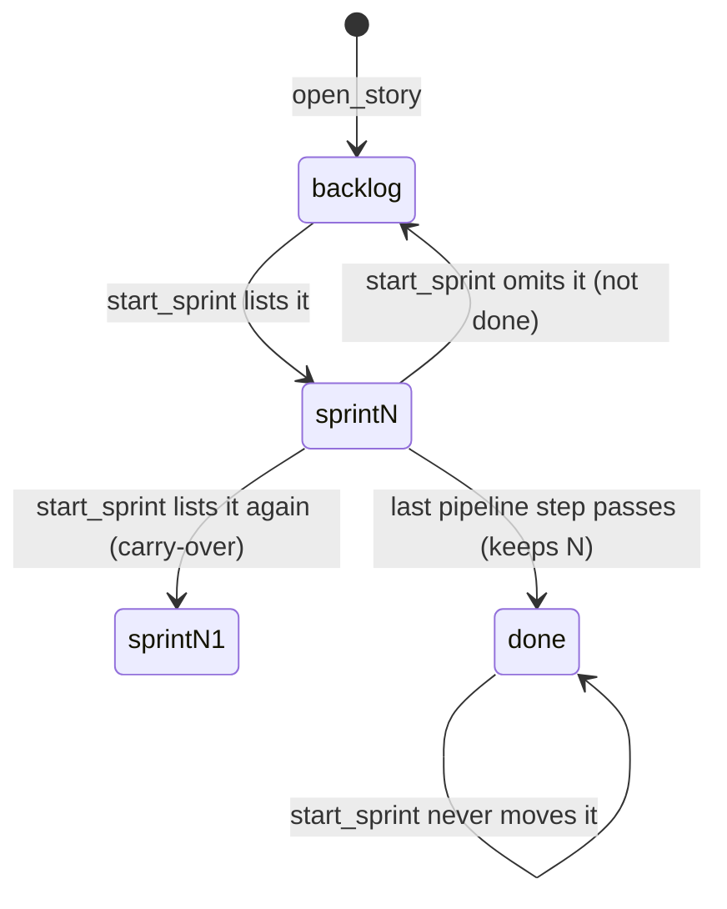
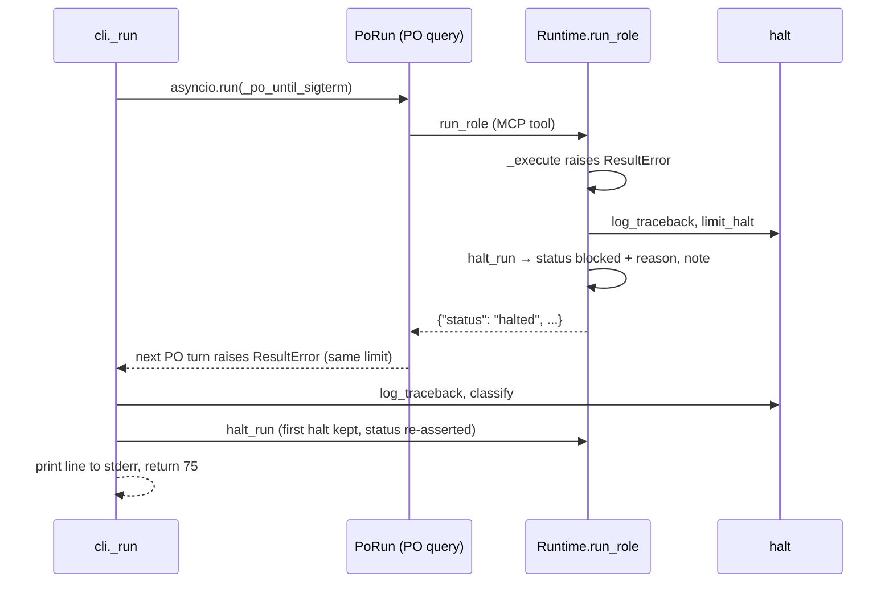
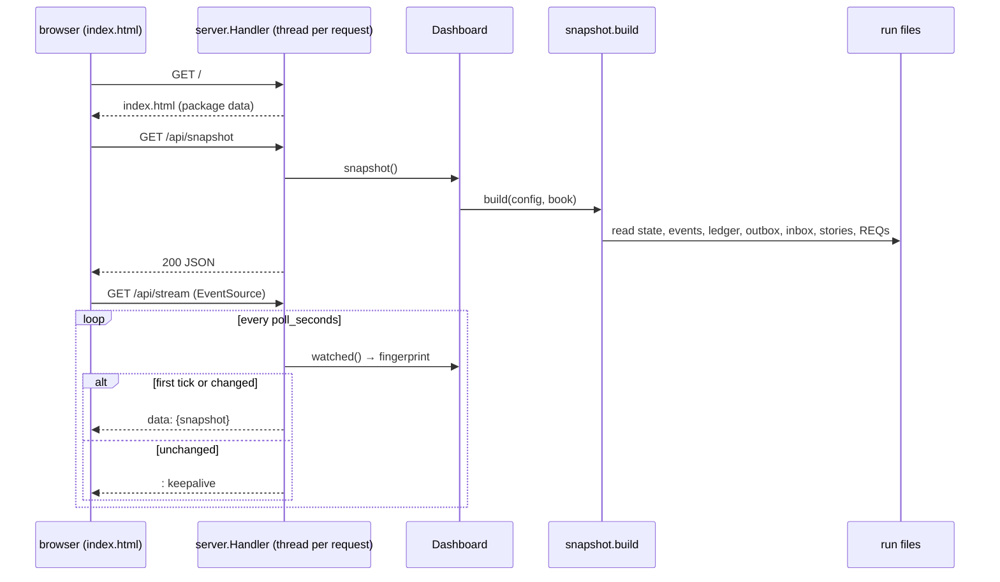

# agile-team runner: architecture

The runner (`agile-team/runner/agile_team/`) is the program that runs the team.
The skill (`agile-team/SKILL.md`) only drives its CLI. This document covers the
components, their boundaries and how data flows between them. Per-story
designs are the contract a developer implements against and a reviewer checks
against.

## Story designs

From s19 on, each story's design is its own file, `design/<story>.md`, with
one line here. Older designs are the sections at the end of this file.

| Story | Design |
|---|---|
| s3 Backlog and sprint membership | [below](#s3-backlog-and-sprint-membership) |
| s7 Customer Proxy forbidden roots in nested layouts | [below](#s7-customer-proxy-forbidden-roots-in-nested-layouts-bug) |
| s8 Clean stop on a usage limit, a crash or SIGTERM | [below](#s8-clean-stop-on-a-usage-limit-a-crash-or-sigterm) |
| s4 Dashboard backend | [below](#s4-dashboard-backend-snapshot-read-only-sse-server-cli) |
| s5 Dashboard live UI | [below](#s5-dashboard-live-ui-tabs-over-the-s4-snapshot) |
| s13 The team presents the product to the Customer Proxy | [design/s13.md](design/s13.md) |
| s15 The dashboard renders Markdown safely. One `md(text)` in `index.html` uses the pinned `markdown-it@14.1.0` (UMD, dynamic `import()`, ADR-0042) with no raw HTML, http(s) links only (`rel="noopener noreferrer"`) and no images. Text is escaped plain until the library loads, and stays plain if it can't. Used by the Questions tab and the timeline's `step-end`/`message`/`answer` bodies. Tested against a vendored copy under `tests/vendor/` | [design/s15.md](design/s15.md) |
| s19 Routing in code: the runner drives, the PO judges | [design/s19.md](design/s19.md) |
| s11 Test disputes from implement back to tests; rulings at any step | [design/s11.md](design/s11.md) |
| s23 Keep context small: PO session renewal, turns per step, leaner role sessions | [design/s23.md](design/s23.md) |
| s25 Ledger each PO query's own cost, not the resumed session's running total | [design/s25.md](design/s25.md) |
| s26 A presentation must start the acceptance environment's service; "presentation ready" means up and answering | [design/s26.md](design/s26.md) |
| s24 Tests gate accepts code from an earlier pass; a hold on a done story can be cleared | [design/s24.md](design/s24.md) |
| s27 A repeated setback escalates to the Manager instead of looping | [design/s27.md](design/s27.md) |
| s29 Sync with upstream at sprint start; each sprint as a rebased, checked, stacked PR | [design/s29.md](design/s29.md) |
| s9 Recover from an interrupted step: keep its edits, stop reporting a dead run as running | [design/s9.md](design/s9.md) |
| s40 Story priority lives in code: an explicit order the PO sets, the router follows and the board shows, with holds marked | [design/s40.md](design/s40.md) |
| s21 Dashboard fixes: $/tokens toggle, live budget, visible Done column | [design/s21.md](design/s21.md) |
| s30 Dispute gate compares the test file's content hash from the raise (path resolved at the repo root); PO `pass_tests` for a stuck story | [design/s30.md](design/s30.md) |
| s37 unattended: `next_wake` null unless a timed wait, `wake_on` in status; reset read from agile-team's halt line, then its state.json, then timed free text | [design/s37.md](design/s37.md) |
| s38 Corrected spend everywhere (pre-s25 PO running totals corrected on read, one function); the budget is a ceiling that halts the run (exit 77); the human commits the raise, then resumes | [design/s38.md](design/s38.md) |
| s45 Manager step: every role-step crash goes to `crash.log` once; a fault applies to any story and an unapplied fault or ruling is reported; `continue_story` refuses a blocked story | [design/s45.md](design/s45.md) |
| s46 Tests gate accepts green tests when a developer's recorded commit is in the branch; Manager `advance` ruling (logged with its reason); dispute brief quotes the test output | [design/s46.md](design/s46.md) |
| s47 A waiting run wakes on an answer (pinned by a driver test); `status_reason` and halt notes say what it waits on (`s40 waits on m42`) | [design/s47.md](design/s47.md) |
| s58 The Proxy's OS sandbox gets `network.allowLocalBinding` for an acceptance environment that serves locally (`Start.BACKGROUND`); verified on macOS by an e2e test with the bundled CLI; service lifecycle stated | [design/s58.md](design/s58.md) |
| s43 Gate commands run in their own process group under `[gates] command_timeout_s`; a timeout bounces naming the hung test; per-test pytest timeout; open wait loops denied in role Bash | [design/s43.md](design/s43.md) |
| s61 The runner records the branch and HEAD it expects and halts (`checkout-changed`, exit 78, a question) when anyone else moves the checkout; `accept-checkout` keeps a new HEAD | [design/s61.md](design/s61.md) |
| s41 Why s29's step got SIGTERM (its agent `kill`ed its own CLI, found by `ps \| grep pytest`); role Bash may not signal the runner's group or kill by name/run-time target; the runner signals only groups it created (pid-file start time checked) | [design/s41.md](design/s41.md) |
| s44 Live spend meter: every turn in `turns.jsonl`, a thread-written `heartbeat.json`, an `interrupted` `step-end` for every step cut short, one `health.RULES` table (`[health]` thresholds), the smart pill, flow-box scope totals, red alerts, localhost URL first; quiet clock restarts on hand-back, the PO's wait is a chore, a graceful stop is neutral (`state.halt_kind`); the page's functions run under node through a boot guard (U1–U3) | [design/s44.md](design/s44.md) |
| s62 Liaison commands: `tell` queues a message the router hands the PO as `human_message`; `watch` blocks token-free and prints one JSON line; `start --resume` saves a checkout halt's leftover edits; self-hosting pin script and doc; `--frozen` docs, `--locked` CI | [design/s62.md](design/s62.md) |
| s67 A first `watch` (no `liaison/watch.json`) records the current outbox, status and health as seen, saves it, then waits; `Seen.load` gives `None` for a missing file, `Seen()` still for an unreadable one | [design/s67.md](design/s67.md) |
| s73 The sprint-boundary full check runs the suite once: `full_checks` leaves `test` out when `coverage` is set (`SUPERSEDED_BY`, `_wanted`); a non-zero coverage run that only fell short reads as the shortfall via the shared `gates.coverage_shortfall` (also used by `Checks._failed_run`), any other is `exit N`; the `boundary.check` description says "once" (ADR-0033 amended) | [design/s73.md](design/s73.md) |
| s68 The implement gate runs the suite once (the `coverage` command only); a non-zero exit never passes; failing tests vs coverage shortfall told apart by `TEST_FAILURES`, bounce texts unchanged | [design/s68.md](design/s68.md) |
| s69 Only the runner runs the full suite: `SUITE_RULES` deny full pytest and coverage runs from role Bash; gate and pre-quality results kept per story and shown under `## Runner results`; the developer's `run_tests`/`run_new_tests` runner tools (`[[toolchain.targeted]]`); the quality czar has no shell | [design/s69.md](design/s69.md) |
| s70 The runner's suite runs in parallel (pytest-xdist dev dependency, `-n auto` in the coverage, test and targeted commands and CI); `sandbox.stop_stale` takes injected `RunnerIds`, so no test ID holds a live pid; a two-process collection test checks it | [design/s70.md](design/s70.md) |
| s71 Unit tests touch no OS: `agile_team/system.py` is the one OS seam (imported as a module); the in-memory `tests/fake_system.FakeSystem` swapped in by an autouse fixture; an audit hook and a patch table (`tests/os_guard.py`) fail a unit test that reaches the real OS; ruff `TID251`; real OS only in `tests/e2e/`; three green phases (s71 ships P1, s76 P2, s77 P3) | [design/s71.md](design/s71.md) |
| s64 A story's acceptance environment must be a configured `[[environment]]` name (names as renamed by s93): one check, `Config.environment_refusal(name)`, refuses any other non-empty name (listing the valid names, or saying none are configured); `open_story` is the only setter and calls it; empty still means the first environment (superseded by s94: each AC names its environment in the story file, checked by `story_spec`) | [design/s64.md](design/s64.md) |
| s72 A 1 s limit per unit test: `timeout = 1` and `e2e_timeout = 30` in `[tool.pytest.ini_options]`; `tests/time_limit.py` marks each test with its world's limit (`os_guard.world_of`: FAKE 1 s, REAL = e2e and `LEGACY` 30 s); no test sets its own limit | [design/s72.md](design/s72.md) |
| s74 Dashboard pill fixes from s44: the fallback pill reads `▶ role on story · ago` (N1); the run-status pill for `stopped` is plain (`STATUS_TONE.stopped = ""`), forced halts stay red on the smart pill; `statusPills(view, now)` makes the status row testable under node | [design/s74.md](design/s74.md) |
| s75 DevOps scopes its test runs: `devops.md` § Test runs says run only what proves the change (normally one named test), never the full suite or coverage (the gate does those); the s69 S8 exemption stays, for the onboarding baseline only. Prompt and docs only | [design/s75.md](design/s75.md) |
| s76 s71 phase P2: processes, signals and the network go through `system` (`run`, `spawn_*`, `killpg`, `http_get`, `listen_http`, …); the deferred P1 modules convert too; `live.Pace` and `Preparer.popen`/`sleep` go; the fake gains spawned children, group signals and held ports; `LEGACY` shrinks to the 31 P3 files; a CI e2e test keeps `pkill`/`killall` out of the repo's code | [design/s76.md](design/s76.md) |
| s77 s71 phase P3, the seam closes: `system` gains `async_sleep`, `which`, `home`, `cwd`, `open_browser`, `on_signal` and `HttpServer`; `router`/`po_tools` lose `sleep`, `preflight` loses `environ` (its `which` field stays as a deprecated shim for two e2e tests, see s87), `cli` loses `DashboardIO` and `cmd_stop`'s `kill` (`--home` read at run time by `home_of`), `providers.reachable` uses `http_get`; every `LEGACY` file migrates and `LEGACY` is deleted. The storyless e2e bridge and DevOps steps never ran; ruff `TID251` moved to s88 | [design/s77.md](design/s77.md) |
| s78 No false reds while work runs: the beat thread survives a failed write (first traceback to `crash.log`); heartbeat v2 carries `mono`, so health tells a sleeping machine (red) from a late beat; a late beat while a tool or chore runs on an awake machine is amber up to `red_quiet_s`; gate runs are the chore `gate: <step> on <id>`; `health.Clock` feeds `Vitals.read` for watch and snapshot alike | [design/s78.md](design/s78.md) |
| s79 E2E tests pass on a CI runner: the autouse `isolated_git` fixture gives every REAL-world test CI's git (no global or system config, `user.useConfigOnly`, no ambient identity variables); repos that commit carry `set_git_identity`; the wake test compares instants in `America/Chicago` across `TZ` values. Tests only: unit-tester writes the fixture, integration-tester the e2e tests (m72), developer no-op | [design/s79.md](design/s79.md) |
| s81 The boundary waits for the review PR's CI. A new last stage `ci` (after `push`) runs `gh pr checks <n> --watch` on the non-draft PR under `[gates] ci_timeout_s` (1800 s), then reads `--json` and the failed jobs' logs (`gh run view --job --log-failed`). `ci.py` holds the data, the verdict tables and `CiWatch`. Green → `done` with the `ci_green` hand-over, the only "ready to merge" text. Red → held `ci_failed` until `record_ci_bug(story)`, and `start_sprint` must list that story first. Timeout → held `ci_pending`. No checks or no PR → no CI result, never "ready" | [design/s81.md](design/s81.md) |
| s82 The service stop waits for its whole process group, not just the `sh` leader (on Linux, dash dies at SIGTERM before the server exits). SIGTERM, then up to 10 s; SIGKILL, then 5 s; then up to 5 s for the port to free. `Prepared.stop() -> str \| None` returns `PORT_HELD`, and the trial holds on it. `sandbox.wait_until` and `port_released` run on the fake clock | [design/s82.md](design/s82.md) |
| s89 Bug: the unit suite fails on 3.13. Fix: the OS guard allows an audited call while `traceback`/`linecache` read source inside the nearest guarded frame (`os_guard.SOURCE_READERS`, `_reading_source`). `traceback` becomes an exempt caller. Each violation names its caller. Code under test is still refused | [design/s89.md](design/s89.md) |
| s51 Finish started stories first: the ranking groups stories (in progress, held, not started; started = a recorded commit) before the PO's order (replaces s40 P2); a not-started story goes ahead only by a pull with a reason (`state.pulled`, `pulled` in the `priority` event); `start_sprint` never pulls except the s81 CI bug story; snapshot `tier` replaces `in_progress` | [design/s51.md](design/s51.md) |
| s65 A role's git never reaches the team repo: `dispatch.GIT_CONFINED` (`e2e` → presentation workspace, `acceptance` → the Proxy's copy) sets `GIT_CEILING_DIRECTORIES` (run dir) and pins Bash's cwd; `git_check` sees through `X=1`/`env`/`command`, tracks `cd … &&`, and one `GIT_RULES` table by `Where` (unconfined, step dir, workspace, elsewhere, unknown) allows any git inside the workspace, read-only in the step's cwd, nothing elsewhere; `lay_out` keeps the workspace across rounds | [design/s65.md](design/s65.md) |
| s59 The sprint-start sync rebases the team branch onto the target (no merge, no `-X ours`); old commits pair with their copies by author, date and message (`rewrite.pair`); `rewrite.remap_state` rewrites the recorded team hashes (`REMAPPED`), but not `upstream.checked`; a no-lost-content check resets and holds `error`; a conflict aborts, holds `sync_conflict` with the files grouped by directory; `Boundary.sync_from` lets a hand rebase be remapped too (ADR-012) | [design/s59.md](design/s59.md) |
| s83 Backlog tab: every outstanding story in the queue's order, grouped Current sprint / Backlog (`backlog.View`), rows that expand to the story file (`md()`), state, file links, spend, events and questions; files served by id from four fixed folders (`GET /api/file`, `story_files`); Backlog moves POSTed from localhost with the start-up token (`/api/reorder`, 403 otherwise) as `.team/run/reorders/r<N>.json`, applied by the router between steps through `with_move`/`move_refusal` (stale version refused), logged as `priority` with `source` `human (dashboard)`, told to the PO at its next hand-over; the human's backlog order (`state.human_order`) binds the PO's `prioritise`/`move_story` unless it gives a reason | [design/s83.md](design/s83.md) |
| s84 Story thread: an expanded Backlog row lists the story's posts and replies (`threads.Threads.all()`, snapshot `thread`, merged into `events` as `thread`) and posts from localhost with the token (`POST /api/thread`). To the PO: a `Relay.tell` file with a thread head; the hand-over names the story; the PO answers with `reply_story` (outbox kind `reply`). To the liaison: a line in `liaison/inbox.jsonl`; `watch` fires `liaison_message`; the liaison answers with `agile-team reply <story> <file\|->` (`liaison/replies.jsonl`) | [design/s84.md](design/s84.md) |
| s85 Liaison opinions on the Backlog tab: `agile-team opinion <story> <kind> <file\|->` (`keep`, `move-up`, `move-down`, `fold`, `close`, `scope`, `ask`; the latest line per story wins) and `agile-team reviewed <file\|->` write `liaison/opinions.jsonl` and `reviews.jsonl`. A suggestion is badged, can be filtered, and shows in the expanded row. "Ask the liaison to review" is `POST /api/review`, an s84 inbox line with story `""` that fires `liaison_message`. Dismiss or apply is `POST /api/opinion` → `liaison/opinion-acts.jsonl`. An applied Backlog move queues an s83 reorder to the top or bottom, and any other kind is an s84 thread post to the PO. Merged as `opinion`/`opinion-act` events | [design/s85.md](design/s85.md) |
| s86 Story dependencies as data: a `depends_on` list in the story file's frontmatter, loaded into `StoryState.depends_on` at `start`, `start_sprint` and `open_story` (which takes the same list). Each load is validated as a graph (not ids, self, unknown, cycle: refused, naming the stories, nothing changed). The router skips a story while a dependency isn't done (`waiting on sN`). A move is never refused, but `priority` events carry `warnings`. The Backlog row shows the dependencies and a warning pill. The PO migrates the prose "Depends on" lines (table M), pinned by an e2e test | [design/s86.md](design/s86.md) |
| s87 Designs match the rulings, docs only: s79's `developer-tests` rows are void (m72: no such role); s77's Z1, Z6, Z7 and Z9 get a dated "Amended by s87" section saying what shipped and why (no bridge or DevOps step, the `preflight.which` shim, TID251 left to s88) | [design/s87.md](design/s87.md) |
| s96 Time per role: snapshot `steps` (each agent step's role, story, model, sprint, start, end, wall `seconds`, status; paired from `step-start`/`step-end` by `dashboard/step_times.spans`; killed steps have no time; a running step has its start only). Flow boxes add the scope's step time and the active box `⏱ running N min`. "Tokens by" gains a `Time` row in `UNITS` ("Time by", h and min bars, step count and share in the tooltip; agent steps only) | [design/s96.md](design/s96.md) |
| s105 A dashboard presentation starts in an empty workspace: a `web` acceptance environment with no `seed` key uses the runner's packaged seed (`agile_team/dashboard/seed/`: `.agile-team.toml` with `[dashboard] token = "presentation"`), and an optional `[[environment]] seed` overrides it (`""` turns it off); `seeds.Seeds.plant` writes the seed files into the presentation workspace where missing (at `lay_out` and in the sandbox before the start command; never overwrites); no `.agile-team.toml` edit needed; a failed start's reason leads with the broken seeded file and its fix (`seeds.CHECKS`) | [design/s105.md](design/s105.md) |
| s104 Flow chart bug: dimmed nodes are recoloured, not given opacity (leading cause, to be confirmed in a browser: WebKit painted the foreignObject labels at the SVG's origin); Mermaid draws at natural size (`useMaxWidth: false`, 16 px) and the chart scrolls sideways; a role with no data reads `idle`; snapshot `roles[].used` (pipeline-routed via `STEP_ROLES`, `developer` → assigned developers, or stepped) hides unused roles until their first step | [design/s104.md](design/s104.md) |
| s103 The guard lets a named test run keep its output: a word after a bare redirect operator (`>`, `>>`, `<`, `2>`; `suite_check.REDIRECT_OPERATOR`) is the redirect's target, not a test path, so `pytest tests/test_x.py > out.txt` and `… \| tee out.txt` pass and a whole-suite run is still refused; no built-in role file or refusal says `timeout ` (the wait rule names the Bash tool's `timeout` parameter or a counted loop); every Bash refusal reads ``refused by rule `<rule>`: <why>. Allowed: <form>`` (`refusal.Rule`, `Refusal`) | [design/s103.md](design/s103.md) |
| s97 Step time leaves out machine sleep: `step-start`/`step-end` carry `data.mono` and `data.slept` (the heartbeat's sleep counter, `Pulse.slept_s`, counted from late beats); `step_times` times a step by `AWAKE[platform]` (POSIX: monotonic span; Windows: wall less counted sleep), falling back to wall with `clock: "wall"` ("may include sleep"); snapshot steps gain `clock` and `slept`; running line subtracts `slept`; legend "Awake time" | [design/s97.md](design/s97.md) |
| s92 A gate failure goes to the role that owns the failing file: the implement gate turns its output (pytest/jest summaries; lint/static in files the story touched) into items, `owners.Owners` (the pipeline roles' expanded write globs, one table) finds each owner, and other roles' items queue as `gate-fix` steps in pipeline order (verdict `route`: no round, no dispute, no Manager; a repeat escalates). `FIXED_AT` keeps red unit tests with the developer; a dispute on another role's test routes to it with the cited rule; the fixer's `asserts` handoff field and an assertion-change flag reach the code-reviewer's brief | [design/s92.md](design/s92.md) |
| s98 Every agent's tool calls are spans: `live.Reading` keeps a `tool_calls.Calls` ledger (opened on a `ToolUseBlock` at the pulse's `Mark`, closed on its result as `ok`/`error`/`timeout`, or `unfinished` when the meter closes), the `Pulse` appends each span to `.team/run/tools.jsonl` (who, `opened_at`, tool, id, label `po.*`/`runner-tool.*`/`Dev: <reason>`, masked 80-character detail, start, awake seconds); `step-end` and a new per-query `po-turn` event carry `tool_s` (union), `model_s` and `waiting_s` (`po.run_role`); snapshot `tools` groups spans per step and gathers the shortest into `misc` under `[dashboard] collapse_under_s` | [design/s98.md](design/s98.md) |
| s99 The runner's own stages are data: `stages.STAGES` (`Name` enum, 21 rows: name, description, `when` before/after/during, attach step/story/boundary); the caller opens a stage by name (`StageLog.open`), the choke points (`CommandShell.run`, `Git._exec`, the `gh` runner, `sandbox.run_shell`/`_serve`) only note command and exit code into the open stage (a context variable), and each stage run writes one `runner-stage` event (story, step, 80-character masked detail, code, start clocks, awake seconds); `.agile-team.toml` `[[tool]]` rows (DevOps-owned, refused on load when repeated or in a built-in namespace) and `agile-team tools` (JSON: built-in and repo lists) | [design/s99.md](design/s99.md) |
| s100 Story timeline in the Backlog row: one SVG time axis from `story-opened` to done or now. Role rows are in `RING_ORDER`, then `PO` (touching `po-turn`s) and `runner` (`runner-stage`). Step bars are coloured by verdict (`OUTCOMES`), bounces draw arrows to the next step's row, and rulings are diamonds. Gaps are explained by `WAIT_KINDS` precedence: asleep, question, hold, other work, idle. Header totals cover work, runner, PO, waiting and asleep. A Story/Sprint scope; zoom, pan and follow-now per story (`ui.tl`). The heartbeat writes where each counted sleep happened (`sleeps.jsonl` → snapshot `sleeps`). A folded Done group and a Board card `timeline` link. Every timeline text's size and colour comes from one `TL_TEXT` table, measured ≥ 12 px and ≥ 4.5:1 | [design/s100.md](design/s100.md) |
| s101 A timeline step or PO-turn bar (or its row label) expands into nested rows (`ui.tlOpen`): a `model` row (the bar's span minus its calls), tool-call lanes on the same axis (parallel calls stack; strip coloured by `TOOL_LOOKS`: ok, red error/timeout, hatched unfinished, `po.run_role` waiting, open grows to now; name and `--ink-2` detail under the strip, or in the tooltip when narrow), and a dashed `misc · n calls · s` box off the axis whose calls load on click from `GET /api/misc` (`tool_groups.gathered_calls`); the heartbeat gains `calls` (every open meter's open calls, `tool_calls.open_row`) | [design/s101.md](design/s101.md) |
| s102 Runner stages on the Flow chart and in the Time chart: four `STAGE_NODES` hexagons (`Prepare env` before the customer proxy, `Implement gate` after the developers, `E2E gate` after the integration tester, `Boundary` beside the PO) with last, total and runs for the scope, `idle` when none, lit while open (heartbeat `stages`, listed by `StageLog` on a `StageBoard`: the pulse); a text model/tool share bar on every agent box and the PO's; "Time by" totals pieces from steps, runner stages (`runner` row) and PO turns (model, tools, waiting segments; waiting not in the share); the bar chart at scale 1 with `TL_TEXT` text ≥ 12 px | [design/s102.md](design/s102.md) |
| s106 **Status: cancelled 2026-10-13 (m124). Not a source of truth; see s111.** Bug: a cancelled CI check. The macOS `CI / test` job runs only `install_test.sh` (leading cause: runner-side; the developer confirms it from the job record), so the CI stage now re-runs a cancelled Actions run once (`gh run rerun --failed`, same deadline, stale links not settled), a cancel that stays gets job-record lines (`gh api`: run time, runner, unfinished steps) through the `EVIDENCE` table, and every workflow job gets `timeout-minutes` | [design/s106.md](design/s106.md) |
| s93 "Acceptance environment" is the name: `[[environment]]` (`config.Environment`, `Config.environment`/`environment_refusal`, `sandbox.ENVIRONMENT_KINDS`, `StoryState.environment` (the refusal and the state field removed by s94), snapshot story `environment`); the old section name is one alias constant (`config.OLD_ENVIRONMENT_NAME`, `RENAMED_SECTIONS`) that loads with a `config check` warning, both sections is a load error, old `state.json` keys load; environments are repo data, kinds are the skill's security boundary; new kind `document` (Read/Grep/Glob over the presented files, guide plus workspace, no service, no question); an e2e grep pin keeps the old word out of `agile-team/` except `docs/design/` (history), the alias line and its test | [design/s93.md](design/s93.md) |
| s53 PO story admin: `hold_story`, `release_story` and `request_cancel` (each takes a story and a reason) are `story_admin.TOOLS` rows behind one refusal helper and `Clerk.run`. `StoryState.po_hold` (`holds.PoHold`: kind `PO hold`/`cancel requested`, reason, question) is separate from the hand-over `hold`; the router skips the story but its rank doesn't change. Board: `⏸ {wait.title}`. Release clears the hold, unblocks and notes the reason. A cancel request posts one cancel/keep question, and only `Clerk.settle` (router tick, `wait_for_answers`, before each admin tool) turns a "cancel" answer into `StoryStatus.CANCELLED` (in `gates.FINISHED`; taken out of order, sprint, pulls and scribe queue; file and commits kept). Each success writes one `story-admin` event with before/after; the Backlog tab has a Cancelled group | [design/s53.md](design/s53.md) |
| s94 Every AC names its acceptance environment: the story file's frontmatter `acceptance: [{id, text, environment}]` is the only record (`StoryState.environment` goes; old state keys are dropped). Pure `story_spec.py` parses it and lists every problem as `{file}: AC {id}: {problem}`; `open_story` refuses a bad file, and the runner reads it again before each proxy step, holding the story (gate hold, `continue_story`) when it went bad. A story's environments are its ACs' distinct values in config order; until A14c the first is used (superseded by s95: each is presented and tried). Open stories migrated to `cli`/`dashboard`/`review`; an e2e test checks them against its own scratch config (never the live `.agile-team.toml`) | [design/s94.md](design/s94.md) |
| s107 Bug: flaky e2e tests. Every e2e wait goes through `tests/e2e/readiness.py` (`wait_until`, `Output.wait_for` with the child's output on failure, `dashboard(Launch)`, `serving`; 120 s monotonic deadlines, no fixed sleeps that load can break); health levels are driven by moving the fake step's quiet clock back, not by waiting. Story frontmatter `suite_runs: N` (1–10, `suite_runs.py`) makes the runner run the `test` command N times in a row after the suite step's gate (`e2e`, else `implement`), stopping at the first failure (bounce routed to owners). The pass text goes in the gate reason; the runs are kept as the `suite-runs` result (implement/e2e/acceptance briefs); new stage `gate.suite-runs` | [design/s107.md](design/s107.md) |
| s108 Bug: the review stack after a merge. Every stack PR is ready (`_spec` always `PrMode.READY`), with the base chain unchanged. The team rebases onto main at sprint end only: the START edge does sync and check only and reports how far main moved (`Upstream.behind`, `START_NOTES`; s59's rebase moves to END, ADR-0041 amended by the Scribe), and nothing happens mid-sprint. END stages are sync, check, review (the sprint's own entry), push (its branch only), `rebase` (the team branch onto main) and `restack`: merged parents (`restack.Restacker`, `gh` `MERGED`) are dropped, and every remaining PR is rebased bottom up in the review worktree (all or nothing, tree unchanged), pushed with the lease and retargeted (`restacked`). A conflict or a changed tree falls back to the full rebuild (`rebuild`, `restack` flag, back to `review`). Every PR's CI is watched; `StackEntry.commits` > 100 adds a fast-forward merge note | [design/s108.md](design/s108.md) |
| s109 Bug: one model split into two rows. The Model grouping of "Tokens by", "Spend by" and "Time by" and the Flow boxes' model line use the family (`MODEL_FAMILIES` in `index.html`: `opus`, `sonnet`, `haiku`, else the model itself), so an alias and its exact ids are one row; each row's tooltip lists the versions it holds with their share (an alias or no model is "version not recorded"); snapshot `steps[]` gains `recorded_model` (the step-end's own, or null); history is not rewritten | [design/s109.md](design/s109.md) |
| s110 The CI rule in the PO role file: a sprint is done only with a green CI run on GitHub; a re-run counts only when green and the failed job never ran our code; a possible flake in our code is a bug story. Same words in `SKILL.md` and `protocol.md` (prompt and docs only, no code) | [design/s110.md](design/s110.md) |
| s112 Activity moves to its own full-width tab (Flow keeps the chart only); every timeline body renders through `md()` except the `PLAIN_BODIES` kinds (`gate-fix`, `opinion-act`); a failed Markdown load shows a status-row notice; the header is rebuilt to the approved mock (t68): three short rows (brand and sprint; the goal on one line; one state pill, a `⚑ manager due` flag and the budget inline) and a 380 px live panel at the top right (role · story · step, time and run label, the latest tool call and 3 clamped lines of the latest message; or the runner's stage and result; or why idle; click opens Activity on that story) that replaces the smart pill; the server serves the fixture so `/?mock` works when served | [design/s112.md](design/s112.md) |
| s95 Acceptance runs once per environment: one presentation per environment the ACs name (`.team/run/presentation/<id>/<environment>/`, `presentation.Showing`), each checked by the e2e gate with per-environment gap texts (s91 folded in: "missing", "holds only .git"); one Customer Proxy step per environment in config order, sandbox and brief from that environment alone; the round's verdicts in `StoryState.tried` (`acceptance.Round`, pure), new `Verdict.NEXT` between environments, then one `PASS` or one `BOUNCE` listing every failed environment and AC id (`failed_acs` handoff field); entry into acceptance clears the round; one report with a `## Environment: <name>` section each (gate-checked); snapshot `environments` pills (ADR-0051, ADR-0008 amended; supersedes s94 SF9) | [design/s95.md](design/s95.md) |
| s119 s112 follow-up to the approved mock: the header's goal line is the newest `sprint-start` goal (else the task); the live panel's stage line is the open stage's `description` (new key in the heartbeat's open stage row, ADR-0048 amended), never an older runner event (`runnerResult` goes); `.timeline > li` child selectors so Markdown lists in Activity use the full width; manager flag and live panel pinned by tests | [design/s119.md](design/s119.md) |
| s118 The Flow chart in HTML (mock variant N), Mermaid gone: You ↔ Liaison ↔ Leadership on top, Design/Test/Dev/Check groups (`FLOW_GROUPS`; unknown roles by snapshot `step_roles`) 236–216 px wide with stretching arrows; role boxes with scoped numbers, model/tool bar and a tokens/min sparkline (`rate` on heartbeat step, `step-end`, `po-turn`); run colours (green/violet/amber, `step` on `step-start`); runner tools snug above/below their role, the running test tool with live Pass/Warn/Skip/Fail counts (the `agile_team_tally` pytest plugin, `tally_watch`, `test_tally`, open row `tests`, one tally per pytest session); each tool box's description line (snapshot `stage_descriptions`, rewritten `stages.STAGES` texts) and its newest command as the tooltip; dots in a never-replaced SVG overlay; ⚙ Show… settings; `FLOW_TEXT` ≥ 10 px, ≥ 4.5:1 (ADR-0052, ADR-0053) | [design/s118.md](design/s118.md) |
| s121 Bug: the Board shows only the current sprint (pipeline columns and Done, no Backlog column, no earlier-sprint or cancelled card) and its badge counts the cards shown (`boardStories`); the empty Requirements tab says "No requirement files yet. They live in `<dir>/REQ-NNN.md`; story s1 introduces them." from new snapshot key `run.requirements_dir` (ADR-0027 amended) | [design/s121.md](design/s121.md) |
| s114 The Scribe and its briefs are retired: no `.team/briefs/` section in any prompt, no `scribe` role, `scribe_due` queue or picker; old state drops `scribe_due`; a `[roles.scribe]` section or non-stub `scribe.md` is refused on load (`RETIRED_ROLES`). The Architect writes and amends ADRs in `.team/adr/` at design | [design/s114.md](design/s114.md) |
| s123 Bug: a devops fix that hands over holds the boundary `fix_handover` (new `BoundaryHold`), never the trigger text; loading a state with an unknown `boundary.hold` drops it into the persisted `RunState.load_faults`, and `cmd_start` emits one run-level `fault` event per entry (ADR-0054) | [design/s123.md](design/s123.md) |
| s122 `add_to_sprint(stories, reason)`: the PO adds open stories to the running sprint (same number, goal and branch; no boundary, manager or renewal), placed as `prioritise` would; refusals for a pending boundary, no open sprint, unknown/done/cancelled, already in, unmet `depends_on`, blank reason; one `sprint-add` event; `start_sprint` with unfinished stories needs a `reason` (ADR-0055, ADR-0016 amended; supersedes s3 B3/B5) | [design/s122.md](design/s122.md) |
| s127 The Flow chart's runner tools are one line: each `stages.STAGES` row (and an optional `[[tool]]` `label`) has a unique label of 24 characters or fewer, shown as `label · ↻ runs · time` / `▶ label · run label`. The snapshot carries `stage_labels`. The tooltip is `name — description\n$ command`, and s118's description line goes. Leadership is sized to its content (`--cell-w`) and centred over the groups. Role names and meta lines are centred. `rates.Rate` uses 10-second windows, and a short series says `too short for a sparkline` (ADR-0048 and ADR-0052 amended) | [design/s127.md](design/s127.md) |
| s124 A sprint ends only when finished: one predicate `RunState.sprint_complete()` for the end boundary and `sprint_end`; `notify_user(sprint-end)` refused naming unfinished stories and steps; `revert_story(story, reason)` (`reverts.Reverter`, `revert_log`): one `revert(sN): <title>` commit, back to the backlog before tests, story-file `## Reverted` entry, `story-reverted` event, `reverted (n×)` pill, PR `Reverted:` block, a one-time brief note per role that worked on it, `## After revert N` design gate, `update` to the human; a second revert asks the human; `ready_backlog` hand-over lists ready backlog stories once per stuck/ready set (ADR-0057) | [design/s124.md](design/s124.md) |
| s126 Each role step gets an SDK `Stop` hook (`stop_checks.StopChecks`) that runs the role's checks from data (`STOP_CHECKS`, `EVERY_ROLE` = handoff + lint; developer: the implement gate's suite; unit-tester: red; integration-tester: presentation) and refuses only its own failures, shortest first, ending with the dispute way out. Lint runs the toolchain's fixers (`[toolchain.files]`, python preset) on the changed files first. A non-`done` handoff stops at once. Capped at 3 refusals and `[gates] stop_check_budget_s`. The implement gate reuses the hook's run on the same content (`Git.content_digest`). `stop-check` events and `stop.*` stages with `attempt` show as after tool boxes with `· n refused` (ADR-0056; ADR-0033 and ADR-0048 amended) | [design/s126.md](design/s126.md) |
| s125 Pending tests: every gate and full-check `test`/`coverage` run writes JUnit XML (`[toolchain.report]`, `{report:<root>}` placeholders, `junit`, `test_reports`); a story's new red tests were pending from its tests gate to its implement gate (ADR-0058; ADR-0053 amended). s159 removed the pending tests and the red gate; the JUnit reports stay | [design/s125.md](design/s125.md) |
| s1 Requirements as files: `<docs>/requirements/REQ-NNN.md` (`{id, title, status: active\|retired, covers: ["sN/ACk"]}` + plain-words body) parsed and checked by `requirements.py` (`{file}: {problem}` lines, ids unique and equal to the file name, refs to real story ACs); `agile-team requirements check` prints problems, AC → REQ coverage and unreadable story files as JSON (exit 1 on problems); the `design` gate (`Checks.designed`) bounces a `StoryState.trace = checked` story listing every untraced AC and every broken REQ file naming it (pre-s1 stories load `exempt`); `## Requirements` brief sections for architect, code reviewer and proxy; tab leaves exempt stories out of gaps; seed REQ-001–005 (ADR-0060) | [design/s1.md](design/s1.md) |
| s115 DevOps reviews every design before tests: built-in step `ops-review` (devops) right after `design` whatever `[gates] steps` says (`config.ALWAYS_STEPS`, `pipeline_steps`, `Gates.pipeline`), a checkpoint no bounce, fault or revert targets (`gates.CHECKPOINT_STEPS`); an `## Ops review` brief section (ACs, toolchain, environments, tools, CI globs); a `tooling` handoff row per AC (`automatic`/`added`/`missing` + story) checked by the ops gate (bounce, `UNFILED` hold for the PO, `changes_requested` → design); a pass writes `## Tooling` into the story file in a `chore(sN)` commit (ADR-0059) | [design/s115.md](design/s115.md) |
| s116 Bug: the dashboard fixture is rebuilt only from source: `scripts/make_dashboard_fixture.py` joins `scripts/dashboard_fixture/<key>.json` (one file per top-level key, order and set fixed by `SECTIONS`, a mismatch fails and writes nothing) into `snapshot.json` (indent 1, no trailing newline). It never reads the old fixture; `CURATED_END`, the live tail and the random run are gone. An e2e test fails on drift. Edit the source and rebuild, never hand-edit (ADR-0061) | [design/s116.md](design/s116.md) |
| s120 The liaison shares a file: `agile-team share <file> --story <id>` queues `liaison/shares/f<N>.json` (bytes and SHA-256; refusals for an unknown story, a bad name, an empty, unreadable or >5 MiB file); `sharing.Sharer` applies it between steps (never during a boundary): copy to `<docs>/design/<id>-<name>`, a `shared: [{path, sha256}]` entry in the story file, one `chore(<id>): share <name> (f<N>)` commit, `record_checkout`, a `share` event, a `tell` to the PO. `## Shared files` brief for architect and customer-proxy; the design gate wants each path named; the Proxy reads exactly those paths; acceptance bounces to design on a changed or missing file and holds on a bad list (ADR-0062) | [design/s120.md](design/s120.md) |
| s117 Tidy s114's follow-ups: `test_s114.py` matches the Scribe as a whole word (`SCRIBE_WORD = \bscribe\b`, so "describe" passes) and `fixture_role_names` checks `roles`, `events`, `ledger` and `steps` for `scribe` (and finds `architect`); `product-owner.md` Mission gets its "and" and item 5 starts with a capital, both rewrapped. No runtime change, no ADR | [design/s117.md](design/s117.md) |
| s113 The Flow chart's PO box shows its time: each `po-turn` names the stories its tool calls touched (`data.stories`, `Tools.noted`, `Touched`, ADR-0063); the PO box adds `waiting on roles …`, and in Story scope counts the turns that touched the story, marked `shared turns` when one touched several | [design/s113.md](design/s113.md) |
| s111 Only a green CI read of the pushed head is done: the runner reads each check's Actions job (`Prs.job`, `main_checks`, `rerun`), and each check gets a kind (`ci_triage.py`: `stale`, `ours`, `infra`, `main`, `rerun`…). `continue_boundary` at `ci_failed` is refused; a job that never ran a step is re-run once (`StackEntry.reran`), then held `ci_infra`; the same job and step failing on main hold `main_broken`, and `record_ci_bug` ends the sprint "ended, CI blocked by main"; the Review stack row shows a CI pill (`upstream.stack[].ci`) (ADR-0064; ADR-0040, ADR-0049 amended) | [design/s111.md](design/s111.md) |
| s128 Keep going and re-pin: under `until-blocker` a sprint end with ready backlog hands over `next_sprint` (never quiet), a stuck sprint re-offers `ready_backlog`, 3 unanswered asks end the run `blocked`, `done`/`blocked` are refused while stories are ready, a resume keeps the cadence; a passing END check on a pinned runner sets `state.repin`, the loop ends, `cmd_start` releases `runner.pid`, runs `pin-runner.sh <head>` (old pin kept as `runner-pin.prev`; `--rollback` swaps back) and `config check`, then `os.execv`s the new pin's `start --resume`; a `repin.json` marker carries `trial`/`rolled_back` across the exec, and the next process logs `runner-repin` (and tells the human on a rollback); `run.runner_pin` and a `pin <sha7>` header pill; the PO's status notes and a quiet end store `status_reason`, and the unattended command job records `agile-team <status>: <reason>` or the halt line (ADR-0065; ADR-0027, ADR-0029 amended) | [design/s128.md](design/s128.md) |
| s129 No test depends on the real clock: `tests/clock.py` is the only test file that reads it (`real_now`, `real_monotonic`, `Deadline`, `about`, `page_clock`); `dashboard_node.run_page(driver, now)` freezes the page's `Date.now` (default: the fixture's `generated_at`), and drivers drop `data.skew`; `tests/clock_scan.py`, run on the unit tree by `tests/test_s129_clock_scan.py` and on the e2e tree by `tests/e2e/test_s129_clock_scan_e2e.py`, fails on any other real-clock read under `tests/` and on an exact `==`/`!=` duration compare in an assert (`fake.slept` excepted); unit half by the unit-tester, e2e half by the integration-tester, developer-cli changes nothing (ADR-0066) | [design/s129.md](design/s129.md) |
| s130 Every test passes in any order: the presentation tests' `story_of` takes the config (no module-level `CURRENT`); `tests/state_scan.py` (unit half `tests/test_s130_module_state.py`, e2e half `tests/e2e/test_s130_module_state_e2e.py`) fails on any write to module-level mutable state or `global` in a test function; pytest-randomly joins the dev group and shuffles every run by default (devops); developer-cli changes nothing (ADR-0067) | [design/s130.md](design/s130.md) |
| s131 The Tooling record is committed before the story moves on: `Runtime.gate` runs the step's `PASS_RECORDS` row before `_advance_and_log` (`_pass_record`, `_commit_edit`, `_restore`); a `GitError` puts the story file back and turns the pass into a gate hold naming the error (ADR-0059 amended) | [design/s131.md](design/s131.md) |
| s132 `fullcheck` judges a check from its `TestRun`: `Judging.result(check, run)` replaces the four-parameter `_result`; a plain command becomes `TestRun(code, out, None, {})` (`_plain_run`, `_test_run`); the judges take `(run, judging)`; behaviour and existing tests unchanged | [design/s132.md](design/s132.md) |
| s133 Share requests are checked: a `shared:` path must be its own resolved form (`shares.resolved_path`, `Where.resolve`) and sit directly in `<docs>/design/`, so only such paths reach the Proxy's sandbox; `Share.from_json` gives `Share \| BadRequest` (typed fields, `REQUEST_FIELDS`), and a bad request is settled once as `refused` with a `share` event; `brief_section(found, Brief(story, role))` (ADR-0062 amended) | [design/s133.md](design/s133.md) |
| s134 One numbered queue: `numbered_queue.NumberedQueue(folder, prefix, suffix)` (`publish(text) -> Entry`: draft `.draft-<token>`, hard-link to the first free number, draft removed; `entries()` in number order) replaces the copies in `Relay.tell`/`told`, `Requests.queue`/`all` and `Shares.queue`/`all`; behaviour and file names unchanged (ADR-0069) | [design/s134.md](design/s134.md) |
| s137 A running role's Flow chart box counts its open step: `flowModel` reads `flowTotals(view)` = `scopeTotals` plus the live step in scope (`liveTotals`): `heartbeat.step` tokens and cost until the ledger holds the step (`inLedger`: same role and story, `at >= started_at`), awake seconds from the open `steps` row (`liveSeconds`); `scopeTotals` stays ledger-only; the unused `flowContext` goes (ADR-0068) | [design/s137.md](design/s137.md) |
| s135 The liaison writes stories: `agile-team story new <file> --approved-by human\|none [--sprint current\|next\|backlog] [--after sN] [--plan p]` and `story amend sN <file>` check a draft (`story_spec` `Kind.DRAFT`, `story_drafts`) with every problem listed, then queue `liaison/stories/q<N>.json`; the router's `story_intake.Intake` (after the sharer; not during a boundary except the CI holds) assigns the id, commits `docs(sN): created story to <title>` (author by `--approved-by`, `Human-involvement:` line, `Git.commit_by`), records it in `StoryState.file_commits` (remapped, kept on revert, not `story.commit`), places it through `sprint_add.SprintAdd` and `Priority.with_after`, logs `story-opened` and tells the PO; an amend replaces the ACs in one commit, `Pipeline.redesign`, `story-amended`; `.team/stories/**` is in `guard.RUNNER_FILES`; `open_story` goes, `request_story(summary, evidence)` posts a `story-request` (ADR-0070) | [design/s135.md](design/s135.md) |
| s136 The docs follow the story CLI: `SKILL.md` (Write a story), `protocol.md` ("Stories from the liaison": commands, safe-point onboarding, authorship, events, `request_story`), `liaison-template.md` (Writing stories) and the README say the liaison writes stories and the runner commits them; the developer rewrites the PO role file (schedules, never writes, `request_story`) and one `devops.md` line; no runtime code (ADR-0070 amended: fixing a story file, non-bug requests, `--sprint next` at a CI hold) | [design/s136.md](design/s136.md) |
| s56 No code in the global scope: a module holds only its docstring, imports, constants, definitions and a `__main__` guard calling `main`/`just_do_it`. The fixture script already complies since s116, and `tests/test_s56_fixture_script.py` pins it (`stray_statements`). `code-reviewer.md` gets a `## Checklist` item, and `guidelines.md` gets the rule. The liaison adds it to `.claude/CLAUDE.md` because the team never writes there. The tree-wide AST check (AC2/AC3, REQ-049) waits for the `house-rules` plan (ADR-0071) | [design/s56.md](design/s56.md) |
| s141 Picks mid-sprint (redesigned for the t107 ACs): `agile-team pick <commit\|A..B> --reason [--force]` and the PO's `pick_commits` check every commit locally, with no fetch and every reason listed (`main_picks.PickCheck`), and queue `.team/run/picks/p<N>.json` (kind `request`/`forced`/`own`). The router's `picking.Picker` (after the intake, never during a boundary) hands a `request` to the PO (`pick-request`; `accept_pick`/`deny_pick` in `pick_admin`) and applies accepted, forced and own picks as one `cherry-pick -x` over the commits, oldest first (a conflict aborts it all), recording `state.picks`, a `pick` event, a liaison note and a `pick-forced`/`pick-settled` hand-over. `revert_pick` makes one revert commit (never for a forced pick). Every story gate bounces a step whose tree no longer reverse-applies a pick in force (`picking.lost_picks`). The sprint end is unchanged. `requirements.REF` takes dotted AC ids (ADR-0072 amended; ADR-0041 amended) | [design/s141.md](design/s141.md) |
| s142 Every role reads the repo's `.claude/CLAUDE.md`: `instructions.repo_instructions(repo)` (`Inliner`: `@path` imports inlined once when they resolve inside the repo; a `~` path or one outside gets a `(left out: …)` note; a non-file token stays as text; code spans are skipped) fills a `## Repo instructions` section that `RoleBook.system_prompt` puts before the charter. `setting_sources` stays `[]`, and home is never read. The liaison trims `.team/CLAUDE.md` to what is about the team (ADR-0073) | [design/s142.md](design/s142.md) |
| s143 Requirement refs accept dotted AC ids (`s141/AC1.1`): `requirements.REF` AC part is `[A-Za-z][\w.-]*`; old refs parse the same, malformed ones stay `BAD_REF` (ADR-0060 amended, REQ-069) | [design/s143.md](design/s143.md) |
| s57 Quality pass over the bootstrap code: `event_factory.py` has pure `build_<kind>_event` constructors, and callers emit; `boundary_data`/`boundary_event` become `get_boundary_fields` plus a build-then-emit pair; `Runtime.remote` narrows the Optional upstream (no `type: ignore`); `rt`/`b` aliases go at the named sites; the verb, whole-word and alias rules are in the code-reviewer checklist and `guidelines.md`; the rest of the runner is split into follow-ups Q1–Q10 by module (ADR-0074, REQ-070–076) | [design/s57.md](design/s57.md) |
| s151 The sprint end pushes the team branch as built: END stages `sync, check, push, ci, rebase, push-rebased, ci-rebased`; `push` sends HEAD's sha to `<prefix><N>` with the lease and opens or reuses one PR based on main (earlier entries `superseded`); green as-built CI is the gate (`boundary.get_rebase_refusal`, a refusal goes back to `ci`); red holds and tells the liaison; the rebased branch is force-pushed to the same PR and its CI is recorded, never held; no CI means no rebase; `review`, `restack`, `stack.py`, `restack.py` and the review worktree are removed (ADR-0075, REQ-077–082); a rebase conflict goes to a `rebase-fix` DevOps step in the scratch worktree `.team/run/rebase`, whose result the runner checks (no merge, no squash, full checks there) before it moves the team branch, else holds `rebase_conflict` (`scratch_rebase.py`, ADR-0076, REQ-083–087) | [design/s151.md](design/s151.md) |
| s152 The sprint start rebases once more: the start `sync` rebases the team branch onto the target with the end's `rebase_onto` and remap (`START_REBASES`; a branch with nothing pinned and `behind() == 0` is left alone; a conflict is aborted, holds nothing and is told to the liaison); a failing start `check` holds nothing (`CHECK_FAILURES`): the start finishes with a `done` event carrying `known_failures` (`CheckReport.failing_ids`, from `CheckResult.failed`), and the PO gets the `known_failures` hand-over to `request_story` (ADR-0077, REQ-088–091) | [design/s152.md](design/s152.md) |
| s153 s151 slice 1, the conflict path's pieces with no boundary change: `Upstream.find_upstreamed`, `find_lost_paths(Spans(head=…))`, `move_team_branch` (`TEAM_MOVED`), `REBASE_FLAGS`/`SCRATCH_REBASE_ARGV`; the new `scratch_rebase.py` (`prepare`, `remove`, `drop`, `find_refusal` over `SCRATCH_CHECKS`); `boundary.py` data (`REBASE_FIX`, `REBASE_CONFLICT`, `RebaseFix`, `Failure.worktree`); `state.py` loads `rebase_fix`; `dispatch.py`'s `_set_rebase_fix_scope`/`_set_git_workspace`. A sprint-end conflict still holds `sync_conflict`; the AC6 e2e tests leave the as-built e2e file until s151's e2e step (ADR-0076 amended, REQ-092–096) | [design/s153.md](design/s153.md) |
| s150 Bug: a Board card's wait pill shows `⏸ <wait.reason>` only, with `wait.title` as its tooltip; the detail shows once, on the `waits on:` line; `.story .pill` is one `inline-block`, `nowrap` line cut with an ellipsis, and the card's pills come from `cardPill(text, {tone, title, dot})` with a tooltip each (page only, no ADR, REQ-097–098) | [design/s150.md](design/s150.md) |
| s10 A start ledgers the spend a crash cut off: new `reconcile.record_cut_off_spend(run_dir)` (called in `cli._prepared` after preflight, skipped while a runner is alive) turns each `(role, story)`'s `turns.jsonl` lines after its latest ledger row into one estimated row; `live.Turn.from_line`; `SessionCost.reconciled` nets the reconciled PO cost out of the next same-session delta (ADR-0078, amends ADR-004 rule 4; REQ-099–100) | [design/s10.md](design/s10.md) |
| s12 The Proxy's OS sandbox is its read wall, proven end to end: `tests/e2e/test_s12_proxy_escapes_e2e.py` runs one table of escape probes (`PROBES`: `cd ..`, `cd`, `cd /`, `~`, `$HOME`, `$VAR`, `$(…)`, wildcard, `--file=`, case) through the bundled CLI and the real `os_sandbox_settings`. A control run without the sandbox reads the secret in every row; with it, none may. s58's harness moves to `tests/e2e/scripted_cli.py` with `PROXY_SANDBOX_PLATFORMS = ("darwin",)`, which s60 extends. The token hook is unchanged. A leak is fixed in the sandbox settings (`_repo_spellings`) or goes back to design (ADR-0079, REQ-101–103) | [design/s12.md](design/s12.md) |
| s138 Runner texts stop telling roles to edit story files: `story_spec.STORY_FILE_HOLD` and `suite_runs.BAD_SUITE_RUNS` say only the runner writes story files and name the PO's actions (`continue_story`, `ask_user`, `story amend`); `cli.START_REFUSED` says `story amend` can't change `depends_on` and gives the human's commands; review-stack.md names the PO and the liaison for a CI bug story (text only, no ADR, REQ-104–106) | [design/s138.md](design/s138.md) |
| s144 A repo-instructions import that is not UTF-8 text is left out: the `Inliner` decodes files as UTF-8 itself (`system.read_bytes`) and reads before marking seen; `_read_inline` turns a `UnicodeDecodeError` into `(left out: @<path> is not UTF-8 text)`; a non-UTF-8 root `.claude/CLAUDE.md` still raises (ADR-0073 amended, REQ-107) | [design/s144.md](design/s144.md) |
| s154 Bug: one unit test that reaches the OS in fixture setup broke its whole xdist worker. `os_guard.RealOsCall` subclasses `pytest.fail.Exception` so pytest cleans up its own fixtures; a unit test requesting `tmp_path`/`tmp_path_factory`/`tmpdir`/`tmpdir_factory` is marked at collection (`os_guard.mark_refusals`) and fails at setup before any fixture (`refuse_marked`); `junit.Case.detail` + `Report.failures` give each failing test's first error lines, kept in `results.Ran.failures`, listed in `## Runner results` and on non-pass gate events (`failures`, `failures_more`) and the dashboard's gate entry (ADR-0036 amended, ADR-0080, REQ-108–110) | [design/s154.md](design/s154.md) |
| s157 House-rules gates every story: this repo's `.agile-team.toml` adds `house-rules check` to `static` (gates, quality, boundaries) and to `[toolchain.files] lint_files` (stop, via `--project "$PWD/house-rules/runner"`), and `fix` restores `.house-rules-baseline.json` from HEAD then runs `house-rules baseline` so the baseline only shrinks; Python-writing roles get the file in `write`; `.house-rules.toml` excludes `.team/run/**`; the only runner change is `owners.FINDINGS` skipping `warn`/`warning` lines (ADR-0081, REQ-111–114) | [design/s157.md](design/s157.md) |
| s156 A stuck Sprint Backlog is reported, not refilled: `ready_backlog`/`_offer`/`offered` go; `Router._idle` hands over `sprint_backlog_stuck` (never quiet; each story's stall reason) and after 3 (`RunState.stuck_asks`, reset by a step, `po_tools.STUCK_RESETS` calls, `start_sprint`, `add_to_sprint`) sets `blocked` and posts it; `until-blocker` refuses `done`/`blocked` only while a Sprint Backlog story can move (`sprint_end.can_move`); `next_sprint` unchanged; PO-facing names and texts say Product Backlog or Sprint Backlog (ADR-0082, amends ADR-0057 and ADR-0065; REQ-115–121) | [design/s156.md](design/s156.md) |
| s158 Bug: the self re-pin passed `--repo`/`--home` after the subcommand, so its `config check` and the exec always exited 2. `repin.build_global_argv` builds the global options, `repin.Pin` keeps them (`options`), and the check and `start --resume` exec put them before the subcommand; the check now gets `--home` too; tests parse each argv with `cli.build_parser()` (ADR-0065 amended, REQ-022, REQ-122) | [design/s158.md](design/s158.md) |
| s2 Requirement change tracking: new `requirement_changes.py` sorts a step's in-scope `REQ-*.md` files from `git diff --name-status --no-renames` into added/changed/retired; the handoff's `requirement_changes` gives reasons; an unexplained changed/retired edit is held back (commit + revert) and the step bounces as a bad handoff ("explain change to REQ-003"), after the architect's new `requirements` stop check; reasons are `Requirement-Changed: <id>: <why>` trailers in the step commit's one trailer block (`with_trailer(message, trailers)`); one `requirement-changed` event each with `sha`; open stories past design that trace a changed/retired one go back via `Pipeline.redesign` (no round), done ones are `affected_done_stories` with an `affected_done` hand-over; `requirements log` prints the trailers as JSON (ADR-0083, REQ-123–129) | [design/s2.md](design/s2.md) |
| s159 Story branches. Each story gets its own branch `<story_prefix><id>` and worktree `.team/run/worktrees/<id>` (`workspaces.py`, `Runtime.get_story_view`, `Config.get_worktree_config`; s161 names). The built-in runner step `land` (after acceptance) makes a `--no-ff` merge in `.team/run/land`, runs the full checks, pushes a `-land` branch, waits for its CI (`ci.ShaWatch`), then pushes and fast-forwards the sprint branch, one story at a time (`landing.py`). Every push is leased and checked to be a fast-forward or a creation (`Upstream.push`, `delete`). The sprint end replays story merges onto main to a new `<prefix><N>-r<k>` (`replay.py`, `scratch_replay.py`), and main moves only by fast-forward. A scheduler runs stories in parallel (`scheduler.py`, `max_open_stories`, budget reserve), with one writer of the run files (`run_writer.py`), a PO hand-over queue with snapshots (`po_desk.py`) and trigger scopes (`handover.SCOPES`). Sessions are kept per story and role (`kept_sessions.py`). Waiting runs stay `running`, and a usage limit gets status `limit`. Pending tests and the red gate are gone (ADR-0084–0087, REQ-130–166) | [design/s159.md](design/s159.md) |
| s163 Sprint-49 review fixes and the landing order. Landings stay one at a time, in the PO's `order_landings` order, then smallest first (`landing_queue.py`, `RunState.landing`/`landing_order`; reverts share the queue). Every design has a `## Files` section (`design_files.py`, design gate), and a design overlapping an open story's files holds at design as `overlap` until they land or `release_story` lifts it (`overlaps.py`). A pushed landing resumes only while its merge is on the sprint head; otherwise it gives up the merge (`landing-dropped`). The main lock covers only moves (`Runtime.lock_for`, also for the PO's `run_role`). Boundary stages run as tasks, with their blocking work in threads (`BoundaryRunner.run_step`, `RunWriter.call_from_thread`). `start_sprint` drops stack entries main has (`git cherry`, `stack-dropped`) (ADR-0088; ADR-0084, ADR-0085 amended; REQ-167–173; REQ-152, REQ-160, REQ-164 changed) | [design/s163.md](design/s163.md) |
| s162 unattended's job report gets `time_left` right after `deadline`: whole minutes left as `limits.span` writes them (`0m` under a minute), `overdue` once passed, `null` with no deadline; pure `limits.format_time_left(deadline, now)`, `cli.build_status_limits(bounds, now)`, `cli.report(job, now)`; nothing stored, the `extend` event unchanged (no ADR, REQ-186–187) | [design/s162.md](design/s162.md) |
| s166 Bug: a landing crashed closing its story PR, which the sprint push had merged, and the budget check crashed on a running landing or boundary (role `runner`). `GhPrs.close` reads the PR's state after a failed close and counts `MERGED` as closed (`_is_merged`); `Scheduler.check_budget` reserves only for `select_costly_work` (s161 name), leaving out `COSTLESS` running work (ADR-0084, ADR-0085 amended; REQ-174–175) | [design/s166.md](design/s166.md) |
| s164 Bug: an idle run spun at full CPU because the scheduler's own `checkout.guard` stage event set `writer.wake` every tick. `RunWriter.bind` keeps its task as owner and `submit` wakes only for writes from other tasks or threads (`is_on_owner`); `Scheduler.wait_for_change` drains the scheduler's own writes before it waits (ADR-0085 amended, REQ-184–185) | [design/s164.md](design/s164.md) |
| s167 Bug: the flow-page and tool-box CSS checks backtracked across the whole page. Their regexes get the anchor `(?<![^{}])` (`test_s104_flow_page.FLOW_RULE`/`flow_css`, `test_s127_page.CSS_RULE`/`find_rule`), which scans each brace-free stretch once and finds the same matches; tests only, guideline added, no ADR (REQ-176–177) | [design/s167.md](design/s167.md) |
| s165 Bug: `start --resume` after a cut-off story step raised, because `_resume_story` built `Interruption` with the brief in `cause`. The field order is already fixed in `dispatch.py` and in s159's I2; the story adds the missing tests (the `_recover_stories` CLI path, the `state.json` round trip, every `HaltKind` a `Cause`, the step unchanged, and an e2e run through `start --resume`) (REQ-182, REQ-183) | [design/s165.md](design/s165.md) |
| s168 Bug: the s157 house-rules e2e fixture symlinked all of `house-rules/`, so uv built the checkout's `house-rules/runner/.venv` with scripts naming the pytest temp path. The scratch repo now gets a real `house-rules/runner/` with only `house_rules/`, `pyproject.toml` and `uv.lock` linked and `.gitignore` copied (`link_house_rules`), so the venv lives in `tmp_path`; test-only change (ADR-0081 amended, REQ-188–189) | [design/s168.md](design/s168.md) |
| s161 Design names follow the house rules: the 43 functions s159 and s163 suppressed with "name fixed by the tests/design" are renamed (queries become properties: `Scheduler.ended`, `Runtime.checkout_lock`, `LandingQueue.candidates`/`order`; `Runtime.get_story_view`, `Prs.list_checks`, `system.run_in_thread`/`get_temp_dir`, …; the PO tool `order_landings` maps to `set_landing_order`), real verbs go into `.house-rules.toml` `verbs`; house-rules gains `suppression-excuse` (a fullmatched default grammar: a test or design subject, a fixing verb and the name, in active, passive, noun and bare forms; plus the `excuses` key) and a query heuristic that sees tuple targets and own-class changing calls; the architect names by the rules and a refused design name bounces to design (ADR-0089, ADR-0074 amended; REQ-178–181) | [design/s161.md](design/s161.md) |
| s178 Bug: parallel stories were offered the same next free REQ id. With story branches the architect's brief reserves a block of 5 ids per story (`StoryState.req_block`) above every id on the sprint head and on the other open stories' branches, worktrees and blocks (`requirement_ids.RequirementIds.reserve`, `requirements.format_offer_section`); the design gate bounces an added id another holder has (`Checks.clashed` → `list_clashes`), and a cancelled or departed story frees its ids (ADR-0090, REQ-190–192) | [design/s178.md](design/s178.md) |
| s179 Bug: a resume removed every story worktree without a step in flight, ignored venvs included. `recover_stories` now keeps every open sprint story's worktree (`workspaces.find_prune_reason`: unknown, done, cancelled, not_in_sprint; scratch dirs unless pinned), logs one `worktree-pruned` event per removal and clears the removed story's `worktree_head`; drift stays the next step's check (ADR-0084 amended; REQ-190–192, REQ-160 changed) | [design/s179.md](design/s179.md) |

## Components

| Module | Owns | Talks to |
|---|---|---|
| `cli.py` | subcommands (`COMMANDS` table), `status_report`, top-level halt handling and SIGTERM | config, state, relay, ledger, halt, `po_tools.run_po` |
| `po_tools.py` | the PO's MCP tools (`Tools`, `SCHEMAS`) and the driver `run_po`: PO turns alternating with router passes (s19); renews the PO's session at boundaries (s23); `Tools.noted` wraps each tool so the turn's `Touched` collects the stories its calls name, and the `po-turn` event lists them (s113); no `open_story` since s135: `request_story` posts a `story-request` to the liaison, and `add_to_sprint` goes through `SprintAdd` | `Runtime`, `Router`, `RunState`, events, relay, po_session, sprint_add |
| `sprint_add.py` | adding stories to the running sprint (s135, moved from `po_tools`): `Addition` (with `source` and the intake's `after`), `SprintAdd.refusal`/`boundary_refusal`/`apply`, the add texts | `Runtime`, priority, dependencies, events |
| `story_drafts.py` | a liaison's story draft (s135, ADR-0070; pure): `StoryRequest` (the `q<N>.json` request), `Known`, `Draft`/`Checked`, `draft_problems`/`option_problems` (every problem, one line each), `next_id`, `with_id`, `render_criteria`/`with_criteria`, `involvement`, `commit_message` (subjects, `LIAISON_AUTHOR`), texts | story_spec, frontmatter, request_files, git_ops (`Authored`), gates (`FINISHED`) |
| `story_intake.py` | the story queue and its applier (s135): `StoryQueue` (`liaison/stories/q<N>.json` through a `NumberedQueue`), `Intake.apply` (each router tick after the sharer; never during a boundary except `INTAKE_HOLDS`): new story (id, file, one authored commit, `file_commits`, placement, `story-opened`, tell the PO, post to the liaison), amend (`with_criteria`, one commit, `Pipeline.redesign`, `story-amended`), refusal (`story-refused`) | story_drafts, sprint_add, priority, dispatch (`Runtime`), relay, events, numbered_queue |
| `frontmatter.py`, `request_files.py` | shared helpers (s135): frontmatter `parse` and `without_key`; request-file `Fields`, `FieldKind`, `BadRequest` (moved from `shares`) | roles; none |
| `po_session.py` | renewal texts, `RenewPath`, the open-question carry-over and `.team/po/handoff.md` I/O (s23) | relay |
| `router.py` | `Router`: picks the next step (the sprint boundary or its DevOps fix (s29), Manager, the Manager on a repeated setback (s27), the movable sprint story earliest in the priority ranking (s40)), writes its standard brief, runs it, stops at a hand-over (s19); `_apply_queues` settles the reorder, share, story and pick queues and the admin clerks before any work, and a received or applied pick ends the tick with its `pick-*` hand-over (s141) | `Runtime`, `BoundaryRunner`, handover, gates, relay |
| `boundary.py` | sprint boundary data and texts (s29): `Boundary`, `Failure`, `StackEntry`, `UpstreamState`, stages, fix briefs, the Manager's `repeated_boundary` view; no I/O | loops |
| `boundary_runner.py` | `BoundaryRunner` (s29): runs one boundary stage per router tick; a START only fetches, reports `behind` and checks; an END runs sync, check, push (the team branch as built, one PR on main), ci (green gates the rebase), rebase (s59; a conflict goes to a DevOps `rebase-fix` step in a scratch worktree, ADR-0076), push-rebased and ci-rebased, which never holds (s151, ADR-0075); opens fix steps, escalates repeats, finishes the boundary | `Runtime`, upstream, fullcheck, ci, relay, events |
| `scratch_replay.py` | `ScratchReplay` (s159, replaces s151's `scratch_rebase.py`): the `.team/run/replay` worktree on `agile-team/replay-sprint-<N>` where a replay runs and DevOps resolves its conflict; `prepare`, `find_refusal(progress)` (finished, clean, on branch, descends from the tip, the stopped story's commits by subject, no one-sided path), `remove`, `drop` | git_ops, upstream, checkout, system |
| `scheduler.py` | `Scheduler` (s159, ADR-0085): the run loop. It drains the writer, applies the request queues, runs a due boundary when idle, starts one task per story (role step, land, story rebase) within `max_open_stories` and the budget reserve, runs the Manager review alongside, serves PO turns one at a time, and owns `main_lock` | router, landing, po_desk, run_writer, budget_reserve, workspaces, dispatch |
| `run_writer.py` | `RunWriter` (s159): the one writer of `state.json`, `events.jsonl` and `ledger.jsonl` on the scheduler task (`submit`, `apply`, `drain`, `WrongWriter`); direct outside a scheduler. s164: a submit from the bound scheduler task itself queues without setting `wake` | system |
| `po_desk.py` | the PO's hand-over queue and turns (s159): `PoDesk` (queue, merge, one turn at a time), `TurnSnapshot`/`Mark` (refuse a call on a story that moved), `PoTurns` (renewal and cost, moved from `PoRun`) | handover, po_tools, state |
| `workspaces.py` | story worktrees (s159): `Workspaces` (`ensure`: branch from the sprint head + worktree, or rebuild; `remove`, `get_path`, `count_open`, `prune_stale`, `stored_scratch`, `list_changed_files`; s161 names); `PruneReason` and `find_prune_reason`, what a resume removes (s179) | git_ops, config, gates |
| `story_branches.py` | story-branch names and records (s159, pure): `Landed`, `KeptSession`, `StoryCi`, `StoryRebase`, `format_story_branch`, `format_landing_branch`, `merge_subject`, `merge_id` | none |
| `landing.py` | `Lander` (s159): the `land` step and a landed story's revert. Merge in `.team/run/land`, story-file merge, full checks, landing push, `ShaWatch`, sprint push then fast-forward, draft sprint PR, leased landing-branch delete. s163: resume only on the head (`is_on_head`), `give_up` a stale merge, `move_sprint` under the main lock only, `follow_remote` re-lands or halts | upstream, ci, fullcheck, workspaces, story_rebase, dispatch |
| `landing_queue.py` | the landing order (s163, ADR-0088): pure `count_lines`, `rank_smallest_first`, `arrange`; `LandingQueue` (properties `candidates` and `order`; `pick_next`, `begin`, `finish`, `place` for the `order_landings` tool (`Tools.set_landing_order`), cached `measure`) | dispatch (`Runtime`), sprint_end, events |
| `overlaps.py` | the overlap hold (s163, ADR-0088): `drop_ignored`, `match_pairs`; `Overlaps.screen` at a design pass, `lift_due` each tick, `release` for `release_story`, `lift` | dispatch, design_files, gates, events |
| `design_files.py` | the design's `## Files` section (s163, pure): `parse_files` | none |
| `requirement_ids.py` | requirement ids across the sprint's open stories (s178, ADR-0090): `list_block`; `RequirementIds.reserve` (a 5-id block per story at the architect's brief) and `list_clashes` (the design gate's reasons, bound per story view as `Checks.clashed`) | requirements, workspaces, gates, dispatch (`Runtime`) |
| `replay.py` | `Replayer` (s159): the first-parent replay of story merges onto a target, resumable from `ReplayProgress`; `StoryReplay`: a carried story onto the new sprint head on `-r<k>` | git_ops, rewrite, story_branches |
| `story_rebase.py` | the story rebase fix step (s159): `is_for_devops`, `prepare`, `find_refusal` | git_ops, owners, story_branches |
| `story_ci.py` | story pushes and story CI (s159): `StoryPusher.push_moved_head` (leased push, draft PR), `StoryCiPoll.poll` (`story-ci` events) | upstream, ci |
| `kept_sessions.py`, `budget_reserve.py`, `switchover.py` | pure (s159): session keep and drop rules; the step reserve and the start refusal; the switch-over refusals | gates, ledger, state |
| `upstream.py` | the one narrow interface to the remote (s29): `Upstream` (fetch, rebase onto the target, leased push of a sha to a `<prefix>` branch only, `count`) and the `Prs` protocol (`GhPrs` over `gh`, `NoPrs`); `command_runner` notes each `gh` command and code into the open stage (s99); `Prs.job`, `main_checks`, `rerun` and required checks first (s111) | git_ops, stages |
| `ci.py` | CI results of the sprint's PRs (s81): `Check` (with `kind`, `step`, `head` since s111), `CiResult`, `CiVerdict`, verdicts from kinds (`KIND_VERDICT`), the report and refusal texts, `mark_main`, `rerun_due`, the sprint card (`Card`, `CARD_ROWS`, `card_of`), and `CiWatch` (wait, triage against the pushed head, compare with main, re-run) | ci_triage, system |
| `ci_triage.py` | what one check means (s111, pure, imports no `agile_team` module): `Bucket`, `CheckKind`, `Step`, `Job`, `Seen`, `job_from`, `bucket_of_run`, `ran`, `failing_step`, `kind_of`, `rerun_key` | none |
| `fullcheck.py` | the full checks (s29): toolchain lint, static, coverage gate (`test` only when no `coverage` is set, s73), each acceptance environment's `e2e`; every check yields a `test_reports.TestRun` that `Judging.result(check, run)` turns into a `CheckResult` (s132) | config, gates, test_reports, boundary, commands |
| `handover.py` | `HANDOVERS` table (when the PO is needed), `Pass`, the hand-over prompt, `previous_step` (s19) | gates |
| `dispatch.py` | `Runtime`: refusal, planning, running and settling one role step; `halt_run` records a halt; `Runtime.remote` is the narrowed upstream (s57) | gates, guard, sandbox, git, ledger, state, events, halt |
| `halt.py` | `Halt`, `HaltKind`, `HALTS`, `LIMIT_PATTERNS`: exception → halt; `crash.log` | state (`RunStatus`) |
| `checkout.py` | the checkout guard (s61): `Found`, `Drift`, `OPERATIONS`, `check`, `recorded`, `CheckoutChanged`; `Guard` for `start` and `accept-checkout` | git, halt, state, relay, events |
| `salvage.py` | a step cut short (s9): `Cause`, `InFlight`, `Interruption`; save the tree as a reverted commit; the note, brief and resume texts | git |
| `recovery.py` | `Salvager` (save and record an interrupted step, s9), `recover_cut` for `start --resume` after a kill or a checkout halt that left edits unsaved (s62) | salvage, state, halt, events, git |
| `gates.py` | `StoryState`, `Pipeline` (step machine; the repeat screen and fault rulings, s27; `pass_tests`, s30), `dispatch_refusal`, command gates, the dispute gate (resolve and fingerprint at raise, compare at tests, s30), `Pipeline.route` and `fix_refusal` (gate fix steps, s92), `Trace` and the design gate `Checks.designed` (After revert + AC trace through the injected `traced`, s1) | roles (`Handoff`), loops, fingerprint, owners |
| `owners.py` | who owns a failing gate item (s92): `Source`, `FINDINGS` (a `warn`/`warning` lint line is advice, not a finding, s157), `Finding`/`Item`, `candidates`, `placed`, `Writer`/`Owners` (pipeline roles' write globs; `FIXED_AT`), `split`, `Fix`/`FixRecord`, `fix_lines`, `asserts_changed`, `fix_note`; pure | paths |
| `commands.py` | shell commands the runner runs (s43): `CommandShell`/`shell_runner` (own process group, `[gates] command_timeout_s`, group kill, `TIMED_OUT`), `HUNG_PATTERNS` and `hung_test`; `CommandShell.run` notes each command and code into the open stage (s99); `Pump` reads the output on a thread under one deadline (s118); inside an open stage the command runs with the tally plugin (`tally_watch.watching`), and once more without it if pytest can't import it (s118) | stages, tally_watch |
| `tally_watch.py` | the runner side of the tally plugin (s118 R10): `plugin_env` (`APPENDS` to `PYTHONPATH`/`PYTEST_PLUGINS`, `AGILE_TEAM_TALLY`), `plugin_failed`, `TallyWatch` (reads the scratch file every 0.5 s, `Run.hear` each new record), `watching(run)` | stages, system |
| `pytest_plugin/agile_team_tally.py` | the tally plugin (s118 R9), loaded by pytest in the repo's test environment, never imported by the runner: `Recorder` counts Pass/Warn/Skip/Fail per test on the xdist controller (or the only process) and writes a JSON record to `AGILE_TEAM_TALLY`; alone in its directory, so `PYTHONPATH` shadows nothing | none (stdlib, pytest) |
| `test_tally.py` | the live test tally (s118, pure): `Tally`, `record_of`, `read(tally, text)` folds the plugin's records into Pass/Warn/Skip/Fail counts, % complete points and the first failure; a new session starts afresh | none (stdlib) |
| `rates.py` | tokens-per-minute series of one query (s118, pure): `Rate.add`, `Rate.series` (10-second windows scaled to per minute since s127, `WINDOW_S`), `squeeze` | none (stdlib) |
| `stages.py` | the runner's own stages (s99): `Name`, `When`, `Attach`, `Stage`, the `STAGES` table (each row with a `label`, s127), `LABEL_MAX`, `LABELS`, `NAMESPACES`, `reserved`, the `QUALITY`/`BOUNDARY`/`RUNNER_TOOL` maps, `Place`, `Run` (RS5 detail and code; `listeners` and `hear`, s118), `opened` (context variable of the open run), `current`, `unlogged`, `note`; pure, imports no `agile_team` module | none (stdlib) |
| `stage_log.py` | `StageLog` (s99): `within(place)` sets the story and step for a whole step, `open(name)` times a stage on the `Pulse`'s marks and writes one `runner-stage` event (`Timed.data`, `OSError` suppressed); `place_of`, `Marker`; `Tallier` folds the plugin's records into the open row's `tests` (s118) | stages, events, tool_calls (`shown`, `awake_gap`), dashboard.step_times (`Mark`, `Platform`), test_tally |
| `fingerprint.py` | content fingerprints that ignore whitespace and comments (s30): `of`, `normalise`, `LINE_COMMENTS`; no I/O | none |
| `loops.py` | repeated-setback detection (s27): `NORMALISE` table, `Setback` and its key, the streak, `Author`, `Fault`, the Manager's `repeated_setback` view | events (types only) |
| `priority.py` | story priority (s40, s51): `Priority` (the one ranking rule `key`: groups `Tier` in progress / held / not started, then the PO's order; `ranked`, `queue`, `plan` (the order with no groups), `with_first` and `with_move` (build the new order on the plan, never the queue), `board_move`, `move_pull`, `repulled`), `started`, `pulls`, refusals (incl. a pull without a reason, `first_refusal`), `moves`; no I/O | gates (`StoryState`) |
| `backlog.py` | the dashboard's Backlog (s83): `View` (queue, backlog, order version), `label`, the apply refusals, the human's-order rule (`HumanCheck`, `human_refusal`), `STORY_ID`; no I/O | priority, state |
| `numbered_queue.py` | the numbered-file queue (s134, ADR-0069): `NumberedQueue(folder, prefix, suffix)` (`publish`: draft, hard link to the first free `<prefix><N><suffix>`, draft removed; `entries`: number order, other names ignored), `Entry(id, path)` | system |
| `reorders.py` | reorder requests (s83): `Requests` (`.team/run/reorders/r<N>.json` through a `NumberedQueue`), `parse_ask`, `Desk` (applies pending requests between steps through `Runtime.reorder`), `told_section` | backlog, priority, dispatch (`Runtime`), numbered_queue |
| `threads.py` | story threads (s84): `Party`, `Post`, `Entry`, the text and story refusals, `parse_post`, the tell head (`tagged`, `tag_of`, `told_line`), `Threads` (post to the PO through `Relay.tell` or to `liaison/inbox.jsonl`, the liaison's `reply`, `all` over the four files) | relay, backlog (`STORY_ID`), state |
| `opinions.py` | the liaison's opinions (s85): `Kind`, `Act`, `Route`, `MOVES`, `Opinion`/`Review`/`Settled`, `kind_refusal`, `parse_act`, `route_of`, `Board` (latest per story, act refusals; pure), `Opinions` (record, review, ask a review through `Threads`, act: dismiss, or apply as a reorder request or a PO thread post) | threads, reorders (`Requests`), backlog (`View`, `Ask`), state |
| `story_spec.py` | a story file's frontmatter (s94): `parse` (pure; checks in order, one `{file}: {where}{problem}` line per problem from the `PROBLEMS` table), `read` (the only I/O), `file_of`, `environment_names`, `first_environment`; `Spec`/`Criterion`/`Read`/`Source` (`Kind.FILED`/`Kind.DRAFT`, `RUNNER_KEYS`, s135); `STORY_FILE_HOLD`. Called by `story_drafts` (s135; `po_tools`' `open_story` until then), `gates.Checks.story_spec` (pre-proxy hold), `dispatch` (proxy sandbox environment), `presentation` (recipe, liveness, seeds), `dashboard/snapshot` (story `environment`) | config, roles (`split_frontmatter`), system |
| `requirements.py` | requirement files (s1, ADR-0060): `parse` (T3 checks, `PROBLEMS`), `check` (duplicate ids, refs to story ACs), `Checked` (`counting`, `covering`, `touching`), `coverage`/`report` (the `requirements check` JSON), `design_reasons` (the design gate's trace lines), `coverage_section`/`design_section`/`BRIEFS`, `next_id`; I/O only in `sources`, `stories`, `load`, `trace_reasons`, `folder_of`. Called by `cli` (`requirements check`, `make_pipeline` → `Checks.traced`), `dispatch` (brief sections), `dashboard/snapshot` (`folder_of`) | story_spec, priority (`natural`), roles (`split_frontmatter`), config, system |
| `shares.py` | shared files (s120, ADR-0062): `Share` (a queued request, JSON with base64 bytes), `SharedFile`, `Listed` (`paths`, `unnamed`, `changed`), `Where`, `Check`; `story_refusal`/`data_refusal`, `target_of`, `listed` (the story file's `shared:` list), `render`/`with_entry` (rewrite only that block, verified by re-parse), `brief_section`/`BRIEF_NOTES`, texts; I/O only in `listed_of` and `check` (reads) | story_spec (`file_of`), roles (`FRONTMATTER`, `split_frontmatter`), backlog (`STORY_ID`), config, system |
| `sharing.py` | the share queue and its applier (s120): `Shares` (`liaison/shares/f<N>.json` through a `NumberedQueue`), `Sharer.apply` (each router tick after the reorder desk, not during a boundary: copy, story-file entry, one commit, `record_checkout`, `share` event, `tell` to the PO) | shares, dispatch (`Runtime`), relay, events, system, numbered_queue |
| `main_picks.py` | a pick request (s141, ADR-0072): `Kind` (`request`, `forced`, `own`), `ASKED_BY`, `DECIDED`, `Outcome`, `Commit`, `Pick` (the `p<N>.json` request, `from_json` → `Pick \| BadRequest`), `Ask`, `Verdict`, `PickCheck` (`verdict`, `commit_refusals`: local, read-only git, every reason), `on_target`, `PICK_ARGV` and every pick text | git_ops, request_files |
| `picking.py` | the pick queue, its applier and its gate check (s141): `Picks` (`.team/run/picks/p<N>.json` through a `NumberedQueue`; `patches/p<N>.patch`), `Picker.apply` (each router tick after the intake, never during a boundary: receive requests as `pending`, apply accepted, forced and own picks with one `cherry-pick -x`, abort and reset on any failure, `state.picks`, `pick` event, liaison note; returns the `pick-*` `Pass`), `lost_picks` (the picks in force whose patch no longer reverse-applies) | main_picks, dispatch (`Runtime`), handover (`Pass`, `Trigger`), relay, events, numbered_queue, state |
| `pick_admin.py` | the PO's pick decisions (s141): `PickAdmin.accept`, `deny` (`pick-denied`, a liaison note) and `revert` (one `Git.revert_all` commit, `pick-reverted`, never for a forced pick) | picking, main_picks, dispatch, events, relay |
| `dependencies.py` | story dependencies (s86): `declared` (reads `depends_on` from the story files; the only I/O), the graph refusals (`load_refusal`, `graph_refusal`, `find_cycle`, `mismatch_refusal`), `waiting_on`, `above`, `warnings` | config, gates, priority (`first_refusal`, `natural`), roles (`split_frontmatter`), system |
| `sprint_end.py` | when a sprint may end, what is ready for the next one, and the stuck Sprint Backlog (s124, s128, s156, pure): `end_refusal` (the `notify_user(sprint-end)` refusal), `can_move`, `list_movable_sprint_backlog`, `keep_going_refusal`, `select_ready_product_backlog`, `next_sprint_lines`, `list_stuck`, `format_stuck_blocked_text` | state, gates, dependencies |
| `reverts.py` | the PO's `revert_story` (s124): `Reverter` (refusals, the second-revert question and its settlement, the one-commit revert, story-file record, state reset, `story-reverted` event, notice); pure `story_commits`, `back_step`, `worked_roles`, `dependents`, `reverted_story`, `decision` | dispatch (`Runtime`), git_ops, story_admin (texts, `asked_text`, `facts`), story_spec, revert_log, priority, events, relay |
| `revert_log.py` | a story's revert history (s124, pure, imports no `agile_team` module): `RevertEntry`, the story-file line and `## Reverted` heading, the brief section, the `## After revert N` design check, PR lines, `design_file` | none |
| `waits.py` | why a story is not moving (s40): the `WAITS` table, `Wait`, `wait(story, asking)`; no I/O | gates (`StoryState`) |
| `state.py` | `RunState` (with the PO's story `order`, s40, and the `pulled` stories, s51) and `state.json` load/save | gates (`StoryState`) |
| `events.py` | `events.jsonl` append-only log (`EventKind`) | none |
| `event_factory.py` | pure `build_<kind>_event` constructors, one per event kind; they never emit, and the caller passes the event to `EventLog.emit` (s57, ADR-0074) | events, boundary, ledger, po_session |
| `relay.py` | outbox/inbox with the liaison; the human's queued messages `liaison/messages/t<N>.md` (`tell`, `told`, `unread`, s62; through a `NumberedQueue` since s134) | numbered_queue |
| `watch.py` | `agile-team watch` (s62): `Look` at the outbox and shown status, the `TRIGGERS` table, `Seen` memory in `liaison/watch.json`, `Watcher.until` | relay, state |
| `live.py` | the live meter (s44): `Reading` (turns, tokens, tools, model of one open query), `Meter`, `Pulse` (stack of open readings, chores, `turns.jsonl` lines, `heartbeat.json` from a daemon thread; its `calls` key lists every open meter's open tool calls, outer first, s101), `RATES` estimates; each `Reading` keeps a tokens-per-minute `rate` for the heartbeat step, `step-end` and `po-turn` (s118) | ledger (`Tokens`), providers (`Billing`), salvage (`Cause`, `STOP_REASONS`), events, tool_calls, rates |
| `tool_calls.py` | tool calls as spans (s98): `Where`, `Call`, `ToolSpan` (a `tools.jsonl` row), `Calls` (open by id, finish, abandon as `unfinished`, the time split), labels, masked details, `WAITING`; `start_row` / `open_row` and `Calls.opened` give the heartbeat's open-call rows (s101) | none |
| `health.py` | runner health (s44): `Clock` (wall + monotonic, s78), `Vitals` (heartbeat, shown status, pid, halt kind, sleep and excused late beats), the `RULES` table, `judge`, `current`, `model_note` | live, state, config |
| `ledger.py` | per-step cost, tokens and turns; turns and re-sent context per turn (s23); budget checkpoints; `SessionCost`, a resumed PO query's own share of the session's running cost (s25) | none |
| `suite_check.py` | which test runs a Bash segment starts (s69): `Run`, `run_kind`, `is_target`, the `SUITE_RULES` table, `suite_denial`; a redirect's target is not a test path (`REDIRECT_OPERATOR`, s103); no I/O | refusal |
| `refusal.py` | one shape for every Bash refusal reason (s103): the `Rule` table of rule names, `Refusal(rule, why, allowed).text()` → ``refused by rule `<rule>`: <why>. Allowed: <form>``; pure | none |
| `git_check.py` | which git segments a role's Bash may run and where (s65): `strip_prefixes` (`WRAPPERS`), `parse_git` (`GitCall`), `bases` (`cd … &&`), `where` (`Where`), the `GIT_RULES` table, `GIT_ENV_LOCKED`, `git_env` (ceiling); no I/O beyond `paths.resolve_in` | paths, suite_check (`ASSIGNMENT`), refusal |
| `results.py` | the runner's toolchain results per story (s69): `Ran` (with `failures`: failing test id → first error lines, s154), `Results` (`.team/run/results/<story>/<name>.json`), `BRIEF_RESULTS`, the `## Runner results` section (`format_failures`), `collect_event_failures` for gate events | none |
| `system.py` | the one OS seam (s71): thin functions for files, processes, signals and signal handlers, ids, the clock and sleeps (sync and async), the network, the environment, `which`, home and cwd, and the browser (`__all__`), plus `Command`, `ShellCommand`, `Completed`, `FileStat`, `HttpReply`, `HttpServer`; no logic. Every other module calls `system.x(...)`; unit tests swap it for `tests/fake_system.FakeSystem`; ruff `TID251` bans OS calls elsewhere (s77) | the OS (stdlib only) |
| `stop_checks.py` | a role step's SDK Stop hook (s126): `StopCheck`, `Spec`/`SPECS`, `EVERY_ROLE`, `STOP_CHECKS`, `RUNNERS`, `MAX_REFUSALS`; `StopChecks` (parse the handoff, allow non-`done`, run the due checks through the gates' own functions with `stop.*` stages, refuse own failures with `stop-check` events, cap and budget; `reusing`/`reused` hand the suite run to the implement gate); `refusal_text`, `suite_text`, `own_items` | gates, owners, stages, stage_log, guard, config, roles, events, git_ops, dispatch (types only) |
| `junit.py` | JUnit XML (pytest xunit1) to cases (s125, pure): `Result`, `Case` (`detail`: first error lines, s154), `pick_error_lines`, `parse(text, root)` (repo-relative node ids; a collection error is a file id), `Report` (`failed`, `failures`, `holds`, `passed`), `ReportError` | none (stdlib xml) |
| `pending_tests.py` | removed by s159 (ADR-0058 retired): the pending-tests registry is gone, and any helper still used moves to `test_reports.py` | — |
| `test_reports.py` | building and reading report runs (s125): `PLACEHOLDER`, `Reporting`, `FOLDER`/`LANDING_FOLDER`/`STORY_FOLDER`, `build` (report option per `{report:<root>}`), `run` (fresh folder, run, `read`), `TestRun`; s159 removed the skip options and the tally's `pending` record | config (`ReportOptions`), junit, commands, system |
| `runner_tools.py` | a developer step's MCP tools (s69): `run_tests`, `run_new_tests` (named tests only, a runner chore, a `tests-run` event), `Batch`, `text_result` | gates (`Checks`), config (`Targeted`), live, events |
| `guard.py`, `sandbox.py`, `keys.py` | write scopes, quarantine (`RUNNER_FILES`: `.team/stories/**` since s135, which no role may write), Customer Proxy sandbox (one per acceptance environment, `ENVIRONMENT_KINDS` the skill's fixed kinds, s93; a `web` environment's service: stale stop, start, probe, teardown, s26; loopback reachable from the OS sandbox, s58), key hygiene; `sandbox.run_shell` and `Preparer._serve` note the prepare command and code into the open stage (s99; `NOT_UP` when the service never answers); `git_ops.Git._exec` notes `git <args>` the same way | git, stages |
| `presentation.py` | the story's presentations for the Proxy, one `Showing` per acceptance environment (s95) (`PRESENTATIONS` table of `Recipe(need, check)`): lay-out before e2e, completeness check with per-environment gap texts, the e2e liveness `Trial` (s26), copy into the sandbox | sandbox, gates, git, story_spec |
| `acceptance.py` | the acceptance round (s95, pure): `Tried`, `Round` (due environment, verdicts, one decision, texts, snapshot marks), the report-section check and the Proxy's criteria section | roles, story_spec |
| `instructions.py` | the repo's `.claude/CLAUDE.md` as prompt text (s142, ADR-0073): `repo_instructions(repo)`, `Inliner` (in-repo `@path` imports inlined once, `OUTSIDE`/`REPEATED`/`UNREADABLE` notes; files decoded as UTF-8 on every platform (s144); `~` is never expanded) | system |
| `roles.py`, `config.py` | role layering, handoff parsing (the `tooling` list, s115), `.agile-team.toml`; `RETIRED_ROLES` refuses a `[roles.scribe]` section or a non-stub `scribe.md` (s114); `ALWAYS_STEPS`/`pipeline_steps`/`Gates.pipeline`: steps the config cannot remove (s115) | ops_review |
| `ops_review.py` | the ops-review step (s115, pure; imports no `agile_team` module at run time): `ToolingVerdict`, `ToolingRow`, the row checks, `problems`, `unfiled`, the gate texts, the `## Tooling` story-file section (`section`, `with_section`), `Facts`/`facts`/`brief_section` | none |
| `dashboard/snapshot.py` | `build(config, book)`: run files → one snapshot dict (read-only) | state, ledger, relay files, events file, story and requirement files, roles |
| `dashboard/step_times.py` | agent step awake times (s96, s97): `Span`, `Pairing`, `FEEDS`, `spans(events, watch)` pairs `step-start`/`step-end` by role and story; `Mark`, `Stopwatch` and the `AWAKE` platform table (POSIX monotonic span, Windows wall less heartbeat-counted sleep, wall fallback); pure | events (`EventKind`), salvage (`Cause`) |
| `dashboard/tool_groups.py` | the snapshot's `tools` section (s98): `Key`, `key_of`, `gather` (shortest calls into `misc` under `collapse_under_s`), groups per step; `MiscAsk`, `ask_key` and `gathered_calls` re-gather one group's misc rows for `GET /api/misc` (s101); pure | tool_calls |
| `dashboard/story_files.py` | the story files the dashboard may serve (s83): `FOLDERS` table, `path_of`, `read`, `existing`; by story id only | config, state |
| `dashboard/server.py` | HTTP + SSE server (`open_server` → `system.listen_http`, s76), `default_host`, `dashboard_urls`; GET routes read only (`GET /api/misc` returns a step's misc calls through `snapshot.misc_calls`, s101); two writes, from localhost with the start-up token: `POST /api/reorder` only queues a request file (s83), `POST /api/thread` only writes a thread post file (s84), `POST /api/review` and `POST /api/opinion` only append a liaison inbox line or an act line, plus the act's reorder request or thread post (s85) | snapshot, story_files, reorders, threads, opinions (through `Dashboard`) |

```mermaid
flowchart LR
  liaison[[liaison / human]] -- answer, tell, stop, status, watch --> cli
  cli -- start --> po[po_tools.PoRun driver]
  po -- PO turn: MCP tool calls --> tools[po_tools.Tools]
  po -- router pass --> router[router.Router]
  router -- run_role, standard brief --> rt
  router -- hand-over --> po
  tools -- run_role --> rt[dispatch.Runtime]
  tools -- start_sprint / add_to_sprint --> st[(state.RunState)]
  liaison -- story new / amend --> sq[(liaison/stories/qN.json)]
  sq -. between steps .-> router
  liaison -- pick commit or A..B, --force --> pq[(picks/pN.json)]
  tools -- pick_commits --> pq
  tools -- accept_pick / deny_pick / revert_pick --> st
  pq -. between steps: pick-request, cherry-pick -x, pick-settled / pick-forced .-> router
  tools -- request_story --> relay
  rt -- refusal --> gates[gates.dispatch_refusal]
  rt -- gate / advance --> pipe[gates.Pipeline]
  rt --> st
  rt --> ev[(events.jsonl)]
  tools --> ev
  tools --> relay[(outbox / inbox)]
  relay --> liaison
  rt -- turns, heartbeat --> live[(turns.jsonl, heartbeat.json)]
  live -. read only .-> dash
  ev -. read only .-> dash[dashboard server]
  st -. read only .-> dash
  relay -. read only .-> dash
  dash -- SSE snapshot --> browser[[human's browser]]
  browser -- POST reorder, localhost + token --> dash
  dash -- rN.json --> rq[(reorders/)]
  rq -. between steps .-> router
  browser -- POST thread, localhost + token --> dash
  dash -- tN.md / liaison inbox line --> relay
  relay -- liaison_message --> liaison
```

### One role step

1. The router (s19, standard brief) or the PO (its own brief) calls
   `Runtime.run_role(StepRequest(role, brief, story))`.
2. `Runtime.refusal` runs `_run_refusal`, `_role_refusal` and `_story_refusal`
   in order. The first reason wins and goes back to the PO as
   `{"status": "refused", "reason": …}`. No side effects happen before this point.
3. `plan` → `_execute` (a fresh `query()`) → `settle`: cost, handoff, quarantine
   and commit, gate, save. Inside the query, the role's Stop hook (s126) runs
   its stop checks each time the agent tries to end with a `done` handoff,
   and hands back the failures it can fix, at most 3 times.
4. On a story, `note_step` records the hold (any `HANDOVERS` match) and the
   previous gated step, which the next standard brief reads (s19).

Rule: refusals are pure checks. Any state change happens only after every
check has passed. This holds for every PO tool too.

## Requirements

The product's requirements are `requirements/REQ-NNN.md` in this docs
folder (s1, ADR-0060). Each covers story ACs (`covers: ["sN/ACk"]`), and
from s1 on every AC of a newly designed story must be covered by an active
one before the `design` gate passes. `agile-team requirements check` prints
the problems and the coverage. Story designs keep their numbered rules
(`B1`, `T1`, …) as the implementation contract; a requirement says *what*
the product does, a design rule *how*. Stories designed before s1 are not
traced and need not be. Do not add a free-form `requirements.md`.

---

## s3: Backlog and sprint membership

Developer: **developer-cli** (runner Python: `gates.py`, `state.py`,
`po_tools.py`, plus the built-in `roles/product-owner.md`). The Architect has
already updated `reference/protocol.md`, `SKILL.md` and the README row
in this design step.

### Rules

| # | Rule |
|---|---|
| B1 | `StoryState.sprint: int \| None`. `None` means the story is in the backlog. A number is the sprint the story is committed to. |
| B2 | `open_story` puts a new story in the backlog (`sprint = None`). |
| B3 | `start_sprint(goal, stories)` is the **only** way into a sprint. Nothing else sets `sprint` to a number. (Since s122, `add_to_sprint` also puts stories into the *current* sprint; see design/s122.md.) |
| B4 | `start_sprint` replaces the sprint's scope. It opens sprint `N+1`. Every listed story that is not done gets `sprint = N+1`. Every other story that is not done goes back to the backlog (`None`). A done story never changes: it keeps the sprint it finished in (or `None` for legacy stories). |
| B5 | A story is in at most one sprint (a single int). Carrying an unfinished story over means listing it again. Adding a story mid-sprint means a new `start_sprint` that lists the old stories plus the new one. That starts sprint `N+1` and queues the Manager again. This is intended: sprint scope changes get a Manager review. (Superseded by s122: a story joins the running sprint with `add_to_sprint`, with no new sprint or Manager turn, and a restart with unfinished stories needs a reason. ADR-0055.) |
| B6 | `start_sprint` refuses, with no side effects (sprint number, status, `manager_due`, state file and events all unchanged), when `stories` is missing or empty, or when any id is not an opened story. |
| B7 | A story-bound step on a backlog story is refused with exactly `story sN is in the backlog; add it to a sprint`. Ungated roles (`manager`, `scribe`) and story-less steps are unaffected. |
| B8 | `state.json` written before s3 has no `sprint` key on stories. Those stories load into the backlog (`None`). Nothing else changes: `step`, `rounds`, `status` and `commit` are kept. |
| B9 | `story_status` and `agile-team status` show each story's `sprint` (`null` = backlog) and the current sprint number. |

### Membership lifecycle



### Legacy state and self-hosting (B8)

Loading needs **no migration code**. `StoryState.sprint` has the default
`None` and comes last among the fields, so `StoryState(**data)` in
`state._story` fills it in when the key is missing. The rule needs no special
cases:

- A story already past design (say, at `implement` with a `commit`) keeps its
  step, rounds and commit. Once it is back in a sprint, it carries on where it
  was.
- The current sprint's stories are **not** inferred. The old state has no
  record of which stories the sprint held, and guessing "all of them" would
  silently commit the whole backlog.
- A story that is `needs_manager` or `blocked` and sits in the backlog still
  gets its status refusal first. The Manager can still rule on it, because
  `manager` is ungated.

What happens on the first `start --resume` after s3 (this repo's own run
included): the PO's next `run_role` on a story returns the backlog refusal.
The PO calls `start_sprint(goal, [unfinished ids])`, which opens sprint
`N+1` and queues the Manager. The PO runs the Manager, and work continues at
each story's existing step. The cost is one Manager step, and the refusal text
tells the PO what to do. A runner process that is already running keeps its
loaded code until it restarts.

### Changes by module

#### `gates.py`

- `StoryState`: add `sprint: int | None = None` as the **last** field, after
  `environment` (named so since s93). Positional construction (`StoryState(id, title, step)`) and
  legacy loading depend on this.
- New `_backlog_refusal(story: StoryState) -> str | None`:
  returns `f"story {story.id} is in the backlog; add it to a sprint"` when
  `story.sprint is None`, else `None`.
- `dispatch_refusal` checks in this order: ungated role → no story → status
  → **backlog** → step:

  ```python
  return _status_refusal(story) or _backlog_refusal(story) or _step_refusal(role, story)
  ```

  Status comes first so that a done, blocked or capped story gives the more
  useful reason (a legacy done story says "is done", not "in the backlog").
  `dispatch.Runtime._story_refusal` already ends with `dispatch_refusal`, so
  it needs no change. B7 is met through it.

#### `state.py`

- `RunState.unknown_stories(self, ids: list[str]) -> list[str]`: the ids not
  in `self.stories`, in the order given.
- `RunState.begin_sprint(self, ids: list[str]) -> None`: increments
  `self.sprint`, then applies B4 to each story whose status is not `DONE`
  (`self.sprint` if its id is in `ids`, else `None`). It must stay at 8 lines
  or fewer.
- `from_json` / `_story`: unchanged (B8 holds through the dataclass default).

#### `po_tools.py`

`Tools.start_sprint` becomes refusal-check-then-act. Suggested split, each
function at most 8 lines and 2 parameters:

| Function | Job |
|---|---|
| `start_sprint(self, args)` | `ids = list(dict.fromkeys(args.get("stories") or []))` (dedupe, keep order); refuse via `_sprint_refusal`; else `_begin_sprint`; return the result. |
| `_sprint_refusal(self, ids) -> str \| None` | Applies B6 using the reason strings below. |
| `_begin_sprint(self, goal, ids) -> None` | `state.begin_sprint(ids)`; `status = RUNNING`; append the `manager_due` entry; `save()`; emit `SPRINT_START`. |

Successful result: `{"sprint": N, "stories": ids, "next": "run the manager"}`.

`manager_due` entry: `f"sprint {N} start: {goal} ({', '.join(ids)})"`. The
Manager uses it to check that the scope is realistic.

`SPRINT_START` event data: `{"sprint": N, "goal": goal, "stories": ids}`. This
matches `dashboard/fixtures/snapshot.json`.

`story_status` adds a top-level `"sprint": state.sprint`. The per-story
`sprint` already comes through `vars(s)`.

`SCHEMAS` entries:

```python
"open_story": (
    "Register a story; it starts in the backlog until start_sprint lists it.",
    {"id": str, "title": str, "environment": str},  # named so since s93
),
"start_sprint": (
    "Begin the next sprint with exactly the listed story ids; unfinished stories "
    "not listed go back to the backlog. The manager must run next.",
    {"goal": str, "stories": list},
),
```

#### Refusal strings (tests may assert them exactly)

| When | Reason |
|---|---|
| `stories` missing or empty | `no stories listed; pass the story ids this sprint commits to` |
| unknown ids | `unknown stories: s7, s9; open them with open_story first` (all unknown ids, comma-separated, in the order given) |
| step on a backlog story | `story s3 is in the backlog; add it to a sprint` |

#### `cli.py`

`status_report` already includes `"sprint"` (the current sprint) and
`asdict(story)`, so each story gains `sprint` automatically. No code change is
needed. Tests must cover it (B9).

#### `roles/product-owner.md` (built-in, developer-cli edits it)

Replace step 3 of "How you work" and add a "Backlog and sprints" section that
says:

- `open_story` puts a story in the backlog. Only stories in the current
  sprint can move. `run_role` refuses a backlog story with "story sN is in
  the backlog; add it to a sprint".
- `start_sprint(goal, stories=[…])` lists **every** story the sprint commits
  to, including unfinished ones carried over. Unfinished stories you leave
  out go back to the backlog. Then run the `manager`.
- To add a story mid-sprint, start a new sprint that lists the current
  stories plus the new one (the Manager reviews the change).
- After a resume, if `story_status` shows unfinished stories with
  `sprint: null`, start a sprint with the ones to continue.
- Sprint cadence: "the sprint's stories" means the stories whose `sprint`
  equals the current sprint.

### Test checklist (for the Unit Tester)

Existing helpers that build stories for steps must now put them in a sprint
(`sprint=1`): `tests/test_dispatch.py::open_story` and
`tests/test_gates.py::story`. `test_po_tools.py::test_start_sprint_requires_manager`
must open a story and pass `stories`. These are contract changes, not
weakened tests.

1. B1/B2: `open_story` stores `sprint is None`; `story_status` shows
   `"sprint": null` for it.
2. B8: `RunState.from_json` of a story dict without `sprint` gives `None`; a
   round trip keeps `sprint=2`.
3. B6: an empty list, a missing key and unknown ids are each refused. After
   each refusal, `state.sprint`, `status`, `manager_due` and the events log are
   unchanged. The unknown-ids reason names every unknown id.
4. B3/B4: given s1 in sprint 1 (unfinished), s2 done in sprint 1, s3 in the
   backlog, then `start_sprint(stories=["s3"])` → s3 = 2, s1 = `None`, s2 = 1.
   Listing a done story leaves its sprint unchanged.
5. B5: listing s1 again carries it to sprint 2. Duplicate ids appear once
   in the event and the result.
6. Event, `manager_due` entry and result have the shapes given above.
7. B7: `run_role` on a backlog story at its correct step is refused with the
   exact string. `manager` and `scribe` on a backlog story are not refused by
   it. A story-less architect step is not refused.
8. Order: a done backlog story says "is done"; a needs-manager backlog story
   says "round cap".
9. B9: `story_status` has the top-level `sprint`; `cli.status_report` stories
   carry `sprint`.

### Out of scope

Removing a single story from a sprint without starting a new one, and story
priority or ordering within the backlog, are both out of scope. So is
dashboard rendering, which is s4/s5: the snapshot fixture already carries
`stories[].sprint` and the `sprint-start` event's `stories`.

---

## s7: Customer Proxy forbidden roots in nested layouts (bug)

Developer: **developer-cli** (runner Python: `paths.py`, `sandbox.py`,
`guard.py`). The Architect has already updated `reference/protocol.md`
(Enforcement) in this design step. `SKILL.md` and the README do not describe
forbidden roots, so they do not change.

### Root cause

`paths.literal_root` keeps only the **first** path segment of a glob. In this
repo, all four source/tests/e2e globs (`agile-team/runner/agile_team/**`,
`…/scripts/**`, `…/tests/**`, `…/tests/e2e/**`) reduce to `agile-team`. This
causes two failures:

1. `guard._names_forbidden_root` compares only a Bash token's first segment,
   so the bare CLI name `agile-team` is denied.
2. `sandbox.os_sandbox_settings` emits `Read(/<repo>/agile-team/**)`, and that
   deny rule overrides the `allowRead` for `agile-team/docs/customer/`.

### Rules

| # | Rule | AC |
|---|---|---|
| P1 | A glob's **literal root** is its leading `/`-separated segments up to (not including) the first segment that contains `*`, `?`, `[` or `{`, joined by `/`, with no trailing `/`. A fully literal glob is its own root, even when it names a file. | AC1 |
| P2 | A glob starting with `!` has no root (`""`). A negation only narrows a set, so it never adds forbidden paths. A glob whose first segment holds a wildcard also has no root. | AC1 |
| P3 | `forbidden_roots(config)` = the non-empty literal roots of every glob under `source`, `tests` and `e2e`, deduplicated. A root that lies under another root is dropped. The result is sorted. | AC1 |
| P4 | A path is **under** a root when it equals the root or starts with `root + "/"`. `paths.under_root` is the single definition. The hook calls it, and the deny rules spell the same relation (P6). | AC1, AC2 |
| P5 | A Bash word names a forbidden root under the **Bash word rule** (W1–W6 below). It is one rule for every word, literal or wildcard. | AC2, AC3 |
| P6 | `os_sandbox_settings` emits two `permissions.deny` rules per root, in root order: `Read(/<repo>/<root>)` and `Read(/<repo>/<root>/**)`. (`<repo>` is absolute, so `/<repo>` gives Claude Code's `//abs` form, as today.) | AC1, AC3 |
| P7 | The `or ["src"]` fallback stays in `proxy_scope` only. An empty `bash_forbidden` turns off **all** sandboxed Bash checks (`..`, repo paths), so the Proxy must never get one. The deny rules get no fallback: the OS sandbox's `denyRead` on the whole repo already covers that case. | AC2 |

P3's nesting rule keeps flat layouts **byte-identical** to today. The python
preset gives `src`, `tests` and `tests/e2e`, which collapse to
`["src", "tests"]`. The node preset gives `["e2e", "lib", "src", "test"]` and
rust gives `["src", "tests"]`. For flat roots, the Bash word rule is at least
as strict as the old `head in roots` check. It also closes the old flat
wildcard hole (review P5: `cat s*/x`).

### Worked examples

| Glob | Literal root |
|---|---|
| `src/**` | `src` |
| `agile-team/runner/agile_team/**` | `agile-team/runner/agile_team` |
| `agile-team/runner/tests/e2e/**` | `agile-team/runner/tests/e2e` |
| `src/*.py` | `src` |
| `src/foo*/bar` | `src` |
| `src/[ab]/x` | `src` |
| `src/pkg/main.py` | `src/pkg/main.py` |
| `main.py` | `main.py` |
| `src/` | `src` |
| `**/*.py`, `*.py` | `""` |
| `!tests/e2e/**`, `!tests/**` | `""` |

This repo's `forbidden_roots`: `["agile-team/runner/agile_team",
"agile-team/runner/scripts", "agile-team/runner/tests"]` (`tests/e2e` is
nested, so it is dropped).

### Bash word rule (revised after review round 3)

This replaces the ae1a46a split into a literal branch and a wildcard branch
(`has_wildcard`, `token_prefix`, `_glob_reaches`). Every word goes through
the same steps.

**Property (what the reviewer checks).** A Proxy Bash word is denied when
the shell (bash or zsh, default options) could expand it to a forbidden root
or a path under one, reading that path from the repo root. Over-denying is
allowed. Any under-deny inside this property is a defect. The cases outside
it are listed under Known limits.

| # | Step | Rule |
|---|---|---|
| W0 | Join lines | Before any Bash check, for **every role**, join line continuations the way bash and zsh do (review D2). A `\`-newline is a continuation only when the run of `\` before the newline has odd length: delete that last `\` and the newline, and keep the even part, which is escaped `\\` pairs (review D3; a plain replace turned `echo hi \\⏎git commit` into one command). shlex keeps it as a newline inside the word, so without W0 `agile_\⏎team` and `.\⏎.` get past W1, W2 and W6. It also deletes the pair inside single quotes, where the shell keeps it; that can only join a literal and over-deny. **Comments (reviews D4, D5):** a `#` comment that ends in `\` does not continue in the shell, because a `\` inside a comment escapes nothing. So when the command holds `COMMENT_MARKER` (`#`), `guard.check_bash` checks a second, comment-aware view as well. It joins continuations the same way, except on a physical line that holds `#`, where the `\` and the newline stay. Every check (key name, git, allowlist, paths) runs on each view, and the command is denied if any view is denied. The comment-aware view can only split more than the shell does: a quoted or mid-word `#` adds a newline, which can only over-deny. Without a `#`, the joined view is exactly what the shell runs, so it is the only view. |
| W1 | Unquote | Words come from `shlex.split`, which already removes quotes and `\`. If shlex can't parse the command, the fallback `command.split()` words have every `'`, `"` and `\` deleted. (Example: `cat "agile-team/runner/agile_team/cli.py" # it's` makes shlex fail.) |
| W2 | Climb | Deny when a `/`-segment of the raw word is `..` (as today). Also deny when a segment **other than the last** holds `{` or `(`, or starts with `.` and holds `*`, `?` or `[`. Such a segment could expand to `..` or to text that contains `/`. |
| W3 | Repo path | `_names_repo`, unchanged. |
| W4 | Normalise | `paths.normalise_token(word)` = `posixpath.normpath(word.lstrip("./"))`. This is the only normaliser, so `a//b`, `a/./b`, a leading `./` and a trailing `/` are handled the same way in every word (fixes review B1). The word and the roots are then compared after `casefold()`, because the default macOS filesystem ignores case. |
| W5 | Cwd glob | A normalised word made only of `*` and `?` characters (`*`, `**`, `?`) passes. It names entries of the cwd, the same as `.`. |
| W6 | Walk | Pair the word's segments with each root's segments, starting from the left. If the root runs out of segments first, the word **reaches** the root: deny. If the word runs out first, it names at most an ancestor: pass, the same as literal `agile-team/runner`. A word segment that holds `**` reaches the root (it can cross any number of segments). Any other segment is compared with the table below. A mismatch means the word does not reach that root. |

How a word segment `w` is compared with a root segment `r` (both casefolded):

| `w` holds | matches `r` when |
|---|---|
| `[`, `{` or `(` | always. W2 has already denied `{` and `(` in any segment but the last. |
| none of those | `fnmatchcase(r, w.replace("?", "*"))`. For a literal segment this is plain equality. Widening `?` to `*` makes `scripts?` count as naming `scripts`. |

Why this covers every case:

- **Leading `*`, `?`, `[`, `{`, `(`**: segment 0 is compared like any other
  segment (review B2). An empty literal prefix is no longer a special case.
- **Braces, and zsh `(a|b)` groups**: one of these can contain `/` or produce
  `..`. W2 therefore denies it outside the last segment. In the last segment it
  can't span a `/`, so it matches any one segment.
- **`**`** reaches the root (zsh `**/`, bash globstar).
- **No mismatch can be undone later.** After W2, no expansion has `..` in a
  segment before the last, because a glob only matches a leading `.` when the
  pattern spells that `.` out. A last segment that expands to `..` names the
  parent of a path that is not under any root. That parent is not under a root
  either.
- **Quotes** (W1). A quoted glob (`'agile_*'`) is treated as a glob, which can
  only over-deny.

Examples. N is this repo's roots (`agile-team/runner/{agile_team,scripts,tests}`).
F is the flat roots `["src", "tests"]`. Each command is run through
`guard.check_tool_use` with a Proxy `Scope`. Commands marked "over-deny" are
denied on purpose; that is safe.

| Roots | Command | Result | Step |
|---|---|---|---|
| N | `agile-team status`, `agile-team --help`, `which agile-team` | allow | W6: word runs out |
| N | `cat agile-team/docs/customer/x.md`, `ls agile-team/runner`, `cat agile-team/runner/testsuite` | allow | W6 |
| N | `cat agile-team/docs/*.md`, `cat agile-team/docs/customer/*`, `cat agile-team/docs/customer/{a,b}.md` | allow | W6: `docs` ≠ `runner` |
| N | `cat agile-team/README*`, `ls agile-team/*`, `cat .team/stories/*` | allow | W6 (`agile-team/*` names only ancestors; ae1a46a denied it) |
| N | `cat *.txt`, `cat ./*.txt`, `echo {1..3}` | allow | W6: word runs out |
| N | `ls *`, `ls ?`, `ls **` | allow | W5 |
| N | `cat agile-team/runner/agile_team/cli.py`, `cat agile-team/runner/agile_team`, `ls ./agile-team/runner/tests`, `ls agile-team/runner/tests/` | deny | W6 |
| N | `cat agile-team//runner/agile_team/x`, `cat agile-team/./runner/scripts/x`, `cat 'agile-team/runner/agile_team'/cli.py` | deny | W4, W6 |
| N | `cat agile-team/runner/agile_*/cli.py`, `cat agile-team/runner/agile_tea?/x`, `cat agile-team/runner/agile_tea[m]/x` | deny | W6 |
| N | `cat agile-team/*/agile_team/x`, `ls agile-team/**`, `cat agile-team/**/cli.py`, `cat agile-team/runner/*` | deny | W6 |
| N | `cat agile-team/runner/agile_team{,}/x`, `cat agile-team/runner/{agile_team,x}/cli.py` | deny | W2 |
| N | `cat agile-team/runner/tests/*`, `cat agile-team/runner/scripts?`, `cat a*/runner/agile_team/x`, `cat agile-team/run*/agile_team/x` | deny | W6 |
| N | `cat ./agile-team/runner/agile_*/x`, `cat agile-team//runner/agile_*/x`, `cat .//agile-team/runner/agile_*` | deny | W4, W6 |
| N | `cat 'agile-team/runner/agile_'*/cli.py`, `cat agile-team/runner/agile_\*/x` (over-deny) | deny | W1, W6 |
| N | `cat agile-team/./runner/agile_*/cli.py`, `cat agile-team/runner/./agile_*/cli.py`, `cat ./agile-team/./runner/agile_t*/cli.py` | deny | W4, W6 (review B1) |
| N | `cat {,}agile-team/runner/agile_team/cli.py` | deny | W2 (review B2) |
| N | `cat */runner/agile_team/cli.py`, `cat */*/agile_*/cli.py`, `cat ?gile-team/runner/agile_team/cli.py`, `cat [a]gile-team/runner/agile_team/x` | deny | W6 (review B2) |
| N | `cat {agile-team/runner,x}/agile_team/cli.py`, `cat agile-team/docs/{..,x}/runner/agile_team/cli.py`, `cat agile-team/docs/.*/runner/agile_team/cli.py` | deny | W2 |
| N | `cat agile-team/runner/(agile_team\|x)/cli.py`, `cat agile-team/runner/agile_tea(m)` | deny | W2, W6 (zsh) |
| N | `cat AGILE-TEAM/runner/agile_team/cli.py` | deny | W4 casefold |
| N | `cat "agile-team/runner/agile_team/cli.py" # it's` | deny | W1 fallback |
| N | `cat {docs,x}/a.md`, `ls **/*.md`, `cat .*/x`, `cat agile-team/runner/agile_tea[x]/y` | deny (over-deny) | W2, W6 |
| F | `ls *`, `ls ?`, `cat *.txt`, `cat tests.txt`, `ls srcfoo`, `ls .*` | allow | W5, W6 |
| F | `cat src/x`, `ls ./tests`, `ls tests/`, `cat src//x`, `cat SRC/x` | deny | W4, W6 |
| F | `cat s*/x`, `cat src*`, `cat */x`, `cat ?rc/x`, `cat [s]rc`, `cat {,}src` | deny | W6 |
| F | `cat {,}src/x` | deny | W2 |
| F | `echo {1..3}`, `ls [a-z]*` | deny (over-deny) | W6: a one-segment group or bracket matches the one-segment root |
| N | `cat agile-team/runner/agile_\⏎team/cli.py`, `cat agile-team/runner/agile_team\⏎/cli.py`, `cat agile-team/run\⏎ner/agile_team/cli.py`, `cat agile-team/runner/tes\⏎ts/conftest.py`, `cat \⏎agile-team/runner/agile_team/cli.py` | deny | W0, W6 (review D2) |
| N | `cat .\⏎./.\⏎./.\⏎./.\⏎./agile-team/runner/agile_team/cli.py`, `ls .\⏎.` | deny | W0, W2 (review D2) |
| N | `cat agile-team/docs/customer/x\⏎.md` | allow | W0, W6 |
| F | `cat s\⏎rc/x` | deny | W0, W6 (review D2) |
| N | `echo hi \\⏎git commit -m x` | deny | W0 keeps the newline (even run), `_check_git` (review D3) |
| N | `# x \⏎ca\⏎t agile-team/runner/agile_team/cli.py` | deny | W0 comment-aware view, W6 (review D5) |

(`\|` in the table is only Markdown escaping. The word under test is
`agile-team/runner/(agile_team|x)/cli.py`; shlex keeps it as one word.
`⏎` is a real newline character in the command string: in Python,
`"cat agile-team/runner/agile_\\\nteam/cli.py"`. Every `\` in a command is a
real backslash, so `echo hi \\⏎git` is `"echo hi \\\\\ngit"` in Python.)

W0 also covers every other role. Through `guard.check_tool_use` with a plain
developer `Scope` (no Bash allowlist):

| Command | Result | Check |
|---|---|---|
| `g\⏎it commit -m x` | deny | `_check_git` |
| `git \⏎commit -m x`, `git pu\⏎sh` | deny | `_check_git` (now denied as `commit`/`push`, not by luck) |
| `echo ANTHROPIC_API_\⏎KEY` | deny | `_check_secret_mention` |
| `git st\⏎atus` | allow | `_check_git`: `status` is read-only |
| `echo hi \\⏎git commit -m x` | deny | `_check_git`: run of 2 is even, so the newline stays and `git commit` is its own command (review D3) |
| `echo hi \\\\⏎git commit -m x` | deny | `_check_git`: run of 4 is even, not joined (review D3) |
| `echo hi \\\⏎git commit -m x` | allow | Run of 3 is odd, so it is joined to `echo hi \\git commit -m x`: one `echo` command, `git` is not a command (review D3) |
| `echo hi # note \⏎git commit -m x` | deny | `_check_git` on the comment-aware view: the comment line keeps its newline (review D4) |
| `echo hi # x \⏎g\⏎it commit -m x`, `# \⏎g\⏎it commit -m x`, `# a \⏎echo b # c \⏎g\⏎it commit -m x` | deny | `_check_git` on the comment-aware view: the comment lines stay apart, and `g\⏎it` is joined (review D5) |
| `# c \⏎echo '#'; \⏎g\⏎it commit -m x` | deny | `_check_git`: a real comment plus a quoted `#` (review D5) |
| `echo hi # x \␍⏎g\⏎it commit -m x` | deny | `_check_git`: CRLF on the comment line (review D5) |
| `echo '#' \⏎git commit -m x` | deny (over-deny) | `_check_git` on the comment-aware view. The shell only echoes, because a quoted `#` is not a comment |
| `# x \⏎g\⏎it status`, `echo a#b \⏎git status`, `git status # done \` | allow | Every view passes: `status` is read-only, and a trailing comment `\` has no next line |

(`␍` is a carriage return: `"\\\r\n"` in Python.)

### Changes by module

#### `paths.py`

| Function | Spec |
|---|---|
| `literal_root(glob: str) -> str` | P1 and P2. Docstring: "The wildcard-free leading path of a positive glob; `""` for a `!` glob or one that starts with a wildcard." Suggested: return `""` for `!`; otherwise `"/".join(takewhile(_is_literal, glob.split("/"))).rstrip("/")`. Keep the name: it is still the glob's root, just deeper. |
| `_is_literal(segment: str) -> bool` | `True` when the segment has none of `TOKEN_WILDCARDS` (`*?[{`, as in ae1a46a). |
| `under_root(path: str, root: str) -> bool` (new, public) | P4: `path == root or path.startswith(f"{root}/")`. Docstring: "True when `path` is `root` or lies inside it." The Bash check no longer uses it, but `sandbox._nested` still does. |
| `has_wildcard`, `token_prefix` | Delete them; nothing calls them any more. `TOKEN_WILDCARDS` stays, used only by `_is_literal`. |
| `GROUP_CHARS = "{("`, `ANY_SEGMENT = "[{("`, `GLOB_CHARS = "*?["` | Data for W2 and the segment table. |
| `normalise_token(token: str) -> str` | W4: `posixpath.normpath(token.lstrip("./"))`. Docstring: "A shell word as a repo-relative path: leading `.`/`/` stripped, `//` and `/./` collapsed." |
| `could_climb(token: str) -> bool` | W2, on the raw word. Docstring: "True when a segment of the word could expand to `..` or span a `/`." |
| `reaches(token: str, root: str) -> bool` | W4 to W6. Normalise and casefold, apply the W5 exemption, then `_walk(word_segments, root_segments)`. Docstring: "True when the shell could expand the word to `root` or a path under it." |
| `_walk(word: list[str], root: list[str]) -> bool` | W6. Recursive or a loop, under 8 lines. Order of checks: root empty → `True`; word empty → `False`; `"**" in word[0]` → `True`; then `_segment_matches(word[0], root[0]) and _walk(word[1:], root[1:])`. |
| `_segment_matches(segment: str, root_segment: str) -> bool` | The segment table: `any(c in segment for c in ANY_SEGMENT) or fnmatchcase(root_segment, segment.replace("?", "*"))`. `fnmatch` is stdlib. |

#### `sandbox.py`

- Add a constant `ROOT_GLOB_KEYS = ("source", "tests", "e2e")` (data over
  inline tuples).
- `forbidden_roots(config) -> list[str]`: P3. Docstring: "The outermost
  literal roots of the source, tests and e2e globs; Bash may not name them,
  and the Proxy may not Read under them."
- New `_nested(root: str, roots: set[str]) -> bool`: `True` when another
  root in `roots` contains `root` (`under_root(root, other)` for some
  `other != root`).
- New `_deny_reads(repo: Path, root: str) -> list[str]`: the two P6 rules.
- `os_sandbox_settings`: `permissions.deny` becomes the flattened
  `_deny_reads` of every forbidden root. Nothing else in the dict changes.
- `proxy_scope`: unchanged (P7).
- Import `under_root` alongside `literal_root`.

#### `guard.py`

- `check_bash(scope, command)`: W0. It returns the first denial from
  `_check_view(scope, view)` over `_views(command)`. `_check_view` holds the
  former body: `_SEGMENT_SPLIT`, then the secret, git, allowlist and token
  checks. Do not put the join in `_tokens`, because the secret check reads the
  whole view and the segment split runs before `_tokens`. Module constants:
  `LINE_CONTINUATION = re.compile(r"(?<!\\)((?:\\\\)*)\\\n")` and
  `COMMENT_MARKER = "#"`.
- `_views(command) -> tuple[str, ...]`: the W0-joined view
  (`LINE_CONTINUATION.sub(r"\1", command)`). When `COMMENT_MARKER` is in the
  command, it adds `_join_outside_comments(command)`. Duplicates are dropped
  and order is kept (`dict.fromkeys`).
- `_join_outside_comments(command)`: `LINE_CONTINUATION.sub` with
  `_join_unless_comment` as the replacement. This reuses the single odd-run
  rule rather than copying it.
- `_join_unless_comment(match, command)`: the physical line runs from the
  previous `\n` to the end of the match. If that line holds
  `COMMENT_MARKER`, return `match.group(0)` (keep the continuation).
  Otherwise return `group(1)` (the even-run prefix).
- Nothing else in W1-W6 changes.
- `_tokens(command)`: W1. In the `ValueError` fallback, delete quote
  characters from each word:
  `[w.translate(UNQUOTE) for w in command.split()]`, with the module constant
  `UNQUOTE = str.maketrans("", "", "'\"\\")`.
- `_token_forbidden(scope, token)`: replace the inline `".." in
  token.split("/")` with `could_climb(token)` (W2). Keep the order: climb,
  then `_names_repo`, then `_names_forbidden_root`.
- `_names_forbidden_root(scope, token)`:
  `any(reaches(token, root) for root in scope.bash_forbidden)`. Delete the
  branch on `has_wildcard`.
- Delete `_glob_reaches`. Drop the imports that are no longer used:
  `posixpath`, `has_wildcard`, `token_prefix` and `under_root`. `re` stays,
  because `_SEGMENT_SPLIT` uses it.
- `_names_repo` does not change.

Every function stays under 8 lines, with at most 2 parameters and no flags.

### Test checklist (for the Unit Tester)

One contract change, which does not weaken any test:
`test_paths.py::test_literal_root` currently expects `("!tests/**", "tests")`.
Under P2 it becomes `("!tests/**", "")`. All other existing guard and sandbox
assertions must stay as they are and pass. That includes
`scope.bash_forbidden == ["src", "tests"]`, `ls ./tests` denied,
`Read(/{repo}/src/**)` in the deny list and `forbidden_roots == []` for
`**/*.py`.

1. P1/P2: every row of the "Worked examples" glob table, parametrized.
2. P4: `under_root` for `(a, a)` true, `(a/b, a)` true, `(ab, a)` false,
   `(a, a/b)` false, `(agile-team, agile-team/runner/agile_team)` false.
3. P3: a config with this repo's `[toolchain.globs]` (source, tests with the
   `!` line, e2e) gives exactly the three roots above. The python preset
   globs give `["src", "tests"]`. Duplicate globs give one root.
4. P6: for this repo's globs, `permissions.deny` is exactly the six rules
   (two per root, in root order) and does **not** contain
   `Read(/<repo>/agile-team/**)`. `allowRead` still holds the customer docs
   path.
5. P5: every row of the Bash word rule's example table, parametrized, through
   `guard.check_tool_use` on a Proxy `Scope`. Put the N rows in
   `test_nested_bash_tokens` and the F rows in `test_flat_layout_parity`.
   Unit tests in `test_paths.py` cover each step on its own:
   - `normalise_token`: `./a`, `a//b`, `a/./b`, `a/`, `""` → `.`.
   - `could_climb`: true for `..` in any position, `{a,b}/x`, `x/(a|b)/y`
     and `.*/x`. False for `{a,b}.md`, `x/{a,b}`, `.*`, `./x` and
     `.team/x`.
   - `reaches`: at least one row for each W5/W6 outcome (root runs out, word
     runs out, `**`, a segment from the any-segment table row, a `?` widened
     to `*`, a mismatch, casefold).
   Also test that the W1 fallback deletes quotes, through `check_tool_use`
   with `cat "agile-team/runner/agile_team/cli.py" # it's`.
   W0: the four D2 rows, the D3 row and the D5 row of the example table go in the same
   two tests (N rows in `test_nested_bash_tokens`, the F row in
   `test_flat_layout_parity`), one parametrized case per command. The
   all-roles table under it goes in the general guard tests with a
   developer `Scope`.
   This step must cover all of the new wildcard code. The developer can't
   write tests, so these lines are only covered by this step.
6. Flat parity: with `["src", "tests"]`, `cat src/x`, `ls ./tests`,
   `ls tests/` and `cat src//x` are denied, and `cat tests.txt` and
   `ls srcfoo` are allowed.
7. AC3 end to end through `sandbox.proxy_scope` on a config shaped like this
   repo (`docs_dir = "agile-team/docs"`, its globs, a `package` acceptance environment):
   Read of `agile-team/docs/customer/x.md` is allowed, Read of
   `agile-team/runner/agile_team/cli.py` is denied, Bash `agile-team status`
   is allowed and Bash `cat agile-team/runner/tests/test_x.py` is denied.

### Known limits (unchanged by s7, not in scope)

The root check is a name tripwire, not the wall. The wall is: cwd is the
sandbox (so relative paths resolve inside it), `..` and absolute repo paths
are denied, and the OS sandbox denies reading the repo. The Bash word rule's
property only covers words read as paths from the repo root. These cases fall
outside it and still pass the hook (backlog):

- Ancestors of a root, literal or glob (`ls agile-team/runner`,
  `ls agile-team/*`).
- Words glued to an option or a redirect (`--file=src/x`, `<src/x`)
  (review P2).
- Expansions the hook can't evaluate: `$VAR`, `$(…)`, backticks and `~`. This
  includes wildcard spellings of the absolute repo path
  (`/Users/*/code/claude-skills/…`) (review P1).
- Changes of cwd: `cd` with no argument (home), `cd /`, `cd {..,}`. After one
  of these, relative words no longer resolve from the sandbox (P1 family).
- zsh `EXTENDED_GLOB` operators (`^`, `~`, `#`). The option is off by default.

Deployment: a running runner keeps the old guard in memory. The fix applies
after `stop` then `start --resume`.

---

## s8: Clean stop on a usage limit, a crash or SIGTERM

Developer: **developer-cli** (runner Python: new `halt.py`, `cli.py`,
`dispatch.py`, `po_tools.py`, `state.py`, `relay.py`, plus the built-in
`roles/product-owner.md`). Decision record:
[`adr/ADR-001-clean-halt.md`](adr/ADR-001-clean-halt.md). The Architect has
already updated `reference/protocol.md` ("Run status and stops"), `SKILL.md`
(step 9), the README row, `guidelines.md` ("Errors and halts") and
`customer/stops-and-resume.md` in this design step.

### What the SDK gives us (checked in `claude_agent_sdk` 0.2.163)

- A limit arrives as `claude_agent_sdk.ResultError` (a `ProcessError`
  subclass, exported from the package root). `str(exc)` is
  `"Claude Code returned an error result: You've hit your session limit · resets 2:20pm (America/Edmonton)"`.
  It also has `.session_id`, `.result`, `.errors` and `.data` (the raw result
  payload, which includes `total_cost_usd` and `usage`). Just before raising,
  the SDK yields the same payload as a `ResultMessage(is_error=True)`.
- There is no limit-specific type or code, so detection matches the message
  text (H3).
- An exception inside `run_role` (an SDK MCP tool handler) is caught by the
  SDK and handed to the PO as an `isError` tool result. It does **not** reach
  `cli._run`, so the role-step path must catch the exception itself (H5).

### Rules

| # | Rule | AC |
|---|---|---|
| H1 | Every handled halt has one kind (`HaltKind`: `limit`, `crash`, `sigterm`). The `HALTS` table maps each kind to its run status, relay note kind, exit code and advice (table below). No code branches on the kind outside these tables. | AC1, AC2 |
| H2 | `classify(exc)` flattens `BaseExceptionGroup`s to their leaf exceptions. It then returns the first non-`None` result of `DETECTORS = (limit_halt, sigterm_halt, crash_halt)`. `crash_halt` always returns a halt. | AC2, AC3 |
| H3 | `limit_halt`: the first row of `LIMIT_PATTERNS` whose regex `search`es (case-insensitive) the leaf's message, for any leaf. The message is `str(leaf)` with the SDK's trailing ` (exit code: N)` removed (`EXIT_SUFFIX`, used only for limit matching; crash reasons keep it). The reason is `template.format(**match.groupdict())`, stripped. The reset text is copied from the match and never parsed or computed. It ends at a newline or a `;`, because the SDK joins `errors[]` with `"; "`. | AC1, AC3 |
| H4 | `sigterm_halt`: any leaf is an `asyncio.CancelledError` → `Halt(SIGTERM, "stopped by stop --now")`. `crash_halt`: `Halt(CRASH, f"crashed: {Type}: {first line of str(leaf)}")`, using the first leaf. The line is cut to 200 characters. With an empty message the reason is `crashed: {Type}`. | AC2 |
| H5 | **Role step.** `Runtime` wraps `_execute` in `except Exception`. Every caught exception is appended to `crash.log`. A limit (`limit_halt` is not `None`) → `halt_run`, then return the `halted` report to the PO (below). Anything else is re-raised unchanged, as today (the SDK hands its text to the PO). `CancelledError` is not an `Exception`, so it passes through to the top level. | AC1 |
| H6 | **Top level.** `cli._run` wraps `asyncio.run(...)` in `except (Exception, asyncio.CancelledError)`. It appends the traceback to `crash.log`, calls `runtime.halt_run(classify(exc))`, prints the halt line and returns the kind's exit code. `KeyboardInterrupt` is not caught there and keeps exit 130. | AC1, AC2 |
| H7 | **PO ended normally after a role-step halt.** If `runtime.halted_by` is set when `run_po` returns, `_run` prints the PO's text, then re-asserts the halt with `halt_run`, prints the halt line and returns its exit code. Otherwise it prints the text and returns 0, as today. | AC1 |
| H8 | `Runtime.halt_run(found) -> Halt`: the **first** halt in a process wins (`halted_by`). Every call sets `state.status` and `state.status_reason` from the winning halt and saves, so a later status write by a PO tool cannot hide it. The relay note is posted only on the first call. | AC1, AC2 |
| H9 | **SIGTERM.** Inside the event loop, `cli` installs `loop.add_signal_handler(signal.SIGTERM, task.cancel)` for the PO's main task. Cancellation unwinds `collect`, the SDK's subprocesses and `plan.stop()`. `asyncio.run` then raises `CancelledError`, and H6 handles it. `pid_file`'s `finally` removes `runner.pid`. | AC2 |
| H10 | `crash.log` (`.team/run/crash.log`) is append-only. Each entry is a header line `--- <YYYY-mm-dd HH:MM:SS> <ExceptionType>` followed by `traceback.format_exception(exc)`. Nothing else prints a traceback. | AC2 |
| H11 | **Resume.** `PoRun.run` calls `state.mark(RunStatus.RUNNING)` (no reason) before the PO's query starts. This clears `blocked`/`failed`/`stopped` and the stored reason, so `_run_refusal` does not refuse the resumed PO. `PoRun._record` sets `IDLE` only when the status is still `running`, and leaves any other status and its reason alone. | AC4 |
| H12 | **PO session on a PO-level error.** `PoRun._collect` catches `ResultError`, stores `exc.session_id or state.po_session` in `state.po_session`, saves, and re-raises. This way `start --resume` continues the session that hit the limit. | AC4 |
| H13 | `RunState.status_reason: str \| None = None` is added as the **last** field. Older `state.json` files load with `None`. `status_report` emits `"status_reason"` directly after `"status"`. | AC5 |
| H14 | `_run_refusal`'s halted text includes the reason when there is one: `the run is blocked (session limit, resets 2:20pm (America/Edmonton)); end your turn`. With no reason it is unchanged: `the run is blocked; end your turn`. | AC1 |
| H15 | **No settle after a halt.** `PoRun._settle` calls `settle_po` only when `runtime.halted_by` is `None`. After a halt the tree is left as it is (the cut-off role's partial edits and the PO's edits from that turn): nothing is committed, quarantined or attributed. Steps that finished earlier in the turn were already settled one by one. `_record` (cost, session) still runs. | AC1 |

### The `HALTS` table (exact values, tests may assert them)

| Kind | Status | Note kind | Exit | Advice |
|---|---|---|---|---|
| `limit` | `blocked` | `blocked` | 75 | ``run `agile-team start --resume` after the reset`` |
| `crash` | `failed` | `failed` | 70 | ``details in .team/run/crash.log; run `agile-team start --resume` to continue`` |
| `sigterm` | `stopped` | `stopped` | 143 | ``run `agile-team start --resume` to continue`` |

`Halt.message()` = `f"{reason}; {advice}"`. It is the relay note's text. The
printed line is `f"agile-team start: {message}"` on **stderr**, which matches
the CLI's existing error format. Example (limit):

```text
agile-team start: session limit, resets 2:20pm (America/Edmonton); run `agile-team start --resume` after the reset
```

The exit codes are 75 = `EX_TEMPFAIL` (try again later), 70 =
`EX_SOFTWARE` (internal error) and 143 = 128 + SIGTERM. The existing codes
stay: 0 (ok), 1 (CLI error or preflight), 130 (Ctrl-C).

### The `LIMIT_PATTERNS` table (start with these rows; a new phrasing is a new row)

| Regex (`re.IGNORECASE`) | Template | Example message → reason |
|---|---|---|
| `hit your (?P<kind>[\w ]+?) limit\W+resets (?P<reset>[^\n;]*[^\s;])` | `{kind} limit, resets {reset}` | `You've hit your session limit · resets 2:20pm (America/Edmonton)` → `session limit, resets 2:20pm (America/Edmonton)` |
| `hit your (?P<kind>[\w ]+?) limit` | `{kind} limit` | `You've hit your weekly limit` → `weekly limit` |
| `(?P<kind>usage) limit reached` | `{kind} limit reached` | `Claude AI usage limit reached\|1760000000` → `usage limit reached` |

Row order matters: the reset row comes first. `·` (U+00B7) is not a word
character, so `\W+` consumes ` · `.

### Flow



### Changes by module

#### `halt.py` (new)

Module docstring: "Why the runner stopped: turn an exception into a `Halt`,
and keep the traceback in `crash.log`."

| Name | Spec |
|---|---|
| `CRASH_LOG = "crash.log"` | File name under the run dir. |
| `SIGTERM_REASON = "stopped by stop --now"` | |
| `class HaltKind(StrEnum)` | `LIMIT = "limit"`, `CRASH = "crash"`, `SIGTERM = "sigterm"`. |
| `@dataclass(frozen=True) class HaltRule` | `status: RunStatus`, `note_kind: str`, `exit_code: int`, `advice: str`. |
| `HALTS: dict[HaltKind, HaltRule]` | The table above. |
| `@dataclass(frozen=True) class Halt` | `kind: HaltKind`, `reason: str`. `rule` property → `HALTS[self.kind]`. `message() -> str` → `f"{self.reason}; {self.rule.advice}"`. |
| `LIMIT_PATTERNS: tuple[tuple[re.Pattern[str], str], ...]` | The table above, compiled at import. |
| `leaves(exc) -> list[BaseException]` | `exc` itself, or the flattened leaves of a `BaseExceptionGroup` (recursive). |
| `EXIT_SUFFIX`, `_message(leaf) -> str` | H3: `str(leaf)` without the trailing ` (exit code: N)`. |
| `limit_halt(exc) -> Halt \| None` | H3. |
| `sigterm_halt(exc) -> Halt \| None` | H4. |
| `crash_halt(exc) -> Halt` | H4. |
| `DETECTORS = (limit_halt, sigterm_halt, crash_halt)` | |
| `classify(exc) -> Halt` | H2: `next(h for h in (d(exc) for d in DETECTORS) if h)`. |
| `log_traceback(run_dir: Path, exc: BaseException) -> None` | H10. Creates `run_dir` if needed. Uses only `traceback` and `time` from the stdlib. |

Keep each function at 8 lines or fewer. A private
`_limit_reason(text: str) -> str | None` that tries the rows against one
string keeps `limit_halt` short.

#### `state.py`

- `RunStatus`: add `FAILED = "failed"` and `STOPPED = "stopped"`. Docstring:
  "`sprint-end`, `blocked` and `done` are set by the PO's `notify_user`.
  `blocked`, `failed` and `stopped` are set by the runner when it halts (see
  `halt.HALTS`)."
- `RunState.status_reason: str | None = None`, last field (H13).
- `RunState.mark(self, status: RunStatus, reason: str | None = None) -> None`:
  sets both. Docstring: "Set the run status and why; no reason clears the
  old one."
- `halted()`: unchanged. `failed` and `stopped` only exist after the process
  has exited, and the next start resets them (H11).

#### `relay.py`

- `KINDS` gains `"failed"` and `"stopped"`, in that order after `"done"`.

#### `dispatch.py`

- Import `from . import halt` and `Halt`. Add the field
  `halted_by: Halt | None = field(default=None, init=False)` to `Runtime`.
- `run_role`: the last line becomes `return await self._run_planned(plan)`.
- `_run_planned(self, plan) -> dict[str, Any]` (new):
  `try: result = await self._execute(plan)`,
  `except Exception as exc: return self._step_failed(plan, exc)`, then
  `return self.settle(plan, result)`. `_execute` is unchanged: its
  `try/finally: plan.stop()` stays.
- `_step_failed(self, plan, exc) -> dict[str, Any]` (new): H5.
  `halt.log_traceback(...)`, `found = halt.limit_halt(exc)`. If `None`,
  `raise exc`. Otherwise `self.halt_run(found)` and return
  `halted_report(plan, found)`.
- `halt_run(self, found: Halt) -> Halt` (new, public): H8. Docstring:
  "Record the run's first halt (status, reason, liaison note); later calls
  re-assert it." The note is `Note(rule.note_kind, halted_by.message())`
  with no stories.
- Module function `halted_report(plan, found) -> dict[str, Any]` (next to
  `refused`):
  `{"status": "halted", "role": plan.role.name, "reason": found.reason, "next": "the run is stopping; end your turn"}`.
- `_run_refusal`: H14. A small helper `_halt_text(state) -> str` keeps it
  short.

#### `po_tools.py`

- `PoRun.run`: `self._set_status(RunStatus.RUNNING)` stays where it is,
  before the query (H11). `_set_status` now calls
  `state.mark(status)` and then `save()`. It replaces `await collect(...)`
  with `await self._collect(plan)`, and `settle_po()` with `self._settle()`.
- `PoRun._settle(self) -> None` (new): H15.
- `PoRun._collect(self, plan) -> StepResult` (new): H12. Docstring: "Drain
  the PO's query. On an SDK error result, keep its session for resume."
  Import `ResultError` from `claude_agent_sdk`.
- `PoRun._record`: H11. Record the ledger entry and `po_session` as today.
  Then `if state.status is RunStatus.RUNNING: state.mark(RunStatus.IDLE)`.
  Always save.
- `notify_user` and `_begin_sprint` keep assigning `state.status` directly.
  They do not touch `status_reason`, and H8 re-asserts any halt.

#### `cli.py`

| Function | Spec |
|---|---|
| `_run(runtime, start) -> int` | Inside `pid_file`, `try: result = asyncio.run(_po_until_sigterm(runtime, start))`, `except (Exception, asyncio.CancelledError) as exc: return _halt_exit(runtime, exc)`. After the `with`, `return _finish(runtime, result)`. |
| `async _po_until_sigterm(runtime, start) -> StepResult` | H9: get the running loop and `asyncio.current_task()`, call `add_signal_handler(signal.SIGTERM, task.cancel)`, then `return await run_po(runtime, start)`. The loop removes the handler when `asyncio.run` closes it. Unix only, as is the runner. |
| `_halt_exit(runtime, exc) -> int` | `halt.log_traceback(run_dir, exc)`, then `return _report(runtime.halt_run(halt.classify(exc)))`. |
| `_finish(runtime, result) -> int` | H7: print `result.text`. If `runtime.halted_by`, `return _report(runtime.halt_run(runtime.halted_by))`. Otherwise return 0. |
| `_report(found: Halt) -> int` | Print `f"agile-team start: {found.message()}"` to stderr and return `found.rule.exit_code`. |
| `status_report` | Add `"status_reason": st.status_reason` right after `"status"`. |

#### `roles/product-owner.md` (built-in; developer-cli edits it)

Add to "How you work" step 5: "On `halted`, the run is stopping (for
example, a usage limit). Make no more tool calls and end your turn. The
runner has already told the human."

### Test checklist (for the Unit Tester)

A new fake in `conftest.py`, `RaisingQuery(exc, before=1)`, yields `before`
`AssistantMessage`s and then raises `exc`, so the error comes mid-stream
(AC7). Build the limit error as the SDK does:
`ResultError("Claude Code returned an error result: You've hit your session limit · resets 2:20pm (America/Edmonton)", data={"subtype": "success", "is_error": True, "session_id": "po-sess", "result": "You've hit your session limit · resets 2:20pm (America/Edmonton)", "total_cost_usd": 1.5}, exit_code=1)`.
The real SDK always passes `exit_code`, which appends ` (exit code: 1)` to
`str(exc)`. Tests must not leave it out.

1. H3: every row of the `LIMIT_PATTERNS` table, parametrized, through
   `halt.classify`. Also a `BaseExceptionGroup` wrapping the limit error
   classifies as `limit`.
2. H4: `ValueError("boom\nmore")` gives `crashed: ValueError: boom`.
   `ValueError()` gives `crashed: ValueError`. A 500-character message is cut
   to 200 characters. `asyncio.CancelledError()` gives `sigterm`.
3. AC1, PO path: `cli._run` with a PO `RaisingQuery(limit)` returns 75. State
   has `blocked` and the reason
   `session limit, resets 2:20pm (America/Edmonton)`, and `po_session ==
   "po-sess"`. The outbox's last message is kind `blocked` with text
   ``session limit, resets 2:20pm (America/Edmonton); run `agile-team start --resume` after the reset``.
   Stderr is exactly the one line in the example. Stdout has no traceback.
   `crash.log` holds the traceback. `runner.pid` is gone.
4. AC1, role path: `Runtime.run_role` with a role `RaisingQuery(limit)`
   returns the `halted` report. State is `blocked` with the reason, and there
   is one `blocked` note. A second `run_role` is refused with
   `the run is blocked (session limit, resets 2:20pm (America/Edmonton)); end your turn`.
   `plan.stop()` still ran (use a prepared stub or a spy).
5. AC1, both paths in one run: a role-step limit, then the PO's query raises
   the same limit. Only one note is posted, and the exit code is 75.
6. H7: a role-step limit, then a PO that ends normally. `_run` prints the PO
   text and the halt line and returns 75. The status stays `blocked`, not
   `idle`.
7. H5: a role step raising `ValueError` propagates out of `run_role`
   unchanged. The status is unchanged, no note is posted, and the traceback is
   in `crash.log`.
8. AC2: a PO `RaisingQuery(RuntimeError("boom"))` gives exit 70, status
   `failed`, reason `crashed: RuntimeError: boom`, and a `failed` note.
9. AC2 SIGTERM: a fake PO query whose `action` calls
   `os.kill(os.getpid(), signal.SIGTERM)` and then awaits (for example
   `await asyncio.sleep(10)`) gives exit 143, status `stopped`, reason
   `stopped by stop --now`, a `stopped` note and no `runner.pid`.
10. AC4: with state `blocked` plus a reason, `run_po` in resume mode with a
    normal fake. The first role step is not refused. After the run the status
    is `idle` and `status_reason is None`. Do the same from `failed` and
    `stopped`.
11. H13/AC5: `RunState.from_json` without `status_reason` gives `None`, and a
    round trip keeps it. `cli.status_report` has `status_reason` right after
    `status` (check the key order).
12. H14: the refusal text without a reason is unchanged. Existing tests must
    still pass as they are.
13. H3: the limit text with a trailing ` (exit code: 1)`, and `errors[]`
    joined as `"<limit>; other error"` (and the reverse order), both give the
    exact AC1 reason.
14. H15: a halted role step writes one file inside the PO scope and one
    outside it, then raises the limit, and the PO ends its turn normally.
    Both files stay uncommitted, HEAD does not move, no `QUARANTINE` event is
    emitted, and the story's step and rounds are unchanged.

### How s9 and s10 plug in (not in s8's scope)

s9 is now designed in [design/s9.md](design/s9.md). Its rule I5 supersedes
H15: a halt saves the cut-off edits in a reverted commit.

- **s9, in-flight step.** Record `state.in_flight = {role, story, brief}` in
  `run_role` after `STEP_START`, before `_run_planned`. `settle` clears it.
- **s9, saving an interrupted step's edits.** `Runtime.halt_run` is the
  single place every halt passes through (role-step limit, top-level crash,
  SIGTERM). s9 adds one call there: when `state.in_flight` is set, save the
  tree as a commit, then revert it, and put the sha into `state` and into the
  note text. At the top level the call runs after `asyncio.run` has returned,
  so the role's process is gone and the tree is quiet. H15 already makes sure
  nothing settles the tree after a halt, so the save sees the step's edits
  (and the PO's edits from that turn) as they were. Non-limit role-step
  exceptions that the PO keeps going after would need the same save in
  `_step_failed` before the re-raise. s9 decides that.
- **s9, status for a dead run.** Derive `interrupted` in `status_report`
  from `running` plus a missing or dead pid. With s8, a handled stop never
  leaves `running` behind. Only `kill -9` or a power loss does.
- **s10, PO spend.** Shipped differently from the seam first sketched here
  (ledgering in `PoRun._collect` on the way out). A hard crash never reaches
  an except clause, so s10 reconciles at the next start instead:
  `reconcile.record_cut_off_spend` turns each `(role, story)`'s `turns.jsonl`
  lines after its latest ledger row into one estimated row, called in
  `cli._prepared` before `make_runtime`. See [design/s10.md](design/s10.md)
  and ADR-0078.

### Known limits

- Ctrl-C is unchanged: exit 130, the status is left `running` (s9 derives
  `interrupted`).
- A limit phrased in a way no `LIMIT_PATTERNS` row matches is recorded as
  `failed`. The reason holds the message's first line, so the human still
  sees it. Add a row.
- If the SDK's subprocess cleanup itself hangs on cancellation, SIGTERM
  waits for it. A second `stop --now` does not escalate (no SIGKILL). The
  human can `kill -9`.

---

## s4: Dashboard backend (snapshot, read-only SSE server, CLI)

Developer: **developer-api**, alone, in one step. The work is runner Python:
new `dashboard/__init__.py`, `dashboard/snapshot.py`, `dashboard/server.py`,
plus small edits to `cli.py`, `config.py`, `ledger.py` and `state.py`. Every
developer specialization has the same write scope (`{source}`), so the CLI
row needs no second developer. The Architect has already updated
`reference/protocol.md` (CLI row, "Dashboard"), `SKILL.md` (step 5), the
README row, `guidelines.md` ("Dashboard") and `customer/dashboard.md` in this
design step. `index.html` is s5's and does not change here.

### The contract is the fixture, not the AC's section names

`dashboard/fixtures/snapshot.json` is the contract (AC3). It holds **raw**
sections, and the approved UI (`index.html`) derives the board, flow, tokens
and questions views from them in the browser. `build()` therefore returns the
fixture's eleven top-level keys (`upstream` was added by s29). AC1 and AC2
name views, and each one maps onto those keys like this:

| AC view | Snapshot keys it comes from | Derived in `index.html` by |
|---|---|---|
| `run` | `run`, `pipeline`, `roles` | `renderHeader` |
| `board` | `stories` (only `sprint === run.sprint`, not cancelled, since s121; `step`, `status`, `rounds`), `pipeline` (the enabled steps = columns, then Done; no backlog column since s121), `run.round_cap` | `renderBoard`, `boardStories` |
| `flow` | `events` (briefs = `step-start`, handoffs = `step-end` by status, PO↔human = `message`/`answer`), `ledger` (tokens per role) | `flowStats`, `activeStep`, timeline (last 120 events) |
| `tokens` | `ledger` (by role, story, model; `at` for cumulative) | `totalsBy`, cumulative chart |
| `questions` | `messages` + `answers` (open relay questions), `step-end` `data.open_questions` (raised by a role) | `openQuestions`, `raisedQuestions` |
| `requirements` | `requirements` (status, covers, history), `stories[].acceptance` | `coverage`, `renderRequirements` |

The reviewer checks AC1 and AC2 through this table. No aggregation happens
in Python.

### Rules

| # | Rule | AC |
|---|---|---|
| D1 | `build(config, book) -> dict` returns exactly the keys `generated_at, run, pipeline, roles, stories, requirements, events, ledger, messages, answers, upstream`, in that order (`upstream` added by s29, see [design/s29.md](design/s29.md)), with the shapes in the section table below. After a JSON round trip, the value types match the fixture. | AC1, AC3 |
| D2 | `build` only **reads** the files in the source table (`watched_files(config)` plus the role files already loaded into `book`). It never writes, never runs git, never touches the network and never reads key files. Pure apart from `time.time()` and file reads. | AC1, AC4 |
| D3 | A missing file or directory gives an empty section (`[]`) or the default (`RunState()`). A blank JSONL line, or one that does not parse as a JSON object, is skipped. The runner appends while the server reads, so a torn last line is normal. | AC1 |
| D4 | `roles`: every name in `book.names()`, sorted, resolved with `state.runtime_overrides(name)`, so a PO model override shows up. Disabled roles are left out. A role that raises `RoleError` is left out, not an error. | AC1 |
| D5 | `stories`: one row per `state.stories` entry, in state order. `opened_at` is the `at` of that story's first `story-opened` event (`None` if there is none). `acceptance` comes from the `acceptance` list in the frontmatter of `.team/stories/<id>.md`. If the file is missing, has no frontmatter or doesn't parse, it is `[]`. | AC1, AC2 |
| D6 | `requirements`: one row per `<docs>/requirements/REQ-*.md`, sorted by file name. The frontmatter gives `id` (default: the file stem), `title` (`""`), `status` (`"active"`), `covers` (`[]`). `text` is the body, stripped. `history` is that id's `requirement-changed` events in log order, each `{at, change, reason, role, story, sha}`, where `sha = data.get("sha", "")`. A file that doesn't parse still gets a row, with defaults and empty `text`, so the human can see it is broken. | AC1, AC2 |
| D7 | `events`: the `events.jsonl` objects as written (no `EventKind` parsing, so unknown kinds pass through). Each outbox message is merged in as `{"id": "out-<mid>", "at", "kind": "message", "role": "product-owner", "story": None, "data": {"message": "<mid>"}}`, and each inbox answer as `{"id": "in-<mid>", "at", "kind": "answer", "role": None, "story": None, "data": {"message": "<mid>"}}`. The result is sorted by `at` (stable). All events are kept; the UI shows the last 120. | AC2 |
| D8 | `ledger`: each `ledger.jsonl` line through `Entry.from_dict` then `asdict`, so lines written before token accounting get zero tokens. `messages` and `answers`: the outbox and inbox objects as written. | AC2 |
| D9 | `run`: `{status, sprint, cadence, task, budget_usd, manager_every_pct, round_cap, manager_due}` from `state` (`status` as its string value), `config.team` and `config.gates.round_cap`. `pipeline` = `list(config.gates.steps)`. `generated_at` = `time.time()`. | AC1 |
| D10 | `RunState.task: str = ""` is a new **last** field. `start` without `--resume` stores its `--task` there. `start --resume` leaves it unchanged, because its `--task` is a message to the PO, not the run's task. Older `state.json` files load with `""`. | AC1 |
| D11 | Server routes, matched on `urlsplit(path).path` **exactly**: `GET /` → `index.html` from package data; `GET /api/snapshot` → the snapshot JSON; `GET /api/stream` → SSE. Every other path is 404 (`/index.html`, `/api/snapshot/` and `/.team/...` included; `/fixtures/snapshot.json` too until s112, which serves the packaged fixture). The server has no `do_POST`, `do_PUT` and so on, so other methods get the stdlib's 501. No file path is ever built from the request. | AC4 |
| D12 | SSE: each tick computes `fingerprint(watched())`. On the first tick, and whenever the fingerprint has changed since the last tick, it sends `data: <snapshot JSON on one line>\n\n`. On every other tick it sends the keepalive comment `: keepalive\n\n`. It then sleeps `poll_seconds` (1.0, injectable). The loop ends when a write raises `BrokenPipeError` or `ConnectionResetError`. | AC4 |
| D13 | `default_host()` is `"127.0.0.1"` when `sys.platform == "win32"` and `"0.0.0.0"` otherwise. `--host` overrides it. `display_url(host, port)` uses `socket.gethostname()` in place of an all-interfaces host (`0.0.0.0`, `""`), so the URL opens from another machine. No auth. | AC5 |
| D14 | CLI `dashboard [--host H] [--port 8765] [--no-open]`: binds first, then prints `dashboard: <url>` with `flush=True`, using the **bound** port (so `--port 0` prints the real one). Unless `--no-open` is given, it then opens the URL with `webbrowser.open`, then serves until interrupted. A bind failure exits 1 with `agile-team dashboard: cannot listen on H:P: <strerror>`. | AC5, AC6 |

**Known gaps after s4 (accepted at review, `.team/reviews/s4.md`; not
contract changes, candidates for a hardening story):**

- D3/D6 do not cover well-formed but wrongly typed input. A REQ file with
  `covers: 5`, or a ledger line with an unknown key, makes `build()` raise,
  so `/api/snapshot` and every SSE reconnect fail until the file is fixed
  (`covers: "REQ-1"` gives a list of characters). The fix, when taken: each
  `SECTIONS` builder falls back to its empty value on error.
- D12 ends the loop on `BrokenPipeError`/`ConnectionResetError` only. Other
  disconnect errors (`ConnectionAbortedError` on Windows, `OSError` on macOS)
  print a traceback to stderr; the thread still ends. `_stat` likewise
  catches only `FileNotFoundError`. The fix: catch `OSError`.
- D14 opens the printed hostname URL. Where the machine's own name doesn't
  resolve locally, the browser tab fails; the human then opens
  `http://localhost:<port>/` (see `customer/dashboard.md`).
- `index.html` ships through the build backend's default package data; fine
  under `uv run`, to be checked if the runner is ever built as a wheel.

### Section shapes (source → value)

| Key | Source files | Value |
|---|---|---|
| `generated_at` | none | `float` |
| `run` | `state.json`, `.agile-team.toml` | object (D9) |
| `pipeline` | `.agile-team.toml` | `[str]` |
| `roles` | role files (via `book`), `state.json` overrides | `[{name, model, provider}]` |
| `stories` | `state.json`, `events.jsonl`, `.team/stories/<id>.md` | `[{id, title, sprint: int\|null, environment: str, environments: [{name, verdict}], step, status, rounds: int, opened_at: float\|null, acceptance: [{id, text}]}]`. `environments` (s95 AE12) is `acceptance.Round(names, story.tried).marks()`: one entry per story environment in config order, `verdict` `"pass"`, `"fail"` or `""` (not tried this round). `environment` is the story's acceptance environments read from its story file, in config order, joined by `", "` (`", ".join(story_spec.environment_names(config, story.id))`), or `""` when the file has problems (s94 SF8; state keeps no environment). |
| `requirements` | `<docs>/requirements/REQ-*.md`, `events.jsonl` | `[{id, title, status, covers: [str], text, history: [{at, change, reason, role, story, sha}]}]` |
| `events` | `events.jsonl`, `outbox.jsonl`, `inbox.jsonl` | `[{id, at, kind, role, story, data}]` |
| `ledger` | `ledger.jsonl` | `[{role, model, cost_usd, story, at, tokens: {input, output, cache_read, cache_creation}}]` |
| `messages` | `outbox.jsonl` | `[{id, kind, text, stories, at}]` |
| `answers` | `inbox.jsonl` | `[{id, text, at}]` |

### How s1 and s2 plug in (not built yet)

- **s1** defines the story and requirement file formats. D5 and D6 read only
  the keys the fixture needs, through `roles.split_frontmatter` (PyYAML is
  already a dependency). If s1's parser lands in `requirements.py`, s1 may
  swap `_frontmatter` for it. Paths come from `Config.stories_dir` and
  `Config.requirements_dir` (new here), and s1 should use them too.
- **s2** says git trailers are the durable history and that there is no
  extra store (s2 AC3). The dashboard reads no git, so the
  `requirement-changed` event **is** the requirements log for the dashboard.
  Until s2 puts `sha` into that event's `data`, `history[].sha` is `""`. s2
  should add it there: one key, and the event keeps its other fields.
  (s2's design does this, C7 in [design/s2.md](design/s2.md).)
- Until s1 and s2 land, `requirements` is `[]` in this repo, and AC1 allows
  that.

### Data flow



### Changes by module

#### `config.py`

| Name | Spec |
|---|---|
| `STORIES_DIR = ".team/stories"`, `REQUIREMENTS_DIR = "requirements"` | Constants. |
| `Config.stories_dir` (property) | `self.repo / STORIES_DIR`. Docstring: "Where story files live." |
| `Config.requirements_dir` (property) | `self.repo / self.team.docs_dir / REQUIREMENTS_DIR`. Docstring: "Where `REQ-NNN.md` files live." |

#### `ledger.py`

- Add `LEDGER = "ledger.jsonl"` (moved from `cli.py`). `cli.py` imports it
  from `ledger`, so `cli.LEDGER` keeps working.

#### `state.py`

- `RunState.task: str = ""`, the **last** field, after `status_reason` (D10).
  No other change: `from_json` fills it in through the default.

#### `dashboard/__init__.py` (new)

Module docstring only: "Read-only live dashboard: snapshot builder and
server." This makes `dashboard` a package, so `importlib.resources` finds
`index.html`. Hatch already ships every file under `agile_team/`.

#### `dashboard/snapshot.py` (new)

Module docstring: "Turn the run's files into the one JSON snapshot the
dashboard renders. Read-only; the contract is `fixtures/snapshot.json`."

| Name | Spec |
|---|---|
| `RUN_FILES = (STATE_FILE, EVENTS, LEDGER, OUTBOX, INBOX)` | Imported names from `state`, `events`, `ledger` and `relay`. |
| `@dataclass(frozen=True) class RunFiles` | `config: Config`, `book: RoleBook`, `state: RunState`, `events: list[dict]` (raw `events.jsonl`). Docstring: "The inputs one snapshot reads, loaded once." |
| `RunFiles.load(config, book)` (classmethod) | `state_mod.load(config.run_dir)`, `read_jsonl(config.run_dir / EVENTS)`. |
| `SECTIONS: dict[str, Callable[[RunFiles], Any]]` | The eleven keys in D1 order → `_generated_at`, `_run`, `_pipeline`, `_roles`, `_stories`, `_requirements`, `_events`, `_ledger`, `_messages`, `_answers`, `_upstream` (s29). |
| `build(config, book) -> dict[str, Any]` | `files = RunFiles.load(config, book)`; `return {key: section(files) for key, section in SECTIONS.items()}`. Docstring names the fixture as the contract. AC1 reads `build(config)`. The role book is the second argument because resolving roles needs the global layer under the home dir, which `Config` doesn't carry. |
| `watched_files(config) -> list[Path]` | `[run_dir / n for n in RUN_FILES]` + `sorted(stories_dir.glob("*.md"))` + `sorted(requirements_dir.glob("REQ-*.md"))`. Missing ones included (the fingerprint skips them). |
| `read_jsonl(path) -> list[dict]` | D3. `[]` when the file is missing. Uses a helper `_parse_line(line) -> dict \| None` that returns `None` for blank lines, `json.JSONDecodeError` and non-dict values. |
| `_generated_at(files)`, `_pipeline(files)`, `_run(files)` | D9. |
| `_roles(files)` / `_role(files, name) -> dict \| None` | D4. `_role` catches `RoleError` only. |
| `_stories(files)` / `_story(files, story) -> dict` | D5. `_story` spreads the fields listed in the shape table (not `asdict`, which would add `commit`). |
| `_opened_at(events, story_id) -> float \| None` | D5: `next((e["at"] for e in events if …), None)`. |
| `_acceptance(config, story_id) -> list[dict]` | D5. Each item is `{"id": str(a.get("id", "")), "text": str(a.get("text", ""))}`, and only dict items are kept. |
| `_frontmatter(path) -> tuple[dict, str]` | `({}, "")` for a missing file. Otherwise `roles.split_frontmatter(path.name, text)` with `None` meta → `{}`. Catches `yaml.YAMLError` and `RoleError` only and returns `({}, "")`. |
| `_requirements(files)` / `_requirement(path, history) -> dict` | D6. `history` is the dict from `_history`. |
| `_history(events) -> dict[str, list[dict]]` | D6. Only `kind == "requirement-changed"`, grouped by `data["id"]`. |
| `_events(files)` | D7: `sorted([*files.events, *map(_message_event, outbox), *map(_answer_event, inbox)], key=lambda e: e["at"])`. |
| `_message_event(message)`, `_answer_event(answer)` | D7 shapes. |
| `_ledger(files)`, `_messages(files)`, `_answers(files)` | D8. |

Every function stays at 8 lines or fewer with at most 2 parameters. Comment
the torn-line pitfall in `read_jsonl`.

#### `dashboard/server.py` (new)

Module docstring: "Read-only dashboard server: `/`, `/api/snapshot` and an
SSE stream, stdlib only. Never serves a directory."

| Name | Spec |
|---|---|
| `POLL_SECONDS = 1.0`, `DEFAULT_PORT = 8765` | |
| `KEEPALIVE = b": keepalive\n\n"` | |
| `HOSTS = {"win32": "127.0.0.1"}`, `ALL_INTERFACES = {"0.0.0.0", ""}` | Data for D13. |
| `INDEX = resources.files(__package__) / "index.html"` | Package data, read per request with `read_bytes()`. |
| `@dataclass(frozen=True) class Dashboard` | `snapshot: Callable[[], dict[str, Any]]`, `watched: Callable[[], list[Path]]`, `poll_seconds: float = POLL_SECONDS`. Docstring: "What the server shows and how often the stream polls." |
| `Dashboard.for_run(config, book)` (classmethod) | `cls(partial(snapshot.build, config, book), partial(snapshot.watched_files, config))`. |
| `fingerprint(paths) -> tuple[tuple[str, int, int], ...]` | `(str(p), st_mtime_ns, st_size)` for each existing path. A missing file is skipped (`FileNotFoundError` only). Docstring: "Changes when a watched file appears, disappears or is written." |
| `class DashboardServer(ThreadingHTTPServer)` | `__init__(self, address, app: Dashboard)` stores `self.app` and calls `super().__init__(address, Handler)`. `daemon_threads = True` (already the stdlib default; state it). |
| `class Handler(BaseHTTPRequestHandler)` | `do_GET(self)`: `ROUTES.get(urlsplit(self.path).path, _not_found)(self)`. `log_message` is a no-op (docstring: "Quiet: the dashboard runs in the background."). |
| `ROUTES: dict[str, Callable[[Handler], None]]` | `{"/": _index, "/api/snapshot": _snapshot, "/api/stream": _stream}` (D11). |
| `class Body(NamedTuple)` | `content_type: str`, `data: bytes`. |
| `_send(handler, body: Body) -> None` | 200, `Content-Type`, `Content-Length`, `Cache-Control: no-store`, then write. |
| `_index(handler)` | `_send(handler, Body("text/html; charset=utf-8", INDEX.read_bytes()))`. |
| `_snapshot(handler)` | `_send(handler, Body("application/json", json.dumps(app.snapshot()).encode()))`. |
| `_not_found(handler)` | `handler.send_error(404)`. |
| `_stream(handler)` | 200 with `Content-Type: text/event-stream` and `Cache-Control: no-store`, `end_headers()`, then `try: _pump(handler.wfile, handler.server.app)` `except (BrokenPipeError, ConnectionResetError): return`. |
| `_pump(out: BinaryIO, app: Dashboard) -> None` | D12 loop. `last = None`; each tick: `now = fingerprint(app.watched())`, write `sse_data(app.snapshot())` if `now != last`, else `KEEPALIVE`; `out.flush()`; `last = now`; `time.sleep(app.poll_seconds)`. |
| `sse_data(snap) -> bytes` | `f"data: {json.dumps(snap)}\n\n".encode()`. `json.dumps` without `indent` never emits a raw newline. |
| `default_host() -> str` | `HOSTS.get(sys.platform, "0.0.0.0")` (D13). |
| `display_url(host, port) -> str` | `f"http://{name}:{port}/"`, where `name` is `socket.gethostname()` if `host in ALL_INTERFACES`, else `host`. |
| `serve(server) -> None` | `with server: server.serve_forever()`. Ctrl-C propagates; `cli.main` already maps it to 130. |

HTTP/1.0 (the stdlib default) is fine for SSE: the stream has no
`Content-Length` and ends when the connection closes. Pass the stream as
`handler.wfile` to `_pump`, so a unit test can drive `_pump` with a fake
writer.

#### `cli.py`

| Name | Spec |
|---|---|
| `class Browser(StrEnum)` | `OPEN = "open"`, `SKIP = "skip"` (no boolean flag; like `StopMode`). |
| `@dataclass(frozen=True) class DashboardIO` | `browse: Callable[[str], object] = webbrowser.open`, `serve: Callable[[DashboardServer], None] = server.serve`. Docstring: "Side effects of `dashboard`, swappable in tests." Module constant `DEFAULT_IO = DashboardIO()` (ruff B008 forbids calling it in a default argument). |
| `DASHBOARD_ARGS` | `--host` (default `None`, help "address to bind (default: all interfaces; 127.0.0.1 on Windows)"), `--port` (`type=int`, default `server.DEFAULT_PORT`), `--no-open` (`store_const`, `dest="browser"`, `const=Browser.SKIP`, `default=Browser.OPEN`, help "do not open a browser"). |
| `COMMANDS` row | `Command("dashboard", "serve the read-only live dashboard (blocks; run in the background)", cmd_dashboard, DASHBOARD_ARGS)`, after `stop`. |
| `cmd_dashboard(args, io: DashboardIO = DEFAULT_IO) -> int` | `httpd = _dashboard_server(args)`; `url = server.display_url(*httpd.server_address[:2])`; `print(f"dashboard: {url}", flush=True)`; `if args.browser is Browser.OPEN: io.browse(url)`; `io.serve(httpd)`; `return 0`. Docstring: "Serve the read-only dashboard until interrupted." |
| `_dashboard_server(args) -> DashboardServer` | `place = Place.of(args)`, `config = _load_config(place.repo)`, `app = server.Dashboard.for_run(config, role_book(config, place.home))`, `address = (args.host or server.default_host(), args.port)`. Construct `DashboardServer(address, app)`; on `OSError as exc`, raise `CliError(f"cannot listen on {address[0]}:{address[1]}: {exc.strerror}")`. |
| `_record_task(state, start) -> None` | D10: `if start.mode is not StartMode.RESUME: state.task = start.task`. `cmd_start` calls it after the cadence line. `PoRun.run`'s status save persists it. |
| module docstring | Add `dashboard` to the first line's command list. |

`flush=True` matters: the liaison runs this in the background with stdout
going to a file. `serve_forever` blocks, so an unflushed URL never shows up.

### Test checklist (for the Unit Tester)

Put the new tests in `tests/test_snapshot.py`, `tests/test_server.py` and
`tests/test_cli.py`. Use the `configured` fixture's repo and a
`RoleBook.for_repo(repo, config.roles, tmp_path / "no-global")`. The
autouse `AGILE_TEAM_HOME` fixture already isolates the home dir.

**Snapshot**

1. **Fixture shape (AC3).** A helper `write_run(repo, fixture)` turns the
   fixture back into run files:
   - `.agile-team.toml`: `budget_usd = 20.0`, `manager_every_pct = 25`,
     `round_cap = 3`, the fixture's `pipeline` as `gates.steps`.
   - `state.json`: `run` fields, plus stories without `opened_at` and
     `acceptance`.
   - `events.jsonl`: the fixture events except kinds `message` and `answer`.
   - `ledger.jsonl`, `outbox.jsonl` (= `messages`) and `inbox.jsonl` (=
     `answers`).
   - `.team/stories/<id>.md`: frontmatter `id`, `title`, `acceptance`.
   - `<docs>/requirements/<id>.md`: frontmatter `id`, `title`, `status`,
     `covers`, and the `text` as the body.

   Then assert `shape(json.loads(json.dumps(build(config, book)))) ==
   shape(fixture)`. `shape` maps a dict to `{k: shape(v)}`, a list to the
   `frozenset` of `json.dumps(shape(item), sort_keys=True)` over its items,
   and a scalar to `type(v).__name__`. This way `int` vs `float` and `null`
   vs `str` count, and a list's mixed item shapes (stories with
   `sprint: 1` and `sprint: null`) must all appear. Also assert some exact
   values: `stories[*].acceptance`, `requirements` (`history` equal apart
   from `sha == ""`), `ledger`, `messages`, `answers` and `pipeline` equal
   the fixture's, and the top-level key order equals D1.
2. **Empty (AC1).** Config only, with no run files, story dir or
   requirements dir. All eleven keys are present. `stories`, `requirements`,
   `events`, `ledger`, `messages` and `answers` are `[]`. `run` is
   `{"status": "idle", "sprint": 0, "task": "", "manager_due": [], …}`.
   `roles` is not empty (built-ins). Nothing is raised.
3. **Torn lines (D3).** `events.jsonl`, `ledger.jsonl` and `outbox.jsonl`
   each hold one good line, one blank line, a `[1]` line and a truncated
   `{"kind": "ga`. Each section has exactly the one good item.
4. **Ledger (D8).** A line without `tokens` gives four zero counts.
5. **Stories (D5).** No story file gives `acceptance == []`. Bad YAML
   frontmatter gives `[]`. No `story-opened` event gives
   `opened_at is None`. `environment None` gives `""`. `commit` is not a key.
6. **Requirements (D6).** A file without frontmatter gets `id` = stem,
   `status` `"active"` and `text` = body. Bad YAML gives a row with
   defaults. History collects only that id's `requirement-changed` events,
   in order. `data.sha` is used when present, otherwise `""`.
7. **Roles (D4).** A state override (`architect` → `haiku`) shows in
   `roles`. `[roles.integration-tester] enabled = false` drops it. A
   config-only role extending an unknown role is dropped, with no error.
8. **Events (D7).** Outbox and inbox items are merged by `at` between log
   events, with ids `out-m1` / `in-m1` and the D7 shapes. Unknown event
   kinds pass through.
9. **`watched_files`.** It lists the five run files (present or not), the
   story `*.md` files and the `REQ-*.md` files, and nothing else (for
   example, not `api-key`).
10. **D10.** `RunState.from_json` without `task` gives `""`. `cmd_start`
    (non-resume) stores `--task`. `--resume --task X` keeps the old task.

**Server** (`DashboardServer(("127.0.0.1", 0), app)` with `serve_forever`
in a daemon thread, `shutdown()` + `server_close()` in the fixture's
teardown; `app = Dashboard(lambda: box["snap"], lambda: [watched_file],
poll_seconds=0.01)`)

11. `GET /` and `GET /?mock`: 200, `text/html`, and the body equals the
    package's `index.html` bytes.
12. `GET /api/snapshot`: 200, `application/json`, and the body parses to
    `box["snap"]`.
13. **404 (D11, no directory serving).** Parametrize over `/index.html`,
    `/api`, `/api/snapshot/`, `/api/stream/x`, `/fixtures/snapshot.json`,
    `/dashboard/`, `/.team/run/state.json`, `/../.team/run/api-key` and
    `/%2e%2e/api-key`. Send the raw path with `http.client` so it is not
    normalised. Also: `POST /` gives 501.
14. **SSE change push (D12).** Open `/api/stream` with `http.client` and a
    socket timeout of about 2 s. The headers have `text/event-stream`. The
    first `data:` line equals the snapshot. Then change `box["snap"]` and
    rewrite the watched file with different content, bumping its mtime with
    `os.utime(..., ns=…)`. Within the timeout, a later `data:` line carries
    the new snapshot, and at least one `: keepalive` line has arrived.
15. **`_pump` unit.** A fake writer that raises `BrokenPipeError` on its
    second `write` makes `_stream`'s handling end cleanly. Drive `_stream`
    with a stub handler (`wfile`, `server.app`, `send_response`,
    `send_header` and `end_headers` recorders), or test `_pump` raising and
    `_stream` returning. Do the same with `ConnectionResetError`.
16. `fingerprint`: a missing path is skipped. The result changes when a
    file's size or `mtime_ns` changes and when a file appears.
17. **D13.** `default_host()` with `sys.platform` monkeypatched to `"win32"`
    gives `127.0.0.1`, and with `"linux"` or `"darwin"` gives `0.0.0.0`.
    `display_url("0.0.0.0", 8765)` with `socket.gethostname` monkeypatched
    to `labbox` gives `http://labbox:8765/`. `display_url("127.0.0.1", 9)`
    gives `http://127.0.0.1:9/`.
18. `serve` returns after `shutdown()` is called from another thread.

**CLI**

19. Parser: `dashboard` defaults to `host None`, `port 8765`,
    `browser OPEN`. `--no-open` gives `SKIP`.
20. **AC6 `--port 0`.** `main`-level or `cmd_dashboard(args, DashboardIO(browse=urls.append, serve=lambda s: s.server_close()))`
    with `--host 127.0.0.1 --port 0` returns 0. Stdout is exactly
    `dashboard: http://127.0.0.1:<p>/` with `p != 0`, and `urls == [that
    url]`. With `--no-open`, `urls == []`.
21. Default host: with `sys.platform` monkeypatched to `"win32"` and no
    `--host`, the bound address is `127.0.0.1`.
22. Port in use: bind a socket on `127.0.0.1:<p>`, then `main([... ,
    "dashboard", "--host", "127.0.0.1", "--port", str(p), "--no-open"])`
    returns 1. Stderr starts with `agile-team dashboard: cannot listen on
    127.0.0.1:<p>:`.
23. No `.agile-team.toml`: exit 1 with the existing config error.

### Presentation for the Customer Proxy (added after acceptance round 2)

The `dashboard` acceptance environment is `kind = "web"`. The runner starts the service
(`.agile-team.toml` `prepare`, `--host 127.0.0.1 --port 8799 --no-open`
against `{sandbox}/presentation/workspace`), probes `api/snapshot`, and only
then runs the Proxy. The Proxy's Bash allows **only `curl`** (`Shell.CURL`).
It cannot run `agile-team`, `ls`, `grep`, or edit or delete workspace files.
So any check that needs one of those must ship as evidence the tester
captured. The code and rules D1–D14 do not change.

| Rule | Requirement |
|---|---|
| PR1 | `PRESENTATION.md` says the runner has **already started** the dashboard at `http://127.0.0.1:8799/` and that the Proxy must not start, stop or restart it. It gives no start command for the Proxy to run. |
| PR2 | AC1, AC2 and AC4 are checked live with `curl` against `http://127.0.0.1:8799/`: `/api/snapshot` (eleven keys, D1 order), `/`, `/api/stream` (`curl -sN --max-time 3`), and 404s for `/nope`, `/api/` and `/%2e%2e/.team/run/events.jsonl`. |
| PR3 | The tester runs each check below in a scratch copy of the workspace, **not** against the runner's service, and writes the results to `evidence.txt` in the presentation dir. Every block starts with `$ <exact command>`, followed by its verbatim output: (a) `agile-team dashboard --help` (AC6: `--host`, `--port` default 8765, `--no-open`); (b) the start line printed by `dashboard --host 127.0.0.1 --port 0 --no-open` (AC6: a real port, not 0); (c) the start line printed with no `--host` (AC5: the machine's hostname, bound to 0.0.0.0); (d) `curl -s .../api/snapshot` against a workspace whose `.team/run/` is empty (AC1: 200 with empty sections); (e) an SSE transcript showing a fresh `data:` snapshot after one line is appended to `events.jsonl` (AC4 push); (f) the `dashboard` lines from `agile-team/SKILL.md` step 5 and from the `reference/protocol.md` CLI row and routes table (AC7). |
| PR4 | `test-results.txt` stays as it is (AC3, AC8: suite, coverage, ruff). |
| PR5 | The guide's AC table names, for each AC, whether to check it live (PR2) or in `evidence.txt` (PR3). It sends the Proxy to no command that its allowlist would deny. |

If the live URL refuses connections even though the runner's probe passed,
that is a runner or sandbox fault and not a defect in s4. The Proxy reports
it as such, as it did in round 2.

### Known limits (accepted for lab use)

- No auth and no TLS. Anyone on the network who can reach the port sees the
  run: task, stories, questions and spend, but never keys. On Windows the
  default host is localhost.
- Each snapshot re-reads every file, and the stream sends the whole snapshot
  on each change. That is fine at the size of a run. Paging or deltas are
  out of scope.
- Role files are read once at start, so a role edit needs a dashboard
  restart. Model overrides from the PO do show live (D4). Since s21,
  `.agile-team.toml` is watched and re-read for each snapshot (s21 F5, F6).
- A requirement retired by deleting its file disappears from `requirements`
  (its history remains in the events).
- (Lifted by s112: the server now serves `fixtures/snapshot.json`.) `/?mock` served by the server gets 404 for `fixtures/snapshot.json`. Mock
  replay is for opening `index.html` as a file.

## s5: Dashboard live UI (tabs over the s4 snapshot)

Developer: **developer-gui**, alone. It edits only
`runner/agile_team/dashboard/index.html` and adds
`tests/test_dashboard_ui.py`. s4's server, routes and snapshot contract
(D1–D14, `fixtures/snapshot.json`) **do not change**. s5 needs no contract
change. Before writing the charts, the developer loads the `dataviz` skill
(AC5).

The starting point is the approved mock (`index.html` at 626d4663). It
already holds the tabs, CSS tokens, board, tokens, questions, requirements,
timeline, mock replay and the live boot. Keep all of that. Only the
differences below are s5 work. Each one is a rule a reviewer can check.

### Rules

| # | Rule | AC |
|---|---|---|
| U1 | **Boot.** Outside mock mode, `boot()` fetches `api/snapshot` (relative URL), checks `res.ok`, renders, then calls `connectLive()`. If the fetch fails or isn't ok, it does **not** show a fatal error. It sets `data.conn = "reconnecting…"` and still calls `connectLive()`, because the stream's first tick sends the full snapshot (D12). | AC1 |
| U2 | **Stream and reconnect.** `connectLive()` opens `new EventSource("api/stream")`. `onopen` sets `conn = "live"` and resets the backoff to 1 s. `onmessage` parses the snapshot, normalizes it (U4) and renders it. A bad JSON payload is ignored: keep the last snapshot. `onerror` sets `conn = "reconnecting…"`. If `es.readyState === EventSource.CLOSED`, the browser has given up, so it closes `es`, waits `backoff` with `setTimeout(connectLive, backoff)`, and doubles the backoff up to 10 s. Otherwise it lets EventSource retry by itself. There is never more than one open EventSource. After a server restart, the first `data:` line brings a full snapshot, so no refetch is needed. | AC1 |
| U3 | **Rendering.** Every pushed snapshot re-renders the header and the visible tab (`RENDER[ui.tab]`). `RENDER.flow` is `renderFlowTab` = `renderFlow` + `renderTimeline`, so Flow is no longer rendered while it is hidden (Mermaid lays out wrong in `display:none`). Each renderer call is wrapped by `safely(fn, view)`. A throw puts one `pill("render error: …", "critical")` in the status row, and the other panels and the stream keep going. `timelineRow` also catches errors per row and drops the row that threw. | AC1 |
| U4 | **Empty state.** `normalize(snap)` gives every list key of D1 (`pipeline, roles, stories, requirements, events, ledger, messages, answers`) the default `[]` when it is missing or not an array. `run` gets `{}`, merged over `{status: "idle", sprint: 0, task: "", budget_usd: 0, manager_every_pct: 25, round_cap: 3, manager_due: []}`. `story.acceptance`, `requirement.covers` and `requirement.history` also default to `[]`. Every panel with no rows shows one `<p class="empty">` line instead of an empty table or chart. Optional fields render only when they are non-empty: `history[].sha` (it is `""` until s2), `story.environment` (s93), and a step-end's `data.commit`, `data.tokens` and `data.cost_usd`. | AC1, AC6 |
| U4a | **Sparse events** (acceptance round, the customer saw an empty `sprint-start` crash the timeline). `sprint-start`'s `data.sprint`, `data.goal` and `data.stories` are each optional. `replayStories` reads members as `sprint?.data?.stories ?? []`. The timeline row's `to` is `sprint <n>` when `data.sprint != null` (so `0` still shows), else `sprint`. Its body leaves out a missing goal and an empty stories list. A `step-end` with no `data.status` shows the pill text `done` with no tone. Any other handler that throws on missing `data` loses only its own row (U3's per-row catch). The runner always writes `data`, so that case comes only from test fixtures. | AC1, AC3 |
| U5 | **Requirements empty state.** When `view.requirements` is empty, the Requirements tab shows only one card: "No requirements yet. The Architect writes them as `<docs>/requirements/REQ-NNN.md`." There are no tiles, no matrix and no gap pills. The tab badge is 0, and story cards hide "AC x/y traced". In this repo that is the expected state until s1 and s2 land. Once the list has one row, the mock's full view applies. (Since s121: the line is "No requirement files yet. They live in `<run.requirements_dir>/REQ-NNN.md`; story s1 introduces them.", `design/s121.md` RQ1–RQ3.) | AC6 |
| U6 | **Flow is Mermaid.** It replaces the mock's hand-drawn SVG ring (`FLOW`, `ringPositions`, `edgePath`, `flowEdges`, `flowNode`, `roleNode`, `PULSE_PATH` and `pulse` are removed). The mock's pulse comes back in another form, drawn over the Mermaid SVG (U7a), at the human's request. `MERMAID_URL = "https://cdn.jsdelivr.net/npm/mermaid@11.4.1/dist/mermaid.esm.min.mjs"` is loaded once, lazily, with dynamic `import()`. The page script stays a classic `<script>`. It calls `initialize({startOnLoad: false, securityLevel: "strict", theme: "base", themeVariables})`, where the variables are read from the CSS tokens through `getComputedStyle` (`--surface`, `--ink`, `--axis`, `--accent`). | AC3, AC7 |
| U7 | **Flow source.** `flowSource(view)` is a pure function that returns the Mermaid text: `flowchart TB`; the node `you(["You (via liaison)"])`; the node `po["Product Owner<br/>model · tokens"]`; and one node `r<i>` per `ringRoles(view)` role, labelled `name<br/>model · tokens`, plus `<br/>↩ n bounced` when it has bounces. **Groups** (human request, "too flat"): `groupOf(name)` puts each role in a group from two tables. `SIDE_ROLES` = `customer-proxy`→Customer, `manager`→Steering. `PHASE_ROLES` = Design: `architect`; Build: `unit-tester`, `developer`; Verify: `quality-czar`, `code-reviewer`, `integration-tester` (name equal or `<prefix>-…`). Any other role goes to Support. `po` is always in Steering. Each non-empty group becomes `subgraph grp<Group>["<Group>"] … end`, in `GROUP_ORDER` = Customer, Steering, Design, Build, Verify, Support; Steering gets `direction LR`. `you` and Customer form the top row and Steering sits under them. **Edges** are added only for counts > 0. The PO end of an edge is `poEnd(name)`: the Steering box `grpSteering` (`STEER`), or `po` itself for the manager. Top-row edges come first, each a single `<-->` to `STEER` so that Mermaid ranks the node above the PO: `you <-->│"n answers · n messages"│ grpSteering`, and the customer-proxy `r<i> <-->│"n handoffs · n briefs"│ grpSteering`. The label lists only the parts > 0. Then, per pipeline role, come `poEnd -->│"n briefs"│ r<i>` and `r<i> -->│"n handoffs"│ poEnd`. After the edges come `linkStyle <k> stroke-width:<weight(n,max)>px,stroke:<color>` (brief `--ink-2`, handoff `--s1`, human `--s2`, as literal colours). Then come `classDef active stroke:<accent>,stroke-width:3px` and `classDef idle opacity:0.55`, and `class` lines: the active step's role (`activeStep`) gets `active`, or `po` gets it when no step is open; roles with no stats get `idle`. Every label goes through `mmdText(s)`, which replaces `"` with `#quot;` and `<`/`>` with `#lt;`/`#gt;`. Node ids are generated, never role names. (`│` stands for `|` here.) | AC3 |
| U7a | **Live indication** (human request, "no live indication of flow or who's running"; this reverses U6's drop of the pulse). It is drawn on the rendered SVG and is never part of `flowSource`, so the memo (U8) stays stable. `renderFlowTab` stores the view in `live.view` and queues the events in `data.fresh`. `flushLive()` runs only when the current chart is drawn (`flowMemo.drawn === flowMemo.seq`), either after `drawFlow` writes the SVG or on a memo hit. It then (1) calls `markActive`, which moves the class `live-halo` (a pulsing accent drop-shadow) to the `g.node` of `activeNodeId(view)`, and (2) plays the last 6 queued events. For each event, the `EVENT_EDGE` table maps the kind to `[from, to, class]`: `step-start` → `[poEnd(role), roleNode, "brief"]`, `step-end` → `[roleNode, poEnd(role), "back"]`, `message` → `[STEER, "you", "human"]`, `answer` → `["you", STEER, "human"]`. `findEdge(from, to)` matches `path.flowchart-link` ids against Mermaid 11's `[prefix-]L_<from>_<to>_<n>`, and tries the reverse ids for `<-->` edges. `runDot` moves a 5 px `circle.flow-dot.<class>` along the path over 900 ms with `requestAnimationFrame`, then removes it. If `prefers-reduced-motion: reduce` is set, `hitEdge` adds `edge-hit` to the path for 1.2 s instead of moving a dot, and the halo becomes a static glow (CSS). An event with no drawn edge does nothing. Each call is wrapped in `safely`. If Mermaid fails to load, there is no SVG, so nothing plays. | AC3 |
| U8 | **Flow render.** `renderFlow` keys a memo on `source + theme`. If the key hasn't changed, it does nothing. Otherwise it calls `mermaid.render("flow-svg-<seq>", source)` and writes the SVG only if `seq` is still the latest (an async race guard). If the import or the render fails, `#flow` shows `<p class="empty">Flowchart unavailable (mermaid could not load).</p>` followed by `<pre>` with the source, and the timeline still renders. A theme change clears the memo. (Superseded by s118: the chart is HTML, `design/s118.md` FC20–FC21.) | AC3, AC7 |
| U9 | **Timeline.** It is the mock's timeline, unchanged: the last 120 events, newest first, each row a lane `from → to`, plus a story filter. It sits beside the chart in `.grid-flow` (since s112: its own Activity tab, full width). This is the swimlane AC3 asks for. | AC3 |
| U10 | **Board.** It is the mock's board, unchanged: Backlog, one column per `pipeline` step, then Done. (Since s121: no Backlog column; only the current sprint's stories, and the tab badge counts the cards shown, `design/s121.md` BD1–BD4.) Cards show the rounds dots against `round_cap`, `⚑ needs manager`, `escalated` (`blocked`) and `? waiting on <qid>`. | AC4 |
| U11 | **Tokens by role, story and model.** The "Tokens by role" card becomes "Tokens by", with a three-button segmented control (`data-group="role\|story\|model"`, `aria-pressed`) stored in `ui.group` (default `"role"`). `renderMix` becomes `renderBars(view)`, using `totalsBy(view.ledger, ui.group)`. The stacked bars, legend and tooltip stay as they are. A null story groups as `(no story)`. The cumulative chart (`renderSpend`) is unchanged. | AC5 |
| U12 | **Questions.** Open relay questions are as in the mock. In each raised question's head, the bold role becomes the text `raised by <role>`. "Not yet asked" means `raisedQuestions` drops any question whose trimmed text equals the trimmed `text` of some message in `view.messages`. A question the PO reworded still shows (known limit). | AC6 |
| U13 | **Themes.** The colours come only from the existing CSS tokens. The `prefers-color-scheme` media block and the ◐/☀/☾ override stay. No new hex colours go outside `:root` blocks. | AC7 |
| U14 | **Outside URLs.** The only outside URL in the page is `MERMAID_URL`. There is no other `<script src>`, stylesheet, font or fetch to another origin, and there is no build step. (Since s118: no Mermaid; the only outside URL is markdown-it's, ADR-0042.) | AC3, guidelines |

### Data flow (browser side)

```mermaid
sequenceDiagram
  participant P as index.html
  participant S as s4 server
  participant C as cdn.jsdelivr.net
  P->>S: GET api/snapshot
  S-->>P: snapshot → normalize → render header + visible tab
  P->>S: EventSource api/stream
  loop every change (D12)
    S-->>P: data: snapshot → normalize → render
  end
  Note over P,S: error: CLOSED → retry after 1,2,4…10 s; else browser retries
  P->>C: import(mermaid@11.4.1) once, on the first Flow render
```

### Test plan (`tests/test_dashboard_ui.py`, stdlib only, no new deps)

Load the page with `resources.files("agile_team.dashboard").joinpath("index.html").read_text()`.
This also proves the page ships as package data. Parse it with an
`html.parser.HTMLParser` subclass that collects `id`s and `<script>` text.

1. **Packaged.** The resource `is_file()`. s4's test 11 already checks
   that `GET /` serves exactly these bytes.
2. **Routes.** The script contains `fetch("api/snapshot")`,
   `new EventSource("api/stream")` and `EventSource.CLOSED` (U1, U2).
3. **One element per tab.** The ids include `tab-flow`, `tab-board`,
   `tab-tokens`, `tab-questions` and `tab-requirements`, and also `tabs`,
   `flow`, `timeline`, `board`, `spend`, `mix`, `q-open`, `q-raised`,
   `matrix` and `reqs`.
4. **Pinned Mermaid only (U14).** Every match of `https?://[^"'\s)]+` is
   either the U6 `MERMAID_URL` or starts with `http://www.w3.org/`.
   `mermaid@11.4.1` appears, and no other `mermaid@` version does.
5. **Themes (U13).** The page contains `prefers-color-scheme: dark` and
   `data-theme`.
6. **Empty-state copy (U5).** The page contains the U5 sentence "No
   requirements yet".
7. **JS syntax (optional).** `@pytest.mark.skipif(shutil.which("node") is
   None)`: write each inline script to `tmp_path/x.js` and run
   `node --check` through `subprocess.run`. The return code must be 0.
   Node is not a dependency, and coverage counts only `agile_team`, so the
   skip doesn't change coverage.

Manual check (Integration Tester / Customer Proxy): run `agile-team
dashboard --port 0 --no-open`, open the URL and touch `.team/run/events.jsonl`.
The page updates without a refresh. Then stop and restart the server on the
same port: the pill goes "reconnecting…" and back to "live". Open `/?mock`
from the file to replay the fixture through every tab.

### Known limits

- Without internet access the Flow chart shows its source text instead of
  the diagram (U8). The other tabs work offline. (Lifted by s118: the
  chart is HTML and needs no outside library.)
- A dynamic `import()` can't carry Subresource Integrity. The pinned
  version is the only control.
- U12 matches by exact text, so a question the PO reworded still shows as
  raised.
- The page's JS has no executable test. `test_dashboard_ui.py` checks only
  strings, ids and (with node) syntax. U4a and U7a's `findEdge` were each
  verified by hand in node or headless Chrome during review. A runtime check
  (render every `TIMELINE` handler with `data: {}`, and match `findEdge`
  against a Mermaid 11 SVG) belongs in a follow-up story.
