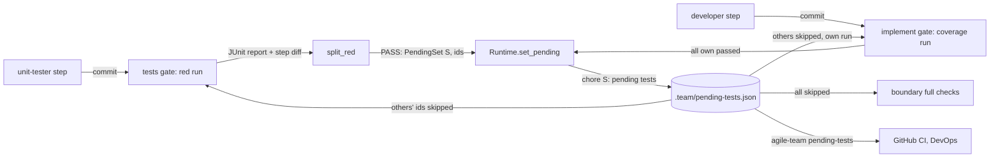

# s125: A story's tests are pending until its implement gate passes

Story: `.team/stories/s125.md`. ADR: **ADR-0058** (new). Amends **ADR-0053**
(the tally gains a `pending` count). Developer: `developer-cli` (Python runner;
the dashboard part is about ten lines of `index.html`).

Work outside this story's code (the PO routes it; see "Not the developer's"):
DevOps edits `.agile-team.toml` and `.github/workflows/agile-team.yml`.

## Rules

| # | Rule | AC |
|---|---|---|
| P1 | **Report option from data.** `Toolchain.report: ReportOptions(option, deselect, ignore)` comes from the preset's `[<preset>.report]` table, with the config's own `[toolchain.report]` keys on top (merged the way `_files` merges `files`). Python preset: `option = "--junitxml={file} -o junit_family=xunit1"`, `deselect = "--deselect={id}"`, `ignore = "--ignore={id}"`. Node and rust have no `report` table, so reporting is **off** for them: the gates judge exit codes as before, and nothing is ever pending. | AC1 |
| P2 | **Placeholders.** In the `test` and `coverage` commands, every `{report}` or `{report:<root>}` (regex `PLACEHOLDER`) is replaced by: the `option` with `{file}` set to that occurrence's own file `<run_dir>/reports/<k>.xml` (k = 1, 2, … in order), then a space and the skip options (P5) for the skipped ids under `<root>` (`{report}` means root `""`, which holds every id). A command with no placeholder gets `" {report}"` appended first. `<root>` is the repo-relative directory pytest runs in (its rootdir). Values are shell-quoted (`shlex.quote`). Templates are filled with `str.replace`, never `str.format`. | AC1, AC3 |
| P3 | **Every gate and full-check run writes a report.** These go through P2: `Checks._red` (tests gate, its Stop hook, rework), `green` (`pass_tests`), `tests_green_and_covered` (implement gate, its Stop hook), `ran("test"/"coverage")` (quality), `_run_suite` (suite runs), `test_output` (a dispute's excerpt), and `fullcheck`'s `test` and `coverage` checks. Named runs (`runner_tools` and `[[toolchain.targeted]]`) are **not** built: they run exactly the ids they name, pending or not, and write no report. Before each built run, the runner empties the folder `<run_dir>/reports/` (`remove_tree`, then `make_dirs`). | AC1, AC7 |
| P4 | **Results come from the report.** After a built run the runner parses every `<k>.xml` that exists (`junit.parse`). A missing file is left out, because a red first link of a `&&` chain stops the later links. Pass, fail and skip per id, the pending set, and the owner routing of failing tests (s92) all come from the report. The text output is still kept (`Ran`, `## Runner results`, the reason's tail) for roles to read. With reporting off, everything reads the text as before. | AC1 |
| P5 | **Skip options.** For each skipped id under the occurrence's root, the id is made root-relative first (`<root>/` removed). An id with `::` gets `deselect`, and a file id (no `::`) gets `ignore` (an import error is raised at collection, before `--deselect` acts). An empty template skips nothing. | AC3 |
| P6 | **Ids.** A test id is the repo-relative pytest node id, rebuilt from an xunit1 `<testcase>`: `<root>/<file>::<classname with the module prefix removed, dots as ::>::<name>`. Example: root `agile-team/runner`, `file="tests/test_g.py"`, `classname="tests.test_g.TestX"`, `name="test_y[a]"` → `agile-team/runner/tests/test_g.py::TestX::test_y[a]`. With `classname == module` there is no class part. A `<testcase>` with an empty `classname` is a file that failed to collect, and its id is `<root>/<file>`. Result: `failure` or `error` child → `FAILED`, `skipped` child → `SKIPPED`, else `PASSED`. `line` is 0-based in the XML. `Case.line` stores it 1-based, or `None` when the attribute is missing. | AC1 |
| P7 | **Which run skips what.** A run made for story S skips every pending id of **other** stories and runs S's own (`Registry.others(S)`). A run made for no story (the boundary's full checks, the CLI) skips every pending id. Gate runs serve a story through `Checks.serving` (P16). | AC3, AC4 |
| P8 | **Tests gate (red) with reporting on.** Its outcome, in order: (1) timed out → as today. (2) No report file → BOUNCE `REPORT_MISSING`. (3) `split_red(report, own)` with `own` = S's current ids, and the step's changed lines (P10): `pending` = the failed ids that are touched by the step, or already in `own`; `real` = the other failed ids. A non-empty `real` → BOUNCE `NOT_PENDING`. (4) `pending` is empty: a non-zero exit → BOUNCE `UNREPORTED_FAILURE`, a zero exit → BOUNCE `GREEN_TOO_EARLY` (today's text; the rework claim rule after it is unchanged). (5) Otherwise PASS with reason `PENDING_SET` and `Outcome.pending = PendingSet(S, pending)`. | AC2, AC7 |
| P9 | **Rework at tests** (`tests_reworked`, code already in). It is red as P8. A passing claim on a green suite ends with `Outcome.pending = PendingSet(S, ())`, which removes any entry. | AC2 |
| P10 | **The step's changes.** `changed = pending_tests.changed_lines(git.diff_lines(base), git.untracked())`, where `base` is the HEAD when the step was planned (`Plan.base`). From `git diff -U0` the new-side line ranges of each `+++ b/<path>` hunk count: `@@ -a,b +c,d @@` gives `range(c, c + d)` when `d > 0`, and `range(c, c + 2)` for a pure deletion (`d == 0`). With no `,d`, d is 1. Every untracked file counts whole (`WHOLE = range(1, sys.maxsize)`). After the step's commit the working tree is clean, so the diff equals that commit's diff (quarantined paths are already reverted). In the Stop hook, before the commit, it is the agent's working tree. | AC2 |
| P11 | **Touched.** A case with `line is None` (a file id) is touched when its file is in `changed`. Any other case's extent is `range(line, next_line)`, where `next_line` is the smallest `line` above it among **all** the report's cases in the same file (else `sys.maxsize`). It is touched when that extent overlaps any changed range of its file. | AC2, AC7 |
| P12 | **Implement gate.** It is computed as today (exit code, coverage). Then, with reporting on and S having pending ids: (a) a missing report on a PASS → BOUNCE `REPORT_MISSING`. (b) `leaving(report, own)`: `failing` = own ids that the report holds but did not pass (FAILED or SKIPPED; a file id passes only when the report has at least one case of that file and every one of them PASSED); `missing` = own ids the report does not hold. Any `failing` → BOUNCE whose reason is the gate's own reason (if it bounced) plus a line `PENDING_FAIL`. (c) On PASS: `Outcome.pending = PendingSet(S, ())` and the reason gains `; ` + `PENDING_LEFT`, plus `; ` + `PENDING_GONE` when `missing` is not empty (renamed or deleted tests). On a bounce, `missing` is not reported, because a short-circuited chain can leave ids unrun. The Stop hook's reused run (s126 SC13) carries the same `pending`, since it is the same function. | AC3, AC7 |
| P13 | **Applying a change.** Only `Runtime.gate`, on a PASS whose `outcome.pending` is not `None`, calls `Runtime.set_pending(change)`. That reads the registry, applies `with_ids`, and does nothing when the text is unchanged. Otherwise it writes the file, commits only `REGISTRY` as `PENDING_SUBJECT`, and calls `record_checkout()`. The Stop hook never applies a change. | AC2, AC3 |
| P14 | **Leaving early.** A cancel (`story_admin.Clerk._settle_one` when the story ends `CANCELLED`) and a revert (`reverts.Reverter`, right after `_record`) call `set_pending(PendingSet(story, ()))`. | AC3 |
| P15 | **Only the runner writes it.** `guard.RUNNER_FILES = (pending_tests.REGISTRY,)`. `_check_write` refuses them before the scope check with `RUNNER_ONLY`. `audit_step` never counts them in scope, so a Bash edit is quarantined. A registry that does not parse raises `pending_tests.RegistryError`. `Pipeline.evaluate` catches it around the gate call and HOLDs with `REGISTRY_BAD` (no write). Anywhere else (boundary, `set_pending`, CLI), it propagates: the run halts as a crash with the message, and the human fixes the file. | AC2, AC7 |
| P16 | **Serving.** `gates.Serving(story: str = "", base: str = "")` is a field of `Checks` (default `Serving()`). `Pipeline.serving(serving) -> Pipeline` returns a copy with `checks.serving` replaced. `Runtime.served(plan)` = `self.pipeline.serving(Serving(plan.story.id, plan.base))`, used by `_gating` (before the Stop hook's `reusing`) and by `StopChecks._hooked`. The quality chore and `pass_tests_refusal` serve the story with `base=""`. | AC3, AC4 |
| P17 | **Counted as pending.** After a built run, the ids it skipped that the report does not hold are counted per story. `pending_tests.counts_text(...)` → `pending (s125): 3, pending (s130): 1`. When it is not empty, a gate's reason gains `; skipped ` + that text, and a full check's result has `pending` = that text. | AC3 |
| P18 | **Tally.** Before a built run, `test_reports.run` calls `stages.hear(test_tally.pending_record(n))`, where n is the number of ids skipped. `test_tally.read` folds a `{"pending": n}` record into `Tally.pending`. A new pytest session keeps `pending`, and `as_dict` adds `"pending"`. The dashboard's caption appends ` · N Pending` after the total when `pending > 0`. `testsRan`, `testBar` and `completePct` ignore it. | AC6 |
| P19 | **CI.** `agile-team pending-tests [--root R]` prints, on one line, the skip options (P5) of every pending id under R, joined with spaces (`shlex.join`), in a form `PYTEST_ADDOPTS` accepts (pytest splits it with `shlex`). An empty registry prints an empty line. | AC5 |
| P20 | **Config checks.** `{report…}` in a command other than `test`/`coverage` → `ConfigError(REPORT_ONLY_IN_TESTS)`. `{report…}` with an empty `option` → `ConfigError(REPORT_NEEDS_OPTION)`. `onboard.gitignore_lines("ignored")` adds `"!.team/pending-tests.json"`. | AC1, AC5 |
| P21 | **No agent skips.** `_shared.md`'s "Never weaken, skip or delete a test" stays. Only the runner's registry skips a test. | AC8 |

### Texts (tests may assert them exactly)

```python
# gates.py
REPORT_MISSING = "the test command wrote no report in {folder}; check [toolchain.report] and the {{report}} placeholders:\n{tail}"
NOT_PENDING = "these tests fail but are not new or changed in this step, so they are not pending: {ids}\n{tail}"
UNREPORTED_FAILURE = "the test command failed (exit {code}) but its report names no failing test:\n{tail}"
PENDING_SET = "{count} pending test(s) for {story}"
PENDING_FAIL = "pending tests of {story} still fail: {ids}"
PENDING_LEFT = "{count} pending test(s) of {story} pass"
PENDING_GONE = "no longer in the suite, dropped from pending: {ids}"
REGISTRY_BAD = "{file} is not valid ({error}); only the runner writes it"
# dispatch.py
PENDING_SUBJECT = "chore({story}): pending tests"
# guard.py
RUNNER_ONLY = "{role} may not write {rel}; only the runner writes it"
# config.py
REPORT_ONLY_IN_TESTS = "toolchain.{name}: {{report}} only works in the test and coverage commands"
REPORT_NEEDS_OPTION = "toolchain.{name} uses {{report}}, but [toolchain.report] option is not set"
```

`{ids}` is the ids joined with `", "` in sorted order. `REPORT_MISSING`'s
`{{report}}` renders as `{report}`, so these templates are filled with
`.format`. They are runner texts, not command templates.

## Data flow



## Changes by module

### `config.py`

```python
@dataclass(frozen=True)
class ReportOptions:
    """How the test commands write a JUnit report and skip pending ids (s125 P1)."""
    option: str = ""     # {file}
    deselect: str = ""   # {id}
    ignore: str = ""     # {id}

    @property
    def on(self) -> bool:
        """True when the toolchain writes a report."""
```

- `Toolchain.report: ReportOptions = field(default_factory=ReportOptions)`.
- `_report(raw) -> ReportOptions`: the named preset's `report` table, then
  `raw.get("report", {})` over it. Unknown keys are dropped, as in `_files`.
- `TEST_COMMANDS = ("test", "coverage")`. Add P20's two checks to the toolchain
  validation, which uses `test_reports.PLACEHOLDER` to find a placeholder.

### `presets.toml`

Add `[python.report]` with P1's three keys, and one header comment line:
`# report    JUnit option ({file}) and skip templates ({id}) for pending tests (s125)`.

### `junit.py` (new, pure; stdlib `xml.etree.ElementTree`)

```python
class Result(StrEnum): PASSED = "passed"; FAILED = "failed"; SKIPPED = "skipped"

@dataclass(frozen=True)
class Case:
    id: str            # repo-relative node id or file id (P6)
    file: str          # repo-relative file
    line: int | None   # 1-based, None for a file id or a missing attribute
    result: Result
    message: str = ""  # first line of the failure/error message attribute

class ReportError(Exception): ...

def parse(text: str, root: str) -> tuple[Case, ...]
    """Every <testcase> of one xunit1 report, ids prefixed with ``root``; ReportError on bad XML."""
def node_id(case: ET.Element, root: str) -> str

@dataclass(frozen=True)
class Report:
    cases: tuple[Case, ...] = ()
    def failed(self) -> tuple[Case, ...]
    def holds(self, id: str) -> bool          # a file id: any case in that file
    def passed(self, id: str) -> bool         # P12's rule for test and file ids
```

`parse` raises `ReportError` on bad XML, and the caller treats that file as
missing. The reports are the runner's own pytest output, so the stdlib parser
is fine here, and no new dependency is needed.

### `pending_tests.py` (new; pure apart from `read`/`write`)

```python
REGISTRY = ".team/pending-tests.json"
WHOLE = range(1, sys.maxsize)
Changed = Mapping[str, tuple[range, ...]]

class RegistryError(Exception): ...

@dataclass(frozen=True)
class PendingSet:
    story: str
    ids: tuple[str, ...]   # () removes the story's entry

@dataclass(frozen=True)
class Registry:
    entries: Mapping[str, tuple[str, ...]] = field(default_factory=dict)
    def of(self, story: str) -> tuple[str, ...]
    def others(self, story: str) -> dict[str, tuple[str, ...]]   # story "" → all
    def with_ids(self, change: PendingSet) -> Registry           # () drops the key
    def text(self) -> str    # json.dumps(sorted keys, sorted ids, indent=2) + "\n"

def parse(text: str) -> Registry              # RegistryError unless {str: [str, ...]}
def read(repo: Path) -> Registry              # missing file → Registry()
def write(repo: Path, registry: Registry) -> None
def changed_lines(diff: str, untracked: Sequence[str]) -> Changed       # P10
def touched(case: junit.Case, ctx: Touch) -> bool                       # P11
@dataclass(frozen=True)
class Touch: report: junit.Report; changed: Changed
@dataclass(frozen=True)
class RedSplit: pending: tuple[str, ...]; real: tuple[str, ...]
def split_red(report: junit.Report, ctx: RedAsk) -> RedSplit            # P8 (3)
@dataclass(frozen=True)
class RedAsk: changed: Changed; own: tuple[str, ...]
@dataclass(frozen=True)
class Leaving: failing: tuple[str, ...]; missing: tuple[str, ...]
def leaving(report: junit.Report, own: tuple[str, ...]) -> Leaving      # P12 (b)
def counts_text(skipped: Mapping[str, tuple[str, ...]], report: junit.Report) -> str  # P17
```

The parameter objects (`Touch`, `RedAsk`) keep each function at two
parameters.

### `test_reports.py` (new: builds and reads report runs)

```python
PLACEHOLDER = re.compile(r"\{report(?::(?P<root>[^{}]*))?\}")
FOLDER = "reports"   # under run_dir

@dataclass(frozen=True)
class Built:
    command: str
    files: tuple[tuple[str, Path], ...]             # (root, report file) per occurrence
    skipped: Mapping[str, tuple[str, ...]]          # story → ids skipped

@dataclass(frozen=True)
class TestRun:
    code: int
    out: str
    report: junit.Report | None                     # None: reporting off, or no file written
    skipped: Mapping[str, tuple[str, ...]]
    own: tuple[str, ...] = ()                       # the served story's pending ids at run time

@dataclass(frozen=True)
class Reporting:
    options: ReportOptions = ReportOptions()
    folder: Path = Path()
    registry: Callable[[], Registry] = Registry      # reads the repo's registry
    changed: Callable[[str], Changed] = _unchanged   # base → changed lines; "" → {}

def build(template: str, ask: Ask) -> Built          # P2, P5
@dataclass(frozen=True)
class Ask: reporting: Reporting; skipped: Mapping[str, tuple[str, ...]]
def skip_options(options: ReportOptions, under: Under) -> list[str]   # P5
@dataclass(frozen=True)
class Under: root: str; ids: tuple[str, ...]
def read(built: Built) -> junit.Report | None       # files present and parsable; None if none
def run(built: Built, runner: CommandRunner) -> TestRun
    """Empty the folder, tell the tally the pending count (P18), run, read."""
def skip_line(options: ReportOptions, under: Under) -> str   # P19: shlex.join(skip_options(...))
```

`Reporting.registry` is `functools.partial(pending_tests.read, repo)`.
`Reporting.changed` is `changed_for(git)`:

```python
@dataclass(frozen=True)
class ChangedFor:
    """The step's changed lines since ``base`` (P10); ``{}`` for an empty base."""
    git: Git
    def __call__(self, base: str) -> Changed:
        ...  # {} if not base else pending_tests.changed_lines(git.diff_lines(base), git.untracked())

def changed_for(git: Git) -> ChangedFor
```

### `git_ops.py`

- `Git.diff_lines(self, base: str) -> str`: `diff -U0 --no-color --no-ext-diff <base>`.
- `Git.untracked(self) -> list[str]`: `ls-files -z --others --exclude-standard`,
  split on `\0`, empties dropped. `content_digest` may reuse it.

### `gates.py`

- `Serving` (P16). New `Checks` fields: `reporting: test_reports.Reporting =
  test_reports.Reporting()` and `serving: Serving = Serving()`.
- `Outcome` gains `pending: PendingSet | None = None` and
  `report: junit.Report | None = field(default=None, repr=False)`.
- `Checks._test_run(self, name: str) -> TestRun`: reads the registry (a
  `RegistryError` propagates to `Pipeline.evaluate`, see P15), then `test_reports.build(self.commands[name],
  Ask(self.reporting, registry.others(self.serving.story)))` and
  `test_reports.run(built, self.run)`, with `own = registry.of(self.serving.story)`
  set on the `TestRun`. With reporting off it builds nothing:
  it runs the raw command, and `report=None`, `skipped={}`.
- Every place that runs `self.commands["test"]` or `["coverage"]` uses
  `_test_run` (P3): `test_output`, `ran` (when `name in TEST_COMMANDS`), `_red`,
  `green`, `tests_green_and_covered`, `_run_suite`. `_ran(...)` and
  `Outcome.output` keep the text, and `Outcome.report` is set from the run.
- `_red_outcome(run: TestRun) -> Outcome` follows P8, with
  `RedAsk(self.reporting.changed(self.serving.base), run.own)`. With
  reporting off it is today's code. `tests_reworked` follows P9.
- `_covered_outcome` is unchanged. A new `_leaving(outcome, run) -> Outcome`
  applies P12 after it. `tests_green_and_covered` returns
  `self._leaving(covered, run)`.
- `_noted(outcome, run) -> Outcome` appends P17's text to the reason. Every
  built gate run applies it last.
- `Pipeline._command_gate` stays keyed by step. The gates read
  `self.checks.serving.story`, so their signatures do not change.
- `Pipeline.serving(self, serving: Serving) -> Pipeline`.
- `pass_tests_refusal`: `self.serving(Serving(story.id)).checks.green()`.
- `test_findings(outcome: Outcome) -> list[owners.Finding]`: from
  `outcome.report` when set (one `Finding(case.file, (f"FAILED {case.id} - {case.message}",), Source.TEST)`
  per failed case), else `owners.findings(outcome.output, Source.TEST)`.
  `_route_items` uses it.

### `stop_checks.py`

- `own_items(outcome, owners, listing)` uses `gates.test_findings(outcome)`.
- `_hooked(stage)` starts from `self.runtime.served(self.plan)` instead of
  `self.runtime.pipeline`.

### `dispatch.py`

- `Plan.base: str = ""`. `Runtime.plan` sets `plan.base = self.git.head()` when
  the request has a story, before `_set_up`.
- `Runtime.served(self, plan: Plan) -> Pipeline` (P16). `_gating(plan)` uses it.
- `Runtime.gate`: after `_evaluate`, when `outcome.verdict is Verdict.PASS and
  outcome.pending is not None`, call `self.set_pending(outcome.pending)`. Then
  advance as today.
- `Runtime.set_pending(self, change: PendingSet) -> str | None` (P13): the
  commit sha, or `None` when nothing changed.
- `_run_quality_checks` runs `self.pipeline.serving(Serving(plan.story.id)).checks.ran(name)`.

### `fullcheck.py`

- `full_checks(config: Config, registry: Registry) -> list[FullCheck]`.
  `FullCheck.built: Built | None = None`, set for `test`/`coverage` when
  reporting is on: `test_reports.build(command, Ask(reporting, registry.others("")))`.
  `FullCheck.command` keeps the configured template, which is what
  `CHECK_FAILED` shows.
- `_run_one`: when `check.built` is set, it calls
  `test_reports.run(check.built, judging.run)`, and the result is
  `CheckResult.pending = counts_text(...)` (default `""`). `summary()` adds
  `"pending"`.
- `boundary_runner._run_checks(path)` passes `pending_tests.read(path)`, the
  registry of the tree being checked. The reporting folder is
  `config.run_dir / "reports"`.

### `guard.py`

P15: `RUNNER_FILES`, `RUNNER_ONLY`. `_check_write` checks it after `PROTECTED`.
`audit_step` puts every changed path matching `RUNNER_FILES` in `out_of_scope`.

### `story_admin.py`, `reverts.py`

P14. Both call `runtime.set_pending(PendingSet(story.id, ()))`. The revert
does it after the record commit. The cancel does it after `OUTCOMES[decided]`
when `story.status is StoryStatus.CANCELLED`.

### `stages.py`, `test_tally.py`, `stage_log.py`

- `stages.hear(text: str) -> None`: `current().hear(text)` when a run is open.
- `test_tally.pending_record(n: int) -> str` returns `json.dumps({"pending": n})`.
  `read` handles that record before `record_of`: it sets `pending`, and nothing
  else changes. A new session copies `pending` into the fresh `Tally`.
  `Tally.pending: int = 0`, and `as_dict` gains `"pending"`. A `Tallier` shows
  the row only once `counted()`, as today.

### `dashboard/index.html`, `dashboard/fixtures/snapshot.json`

- `captionOf(t, part)`: after the total, append `` ` · ${t.pending} Pending` ``
  when `t.pending > 0`. Do the same in `captionHtml`, with a `fc-sw pending`
  swatch: add `--pending: #6b7fd7` next to `--skip` in all three palettes and a
  `.fc-sw.pending` rule. `TEST_PARTS`, `testsRan`, `testBar` and `completePct`
  are unchanged.
- The fixture's open `gate.tests+coverage` row's `tests` gains `"pending": 3`.

### `cli.py`

- `make_pipeline` passes `reporting=test_reports.Reporting(config.toolchain.report,
  config.run_dir / test_reports.FOLDER, partial(pending_tests.read, config.repo),
  changed_for(Git(config.repo)))`.
- A new `COMMANDS` row `pending-tests` with `--root` (default `""`). It prints
  `test_reports.skip_line(options, Under(root, ids under root))` for every
  story's ids. It does not need a running team.

### `onboard.py`

`gitignore_lines("ignored")` adds `"!.team/pending-tests.json"` after
`"!.team/CLAUDE.md"`.

### Role files (the developer edits them; AC8)

Add to `unit-tester.md`, after the paragraph on the stop check:

```markdown
## Pending tests

When your tests gate passes, the runner reads the red run's JUnit report and
records your story's failing tests that are new or changed in your step in
`.team/pending-tests.json`. Other stories' runs, the sprint checks and CI skip
them until the developer's implement gate passes them. A failing test you did
not add or change is not pending: the gate fails and names it, so fix it or
dispute it. Never write the registry yourself (the guard refuses it), and never
mark a test `skip` or `xfail` to get it out of the way.
```

Add to `developer.md`, in "Your stop check":

```markdown
Your story's pending tests (in `.team/pending-tests.json`) run in your gate;
other stories' pending tests are skipped. The gate passes only when every one
of yours passes, and then the runner removes them from the registry. `run_tests`
runs any test you name, pending or not.
```

### Docs (the architect has updated them in this step)

`agile-team/reference/protocol.md`: a new "Pending tests (s125)" section after
"Stop checks (s126)", the `[toolchain.report]` keys and `pending-tests` in the
CLI table. `agile-team/SKILL.md`: a Rules bullet. `README.md`: one sentence.
`architecture.md`: the index entry and three component rows.

### Not the developer's (the PO routes these to DevOps)

- `.agile-team.toml`: put `{report:agile-team/runner}` after
  `pytest -n auto -q` and `{report:unattended/runner}` after `pytest -q`, in
  both `test` and `coverage`.
- `.github/workflows/agile-team.yml`: add `.team/pending-tests.json` to both
  `paths` lists. Run the tests as
  `PYTEST_ADDOPTS="$(uv run --locked agile-team --repo ../.. pending-tests --root agile-team/runner)" uv run --locked pytest -n auto --cov`
  (the job's working directory is `agile-team/runner`). The same applies to
  `unattended.yml` with `--root unattended/runner`.

## Test checklist (`tests/test_s125_pending_tests.py`; dashboard: `tests/test_s125_flow_pending.py`, node harness)

Fixtures: small xunit1 XML strings written by hand, a `FakeSystem` repo, a
scripted `CommandRunner` that writes the XML into the `--junitxml=` path it is
given (it parses the command), and a real tmp git repo for the diff tests.

- [ ] AC1/P1: the python preset gives `ReportOptions("--junitxml={file} -o junit_family=xunit1", "--deselect={id}", "--ignore={id}")`. A config `[toolchain.report] option = "x {file}"` overrides only `option`. The node preset has `on == False`.
- [ ] AC1/P2: `build("uv run pytest -q", …)` appends one occurrence. Its file is `<folder>/1.xml` (quoted), and the skip options follow it. A chain with `{report:a}` and `{report:b}` gets `1.xml`/`2.xml`, and each gets only the ids under its root, made root-relative. A literal `{x}` in the command is untouched.
- [ ] AC1/P20: `{report}` in `lint` → `REPORT_ONLY_IN_TESTS`. `{report}` with no option → `REPORT_NEEDS_OPTION`.
- [ ] AC1/P6: `junit.parse` on a case with a class, one with no class, a parametrized name, a collection error (empty classname → file id), `failure`, `error` and `skipped` children, and a 0-based `line` → 1-based. Bad XML → `ReportError`.
- [ ] AC1/P4: a gate run where only `1.xml` exists still reads it. No file at all → tests gate BOUNCE `REPORT_MISSING`.
- [ ] AC7/P10: `changed_lines` on a real `git diff -U0` from a tmp repo: an added test, an edited body line, a pure deletion (`+c,0`), and an untracked file (`WHOLE`).
- [ ] AC7/P11: a failing test whose body line changed is touched. A failing test in the same file, whose extent has no hunk, is not. A collection-error file id is touched when its file changed.
- [ ] AC7 "registry built from a JUnit report (new failing ids only)": the tests gate for s1, with a report holding a new failing test, an unchanged passing test and a new passing test, yields `PASS`, `pending == PendingSet("s1", (<the new failing id>,))`, and reason `PENDING_SET`.
- [ ] AC7 "an old failing test not made pending": the same with one more failing test in an unchanged file → BOUNCE `NOT_PENDING` naming only that id, and `pending is None`.
- [ ] P8 (4): a non-zero exit with a report holding no failed case → `UNREPORTED_FAILURE`. A zero exit → `GREEN_TOO_EARLY`.
- [ ] AC7 "adding at the tests step": `Runtime.gate` on that PASS writes `.team/pending-tests.json` = `{"s1": [id]}` and makes one commit with subject `chore(s1): pending tests` holding only that file. A gate that does not pass makes no commit.
- [ ] AC7 "the implement gate enabling only its own story's tests": with registry `{"s1": [a], "s2": [b, file_c]}`, the s1 implement gate's command has `--deselect=<b>` and `--ignore=<file_c>`, and nothing for `a`.
- [ ] AC7 "removing at the implement gate" / "removed only when all pass": with `a` passed → PASS, `pending == PendingSet("s1", ())`, the registry loses `s1`, commit `chore(s1): pending tests`. With `a` failed → BOUNCE whose reason holds `PENDING_FAIL` naming `a`, and the registry is unchanged. With `a` skipped → also BOUNCE. An own id that is missing on a pass → PASS with `PENDING_GONE`.
- [ ] AC7 "a boundary run skipping pending files but failing on another red test": `full_checks(config, Registry({"s1": (file_id,)}))` builds a test command with `--ignore=<file>`. The scripted report has another failed test, and the exit code is 1 → the check fails. `CheckResult.pending == "pending (s1): 1"`.
- [ ] AC7 "a named run executing them": `run_tests` on a pending id runs the targeted command with no `--deselect`/`--ignore`.
- [ ] AC7 "a hand edit to the registry refused": `check_tool_use` of `Write` to `.team/pending-tests.json`, by a role whose scope is `["**"]`, → `RUNNER_ONLY`. A Bash-made change to it is in `audit_step(...).out_of_scope`.
- [ ] P15: a registry holding `{"s1": "x"}` → `Pipeline.evaluate` at tests HOLDs with `REGISTRY_BAD`, and no command runs. `pending_tests.parse` raises `RegistryError` for a non-object, a non-list value and a non-string id.
- [ ] AC4: a story at `review` bounced to `implement` with no registry entry runs all its tests. A failing one bounces as `tests fail` (no pending skip).
- [ ] P9: rework at tests with a green suite and a tests claim → PASS, with `pending == PendingSet(S, ())`.
- [ ] P14: a cancelled story and a reverted story have their entry dropped, each in a `chore(sN): pending tests` commit.
- [ ] P16: the Stop hook's red check sees the agent's uncommitted new test file as touched (untracked → `WHOLE`), and its PASS writes no registry.
- [ ] P17: a gate run that skipped 2 ids of s2 has `; skipped pending (s2): 2` in its reason.
- [ ] AC5/P19: `agile-team pending-tests --root agile-team/runner` prints `--deselect=tests/x.py::t --ignore=tests/y.py` for ids under that root only. An empty registry prints an empty line.
- [ ] P20: `gitignore_lines("ignored")` holds `!.team/pending-tests.json`.
- [ ] AC6/P18: `test_tally.read(EMPTY, pending_record(3)).pending == 3`, a following record from a new session keeps `pending == 3`, and `as_dict()["pending"] == 3`. A built run with 2 skipped ids makes the open stage's listener hear `{"pending": 2}` before the command runs.
- [ ] AC6 (node harness, from the fixture): the open `gate.tests+coverage` caption ends with `· 3 Pending`. A copy with `pending: 0` or no `pending` key has no `Pending`. The bar's segments and `% complete` are the same as without the key.
- [ ] AC8: `unit-tester.md` holds "## Pending tests" and "never mark a test `skip` or `xfail`". `developer.md` holds "pending tests". `_shared.md` still holds "Never weaken, skip or delete a test". `protocol.md` holds "### Pending tests (s125)".

## Existing tests this story changes (unit-tester)

- Tests that build `Checks` with a scripted runner keep passing unchanged:
  `Reporting()` is off by default, so no command changes.
- `full_checks(config)` callers now pass a `Registry()`.
- Tests of `gitignore_lines("ignored")` that pin the exact list gain the new
  line.
- A heartbeat or tally test that pins `as_dict()` exactly gains
  `"pending": 0`.

None of these may be loosened. Each still pins exact keys and values.

## Known limits

- Owner routing of lint findings still reads the text output. Only test
  findings come from the report.
- In a `&&` chain, a red first link hides real failures in later links until
  the next run.
- Named runs write no report.
