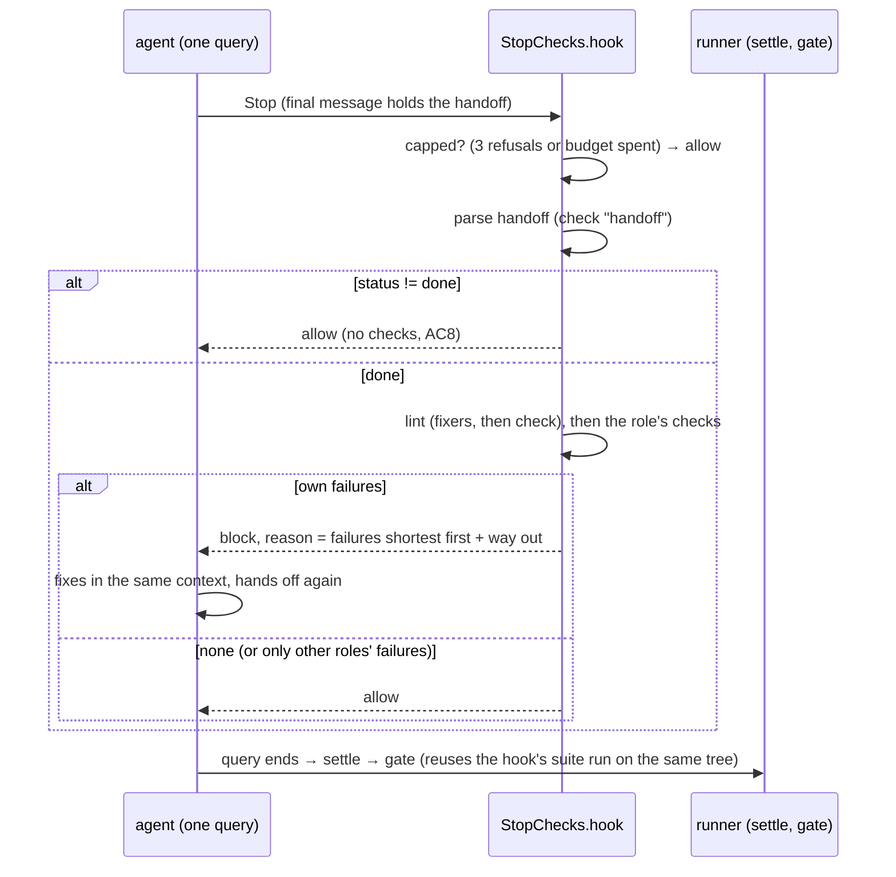

# s126: Each role's stop checks run as a Stop hook; failures go back to the same agent

Story: `.team/stories/s126.md`. ADR: **ADR-0056** (new). Amends **ADR-0033** (the
implement gate can reuse the hook's coverage run) and **ADR-0048** (the `stop`
stage namespace and the `attempt` key). Developer: **developer-cli**. Most of the
work is in the runner. AC9 adds a small change to `dashboard/index.html`, which is
inside `{source}`.

## What happens



## Rules

| # | Rule | AC |
|---|---|---|
| SC1 | **Attached.** `Runtime.plan` gives every step of a kind in `STOP_HOOK_KINDS` (`StepKind.ROLE`, `StepKind.GATE_FIX`) a `StopChecks(runtime, plan)` as `plan.stop_hook`. `build_options` adds `"Stop": [plan.stop_hook.matcher()]` beside `PreToolUse`. These get no hook: the PO's plan (`po_tools`), `TEAM_FIX` and `REVIEW_FIX` boundary fixes (the review fix works in another worktree), and any plan with `stop_hook is None`. | AC1 |
| SC2 | **The table.** The checks a role's stop runs are `EVERY_ROLE + STOP_CHECKS.get(family(role), ())`, in that order. `family` maps every `developer*` role to `"developer"` (the same rule as `gates.role_fits_step`). Each check's stage and the story step it needs live in `SPECS`, and its function lives in `RUNNERS`. A new row in `STOP_CHECKS` needs no code. | AC1, AC4 |
| SC3 | **Due.** A check whose `Spec.step` is `None` runs at every hooked stop. A check with a step runs only when `plan.kind is StepKind.ROLE`, `plan.story` is set, and `plan.story.step == spec.step`. So a gate fix step runs only `handoff` and `lint`. | AC4 |
| SC4 | **Capped** (checked first, at every stop). When `refusals >= MAX_REFUSALS` (3) or `spent >= gates.stop_check_budget_s`, the hook allows the stop and runs nothing. The normal gate then decides as today. An attempt that starts within budget runs to its end. Each of its commands is bounded by `command_timeout_s`. | AC5 |
| SC5 | **Handoff first.** The hook parses the step's latest assistant text (`plan.said.text`) with `roles.parse_handoff`, inside stage `stop.handoff`. A `HandoffError` is refused: `HANDOFF_BAD`, with the error text (for example `asserts must be a string`). | AC4 |
| SC6 | **Escalation is never blocked.** If the parsed `status != "done"`, the hook allows the stop at once and runs no other check. This covers `changes_requested` (with or without a `dispute`), `blocked`, `failed` and any other status. The runner routes them as today. | AC8 |
| SC7 | **Lint, fixed first.** `lint` takes the step's changed files: `guard.audit_step(runtime.git, plan.scope).in_scope`, kept only when they exist on disk and match `toolchain.files.lintable`. If there are none, or neither `fix` nor `lint_files` is configured, it passes and opens no stage. Otherwise, inside stage `stop.lint`, it runs every `toolchain.file_runs(FileCommand.FIX, files)` command and ignores their exit codes. It then runs every `file_runs(FileCommand.LINT, files)` command. Any lint command that exits non-zero (and did not time out) fails the check. The text is those commands' output, `result_tail`. The fixers' edits stay in the working tree, so `settle_tree` commits them with the step. | AC2 |
| SC8 | **Suite (developer at `implement`).** Runs the step's gate exactly as the pipeline would: `pipeline.step_gate(story, handoff)()` on a copy whose `Checks.stages` opens `stop.suite` in place of the gate's own stage name (`self._hooked(Name.STOP_SUITE)`); the copy's `reuse` is the default, so the hook always runs fresh. That is today's `tests_green_and_covered`. When s125 (pending tests) or s35 (the uncovered-set rule) change the implement gate, the hook follows with no change here. Just before the gate call it records `base = git.head()` and `digest = git.content_digest(base)`. After the call it keeps `Proof(base, digest, outcome)` (SC13). | AC3 |
| SC9 | **Red (unit-tester at `tests`).** The same as SC8 with stage `stop.red`. `step_gate` picks the dispute check, the rework check or `tests_red`, as the gate would. No proof is kept. | AC4 |
| SC10 | **Presentation (integration-tester at `e2e`).** Only when `"acceptance" in pipeline.steps` (as the e2e gate). Inside stage `stop.presentation`: `pipeline.checks.presentation(story)`. That is the completeness check (`PRESENTATION.md` missing or empty, an empty environment folder). The liveness trial is not run. The reason text, when there is one, is the failure. | AC4 |
| SC11 | **Own failures only.** A check fails the stop only with failures the role can fix. `lint` only looks at in-scope files, so all its failures are the role's own, and so are `handoff`, `red` and `presentation` failures. For `suite`: a passing outcome, or a timed-out one (`outcome.ran.code == TIMED_OUT`), lets the stop through. Otherwise `split = owners.split(owners.placed(owners.findings(outcome.output, Source.TEST), checks.listing()), runtime.owners(story))`. If `split.own` has items, the failure is `SUITE_FAILED` with those items' lines. If it has none but `split.fixes` has some, the stop goes through and the gate routes the failures to their owners as today. If there are no findings at all (a coverage shortfall, an unknown failure), the failure is `suite_text`: the outcome's reason, plus the coverage rows with misses when `not gates.tests_failed(output)`. `red` and `suite` treat a timeout the same way: the stop goes through. | AC3, AC8 |
| SC12 | **Refusal.** Every due check runs, in order, and each failure is collected. When there are failures: `refusals += 1`, one `stop-check` event per failure (SC14), and the hook returns `{"decision": "block", "reason": refusal_text(failures, attempt)}`. Failures are sorted by `len(text)`, shortest first. The text ends with `WAY_OUT`. When there are none, the hook returns `{}` (allow). | AC1, AC8 |
| SC13 | **The gate reuses the hook's run.** `Runtime._evaluate` evaluates with `plan.stop_hook.reusing(self.pipeline)` when the plan has a hook. That is a copy whose `Checks.reuse` is `StopChecks.reused`. `tests_green_and_covered` asks `self.reuse()` first, and when it returns an outcome, returns that outcome without running or opening a stage. `reused()` gives the kept proof's outcome only when `git.content_digest(proof.base) == proof.digest` (the same content, whatever was committed in between). Its reason becomes `REUSED.format(reason=…)`. The proof is used at most once (cleared on read). Suite runs (`after_suite_runs`) and routing run as today. | AC3 |
| SC14 | **Events.** Each failure in a refused attempt writes `stop-check` (`EventKind.STOP_CHECK`) through `runtime.emit(kind, plan, …)`: role and story from the plan; data `{check, stage, attempt, of, seconds, text}`. `text` is the failure's first `EVENT_LINES` (20) lines. A stop that is allowed writes no `stop-check` event. | AC5 |
| SC15 | **Attempt on the stages.** The whole attempt runs inside `runtime.stage_log.trying(stages.Attempt(n, MAX_REFUSALS))`, where `n = refusals + 1`. Every stage opened inside carries it: the heartbeat's open row and the `runner-stage` event get `"attempt": {"n": n, "of": 3}`. Every other stage has `"attempt": null`. The attempt also runs under `runtime.pulse.doing(STOP_CHORE)`. | AC5, AC9 |
| SC16 | **Budget.** `spent` adds up the wall seconds (`system.monotonic`) of every attempt in this step. `[gates] stop_check_budget_s` defaults to 1800 and must be positive. | AC5 |
| SC17 | **The SDK's hook timeout is ours.** The matcher's `timeout` is `STOP_HOOK_TIMEOUT_S` (86400). *Pitfall:* the SDK default (60 s) would cancel the callback while `to_thread` keeps a suite running into `settle`. SC4 and the command timeouts bound the hook instead. | AC5 |
| SC18 | **Reading the handoff.** *Pitfall:* the Stop hook's input has no message text (bundled CLI: no `last_assistant_message`). `_Drain.take` copies its `last_text` into `plan.said` (a `Said` holder) on every message. The hook first does `await system.async_sleep(0)`, which lets `collect` take the final assistant message, already queued before the hook request. If the input does carry `last_assistant_message` (a newer CLI), the hook uses that instead. | AC1 |
| SC19 | **Errors.** The hook does not catch exceptions. The SDK reports a callback error to the CLI as a non-blocking hook error, so the stop goes through and the gate decides. | AC5 |

AC9's "Pass/Warn/Fail bar from the JUnit report" is s118's tally bar. The tally
plugin feeds the innermost open stage, and `stop.suite` and `stop.red` are open
while their command runs, so the bar needs no new code.

## Tables (exact data, `agile_team/stop_checks.py`)

```python
class StopCheck(StrEnum):
    HANDOFF = "handoff"
    LINT = "lint"
    SUITE = "suite"
    RED = "red"
    PRESENTATION = "presentation"

@dataclass(frozen=True)
class Spec:
    """One check's stage, and the story step it needs (None: every stop)."""
    stage: stages.Name
    step: str | None = None

SPECS: dict[StopCheck, Spec] = {
    StopCheck.HANDOFF: Spec(stages.Name.STOP_HANDOFF),
    StopCheck.LINT: Spec(stages.Name.STOP_LINT),
    StopCheck.SUITE: Spec(stages.Name.STOP_SUITE, "implement"),
    StopCheck.RED: Spec(stages.Name.STOP_RED, "tests"),
    StopCheck.PRESENTATION: Spec(stages.Name.STOP_PRESENTATION, "e2e"),
}
EVERY_ROLE: tuple[StopCheck, ...] = (StopCheck.HANDOFF, StopCheck.LINT)
STOP_CHECKS: dict[str, tuple[StopCheck, ...]] = {
    "developer": (StopCheck.SUITE,),
    "unit-tester": (StopCheck.RED,),
    "integration-tester": (StopCheck.PRESENTATION,),
}
RUNNERS: dict[StopCheck, Callable[[StopChecks, Handoff], str | None]]  # LINT, SUITE, RED, PRESENTATION
MAX_REFUSALS = 3
STOP_HOOK_TIMEOUT_S = 86_400.0
EVENT_LINES = 20
STOP_HOOK_KINDS = frozenset({StepKind.ROLE, StepKind.GATE_FIX})
```

`HANDOFF` is not in `RUNNERS`, because the hook itself runs it (SC5) before
it knows the status.

### New stages (`stages.py`, `_ROWS`; all `When.AFTER`, `Attach.STEP`)

| Name | Value | Label (≤ 24) | Description |
|---|---|---|---|
| `STOP_HANDOFF` | `stop.handoff` | `stop: handoff parses` | Stop check: the step's handoff block parses |
| `STOP_LINT` | `stop.lint` | `stop: lint fix + check` | Stop check: fix the step's changed files with the toolchain's fixers, then lint them |
| `STOP_SUITE` | `stop.suite` | `stop: suite + coverage` | Stop check: the implement gate's suite and coverage, before the developer may stop |
| `STOP_RED` | `stop.red` | `stop: new tests red` | Stop check: the tests gate, before the unit-tester may stop |
| `STOP_PRESENTATION` | `stop.presentation` | `stop: presentation` | Stop check: the story's presentation is complete, before the integration-tester may stop |

`stop` becomes a built-in namespace, so `[[tool]]` names cannot use it.

## Texts (constants; tests may assert them exactly)

```python
# stop_checks.py
WAY_OUT = "fix these, or hand off `changes_requested` with a `dispute` naming the test and why"
REFUSAL = "The runner's stop checks failed (refusal {n} of {of}); your step is not finished.\n\n{failures}\n\n" + WAY_OUT
FAILURE = "[{check}] {text}"            # failures joined by "\n\n"
HANDOFF_BAD = "your handoff block does not parse: {error}"
SUITE_FAILED = "{count} failing test(s) are yours to fix (run them with run_tests):\n{lines}"
STOP_CHORE = "stop checks for {role} on {story}"   # story "-" when none
# gates.py
REUSED = "{reason} (the stop hook's run on this tree)"
```

## Changes per module

### `agile_team/stop_checks.py` (new)

The module docstring says what it is: a role step's Stop hook. It imports
`Runtime` and `Plan` only under `TYPE_CHECKING`, as `runner_tools` does. It also
holds the tables above and:

```python
def family(role: str) -> str
    """``developer`` for every developer specialisation, else the role."""
def checks_for(role: str) -> tuple[StopCheck, ...]
    """EVERY_ROLE, then the role's STOP_CHECKS row (SC2)."""
@dataclass(frozen=True)
class Failure:
    check: StopCheck
    text: str
    seconds: float

@dataclass(frozen=True)
class Proof:
    """The suite run the hook kept, and the content it ran on (SC8, SC13)."""
    base: str
    digest: str
    outcome: Outcome

def refusal_text(failures: list[Failure], attempt: stages.Attempt) -> str
    """REFUSAL with the failures shortest first (SC12)."""
def own_items(outcome: Outcome, owners: Owners, listing: str) -> Split
    """The suite's test findings split between this step's role and others (SC11)."""
def suite_text(outcome: Outcome, own: list[Item]) -> str
    """SUITE_FAILED for own items; else the reason, plus coverage rows with misses (SC11)."""
def coverage_rows(output: str) -> list[str]
    """The coverage table's rows with a non-zero Miss column, and its TOTAL row."""

@dataclass(eq=False)
class StopChecks:
    """One step's Stop hook: runs the role's checks; refuses own failures, at most 3 times."""
    runtime: Runtime
    plan: Plan
    refusals: int = 0
    spent: float = 0.0
    proof: Proof | None = None

    def matcher(self) -> HookMatcher                       # HookMatcher(None, [self.hook], STOP_HOOK_TIMEOUT_S)
    async def hook(self, input_data: dict[str, Any], _tool_use_id: str | None, _ctx: Any) -> dict[str, Any]
    def reusing(self, pipeline: Pipeline) -> Pipeline      # SC13
    def reused(self) -> Outcome | None                     # SC13
    def _hooked(self, stage: stages.Name) -> Pipeline      # SC8: a copy of runtime.pipeline whose
        # checks open `stage` for every gate stage:
        # replace(p, checks=replace(p.checks, stages=lambda _name: self.runtime.stage_log.open(stage)))
    # private, one job each: _capped(), _said(input_data), _handoff(text) -> Handoff | Failure,
    # _attempt(handoff) -> list[Failure] (sync; run via asyncio.to_thread), _due(check) -> bool,
    # _timed(check, handoff) -> Failure | None, _refuse(failures) -> dict, _log(failure, attempt),
    # _lint(handoff), _suite(handoff), _red(handoff), _presentation(handoff)  (the RUNNERS rows)
```

`hook`, step by step, keeping each helper under 8 lines:

1. `await system.async_sleep(0)` (SC18).
2. `if self._capped(): return {}` (SC4).
3. `attempt = stages.Attempt(self.refusals + 1, MAX_REFUSALS)`. With
   `stage_log.trying(attempt)` and `pulse.doing(STOP_CHORE…)`, and timed with
   `system.monotonic`:
   - parse (SC5): a `Failure` → `failures = [it]`;
   - else `status != "done"` → `failures = []` and no checks (SC6);
   - else `failures = await asyncio.to_thread(self._attempt, handoff)`.
4. `self.spent += elapsed`; `return self._refuse(failures) if failures else {}`.

`asyncio.to_thread` copies context variables, so `stages.current()` and the
tally both work inside the worker thread.

### `agile_team/stages.py`

- The five `Name` members and `_ROWS` rows above.
- `@dataclass(frozen=True) class Attempt: n: int; of: int`, with `as_dict()`
  returning `{"n": n, "of": of}`.
- `Run.attempt: Attempt | None = None`.

### `agile_team/stage_log.py`

- `StageLog.attempt: stages.Attempt | None = None`, and
  `@contextmanager def trying(self, attempt: stages.Attempt) -> Iterator[None]`,
  which sets it for the stages opened inside, the same pattern as `within`.
- `open` builds `stages.Run(STAGES[name], self.place, attempt=self.attempt)`.
- `open_row` and `Timed.data` add the key `"attempt"`: `run.attempt.as_dict()`,
  or `None`. In `Timed.data` it goes after `"step"`.

### `agile_team/events.py`

`EventKind.STOP_CHECK = "stop-check"`.

### `agile_team/dispatch.py`

- `@dataclass class Said: text: str = ""` ("the step's latest assistant text,
  for the Stop hook").
- `Plan.said: Said = field(default_factory=Said)` and
  `Plan.stop_hook: StopChecks | None = None`.
- `_Drain.said: Said | None = None`. `take` sets `self.said.text = self.last_text`
  when it is set. `collect` passes `said=getattr(plan, "said", None)`, because
  tests pass bare plans.
- `build_options`: `hooks = {"PreToolUse": [...]}`, plus
  `"Stop": [plan.stop_hook.matcher()]` when `plan.stop_hook`. Keep it under
  8 lines with a helper `_hooks(plan) -> dict[str, list[HookMatcher]]`.
- `_set_up(plan, kind)`: when `kind in STOP_HOOK_KINDS`,
  `plan.stop_hook = stop_checks.StopChecks(self, plan)`.
- `_evaluate`: `return self._gating(plan).evaluate(plan.story, handoff)`, with
  `_gating(plan) -> Pipeline`, which is `plan.stop_hook.reusing(self.pipeline)`
  when there is a hook, else `self.pipeline`.

### `agile_team/gates.py`

- Rename `Pipeline._step_gate` to the public `step_gate(story, handoff)`, with
  the docstring "The gate a `done` at the story's step runs, or None." Update
  `_gate_for`.
- `Checks.reuse: Callable[[], Outcome | None] = _nothing_kept`, where
  `_nothing_kept()` returns `None`.
- `tests_green_and_covered`: `kept = self.reuse()`, and return `kept` when it
  is not `None`, before the stage opens. The rest is unchanged.
- `REUSED` (texts). `StopChecks.reused` applies it to the reason.

### `agile_team/git_ops.py`

`Git.content_digest(base: str) -> str` gives the sha256 hex of the working
tree's content relative to `base`. The paths are
`diff --name-only -z <base>` together with `ls-files -z --others --exclude-standard`,
sorted and unique. Each existing path gets `hash-object -- <paths…>` (one call),
and each missing one gets `"-"`. The digest is over `base`, then one
`"{path} {blob}"` line per path. A tree with uncommitted changes and the same
tree after they are committed give the same digest.

### `agile_team/config.py`

- `PRESETS = Path(__file__).parent / "presets.toml"` and `load_presets()` move
  here from `onboard.py`. `onboard` imports both by the same names (DRY, and it
  avoids an import cycle).
- `class FileCommand(StrEnum): FIX = "fix"; LINT = "lint_files"`.
- `@dataclass(frozen=True) class FileCommands: fix: str = ""; lint_files: str = ""; lintable: tuple[str, ...] = ()`,
  with `template(kind: FileCommand) -> str` (a dict lookup, no branches).
- `Toolchain.files: FileCommands = FileCommands()`, plus
  `Toolchain.file_runs(kind: FileCommand, files: list[str]) -> list[str]`.
  It groups `files` by `targeted_for(path)`'s root (no row means `""`), in
  first-seen order. Each group gives one command:
  `template.replace("{root}", shlex.quote(root or ".")).replace("{files}", " ".join(quoted root-relative paths))`.
  An empty template gives `[]`.
- `_toolchain`: `files` is `{**preset_files, **raw.get("files", {})}`, where
  `preset_files = load_presets().get(raw.get("preset", ""), {}).get("files", {})`.
  So a key that the config does not set comes from the named preset.
- New `TOOLCHAIN_RULES` rows: "toolchain.files.fix must hold {files}" and the
  same for `lint_files`, each only when the key is set.
- `Gates.stop_check_budget_s: float = DEFAULT_STOP_BUDGET_S` (1800.0), and a
  `GATE_RULES` row: "gates.stop_check_budget_s must be positive".

### `agile_team/presets.toml`

```toml
[python.files]
fix = "uv run --directory {root} ruff check --fix --exit-zero --quiet {files} && uv run --directory {root} ruff format --quiet {files}"
lint_files = "uv run --directory {root} ruff check --quiet {files}"
lintable = ["*.py"]
```

`node` and `rust` get no `files` table, so their lint check is skipped. Add a
line to the header comment: `files: fix / lint_files templates ({root}, {files})
and lintable globs, for the stop hook's lint check (s126)`. `onboard` does not
copy `files` into a new config, because the preset supplies it at load. This
repo needs no config edit: its `[[toolchain.targeted]]` roots
(`agile-team/runner`, `unattended/runner`) become `{root}`.

### `agile_team/dashboard/index.html` (AC9)

| # | Rule |
|---|---|
| D1 | No new placement code. The `stop.*` stages are `after`/`step` rows, so `stageRole` puts them under the role whose step they ran in, as that role's after tool boxes (s118 FC16/FC17). |
| D2 | `roleTools` adds `refused: 0` to each tool. Then, for every `stop-check` event inside `inScope(view)` (as a row `{story: e.story, at: e.at}`), it adds 1 to `out[e.role]?.after` tool whose `stage === e.data.stage`. `idleTool` appends `` · ${n} refused`` after the time when `tool.refused > 0`, in the same `f-toolstats` span. So it reads `stop: suite + coverage · ↻ 3 · 9.5m · 2 refused`. |
| D3 | `runningTool`: when `row.attempt` has finite `n` and `of`, the head reads `▶ label · attempt n of of` in place of `look.label`. The run colour (`look.cls`) stays. Without `attempt`, nothing changes. |
| D4 | A running `stop.suite` or `stop.red` box shows s118's Pass/Warn/Skip/Fail bar and caption from `row.tests`, unchanged. |

New helper: `/** stop-check events per role and stage, in scope (s126 D2). */ function stopRefusals(view, inside)`,
which returns a `Map` keyed by `` `${role}\n${stage}` ``.

### `dashboard/fixtures/snapshot.json`

- Every heartbeat stage row and every `runner-stage` event gains
  `"attempt": null`.
- Add, inside the fixture's current sprint, on a story with a developer step:
  - a `runner-stage` event for `stop.lint` (code 0) and one for `stop.suite`
    (code 1), each with `"attempt": {"n": 1, "of": 3}`;
  - a `stop-check` event `{check: "suite", stage: "stop.suite", attempt: 1, of: 3, seconds: 212.4, text: "1 failing test(s) are yours to fix …"}`,
    role being that developer;
  - a second `runner-stage` `stop.suite` with attempt 2 and code 0.

  The fixture's existing open stage row stays as it is. A test that needs a
  running stop box adds a row to its own copy.

### Role files (`agile_team/roles/`, the developer edits them; AC7, AC8)

Add this to `_shared.md`, after "Handoff (required)":

```markdown
## Stop checks

When you end your step with a `done` handoff, the runner checks your work
before the step ends: your handoff parses; your changed source and test files
are fixed by the toolchain's fixers (python: `ruff check --fix`, `ruff format`)
and then linted; and your role's own checks run (below). If something you can
fix fails, your stop is refused and you get the failures, shortest first, in
the same conversation: fix them and hand off again. After 3 refusals the step
ends and the gate decides. A handoff that is not `done` (`changes_requested`,
`blocked`, `failed`) ends the step at once with no checks: if you already know
a failing test or file is not yours to fix, escalate on your first turn
without running anything.
```

Add this to `developer.md`, as a new section before "A test that contradicts
the design":

```markdown
## Your stop check

Your `done` stop runs the implement gate: the full suite with coverage. Failing
tests you can fix come back to you as test ids. A failure only in a file another
role owns does not block you: the gate routes it. If a test contradicts the
design, hand off `changes_requested` with a `dispute`; you may do this on your
first turn. When your stop passes, the gate reuses that run.
```

Add one paragraph to `unit-tester.md`: "Your `done` stop runs the tests gate:
your new tests must fail (or, with the code in, see below). A green suite is
refused." Add one to `integration-tester.md`: "Your `done` stop checks that each
environment's presentation is complete (`PRESENTATION.md` exists and is not
empty). An incomplete one is refused."

### Docs (the architect has updated them in this step)

`agile-team/reference/protocol.md` has the new "Stop checks (s126)" section, the
config keys and the `stop-check` event. `agile-team/SKILL.md` has a new Rules
bullet. The architecture index has its entry, and the components table has the
new module.

## Test checklist (`tests/test_s126_stop_checks.py`; dashboard: `tests/test_s126_flow_stop_checks.py`, node harness)

The tests use a fake runtime (`FakeSystem`, a scripted `CommandRunner`, a
`Git` over a tmp repo or a stub). They call `StopChecks.hook(...)` with
`{"hook_event_name": "Stop", "stop_hook_active": False}`, after setting
`plan.said.text`.

- [ ] AC1/SC12: a developer at implement with a failing own test → the first call returns `decision == "block"`, the reason holds the `FAILED tests/…::test_x` line and ends with `WAY_OUT`. After the script turns green, the next call returns `{}`.
- [ ] SC12: two failures come out shortest first, and `REFUSAL` says `refusal 1 of 3`.
- [ ] AC2/SC7: a changed `*.py` file. The fix command runs before `lint_files`, both through `file_runs`, with `{root}`/`{files}` filled from the targeted row. A clean `lint_files` → no lint failure, and the file (edited by the fake fixer) is committed by `settle_tree`.
- [ ] AC2/SC7: `lint_files` exits 1 → `[lint]` failure with its output. A changed `.md` file only, or files outside the write scope → no lint command runs and no `stop.lint` stage is opened.
- [ ] AC2: `file_runs` groups files by targeted root in first-seen order. With no template it returns `[]`. A preset's `files` fill keys the config does not set, and a config key overrides the preset. A template without `{files}` is a config error.
- [ ] AC3/SC8/SC13: the hook's suite run passes. Then the gate on the same content (after `settle_tree`'s commit) calls the coverage command **zero** more times, and its reason ends with `(the stop hook's run on this tree)`. After a further edit (different digest) the gate runs coverage once. The proof is used only once.
- [ ] SC13: `Git.content_digest(base)` is the same before and after the step's commit, and changes when a file changes or a new untracked file appears.
- [ ] AC4/SC9: unit-tester at tests, green suite → refused with `GREEN_TOO_EARLY`; red suite → allowed. Stage `stop.red` is written.
- [ ] AC4/SC10: integration-tester at e2e with a missing or empty `PRESENTATION.md` → refused with the presentation reason; complete → allowed; no acceptance step → not run.
- [ ] AC4/SC5: final text whose handoff has `"asserts": 3` → refused with `HANDOFF_BAD` containing `asserts must be a string`.
- [ ] AC4/SC2: the table is data. Monkeypatching `STOP_CHECKS["code-reviewer"] = (StopCheck.PRESENTATION,)` makes a code-reviewer stop at e2e run the presentation check, with no other change. `checks_for("developer-gui") == (HANDOFF, LINT, SUITE)`.
- [ ] SC3: a `GATE_FIX` developer step runs only `handoff` and `lint`, never the suite.
- [ ] AC5/SC4: after 3 refusals the fourth call returns `{}` and runs no command. The gate then runs and bounces as today. With `stop_check_budget_s` spent, the next call returns `{}` with no command.
- [ ] AC5/SC14: each refusal writes one `stop-check` event per failure with role, story, `check`, `stage`, `attempt`, `of`, `seconds`, `text`. An allowed stop writes none.
- [ ] SC15: the `runner-stage` event of a stop stage has `"attempt": {"n": 2, "of": 3}` on the second attempt. A gate stage has `"attempt": null`, and so does the heartbeat's open row of a gate stage.
- [ ] SC1/SC17: `build_options` for a role step has `"Stop"` with `timeout == STOP_HOOK_TIMEOUT_S`. A PO plan or a `REVIEW_FIX` plan has no `"Stop"`.
- [ ] SC18: `_Drain.take` keeps `plan.said.text` equal to the latest assistant text. `last_assistant_message` in the input wins when it is present.
- [ ] AC8/SC6: a `changes_requested` handoff with a `dispute` → `{}`, and no command runs (the scripted runner records no call). A `blocked` handoff → `{}`, no command.
- [ ] AC8/SC11: a suite failure only in `tests/e2e/…` (owned by the integration-tester) → `{}`. Settling routes a gate fix to the integration-tester as today.
- [ ] AC8: every refusal text ends with `WAY_OUT`, including a lint-only and a handoff-only refusal.
- [ ] Stages: the five `stop.*` rows are `after`/`step`, their labels are unique and ≤ 24 characters, and `reserved("stop.anything")` is true.
- [ ] AC9 (node harness, from the fixture): the developer's after boxes include `stop: suite + coverage · ↻ 2 · … · 1 refused` and `stop: lint fix + check · ↻ 1 · …` with no `refused`. In Story scope on another story there is no `refused`. A copy with an open `stop.suite` row with `attempt: {n: 2, of: 3}` and `tests` renders `▶ stop: suite + coverage · attempt 2 of 3` and the Pass/Fail bar.
- [ ] AC7: `_shared.md`, `developer.md`, `unit-tester.md` and `integration-tester.md` contain the stop-check paragraphs (a string check on "Stop checks" / "Your stop check"). `protocol.md` has "### Stop checks (s126)".

## Known limits

- SC18 relies on the final assistant message already being in `collect` after
  one event-loop turn. If it is not, the handoff check reads an older text and
  refuses once. That costs one turn, and the cap bounds it.
- The lint text uses paths relative to the targeted root, as ruff prints them.
- A timed-out suite or red run is not refused (SC11). The gate runs it again and
  bounces on the timeout as today.
