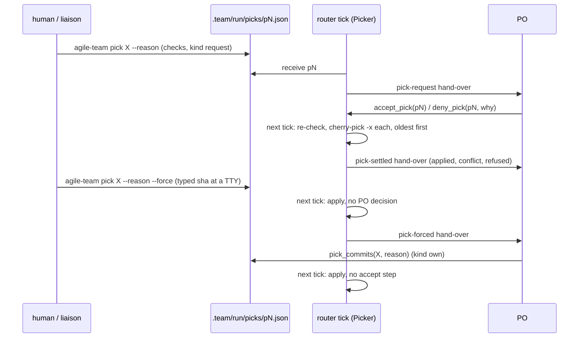

# s141: Pick commits into the running sprint

Story: `.team/stories/s141.md` (the ACs were replaced in t107; this design
replaces the earlier one in full). ADR: ADR-0072
(`.team/adr/0072-main-picks-mid-sprint.md`, amended by this redesign);
ADR-0041 amended. Requirements: REQ-060 to REQ-068. REQ-051 to REQ-055 are
retired.
Developer: `developer-cli`.

No pick code has shipped yet, so there is nothing to keep or remove in the
runner. Every doc that described the earlier design changes in this step
(see "Docs").

## Why

Mid-sprint the team branch takes nothing from main (s108). When the team
needs a change now, whether it's a fix on main or a commit in an open PR, the
human wants it cherry-picked onto the team branch, with no merge and no hash
rewrite. The PO can decline it, and only the human can force it.

## Flow



## Rules

- **P1 Three kinds of request, one queue** (AC1.1, AC1.2, AC2.1, AC4.1).
  Each request is one file `.team/run/picks/p<N>.json`, written through
  `NumberedQueue(folder, "p", ".json")`. The file is never rewritten, and the
  PO's decisions live in `state.picks`.

  | kind | made by | asked by | decided |
  |---|---|---|---|
  | `request` | `agile-team pick SPEC --reason R` | `liaison` | `accepted` (by `accept_pick`) |
  | `forced` | `agile-team pick SPEC --reason R --force` | `human` | `forced` |
  | `own` | the PO's `pick_commits(commits, reason)` | `product-owner` | `own` |

  A forced pick needs a TTY (P5), and the liaison's shell has none, so
  `forced` is always the human's. A plain CLI pick is recorded as the
  liaison's, because the liaison runs the CLI for the human.
- **P2 Spec.** `SPEC` is a single commit (a sha or a ref) or a range `A..B`
  (the commits of `git rev-list --reverse --topo-order A..B`, oldest first).
  The spec is refused as `BAD_SPEC` when it is empty, starts with `-`, holds
  whitespace or `...`, or has an empty side of `..`. **The runner never
  fetches.** Whoever asks makes sure the commits are in the local repo.
- **P3 Checks** (AC1.3, AC2.1). Every check runs and every refusal is
  collected (nothing short-circuits except where noted). Any refusal means
  nothing is queued, and the asker gets every reason:
  1. a blank reason (after `strip`) → `NO_REASON`;
  2. a bad spec → `BAD_SPEC`. The checks below are skipped;
  3. each side that `git rev-parse --verify --quiet <ref>^{commit}` can't
     resolve → `UNKNOWN` (one per side). If any side is unknown, the checks
     below are skipped;
  4. a range with no commits → `EMPTY_RANGE`;
  5. for each commit, oldest first, with `PickCheck.commit_refusals`:
     - parents (`git rev-list --parents -n 1 <sha>`, the words after the
       first): two or more → `MERGE`; none → `ROOT`;
     - otherwise, an ancestor of HEAD (`Git.is_ancestor`) → `ON_BRANCH`;
     - otherwise `git cherry HEAD <sha> <sha>^` prints a line starting with
       `- ` (an equal patch is on the team branch) → `SAME_PATCH`.
- **P4 Asking never changes the repo.** The CLI and `pick_commits` use only
  read-only git. They work in any run state, and a stopped run handles the
  queue at its next `start`. The queued commits are full shas with their
  subjects, oldest first, never the refs the asker typed.
- **P5 Forcing** (AC4.2). With `--force`, after the P3 checks pass:
  `system.is_tty()` false → refuse `FORCE_NO_TTY`. Otherwise print
  `FORCE_SHOW` (each commit's sha12 and subject, and the team branch,
  `Git.branch()` or `HEAD (detached)`), then read `system.ask(FORCE_ASK)`.
  An answer that, after `strip`, is not the first commit's sha12 → refuse
  `FORCE_WRONG`. Every refusal exits 1, and nothing is queued.
- **P6 The safe point** (AC5.1). On each router tick, after the story intake
  and before anything is delivered to the PO, `Picker.apply` runs. It does
  nothing while a boundary is open (`state.boundary is not None`). Otherwise:
  1. **receive** every queued file whose id is not in `state.picks`, in
     number order. A `BadRequest` → `REFUSED`. A `request` → `PENDING`, with a
     `pick-request` line (AC1.4). A `forced` or `own` request → **apply** it
     now;
  2. **apply** every `ACCEPTED` pick, in number order.

  No role runs at the safe point, and the checkout guard has just passed, so
  no step's diff, gate or commit range sees a pick as its own.
- **P7 Applying one pick** (AC5.1, AC5.3):
  1. run the P3 commit checks again on the queued shas (step 5, plus
     `UNKNOWN` for a sha that is gone) → `REFUSED` with every reason joined
     by `"; "`;
  2. a dirty tree (`Git.changed_paths()` not empty) → `FAILED` with `DIRTY`,
     and nothing is run;
  3. `before = git.head()`, then `git.attempt(*PICK_ARGV, *shas)`: one
     `cherry-pick -x` over every commit, oldest first. Git makes one commit
     per source commit;
     - exit 0 → `APPLIED`. `shas` = `git rev-list --reverse <before>..HEAD`.
       Write the pick's patch (`git diff --binary <before> HEAD`) to
       `Picks.patch(id)`, then call `Runtime.record_checkout()`;
     - non-zero with conflicted files (`git diff --name-only
       --diff-filter=U`) → `CONFLICT` with those files;
     - any other non-zero (an empty result included) → `FAILED` with git's
       output, stripped;
     - after every outcome but `APPLIED`, call `_undo(before)`:
       `cherry-pick --abort`, then `cherry-pick --quit` (both through
       `attempt`, failures ignored), then `reset --hard <before>` when HEAD
       moved or the tree is dirty. **The branch always ends where it was.**
       One commit that conflicts aborts the whole pick (AC5.3).
  4. Record it (P9) and add the hand-over line (P8).
- **P8 Hand-overs** (AC1.4, AC4.3, AC5.3). `Picker.apply` returns
  `Pass(kinds, lines, [])`, with one line per received or applied pick and
  `kinds` the distinct triggers in line order. It returns `None` when there
  is no line. The router returns that Pass as the tick's hand-over, after
  `_end_wait()`. Triggers:
  - `Trigger.PICK_REQUEST = "pick-request"`: a request was received (AC1.4);
  - `Trigger.PICK_FORCED = "pick-forced"`: a forced pick was applied (AC4.3);
  - `Trigger.PICK_SETTLED = "pick-settled"`: every other outcome (an
    accepted or own pick applied, refused, conflicted or failed; a forced
    pick that did not apply; a bad request file).

  None of them is in `QUIET_AFTER_PO`. A pending request is handed over once.
  After that it stays visible in `status` and on the dashboard until the PO
  answers it (AC3.3).
- **P9 Records** (AC5.2). `state.picks[id] = PickState(...)` and save. Then
  one `pick` event (`EventKind.PICK`, the old `main-pick` renamed) for every
  apply outcome and every bad request, and one liaison note
  (`relay.post(Note("update", text, []))`; the liaison relays it to the
  human) with `POSTED[outcome]`. Receiving a `request` writes only the state
  and the hand-over line.
- **P10 The PO decides** (AC3.1, AC3.2). The `accept_pick(request)` and
  `deny_pick(request, reason)` tools work only on a `PENDING` pick.
  `accept_pick` sets `ACCEPTED`, and the next tick applies it. `deny_pick`
  needs a non-blank reason. It sets `DENIED`, with `why` set to the reason,
  logs one `pick-denied` event and posts `DENIED_POSTED` to the liaison. The
  branch is not touched.
- **P11 Reverting** (AC6.1, AC6.2). `revert_pick(pick, reason)` runs in the
  PO's turn, like `revert_story`. The refusals, first wins: `drift_halt()`
  (halted report), then an open boundary (`SprintAdd.boundary_refusal()`), an
  unknown id (`NO_PICK`), a `forced` pick (`FORCED_REVERT`), a pick not in
  force this sprint (`NOT_IN_FORCE`), and a blank reason (`REVERT_NO_REASON`).
  Then `Git.revert_all(newest-first shas, REVERT_MESSAGE)` makes **one**
  revert commit. A `GitError` (already aborted by `revert_all`) gives
  `REVERT_FAILED` and changes nothing. On success: `record_checkout()`,
  status `REVERTED`, `revert` = the new sha, `why` = the reason, save, one
  `pick-reverted` event and a `REVERTED_POSTED` note to the liaison.
- **P12 Picks stay applied** (AC6.3). A pick is **in force** when its status
  is `APPLIED` and `sprint == state.sprint`. On every story step's gate,
  `Runtime.gate` first runs `picking.lost_picks(runtime)`, unless the
  hand-off is `blocked` or `failed`. For each pick in force whose patch file
  exists, `git apply --reverse --check <patch>` must exit 0. Every pick that
  fails gives one `PICK_LOST` line. With any such line, the outcome is
  `Outcome(Verdict.BOUNCE, "\n".join(lines), story.step, author=Author.ROLE)`:
  the same step runs again and must put the pick back. Otherwise the step's
  own gate runs as before.
- **P13 The sprint end doesn't change** (AC7.1). There is no code at the
  boundary. Picks and their reverts are ordinary commits in the team's
  chain. The END rebase and the review build treat them like any team
  commit, and git drops a pick whose patch main already has. `state.picks`
  shas are not remapped (`rewrite.REMAPPED` is unchanged). A pick of an
  earlier sprint is no longer in force (P12), so its old shas are never
  used again.
- **P14 Commit message.** A picked commit keeps its author and message, plus
  the `(cherry picked from commit <sha>)` line from `-x`, and carries **no**
  `CO_AUTHOR` trailer. Hooks are off for it (`core.hooksPath=/dev/null`). The
  revert commit is the runner's own, so it gets the trailer through
  `revert_all`. The `git_ops` module docstring states the exception.

## Texts (`agile_team/main_picks.py`; tests may assert them exactly)

Fields: `{short}` = sha[:12]; `{target}` = `runtime.upstream.target`
(`<remote>/<branch>`); `{list}` = the commits joined by `"; "`, each
`{short} "{subject}"`; `{sourced}` = the same, each followed by
` (on {target})` or ` (not on {target} yet)`; `{pairs}` = each
`{short} "{subject}" as {new12}`, joined by `"; "`; `{files}` joined by
`", "`; `{count}` = the number of commits.

```python
REFUSALS: dict[Refused, str] = {
    Refused.NO_REASON: "a reason is required: say why the team needs this now",
    Refused.BAD_SPEC: "'{spec}' is not a commit or an A..B range",
    Refused.UNKNOWN: "'{ref}' is not a commit in the local repo (the runner doesn't fetch; fetch it first)",
    Refused.EMPTY_RANGE: "'{spec}' holds no commits",
    Refused.MERGE: "{short} is a merge commit; pick the commits it brought in",
    Refused.ROOT: "{short} has no parent; it can't be picked",
    Refused.ON_BRANCH: "{short} is already on the team branch",
    Refused.SAME_PATCH: "{short}'s change is already on the team branch",
}
REFUSED_HEAD = "pick refused; nothing queued:"   # then one "- <refusal>" line each
QUEUED = "queued {id}: {count} commit(s) for the PO to accept or deny: {list}"
QUEUED_FORCED = "queued {id} (forced): the runner picks {list} at the next safe point and tells the PO"
FORCE_NO_TTY = "--force needs an interactive terminal; run it yourself. Nothing queued"
FORCE_SHOW = "Force onto {branch}, without the PO's decision:"   # then "  {short} {subject}" per commit
FORCE_ASK = "Type {short} to force it: "
FORCE_WRONG = "'{answer}' is not {short}; nothing queued"
DIRTY = "the working tree has changes ({paths}); nothing was picked"
TOOL_NEXT = "The runner picks it at the next safe point between steps and tells you (pick-settled)."
ACCEPT_NEXT = "The runner picks it at the next safe point between steps and tells you (pick-settled)."
HANDED_REQUEST = 'pick-request {id} from the {asked_by}: {reason}. Commits, oldest first: {sourced}. Answer with accept_pick("{id}") or deny_pick("{id}", reason).'
HANDED_FORCED = "pick-forced {id}: the human forced {count} commit(s) onto the team branch: {pairs}. Reason: {reason}. Plan around it; it can't be reverted."
HANDED: dict[Outcome, str] = {
    Outcome.APPLIED: "pick-settled {id} ({decided}, asked by the {asked_by}): picked {pairs}. Reason: {reason}.",
    Outcome.REFUSED: "pick-settled {id}: not picked: {why}; nothing changed.",
    Outcome.CONFLICT: "pick-settled {id}: {list} conflicts with the team branch in {files}; the whole pick was aborted and nothing changed.",
    Outcome.FAILED: "pick-settled {id}: not picked: {why}; nothing changed.",
}
POSTED: dict[Outcome, str] = {
    Outcome.APPLIED: "Picked {id} ({decided}): {pairs}; the PO was told.",
    Outcome.REFUSED: "Pick {id} not picked: {why}; nothing changed.",
    Outcome.CONFLICT: "Pick {id} ({list}) conflicts with the team branch in {files}; the whole pick was aborted and nothing changed.",
    Outcome.FAILED: "Pick {id} not picked: {why}; nothing changed.",
}
DENIED_POSTED = "The PO denied pick {id} ({list}): {why}"
REVERTED_POSTED = "The PO reverted pick {id} ({list}) in {revert12}: {why}"
REVERT_MESSAGE = "Revert pick {id}: {reason}\n\n{reverts}"   # {reverts}: one "Reverts {short} \"{subject}\"" line per commit
NO_PICK = "no pick request '{id}'"
NOT_PENDING = "{id} is {status}; only a pending request can be accepted or denied"
DENY_NO_REASON = "a reason is required: the liaison and the human read it"
FORCED_REVERT = "{id} was forced by the human; a forced pick can't be reverted"
NOT_IN_FORCE = "{id} is not in force this sprint ({status}); only a pick applied this sprint can be reverted"
REVERT_NO_REASON = "a reason is required: say why the team no longer wants it"
REVERT_FAILED = "git could not revert {id}: {error}; nothing changed"
PICK_LOST = "this step undid pick {id} ({list}): its change no longer reverse-applies on the team branch. Put it back; only the PO can drop a pick, with revert_pick."
```

A bad request file has no commits, so its texts use only `{id}` and `{why}`.
`NOT_IN_FORCE`'s `{status}` is the status value, or `applied in sprint <n>`
for an older sprint's pick.

## Changes per module

### `agile_team/requirements.py` (needed first)

- `REF = re.compile(r"(s\d+)/([A-Za-z][\w.-]*)")`. Today the pattern rejects
  a dotted AC id such as `s141/AC1.1` (`BAD_REF`), so no requirement can
  trace this story's ACs. A test pins that `parse_ref("s141/AC1.1")` gives
  `Ref("s141", "AC1.1")` and that `"s141/AC1."` still parses (`\w.-` allows
  a trailing dot, as `-` already allows a trailing hyphen).

### `agile_team/request_files.py`

- `LIST = FieldKind((list,), "a list")`.

### `agile_team/system.py`

```python
def is_tty() -> bool:
    """True when stdin and stdout are both terminals."""
def ask(prompt: str) -> str:
    """Print ``prompt`` and read one line from stdin; ``""`` at end of input."""
```
The tests' `FakeSystem` gains both (scripted answers; `is_tty` false by
default).

### `agile_team/main_picks.py` (new: the request, the checks, the texts)

```python
SHORT = 12
FULL_SHA = re.compile(r"^[0-9a-f]{40}([0-9a-f]{24})?$")
PICK_ARGV = ("-c", "core.hooksPath=/dev/null", "-c", "core.editor=true", "cherry-pick", "-x")

class Kind(StrEnum): REQUEST = "request"; FORCED = "forced"; OWN = "own"
ASKED_BY: dict[Kind, str]      # P1 table
DECIDED: dict[Kind, str]       # P1 table
class Refused(StrEnum): NO_REASON, BAD_SPEC, UNKNOWN, EMPTY_RANGE, MERGE, ROOT, ON_BRANCH, SAME_PATCH  # values: snake_case names
class Outcome(StrEnum): APPLIED = "applied"; REFUSED = "refused"; CONFLICT = "conflict"; FAILED = "failed"

@dataclass(frozen=True)
class Commit:
    """A source commit: its full sha and subject."""
    sha: str
    subject: str

@dataclass(frozen=True)
class Pick:
    """A queued pick request; ``id`` is empty until queued."""
    id: str
    commits: tuple[Commit, ...]   # oldest first
    reason: str
    kind: Kind
    at: float = 0.0
    def to_json(self) -> str: ...    # {"commits": [{"sha", "subject"}], "reason", "kind", "at"}
    @classmethod
    def from_json(cls, rid: str, text: str) -> Pick | BadRequest: ...

@dataclass(frozen=True)
class Ask:
    """What an asker typed: a spec (P2) and a reason."""
    spec: str
    reason: str

@dataclass(frozen=True)
class Verdict:
    """The resolved commits, oldest first, and every refusal (empty: go ahead)."""
    commits: tuple[Commit, ...] = ()
    refusals: tuple[str, ...] = ()

@dataclass
class PickCheck:
    """P3 over the team checkout; read-only git, never a fetch."""
    git: Git
    def verdict(self, ask: Ask) -> Verdict: ...
    def commit_refusals(self, shas: Sequence[str]) -> list[str]: ...   # P3.5 plus UNKNOWN per gone sha

def on_target(git: Git, target: str) -> Callable[[str], bool]: ...   # sha -> merge-base --is-ancestor sha target exits 0
def refusal_text(refusals: Sequence[str]) -> str: ...                # REFUSED_HEAD + "- " lines
def listed(commits: Sequence[Commit]) -> str: ...                    # {list}
```

`Pick.from_json` validates with `request_files.Fields({"commits": LIST,
"reason": STRING, "kind": STRING, "at": NUMBER})`. It is a `BadRequest`
(through `request_files.bad_request`) when the commits list is empty, a
commit is not an object with string `sha` and `subject`, a `sha` doesn't
match `FULL_SHA`, or a `kind` is not a `Kind` value. `verdict` walks P3 as a
table of one-job private steps (`_reason`, `_spec`, `_resolve`, `_range`,
`_commits`), each under 8 lines. The spec is split with
`spec.split("..")`, and `rev-list` runs only for a range.

### `agile_team/state.py`

```python
class PickStatus(StrEnum):
    PENDING = "pending"; ACCEPTED = "accepted"; DENIED = "denied"; APPLIED = "applied"
    REFUSED = "refused"; CONFLICT = "conflict"; FAILED = "failed"; REVERTED = "reverted"

@dataclass
class PickState:
    """What became of one pick request (s141)."""
    status: PickStatus
    sprint: int = 0                                  # the sprint it was applied in
    shas: list[str] = field(default_factory=list)    # the new commits, oldest first
    why: str = ""                                    # refusal, failure, files, denial or revert reason
    revert: str = ""                                 # the revert commit
    def in_force(self, sprint: int) -> bool: ...     # APPLIED and self.sprint == sprint
```
`RunState.picks: dict[str, PickState] = field(default_factory=dict)`.
`from_json` loads each value with its `PickStatus`, and a missing key loads
`{}`. For `CONFLICT`, `why` holds the files joined by `", "`.

### `agile_team/events.py`

`PICK = "pick"`, `PICK_DENIED = "pick-denied"`, `PICK_REVERTED =
"pick-reverted"`. Data:
- `pick` (role = asked by; `liaison` for a bad request): `{request, kind,
  decided, asked_by, reason, commits, subjects, target, on_target, outcome,
  shas, files, why}`. `commits` are the source shas, oldest first, and
  `on_target` is one bool per commit (AC5.2). `shas` are the new commits
  (`[]` unless applied), and `files` are the conflicted ones (`[]`). A bad
  request has `null` for kind, decided and asked_by, and `[]` for the lists.
- `pick-denied` (role `product-owner`): `{request, commits, asked_by, reason,
  why}`.
- `pick-reverted` (role `product-owner`): `{request, commits, shas, revert,
  why}`.

### `agile_team/picking.py` (new: queue, applier, gate check)

```python
PICKS_DIR, PATCHES_DIR = "picks", "patches"
REQUEST_PREFIX, REQUEST_SUFFIX = "p", ".json"

@dataclass(frozen=True)
class Picks:
    """The pick request files under the run directory."""
    run_dir: Path
    @property
    def folder(self) -> Path: ...                       # run_dir / "picks"
    def queue(self, pick: Pick) -> Pick: ...            # at = system.now(); publish; id set
    def all(self) -> list[Pick | BadRequest]: ...       # number order; unreadable -> bad_request
    def get(self, rid: str) -> Pick | BadRequest | None: ...
    def pending(self, seen: Mapping[str, PickState]) -> list[Pick | BadRequest]: ...
    def patch(self, rid: str) -> Path: ...              # folder / "patches" / f"{rid}.patch"

@dataclass(frozen=True)
class Told:
    """One hand-over line and its trigger."""
    trigger: Trigger
    line: str

@dataclass
class Picker:
    """P6 to P9: receives and applies picks between steps."""
    runtime: Runtime                                    # TYPE_CHECKING import from .dispatch
    def apply(self) -> Pass | None: ...

def lost_picks(runtime: Runtime) -> list[str]: ...      # P12: one PICK_LOST line per lost pick
```
Mirror `sharing.Shares` and `sharing.Sharer`. Private helpers, one job each:
`_receive(request) -> Told`, `_accepted() -> list[Told]`,
`_settle(pick) -> Told`, `_cherry_pick(pick) -> PickState` (P7.3),
`_undo(before)`, `_keep_patch(rid, before)`, `_record(pick, state) -> None`
(state, save, event, note), `_fields(pick, state) -> dict[str, str]` (the
text fields) and `_trigger(pick, state) -> Trigger`.

### `agile_team/pick_admin.py` (new: the PO's decisions)

```python
@dataclass
class PickAdmin:
    """accept_pick, deny_pick and revert_pick (P10, P11); each returns the tool's result dict."""
    runtime: Runtime
    def accept(self, rid: str) -> dict[str, Any]: ...
    def deny(self, args: Mapping[str, Any]) -> dict[str, Any]: ...      # request, reason
    def revert(self, args: Mapping[str, Any]) -> dict[str, Any]: ...    # pick, reason
```
Refusals come back as `refused(text)` (`dispatch.refused`). Successes are
`{"status": "accepted", "pick": id, "next": ACCEPT_NEXT}`, `{"status":
"denied", "pick": id}` and `{"status": "reverted", "pick": id, "commit":
sha12}`.

### `agile_team/po_tools.py`

- `Tools.pick_commits(args)`: `PickCheck(runtime.git).verdict(Ask(commits,
  reason))`, reading both as strings (`""` when missing or not a string). A
  refusal → `text_result(refused(refusal_text(...)))`. Otherwise queue
  `Pick("", verdict.commits, reason.strip(), Kind.OWN)` and return
  `{"status": "queued", "pick": id, "commits": [sha12, ...], "next":
  TOOL_NEXT}`. It emits no event.
- `accept_pick`, `deny_pick` and `revert_pick` delegate to `PickAdmin`.
  `revert_pick` first runs the `drift_halt` and boundary checks, as
  `revert_story` does.
- `SCHEMAS`, after `request_story`:
  ```python
  "pick_commits": (
      "Pick a commit or an A..B range the team needs now onto the team branch (cherry-pick -x, "
      "between steps; no accept step). Never for whole sprints of work. commits: a sha, ref or "
      "A..B already in the local repo (the runner doesn't fetch). reason: why the team needs it "
      "now. Refused, with every reason, for a blank reason, a commit not in the local repo, a "
      "merge commit or a change already on the team branch. You are told the outcome (pick-settled).",
      {"commits": str, "reason": str},
  ),
  "accept_pick": (
      "Accept a pending pick-request; the runner applies it at the next safe point and tells you.",
      {"request": str},
  ),
  "deny_pick": (
      "Deny a pending pick-request, for any reason; the branch doesn't change, and the reason goes "
      "to the liaison and the human.",
      {"request": str, "reason": str},
  ),
  "revert_pick": (
      "Revert an accepted pick or your own, applied this sprint, in one revert commit; reported to "
      "the liaison and the human. A forced pick is the human's and can't be reverted.",
      {"pick": str, "reason": str},
  ),
  ```

### `agile_team/handover.py`

`Trigger.PICK_REQUEST = "pick-request"`, `PICK_FORCED = "pick-forced"`,
`PICK_SETTLED = "pick-settled"`. There are no `HANDOVERS` rows, because the
Pass carries its own lines.

### `agile_team/router.py`

- `Router.picker: Picker = field(init=False)`, set in `__post_init__`.
- `_apply_queues(self) -> Pass | None` runs `desk.apply`, `sharer.apply`,
  `intake.apply`, `picked = picker.apply()`, `clerk.settle` and
  `reverter.settle`, in that order, and returns `picked`. `_tick` calls it
  right after the `checkout_moved` check:
  `if picked := self._apply_queues(): self._end_wait(); return picked`.
  Everything after is unchanged.

### `agile_team/dispatch.py`

- `Runtime.gate`: `outcome = self._picks_kept(plan, handoff) or
  self._evaluate(plan, handoff)`.
- `_picks_kept(self, plan, handoff) -> Outcome | None` (P12).
  `STOPPED_HANDOFFS` is imported from `.gates`.

### `agile_team/cli.py`

```python
def cmd_pick(args: argparse.Namespace) -> int:
    """Queue a pick of a commit or an A..B range (s141); the PO decides unless --force."""
Command("pick", "pick a commit or A..B range onto the team branch (the PO decides; --force: the human)",
        cmd_pick,
        ((("spec",), {"help": "a commit or A..B range in the local repo (fetch it first)"}),
         (("--reason",), {"required": True, "help": "why the team needs it now"}),
         (("--force",), {"action": "store_true", "help": "skip the PO's decision (asks you to type the sha)"})))
```
The row goes right after `share`. `cmd_pick` builds `Git(config.repo)`,
runs `PickCheck.verdict` and raises `CliError(refusal_text(...))` on any
refusal. `--force` runs P5 through a helper `_confirm_force(git, commits) ->
None`, which raises `CliError`. Then it queues with `Kind.FORCED` or
`Kind.REQUEST`, prints `QUEUED_FORCED` or `QUEUED`, and returns 0.

`status_report` gains:
- `"queued_picks"`: ids not yet received
  (`Picks(run_dir).pending(st.picks)`);
- `"pending_picks"`: ids whose status is `pending` (AC3.3);
- `"picks"`: `{id: asdict(state)}`.

### `agile_team/dashboard/snapshot.py`, `index.html`, fixture (AC3.3)

- `SECTIONS["picks"] = _picks`: one dict per request file, in number order:
  `{id, kind, asked_by, reason, at, commits: [{sha, subject}], status, why}`.
  `status` is the `PickStatus` value, or `"queued"` when not yet received. A
  bad file gives `{id, status, why}` with `kind`/`asked_by` `null` and
  `commits: []`.
- `index.html`, Questions tab: a block `#q-picks`, "Picks waiting on the
  PO", above the raised questions. It lists the picks whose status is
  `pending`, or `queued` with kind `request`. For each: an id pill
  (warning), `asked by <asked_by>`, the age, the reason as text, and the
  commits (`<code>sha12</code> subject`). When there are none: `<p
  class="empty">No pick is waiting on the PO.</p>`. Everything is escaped.
- Add one pending pick to `scripts/make_dashboard_fixture.py`'s source and
  rebuild `fixtures/snapshot.json` with it (REQ-006).

### `agile_team/git_ops.py`

The module docstring says that every commit the runner **makes** carries
`CO_AUTHOR`, and that a picked commit (s141) keeps its own author and
message. There is no code change.

### `agile_team/roles/product-owner.md` (AC8.3)

Under `## Backlog and sprints`, after the `add_to_sprint` bullet:

```
- Picks bring a commit or a short range onto the team branch mid-sprint
  (cherry-pick -x, between steps), from main or from an open PR. They are for
  a change the team needs now (a test fix, a charter rule, a fix it is
  blocked on), never for whole sprints of work.
  - A pick-request comes from the human or the liaison. Accept it with
    accept_pick(request) when the team needs the change now and it fits the
    sprint. Deny it with deny_pick(request, reason) when it doesn't (too
    big, not needed yet, or it would clash with work in flight); the reason
    goes to the human. Don't leave a request unanswered.
  - When the team needs such a change itself, ask for it with
    pick_commits(commits, reason). There is no accept step.
  - A pick-forced is the human's: it skipped you. Plan around it. You can't
    revert it.
  - revert_pick(pick, reason) undoes an accepted pick or your own in one
    revert commit. A step that undoes a pick by hand bounces.
```

## Test checklist (AC8.1: one test per AC id, named `test_ac<N>_<M>_...`)

Unit tests use a `FakeSystem` and a stub `Git` with scripted results. E2E
tests use real git (`tests/e2e/`, `set_git_identity`, a bare remote for
main).

- [ ] **AC1.1** `agile-team pick <sha> --reason r` writes `p1.json` with the
      full sha, its subject, `kind: request`, and prints `QUEUED`.
- [ ] **AC1.2** `pick A..B` writes one file with B's commits after A, oldest
      first (e2e, three commits).
- [ ] **AC1.3** Each refusal (e2e: an unknown sha, a merge commit, a commit
      already on HEAD, a commit whose patch was picked before) exits 1 and
      writes nothing. One ask with two faults prints both reasons. A blank
      reason makes no git call. No `fetch` is ever run (the stub records
      argv).
- [ ] **AC1.4** `Picker.apply` receiving a `request` returns a Pass with
      `kinds == [Trigger.PICK_REQUEST]` and the `HANDED_REQUEST` line. The
      line names each commit and subject, the reason, `the liaison`, and `on
      origin/main` for one commit and `not on origin/main yet` for the other
      (e2e).
- [ ] **AC2.1** `Tools.pick_commits` queues `kind: own`. The next
      `Picker.apply` applies it with no accept call, and a refusal queues
      nothing.
- [ ] **AC3.1** `accept_pick` on a pending pick sets `accepted`, and the next
      tick applies it. It is refused for an unknown id and for a non-pending
      pick.
- [ ] **AC3.2** `deny_pick` sets `denied`, logs one `pick-denied` event and
      posts `DENIED_POSTED`. HEAD is unchanged. A blank reason is refused.
- [ ] **AC3.3** A pending pick shows in `status_report` `pending_picks` and
      `picks`, in the snapshot's `picks` section with `status: pending`, and in
      the Questions tab's `#q-picks` (dashboard JS test).
- [ ] **AC4.1** A forced pick is applied on the next tick with no PO tool
      call.
- [ ] **AC4.2** `--force` with `is_tty` false refuses `FORCE_NO_TTY`. With a
      TTY and a wrong answer it refuses `FORCE_WRONG`. Either way nothing is
      queued. The right sha12 queues `kind: forced`, and the printed text
      shows each sha12, its subject and the branch.
- [ ] **AC4.3** Applying a forced pick returns `kinds ==
      [Trigger.PICK_FORCED]` with `HANDED_FORCED` naming the commits, the
      reason and the new sha12s.
- [ ] **AC5.1** E2E: a range of two picked between steps gives two new
      commits on top of the old HEAD, in order. Each message ends with
      `(cherry picked from commit <src>)` and has no `Co-Authored-By`. Every
      older hash is unchanged, and `record_checkout` saw the new HEAD. Picks
      wait while `state.boundary` is set.
- [ ] **AC5.2** The `pick` event carries the commits, the new shas, the
      reason, `asked_by`, `decided` (`accepted`, `forced`, `own`; one test
      each) and `on_target` per commit.
- [ ] **AC5.3** E2E: in a range of two where the second conflicts, the
      outcome is `conflict` with the file. HEAD equals the old head, `git
      status` is clean, and there is no `CHERRY_PICK_HEAD`. The hand-over and
      the liaison note name the file. A dirty tree is `failed` with `DIRTY`,
      and no cherry-pick runs.
- [ ] **AC6.1** `revert_pick` on an applied accepted or own pick makes one
      commit that reverts every picked commit (e2e: the tree equals the one
      before the pick). It logs `pick-reverted`, posts `REVERTED_POSTED`, and
      sets the status to `reverted`.
- [ ] **AC6.2** `revert_pick` on a forced pick returns `FORCED_REVERT`, and
      HEAD is unchanged.
- [ ] **AC6.3** E2E: after a step's commit that reverts a picked line by
      hand, `Runtime.gate` bounces to the same step with `PICK_LOST` naming
      the pick. A step that leaves it alone passes the gate as before. A
      reverted pick and a pick of an earlier sprint are not checked.
- [ ] **AC7.1** E2E: a team branch with T1, a pick of a commit not on main,
      and its revert. The END rebase (`Upstream.rebase_onto`) keeps all three
      in `<target>..HEAD`. No boundary code mentions picks
      (`grep`-style test over `boundary*.py` and `upstream.py`).
- [ ] **AC8.2** The `SKILL.md`, `protocol.md` ("Picks (mid-sprint)" under
      "Sprint boundaries") and README texts name `agile-team pick`,
      `--force`, `accept_pick`, `deny_pick` and `pick_commits`.
- [ ] **AC8.3** `roles/product-owner.md` names `accept_pick`, `deny_pick`,
      `pick_commits` and `revert_pick`, says "never for whole sprints of
      work", and says a forced pick can't be reverted.

## Docs (AC8.2; the architect writes them in this step)

- `agile-team/reference/protocol.md`: the `pick` CLI row, the `status` keys,
  the three hand-overs, the PO tools, and "Picks (mid-sprint)" under
  "Sprint boundaries".
- `agile-team/SKILL.md`: the liaison's `pick` and `--force`, and the PO's
  decision.
- `README.md` agile-team row: one clause.
- `docs/customer/review-stack.md`: picks are pushed with the sprint's
  history.
