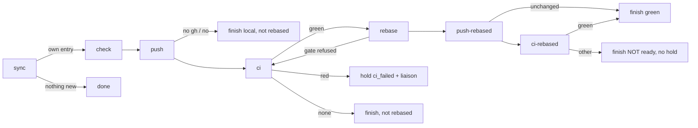

# s151: The sprint end pushes the team branch as it is, opens the PR, then rebases

ADR: [ADR-0075](../../../.team/adr/0075-sprint-end-pushes-as-built-then-rebases.md)
(amends ADR-0015 and ADR-0041). Requirements: REQ-077 to REQ-082.
Developer: `developer-cli`.

## Rules

- **R1 End stages, in order** (`boundary.STAGES`): `sync`, `check`, `push`,
  `ci`, `rebase`, `push-rebased`, `ci-rebased`. The start runs `sync` and
  `check` only (`END_ONLY = frozenset(STAGES[2:])`). `review` and `restack`
  are gone.
- **R2 sync (end).** As today, add the sprint's own entry (`_add_entry`).
  If the sprint has no entry of its own (HEAD is the previous end, or the
  merge-base with main), the boundary finishes at once with `NOTHING_NEW`:
  no check, push, CI or rebase. Otherwise every other entry leaves
  `upstream.stack`. Each one gets a `superseded` event (`SUPERSEDED_NOTE`),
  and its PR number goes into the own entry's `supersedes` when it has a PR
  that is not `closed`. The runner never closes a PR.
- **R3 push (as built, AC1.1/AC1.2).** Order of checks, as today: no `gh` →
  finish local; push permission unasked → hold `push_permission`; `no` →
  finish local. Then set `own.head = own.end = upstream.last_end = HEAD`
  (fix commits from `check` are included). Push HEAD's sha to
  `refs/heads/<prefix><N>` with `--force-with-lease` against `own.pushed`
  (empty: the branch must not exist). On success, `own.pushed =
  own.as_is = HEAD` and `own.commits = Upstream.count(HEAD)`. Then find the
  PR for `<prefix><N>`: create it (base `[upstream] branch`, ready, title
  `SPRINT_TITLE`, body `PR_BODY`), or edit an open one whose base or draft
  state differs, or leave a closed or merged one (`mode = closed`,
  `CLOSED_NOTE`). Post `PUSHED_REPORT` (plus any `BIG_PR_NOTE`) to the
  liaison, emit `pushed`, advance. A refused push holds `push_rejected`, and
  `continue_boundary` reruns the stage. A push of a sha already pushed is a
  no-op.
- **R4 Finish local.** "Finish local" posts `LOCAL_REPORT` + `NOT_REBASED`
  to the liaison and finishes the boundary with that report (`done`,
  `ci: none`). Nothing is rebased.
- **R5 ci (the gate, AC2.1/AC2.2).** Watch the PR of the own entry (when it
  has one and `mode` is `ready`) with the existing `CiWatch`. Store the
  result in `own.ci`. Verdicts:
  - green: emit `pass` with the CI fields and advance to `rebase`. Nothing
    finishes here, and nothing is called ready.
  - red: hold `ci_failed` (as today, so the PO's hand-over and the
    `continue_boundary` refusal are unchanged) **and** post `CI_RED_HELD` to
    the liaison with the check lines.
  - infra, main, pending: unchanged (re-run once, `main_broken`,
    `ci_pending`).
  - none (no PR, a closed PR or no checks): post and finish with
    `CI_NONE_REPORT` + `NOT_REBASED`. Nothing is rebased.
- **R6 The gate in code (AC4.1).** `boundary.rebase_refusal(entry)` returns
  `""` only when `entry` is not `None`, `entry.ci` is not `None`,
  `entry.ci.verdict is CiVerdict.GREEN` and `entry.ci.head == entry.pushed`.
  Otherwise it returns `NO_AS_IS` (no entry) or `REBASE_WAITS`. The
  `rebase` stage calls it first, before any fetch or git call. A refusal
  sets `b.stage = Stage.CI` and holds `error` with outcome `refused` and the
  reason. HEAD, the branch and `state.json`'s hashes are unchanged.
  `continue_boundary` then reruns `ci`.
- **R7 rebase (AC3.1).** Unchanged after the gate: fetch, pin `sync_from`,
  `Upstream.rebase_onto`, `AFTER_REBASE` (conflict holds `sync_conflict`,
  `current` advances, `rebased` remaps every recorded hash with
  `rewrite.remap_state` and advances). `own.as_is`, `own.pushed` and
  `own.ci` are never remapped.
- **R8 push-rebased (AC3.2).** If HEAD equals `own.pushed` (the rebase was
  `current`), emit `pass` with `REBASE_UNCHANGED` and finish ready: the
  as-built green is the green of this head (`green_report`, `ci: green`).
  Otherwise set `own.head = HEAD` and push it to the same `<prefix><N>` with
  the lease on `own.pushed` (the as-built sha). On success, `own.pushed =
  HEAD` and `own.commits = Upstream.count(HEAD)`. Post
  `REBASED_PUSHED_REPORT`, emit `pushed` (`sha`, `as_is`), advance. The PR
  is not edited, since pushing the branch updates it. A refusal holds
  `push_rejected`.
- **R9 ci-rebased (AC3.3).** Watch the PR again. The result replaces
  `own.ci` (the Board's pill shows the PR's current head). Verdicts:
  - green: finish with `green_report` (`ci: green`). This is the only
    "ready to merge".
  - infra with a re-run due: re-run (as today, keyed by the new head), and
    the stage stays.
  - any other verdict (red, main, pending, none, infra after its re-run):
    post `REBASED_NOT_GREEN` to the liaison and finish with it as the
    report (`ci: <verdict>` and the CI fields). There is **never a hold**
    at this stage.
- **R10 record_ci_bug.** `settle_bug` is unchanged, except that its text
  ends with `NOT_REBASED`. It is reachable only from holds at `ci` (the
  as-built read).
- **R11 Legacy state.** On load (`state.py`): a boundary whose `stage` is
  `review` or `restack` loads at `push` (`LEGACY_STAGES`); a `failure` whose
  `case` is `review_check` or `review_conflict` is dropped; the key
  `restack` is dropped; and stack entries drop `checked` and `check`
  (`RETIRED_ENTRY_KEYS`). Old events and stage-log rows keep their old
  names (`review`, `restack`, `built`, `restacked`, `rebuild`, `merged`) and
  still render.
- **R12 Safety unchanged.** Only `<prefix>*` branches are pushed, never the
  team branch or `[upstream] branch`. `Upstream._guard` still checks the
  branch name; the refspec source is now a sha.

### Stage flow



## Changes by module

### `agile_team/boundary.py`

- `Stage`: drop `REVIEW`, `RESTACK`; add `PUSH_REBASED = "push-rebased"`,
  `CI_REBASED = "ci-rebased"`.
  `STAGES = (SYNC, CHECK, PUSH, CI, REBASE, PUSH_REBASED, CI_REBASED)`.
- `StepKind`: drop `REVIEW_FIX`. `FixCase`: keep only `TEAM_CHECK`.
  `FIX_KINDS` and `FIX_LINES`: only the `TEAM_CHECK` row.
- `BoundaryOutcome`: drop `BUILT`, `RESTACKED`, `REBUILD`, `MERGED`; add
  `SUPERSEDED = "superseded"`, `REFUSED = "refused"`.
- `CheckState`: removed. `Boundary`: drop `restack`.
- `StackEntry`: drop `checked`, `check`; add `as_is: str = ""` (the sha of
  the as-built push) and `supersedes: list[int]` (default empty).
- `FixContext(team: str, target: str, sha: str)`; `worktree` and `sprints`
  go.
- `LEGACY_STAGES: dict[str, Stage] = {"review": Stage.PUSH, "restack":
  Stage.PUSH}`, `RETIRED_CASES = frozenset({"review_check",
  "review_conflict"})`, `RETIRED_ENTRY_KEYS = ("checked", "check")`,
  `RETIRED_BOUNDARY_KEYS = ("restack",)`.
- New pure helpers:
  - `own_entry(stack: list[StackEntry], sprint: int) -> StackEntry | None`:
    the entry of `sprint`, else `None`.
  - `rebase_refusal(entry: StackEntry | None) -> str`: R6.
- Texts. Tests may assert these exactly:

```python
NOTHING_NEW = "sprint {sprint} added no commit since the last sprint end; nothing to push or rebase"
SUPERSEDED_NOTE = "sprint {old}'s PR #{pr} is superseded: sprint {sprint}'s branch holds its commits"
PUSHED_REPORT = (
    "Sprint {sprint}'s branch {branch} holds the team branch as built ({sha}): PR #{pr} {url}. "
    "The runner waits for its CI; the team branch is rebased onto {target} only once it is green."
)
CI_RED_HELD = (
    "Sprint {sprint}'s CI failed on the team branch as built ({prs}); the boundary holds and "
    "nothing is rebased:\n{checks}"
)
NO_AS_IS = "no as-built push is recorded for this sprint"
REBASE_WAITS = (
    "the rebase waits for green CI on the team branch as built: {branch} at {sha} has {verdict}"
)
REBASE_UNCHANGED = "the rebase changed nothing; {branch} stays at {sha}"
REBASED_PUSHED_REPORT = (
    "Sprint {sprint}'s PR #{pr} now holds the team branch rebased onto {target} ({sha}); the "
    "as-built push ({as_is}) stays in the PR's history. The runner waits for CI again."
)
REBASED_NOT_GREEN = (
    "Sprint {sprint}'s CI was green on the team branch as built ({as_is}), and is {verdict} on it "
    "rebased onto {target} ({prs}). The PR is NOT ready; do not merge it.\n{checks}"
)
NOT_REBASED = " The team branch is not rebased onto {target}: the rebase waits for green CI."
LOCAL_REPORT = (
    "Sprint {sprint}'s branch {branch} is checked but not pushed ({why}). No CI result exists."
)
SUPERSEDES_LINE = (
    "Holds the commits of earlier sprint PRs {prs}, not merged yet; merging this one merges them "
    "too, so close them once it is merged.\n\n"
)
PR_BODY = (
    "Sprint {sprint} of the agile team.\n\n{stories}\n\n{reverted}{supersedes}"
    "The team branch {team} as built and tested, then, once its CI passed, rebased onto "
    '{target}; both pushes are in this PR\'s history. Merge with "Rebase and merge".'
)
```

  In `REBASE_WAITS`, `{verdict}` is `entry.ci.verdict`, or `no CI read`
  when `entry.ci` is `None`. `{sha}` is `entry.pushed`, or `nothing pushed`
  when it is empty. `{prs}` in `SUPERSEDES_LINE` is `#12, #13`.
  `BIG_PR_NOTE` changes "When it is the bottom of the stack, merge it by
  fast-forward" to "Merge it by fast-forward"; the rest stays. Remove
  `STACKED_LINE`, `MERGED_NOTE`, `NOTHING_REPORT`, the old `PUSHED_REPORT`
  and the `REVIEW_*` fix lines.

### `agile_team/boundary_runner.py`

Remove `rebuilder`, `restacker`, the `stack.py`/`restack.py` imports,
`_review`, `_include_fixes`, `_first_build`, `_build_from`, `_build_one`,
`_conflict_failure`, `_check_ends`, `_check_entry`, `_push_own`,
`_push_stack`, `_push_entry`, `_restack`, `_settle_plan`, `_rebuild`,
`_apply`, `_move`, `_deliver`, `_pushed`, `_drop`, `_local_event`,
`NOTHING_TO_PUSH`, `NOTHING_TO_RESTACK`, and the `REVIEW_CONFLICT` branch
of `after_fix`. `target` returns `self.remote.target`. Keep each method
under 8 lines and at most 2 parameters (charter).

New or changed methods (private, one job each):

| Method | Does |
|---|---|
| `_own(b) -> StackEntry \| None` | `own_entry(self.stack, b.sprint)` |
| `_end_sync(b)` | R2: `_add_entry`; no own entry → `_finish(b, NOTHING_NEW…, note=…)`; else `_supersede`, emit `pass`, advance |
| `_supersede(b, own)` | R2: drop each other entry, extend `own.supersedes`, emit `superseded` |
| `_push(b)` | R3 checks in order, then `_push_as_is` |
| `_push_as_is(b, own)` | R3: set heads, `_push_branch`, `_reject` or `_open_pr` + `PUSHED_REPORT`, advance |
| `_push_branch(entry)` | as today, but `Lease(entry.branch, entry.pushed, entry.head)` |
| `_open_pr(entry)` | today's `_pr` with no `below`; `_spec(entry)` always base `[upstream] branch`, `PrMode.READY` |
| `_finish_local(b, why)` | R4 |
| `_ci(b)` | R5 through `CI_OUTCOMES` |
| `_ci_green(b, results)` | emit `pass` with `ci: green` and CI fields, advance |
| `_ci_red(b, results)` | hold `ci_failed` as today, then `_post(CI_RED_HELD…)` |
| `_ci_none(b, results)` | as today, with `NOT_REBASED` appended to the text |
| `_rebase(b)` | R6 then R7: `refusal = rebase_refusal(self._own(b))`; refused → `_refuse_rebase`; else today's body |
| `_refuse_rebase(b, reason)` | `b.stage = Stage.CI`; `_hold(b, ERROR, Out.REFUSED, reason=reason)` |
| `_push_rebased(b)` | R8 |
| `_ci_rebased(b)` | R9 through `REBASED_OUTCOMES` |
| `_ready(b, results)` | finish with `green_report` (today's `_ci_green` body) |
| `_rebased_infra(b, results)` | re-run when `rerun_due`, else `_rebased_not_green` |
| `_rebased_not_green(b, results)` | post and finish with `REBASED_NOT_GREEN` and `ci: <verdict>` |

Tables:

```python
STAGE_RUNNERS = {SYNC: _sync, CHECK: _check, PUSH: _push, CI: _ci, REBASE: _rebase,
                 PUSH_REBASED: _push_rebased, CI_REBASED: _ci_rebased}
REBASED_OUTCOMES = {GREEN: _ready, INFRA: _rebased_infra, RED: _rebased_not_green,
                    MAIN: _rebased_not_green, PENDING: _rebased_not_green,
                    NONE: _rebased_not_green}
```

`_body(entry)` fills `supersedes` with `SUPERSEDES_LINE` when
`entry.supersedes` is not empty, else `""`. `_context(b)` builds the
three-field `FixContext`. Module docstring: "sync, check, push as built, ci,
rebase, push rebased, ci rebased". Drop "Nothing here rewrites the team
branch"; the rebase stage does, through `Upstream`.

### `agile_team/upstream.py`

- `Lease(branch: str, expect: str, sha: str)`, documented as "push `sha`
  to `branch`, expecting the remote at `expect` (empty: absent)".
- `Upstream.push(lease)`: refspec `f"{lease.sha}:refs/heads/{lease.branch}"`.
  The rest is unchanged, including `_guard`.
- New `Upstream.count(self, head: str) -> int`: `git rev-list --count
  <target>..<head>`.

### `agile_team/state.py`

`_boundary` maps `LEGACY_STAGES`, drops `RETIRED_BOUNDARY_KEYS`, and sets
`failure` to `None` when its `case` is in `RETIRED_CASES`.
`_upstream_state` drops `RETIRED_ENTRY_KEYS` from each entry. Use small
helpers, for example `_without(data, keys)`.

### `agile_team/stages.py`

- `Name`: drop `BOUNDARY_REVIEW`, `BOUNDARY_RESTACK`; add
  `BOUNDARY_PUSH_REBASED = "boundary.push-rebased"`,
  `BOUNDARY_CI_REBASED = "boundary.ci-rebased"`.
- Rows (label, description):
  - `BOUNDARY_SYNC`: "boundary sync", "Fetch the target and record the team
    branch; at a sprint end, record the sprint's own branch"
  - `BOUNDARY_PUSH`: "push as built + PR", "Push the team branch as it is
    to the sprint's branch and open or reuse its pull request onto the
    target"
  - `BOUNDARY_CI_WAIT`: "CI wait", "Wait for the as-built push's CI and
    read failing logs; green is the gate for the rebase"
  - `BOUNDARY_REBASE`: "rebase onto target", "Rebase the team branch onto
    the target, only after green CI (sprint end only)"
  - `BOUNDARY_PUSH_REBASED`: "push rebased", "Force-push the rebased team
    branch to the same sprint branch, so its PR keeps both pushes"
  - `BOUNDARY_CI_REBASED`: "CI wait (rebased)", "Wait for the rebased
    branch's CI and record it; a red result is reported, never held"
- `BOUNDARY`: keys `sync`, `check`, `push`, `ci`, `rebase`, `push-rebased`,
  `ci-rebased`. The table still has 21 rows.

### `agile_team/dispatch.py`

Drop the `stack` import, `_review_fix_scope`, its `FIX_SETUPS` row and
`REVIEW_FIX` from `FIX_KINDS_SET`.

### Deleted

`agile_team/stack.py`, `agile_team/restack.py`, `tests/test_stack.py` and
`tests/test_restack.py`. Tests of removed behaviour are deleted with it;
that does not weaken the suite. The review worktree `.team/run/review/` is
no longer made. An existing one is left alone.

### Dashboard (`dashboard/snapshot.py`, `dashboard/index.html`)

- `_stack_entry`: drop `check`; add `as_is`. Rebuild the fixture with its
  one command (REQ-006).
- `stackRow`: drop the check pill (and `CHECK_TONE` if it is then unused).
  The card's heading is `Sprint PR`. The boundary tone map gains
  `superseded: "good"` and `refused: "warning"`, and keeps the old keys for
  history.

### Built-in role files (`agile_team/roles/`)

- `devops.md` (the fix cases): drop "or on a review branch" and the "review
  branch rebuild conflicts" case. A boundary fix is always on the team
  branch.
- `product-owner.md` lines near "push review branches" and "(sync, checks,
  review branches)": say "push the sprint's branch and open its PR" and
  "(sync, checks, push, CI, rebase)". Under `ci_failed`, add that the
  liaison already got the failing checks.

### Docs (the architect writes them in this step)

- `reference/protocol.md` "Sprint boundaries", `SKILL.md`, the README row,
  `docs/customer/review-stack.md` and `docs/customer/runner-stages.md`
  are updated by the architect.
- `.team/roles/_leadership.md` is outside the architect's file scope. The
  proposed text is below, and the human approves the wording (see the
  handoff):

  > - **Git: main stays linear.** Code reaches main only by rebase-merge.
  >   Within a sprint, never rewrite the team branch's hashes. At the
  >   sprint end the runner pushes the team branch as it is to the sprint's
  >   PR, waits for green CI, then rebases it onto main (never a merge)
  >   and pushes it again to the same PR.

## Test checklist

AC5.1 asks for one test per AC id against a scratch repo and a fake
upstream. Put them in `tests/e2e/test_s151_as_built_end_e2e.py`: a real
scratch git repo whose `origin` is a bare clone (as in
`test_s59_rebase_e2e.World`), `FakePrs` (`tests/s29_helpers.py`) as the PR
service and CI, and green fake full checks (`PrefixRunner`). Name each
`test_ac<major>_<minor>_…`. The unit tests in `tests/test_boundary*.py`,
`test_upstream.py`, `test_state.py` and `test_stages.py` change with the
code.

- [ ] **AC1.1** After `push`, `git rev-parse origin/<prefix><N>` equals the
      team branch's HEAD from before the boundary. No commit on it differs
      from the team branch (no cherry-pick copies), and it is not based on
      the latest main when main moved. A second push of a moved head
      without the lease's expected sha is refused (`push_rejected`).
- [ ] **AC1.2** `FakePrs` received one `create` with branch `<prefix><N>`
      and base `[upstream] branch`, mode ready. With an open PR for that
      branch already there, nothing is created; it is reused (and edited
      only when its base or draft state differs).
- [ ] **AC2.1** With CI pending, then green: before green the team branch
      HEAD is unchanged and the stage is `ci`; after green, the next stages
      rebase it.
- [ ] **AC2.2** Red as-built CI: the boundary holds `ci_failed`, HEAD is
      unchanged, and the relay holds a note with `CI_RED_HELD` naming the
      failing check. `continue_boundary` stays refused (as in s111).
- [ ] **AC3.1** Main moved: after green, HEAD is rebased onto
      `origin/main`, and a story's recorded `commit` is remapped to its
      rebased copy.
- [ ] **AC3.2** `origin/<prefix><N>` now equals the rebased HEAD. The push
      used the lease on the as-built sha (a remote moved by someone else
      holds `push_rejected`). `entry.as_is` still names the as-built sha.
      A `current` rebase pushes nothing and finishes green.
- [ ] **AC3.3** Rebased CI red: the boundary finishes (`done`, `ci: red`,
      `state.boundary is None`, no hold), `entry.ci` is the red read, and
      the relay holds `REBASED_NOT_GREEN`. Rebased CI green finishes with
      the `green_report` text.
- [ ] **AC4.1** A boundary set at stage `rebase` whose entry's CI is
      `None`, red, or green on another sha: one step leaves HEAD and
      `state.json` hashes unchanged, emits `refused` with `REBASE_WAITS`
      (or `NO_AS_IS` when there is no entry), sets the stage to `ci`, and
      runs no git rebase or fetch. Also check `boundary.STAGES` order:
      push < ci < rebase < push-rebased < ci-rebased.
- [ ] **AC4.2** `Stage` has no `review` or `restack`, `agile_team.stack`
      and `agile_team.restack` cannot be imported, and a full end run
      makes no `cherry-pick` call and no `.team/run/review/` worktree.
- [ ] Unit: R2 nothing new finishes with `NOTHING_NEW`. Older entries are
      dropped with `superseded`, and their PR numbers reach the PR body.
- [ ] Unit: R4 no `gh` and `no` permission finish local with
      `NOT_REBASED`, without rebasing. R5 `none` does the same.
- [ ] Unit: R10 `record_ci_bug` text ends with `NOT_REBASED`.
- [ ] Unit: R11 a `state.json` with a boundary at `review` (and one at
      `restack`) loads at `push`. A `review_conflict` failure is dropped,
      and stack entries with `check`/`checked` load.
- [ ] Unit: `Upstream.push` uses the `sha:refs/heads/<branch>` refspec and
      still refuses a non-prefix branch. `Upstream.count` counts
      `target..head`.

## Docs checklist (AC5.2, review)

`README.md` agile-team row, `SKILL.md` "Sprint boundaries",
`reference/protocol.md` "Sprint boundaries", `docs/customer/review-stack.md`
and `runner-stages.md` are updated in this step. `_leadership.md` waits for
the human's approval of the wording above.
