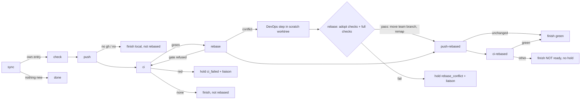

# s151: The sprint end pushes the team branch as it is, opens the PR, then rebases

ADR: [ADR-0075](../../../.team/adr/0075-sprint-end-pushes-as-built-then-rebases.md)
(amends ADR-0015 and ADR-0041) and
[ADR-0076](../../../.team/adr/0076-devops-resolves-sprint-end-rebase-conflicts.md)
(the conflict path, AC6). Requirements: REQ-077 to REQ-087.
Developer: `developer-cli`.

Round note (q3 amendment): AC6.1 to AC6.5 are new. Everything up to R12
was implemented in the previous round and stays. The new work is R13 to R19
and the "AC6" parts of the module sections below. Also remove the duplicate
`_pin_sync_from`, `_rebase_conflict`, `_rebase_current`, `_unpin` and
`_settle_rebase` block in `boundary_runner.py` (it is defined twice, once
under "sync" and once under "rebase"; keep the one under "rebase").

## Rules

- **R1 End stages, in order** (`boundary.STAGES`): `sync`, `check`, `push`,
  `ci`, `rebase`, `push-rebased`, `ci-rebased`. The start runs `sync` and
  `check` only (`END_ONLY = frozenset(STAGES[2:])`). `review` and `restack`
  are gone.
- **R2 sync (end).** As today, add the sprint's own entry (`_add_entry`).
  If the sprint has no entry of its own (HEAD is the previous end, or the
  merge-base with main), the boundary finishes at once with `NOTHING_NEW`:
  no check, push, CI or rebase. Otherwise every other entry leaves
  `upstream.stack`. Each one gets a `superseded` event (`SUPERSEDED_NOTE`),
  and its PR number goes into the own entry's `supersedes` when it has a PR
  that is not `closed`. The runner never closes a PR.
- **R3 push (as built, AC1.1/AC1.2).** Order of checks, as today: no `gh` →
  finish local; push permission unasked → hold `push_permission`; `no` →
  finish local. Then set `own.head = own.end = upstream.last_end = HEAD`
  (fix commits from `check` are included). Push HEAD's sha to
  `refs/heads/<prefix><N>` with `--force-with-lease` against `own.pushed`
  (empty: the branch must not exist). On success, `own.pushed =
  own.as_is = HEAD` and `own.commits = Upstream.count(HEAD)`. Then find the
  PR for `<prefix><N>`: create it (base `[upstream] branch`, ready, title
  `SPRINT_TITLE`, body `PR_BODY`), or edit an open one whose base or draft
  state differs, or leave a closed or merged one (`mode = closed`,
  `CLOSED_NOTE`). Post `PUSHED_REPORT` (plus any `BIG_PR_NOTE`) to the
  liaison, emit `pushed`, advance. A refused push holds `push_rejected`, and
  `continue_boundary` reruns the stage. A push of a sha already pushed is a
  no-op.
- **R4 Finish local.** "Finish local" posts `LOCAL_REPORT` + `NOT_REBASED`
  to the liaison and finishes the boundary with that report (`done`,
  `ci: none`). Nothing is rebased.
- **R5 ci (the gate, AC2.1/AC2.2).** Watch the PR of the own entry (when it
  has one and `mode` is `ready`) with the existing `CiWatch`. Store the
  result in `own.ci`. Verdicts:
  - green: emit `pass` with the CI fields and advance to `rebase`. Nothing
    finishes here, and nothing is called ready.
  - red: hold `ci_failed` (as today, so the PO's hand-over and the
    `continue_boundary` refusal are unchanged) **and** post `CI_RED_HELD` to
    the liaison with the check lines.
  - infra, main, pending: unchanged (re-run once, `main_broken`,
    `ci_pending`).
  - none (no PR, a closed PR or no checks): post and finish with
    `CI_NONE_REPORT` + `NOT_REBASED`. Nothing is rebased.
- **R6 The gate in code (AC4.1).** `boundary.rebase_refusal(entry)` returns
  `""` only when `entry` is not `None`, `entry.ci` is not `None`,
  `entry.ci.verdict is CiVerdict.GREEN` and `entry.ci.head == entry.pushed`.
  Otherwise it returns `NO_AS_IS` (no entry) or `REBASE_WAITS`. The
  `rebase` stage calls it first, before any fetch or git call. A refusal
  sets `b.stage = Stage.CI` and holds `error` with outcome `refused` and the
  reason. HEAD, the branch and `state.json`'s hashes are unchanged.
  `continue_boundary` then reruns `ci`.
- **R7 rebase (AC3.1).** Unchanged after the gate: fetch, pin `sync_from`,
  `Upstream.rebase_onto`, `AFTER_REBASE` (`current` advances, `rebased`
  remaps every recorded hash with `rewrite.remap_state` and advances; a
  conflict goes to DevOps, R13). `own.as_is`, `own.pushed` and `own.ci`
  are never remapped. When `b.rebase_fix` is set (DevOps is back, R15),
  the stage runs `_adopt` (R16) instead, after the gate and with no fetch.
- **R8 push-rebased (AC3.2).** If HEAD equals `own.pushed` (the rebase was
  `current`), emit `pass` with `REBASE_UNCHANGED` and finish ready: the
  as-built green is the green of this head (`green_report`, `ci: green`).
  Otherwise set `own.head = HEAD` and push it to the same `<prefix><N>` with
  the lease on `own.pushed` (the as-built sha). On success, `own.pushed =
  HEAD` and `own.commits = Upstream.count(HEAD)`. Post
  `REBASED_PUSHED_REPORT`, emit `pushed` (`sha`, `as_is`), advance. The PR
  is not edited, since pushing the branch updates it. A refusal holds
  `push_rejected`.
- **R9 ci-rebased (AC3.3).** Watch the PR again. The result replaces
  `own.ci` (the Board's pill shows the PR's current head). Verdicts:
  - green: finish with `green_report` (`ci: green`). This is the only
    "ready to merge".
  - infra with a re-run due: re-run (as today, keyed by the new head), and
    the stage stays.
  - any other verdict (red, main, pending, none, infra after its re-run):
    post `REBASED_NOT_GREEN` to the liaison and finish with it as the
    report (`ci: <verdict>` and the CI fields). There is **never a hold**
    at this stage.
- **R10 record_ci_bug.** `settle_bug` is unchanged, except that its text
  ends with `NOT_REBASED`. It is reachable only from holds at `ci` (the
  as-built read).
- **R11 Legacy state.** On load (`state.py`): a boundary whose `stage` is
  `review` or `restack` loads at `push` (`LEGACY_STAGES`); a `failure` whose
  `case` is `review_check` or `review_conflict` is dropped; the key
  `restack` is dropped; and stack entries drop `checked` and `check`
  (`RETIRED_ENTRY_KEYS`). Old events and stage-log rows keep their old
  names (`review`, `restack`, `built`, `restacked`, `rebuild`, `merged`) and
  still render.
- **R12 Safety unchanged.** Only `<prefix>*` branches are pushed, never the
  team branch or `[upstream] branch`. `Upstream._guard` still checks the
  branch name; the refspec source is now a sha.

### The conflict path (AC6, ADR-0076)

- **R13 Conflict (AC6.1).** `Upstream.rebase_onto` already aborts a
  conflicting rebase and leaves the team branch as it was. `_rebase_conflict`
  no longer holds. It:
  1. prepares the scratch worktree (R14) from `b.sync_from`;
  2. sets `b.failure = Failure(Stage.REBASE, FixCase.REBASE_CONFLICT,
     result.output, branch=<scratch branch>, files=list(result.files),
     commit=result.commit, subject=result.subject)`;
  3. emits `conflict` (`files`, `commit` cut to 12, `subject`, `branch`)
     with **no hold**.
  `due()` then returns `Due(StepKind.REBASE_FIX, FIX_ROLE, fix_brief(…))`.
  The brief (`FIX_LINES[REBASE_CONFLICT]`) names the stopping commit, its
  subject, the conflicting files, the worktree and the scratch branch, and
  `OUTPUT_BLOCK` quotes git's output. `b.sync_from` stays pinned until R16
  adopts or the PO restarts the rebase. Nothing asks the human to rebase.
- **R14 Scratch worktree (AC6.2).** `ScratchRebase.prepare(head)`:
  - path `<run_dir>/rebase` (`REBASE_DIR`), branch
    `agile-team/rebase-sprint-<N>` (`REBASE_BRANCH`). The branch never
    starts with the push prefix's default and is never pushed: only
    `own.branch` is pushed (R12).
  - removes a leftover worktree first (`remove()`), then `git worktree add
    -B <branch> <path> <head>`, then starts the same rebase inside it with
    `SCRATCH_REBASE_ARGV <target>` (the flags of `REBASE_ARGV`, but
    `--empty=keep`). It stops at the conflict. Its exit code is ignored.
  - The team checkout, its branch and its index are never touched.
    `.team/run/**` is ignored by git and by the step audit.
- **R15 The DevOps step (AC6.2).** `StepKind.REBASE_FIX` runs the role
  `devops` with:
  - write scope **only** `<run_dir rel>/rebase/**` (it replaces the role's
    write globs, so nothing in the team checkout can change or be
    committed);
  - git confined to the worktree: `plan.scope.git_workspace` is the
    resolved worktree and the env is `git_check.git_env(run_dir)` plus
    `GIT_EDITOR=true` (so `git rebase --continue` never opens an editor).
    Inside the worktree any git subcommand is allowed (G6 `WORKSPACE`);
    in the team repo only read-only git.
  - DevOps resolves only the conflicting files, keeps both sides' intent,
    `git add`s them and runs `git rebase --continue` until the rebase is
    done; it keeps a commit that became empty with `git commit
    --allow-empty -C REBASE_HEAD`; it never merges, squashes, reorders,
    rewords, skips or drops a commit; it runs named tests. The full
    checks run in the worktree by the runner (R16), since a role may not
    run the full suite.
  - `after_fix(report)`: when the failure's case is `REBASE_CONFLICT`, set
    `b.rebase_fix = RebaseFix(b.failure, report["status"],
    report["summary"])` before clearing `b.failure`, and set `b.hold =
    None` (no `fix_handover`: the conflict hold of R17 carries DevOps's
    notes to the PO). Rounds count as today.
- **R16 Adopt (AC6.3).** At the `rebase` stage with `b.rebase_fix` set,
  after the gate (R6) and with **no fetch**, `_adopt(b)` takes the first
  reason from, in order:
  1. `rebase_fix.status != "done"` → `FIX_NOT_DONE`;
  2. `ScratchRebase.refusal(b.sync_from)` (table `SCRATCH_CHECKS`, first
     non-empty wins): the rebase is finished (`checkout.operation(Git(path))
     is None`), the worktree is on its branch, the worktree is clean, the
     target is an ancestor of the branch, `target..branch` has no merge
     commit, the branch's commit stamps (author, email, date, message, in
     order) equal those of `target..sync_from` minus the commits `git
     cherry` marks as already in the target, and no path only one side
     touched changed (`Upstream.lost_paths`, as for a clean rebase);
  3. the full checks, run by the runner in the worktree
     (`self._run_checks(scratch.path)`), fail → `CHECKS_FAILED` with the
     report's reason.
  With no reason: `result = self.remote.adopt(b.sync_from, scratch.head())`,
  then `scratch.drop()` (worktree and branch removed), `b.rebase_fix =
  None`, and today's `_settle_rebase(b, result)`: hashes remapped with
  `rewrite.remap_state`, checkout recorded, `rebased` event, `sync_from`
  cleared, advance to `push-rebased` (AC3.2 onward, unchanged).
  `Upstream.adopt` raises `UpstreamError` (an `error` hold) when HEAD is no
  longer `old`, so a moved team branch is never reset.
- **R17 Hold (AC6.4).** Any reason from R16 holds `rebase_conflict`
  (`BoundaryHold.REBASE_CONFLICT`) with outcome `conflict` and the fields
  `reason`, `branch` (scratch), `notes` (DevOps's summary, or `none`),
  `commit` (12), `subject`, `files`. The liaison gets `REBASE_FIX_HELD`.
  The PO gets the handover `Trigger.REBASE_CONFLICT`. The worktree and the
  scratch branch are kept so the human can look. The team branch is
  unchanged. `continue_boundary(note)` at this hold also sets
  `b.rebase_fix = None`, so the stage reruns the rebase from scratch: a
  new conflict prepares a fresh worktree and runs DevOps again with the
  PO's note in the brief. If the human rebased the team branch by hand
  meanwhile, the rebase is `current` or `rebased` as today.
- **R18 Legacy hold.** `BoundaryHold.SYNC_CONFLICT` stays so an old
  `state.json` loads. Nothing emits it any more. Its handover text drops
  "ask the human to rebase by hand" and says `continue_boundary` reruns the
  rebase, and that a conflict now goes to DevOps.
- **R19 Role files (AC6.5).** The built-in `roles/devops.md` gains the
  case below (Built-in role files). `.team/roles/devops.md` is outside every
  role's scope; the liaison adds the same paragraph there.

### Stage flow



## Changes by module

### `agile_team/boundary.py`

- `Stage`: drop `REVIEW`, `RESTACK`; add `PUSH_REBASED = "push-rebased"`,
  `CI_REBASED = "ci-rebased"`.
  `STAGES = (SYNC, CHECK, PUSH, CI, REBASE, PUSH_REBASED, CI_REBASED)`.
- `StepKind`: drop `REVIEW_FIX`; add `REBASE_FIX = "rebase-fix"` (AC6).
  `FixCase`: `TEAM_CHECK` and `REBASE_CONFLICT = "rebase_conflict"` (AC6).
  `FIX_KINDS`: `TEAM_CHECK → TEAM_FIX`, `REBASE_CONFLICT → REBASE_FIX`.
  `FIX_LINES`: the `TEAM_CHECK` row and the `REBASE_CONFLICT` row below.
- `BoundaryHold`: add `REBASE_CONFLICT = "rebase_conflict"` (AC6.4); keep
  `SYNC_CONFLICT` for old state (R18). `STALL_HINTS` gains
  `REBASE_CONFLICT: "relay the conflict; continue_boundary(note) runs the
  rebase and DevOps again with your note"`.
- New dataclass (AC6):

```python
@dataclass
class RebaseFix:
    """DevOps's answer to a sprint-end rebase conflict, waiting for the rebase stage."""

    conflict: Failure  # the REBASE_CONFLICT failure the step was given
    status: str  # the DevOps handoff's status
    notes: str  # the DevOps handoff's summary
```

  `Boundary` gains `rebase_fix: RebaseFix | None = None`. `state.py`'s
  `_boundary` loads it like `failure` (`_nested`, with its `conflict`
  loaded as a `Failure`).
- `BoundaryOutcome`: drop `BUILT`, `RESTACKED`, `REBUILD`, `MERGED`; add
  `SUPERSEDED = "superseded"`, `REFUSED = "refused"`.
- `CheckState`: removed. `Boundary`: drop `restack`.
- `StackEntry`: drop `checked`, `check`; add `as_is: str = ""` (the sha of
  the as-built push) and `supersedes: list[int]` (default empty).
- `FixContext(team: str, target: str, sha: str, worktree: str)`; `sprints`
  goes. `worktree` is the scratch worktree's path (AC6), filled for every
  fix (the `TEAM_CHECK` lines don't use it).
- `LEGACY_STAGES: dict[str, Stage] = {"review": Stage.PUSH, "restack":
  Stage.PUSH}`, `RETIRED_CASES = frozenset({"review_check",
  "review_conflict"})`, `RETIRED_ENTRY_KEYS = ("checked", "check")`,
  `RETIRED_BOUNDARY_KEYS = ("restack",)`.
- New pure helpers:
  - `own_entry(stack: list[StackEntry], sprint: int) -> StackEntry | None`:
    the entry of `sprint`, else `None`.
  - `rebase_refusal(entry: StackEntry | None) -> str`: R6.
- Texts. Tests may assert these exactly:

```python
NOTHING_NEW = "sprint {sprint} added no commit since the last sprint end; nothing to push or rebase"
SUPERSEDED_NOTE = "sprint {old}'s PR #{pr} is superseded: sprint {sprint}'s branch holds its commits"
PUSHED_REPORT = (
    "Sprint {sprint}'s branch {branch} holds the team branch as built ({sha}): PR #{pr} {url}. "
    "The runner waits for its CI; the team branch is rebased onto {target} only once it is green."
)
CI_RED_HELD = (
    "Sprint {sprint}'s CI failed on the team branch as built ({prs}); the boundary holds and "
    "nothing is rebased:\n{checks}"
)
NO_AS_IS = "no as-built push is recorded for this sprint"
REBASE_WAITS = (
    "the rebase waits for green CI on the team branch as built: {branch} at {sha} has {verdict}"
)
REBASE_UNCHANGED = "the rebase changed nothing; {branch} stays at {sha}"
REBASED_PUSHED_REPORT = (
    "Sprint {sprint}'s PR #{pr} now holds the team branch rebased onto {target} ({sha}); the "
    "as-built push ({as_is}) stays in the PR's history. The runner waits for CI again."
)
REBASED_NOT_GREEN = (
    "Sprint {sprint}'s CI was green on the team branch as built ({as_is}), and is {verdict} on it "
    "rebased onto {target} ({prs}). The PR is NOT ready; do not merge it.\n{checks}"
)
NOT_REBASED = " The team branch is not rebased onto {target}: the rebase waits for green CI."
LOCAL_REPORT = (
    "Sprint {sprint}'s branch {branch} is checked but not pushed ({why}). No CI result exists."
)
SUPERSEDES_LINE = (
    "Holds the commits of earlier sprint PRs {prs}, not merged yet; merging this one merges them "
    "too, so close them once it is merged.\n\n"
)
PR_BODY = (
    "Sprint {sprint} of the agile team.\n\n{stories}\n\n{reverted}{supersedes}"
    "The team branch {team} as built and tested, then, once its CI passed, rebased onto "
    '{target}; both pushes are in this PR\'s history. Merge with "Rebase and merge".'
)
```

  AC6 texts (tests may assert these exactly):

```python
FIX_LINES[FixCase.REBASE_CONFLICT] = (
    'Rebasing the team branch {team} onto {target} stopped at {commit} "{subject}" with '
    "conflicts in: {files}. The runner aborted that rebase, so {team} is unchanged.",
    "The same rebase is stopped in the scratch worktree {worktree}, on the branch {branch}. "
    "Resolve it there and only there (run git as `git -C {worktree} ...`): edit only the "
    "conflicting files, keep both sides' intent, `git add` them and run `git rebase "
    "--continue` until the rebase is done. Never merge, squash, reorder, reword, skip or "
    "drop a commit; keep a commit that became empty with `git commit --allow-empty -C "
    "REBASE_HEAD`. Run named tests in {worktree}. The runner then checks the result, runs "
    "the full checks in {worktree} and moves {team} to {branch} only if they pass. If you "
    "cannot resolve it, hand off failed with notes the human can act on.",
)
REBASE_FIX_HELD = (
    'Sprint {sprint}\'s rebase onto {target} stopped at {commit} "{subject}" (conflicts in '
    "{files}), and DevOps could not settle it: {reason}. DevOps's notes: {notes}. The team "
    "branch is unchanged; DevOps's work is on the branch {branch}. The boundary holds for "
    "the PO."
)
```

  In `REBASE_WAITS`, `{verdict}` is `entry.ci.verdict`, or `no CI read`
  when `entry.ci` is `None`. `{sha}` is `entry.pushed`, or `nothing pushed`
  when it is empty. `{prs}` in `SUPERSEDES_LINE` is `#12, #13`.
  `BIG_PR_NOTE` changes "When it is the bottom of the stack, merge it by
  fast-forward" to "Merge it by fast-forward"; the rest stays. Remove
  `STACKED_LINE`, `MERGED_NOTE`, `NOTHING_REPORT`, the old `PUSHED_REPORT`
  and the `REVIEW_*` fix lines.

### `agile_team/boundary_runner.py`

Remove `rebuilder`, `restacker`, the `stack.py`/`restack.py` imports,
`_review`, `_include_fixes`, `_first_build`, `_build_from`, `_build_one`,
`_conflict_failure`, `_check_ends`, `_check_entry`, `_push_own`,
`_push_stack`, `_push_entry`, `_restack`, `_settle_plan`, `_rebuild`,
`_apply`, `_move`, `_deliver`, `_pushed`, `_drop`, `_local_event`,
`NOTHING_TO_PUSH`, `NOTHING_TO_RESTACK`, and the `REVIEW_CONFLICT` branch
of `after_fix`. `target` returns `self.remote.target`. Keep each method
under 8 lines and at most 2 parameters (charter).

New or changed methods (private, one job each):

| Method | Does |
|---|---|
| `_own(b) -> StackEntry \| None` | `own_entry(self.stack, b.sprint)` |
| `_end_sync(b)` | R2: `_add_entry`; no own entry → `_finish(b, NOTHING_NEW…, note=…)`; else `_supersede`, emit `pass`, advance |
| `_supersede(b, own)` | R2: drop each other entry, extend `own.supersedes`, emit `superseded` |
| `_push(b)` | R3 checks in order, then `_push_as_is` |
| `_push_as_is(b, own)` | R3: set heads, `_push_branch`, `_reject` or `_open_pr` + `PUSHED_REPORT`, advance |
| `_push_branch(entry)` | as today, but `Lease(entry.branch, entry.pushed, entry.head)` |
| `_open_pr(entry)` | today's `_pr` with no `below`; `_spec(entry)` always base `[upstream] branch`, `PrMode.READY` |
| `_finish_local(b, why)` | R4 |
| `_ci(b)` | R5 through `CI_OUTCOMES` |
| `_ci_green(b, results)` | emit `pass` with `ci: green` and CI fields, advance |
| `_ci_red(b, results)` | hold `ci_failed` as today, then `_post(CI_RED_HELD…)` |
| `_ci_none(b, results)` | as today, with `NOT_REBASED` appended to the text |
| `_rebase(b)` | R6 then R7: `refusal = rebase_refusal(self._own(b))`; refused → `_refuse_rebase`; else today's body |
| `_refuse_rebase(b, reason)` | `b.stage = Stage.CI`; `_hold(b, ERROR, Out.REFUSED, reason=reason)` |
| `_push_rebased(b)` | R8 |
| `_ci_rebased(b)` | R9 through `REBASED_OUTCOMES` |
| `_ready(b, results)` | finish with `green_report` (today's `_ci_green` body) |
| `_rebased_infra(b, results)` | re-run when `rerun_due`, else `_rebased_not_green` |
| `_rebased_not_green(b, results)` | post and finish with `REBASED_NOT_GREEN` and `ci: <verdict>` |

Tables:

```python
STAGE_RUNNERS = {SYNC: _sync, CHECK: _check, PUSH: _push, CI: _ci, REBASE: _rebase,
                 PUSH_REBASED: _push_rebased, CI_REBASED: _ci_rebased}
REBASED_OUTCOMES = {GREEN: _ready, INFRA: _rebased_infra, RED: _rebased_not_green,
                    MAIN: _rebased_not_green, PENDING: _rebased_not_green,
                    NONE: _rebased_not_green}
```

`_body(entry)` fills `supersedes` with `SUPERSEDES_LINE` when
`entry.supersedes` is not empty, else `""`. `_context(b)` builds the
three-field `FixContext`. Module docstring: "sync, check, push as built, ci,
rebase, push rebased, ci rebased". Drop "Nothing here rewrites the team
branch"; the rebase stage does, through `Upstream`.

AC6 methods (private unless named otherwise; one job each):

| Method | Does |
|---|---|
| `_scratch(b) -> ScratchRebase` | `ScratchRebase(self.remote, run_dir / REBASE_DIR, REBASE_BRANCH.format(sprint=b.sprint))` |
| `_rebase(b)` | gate (R6); `b.rebase_fix` set → `_adopt(b)`; else today's body (fetch, pin, `rebase_onto`, `AFTER_REBASE`) |
| `_rebase_conflict(b, result)` | R13: `_scratch(b).prepare(b.sync_from)`, set `b.failure`, emit `conflict` with no hold |
| `after_fix(report)` (public) | as today, plus R15: `_keep_rebase_fix(b, report)` before `b.failure` is cleared; its hold is `None` for a rebase fix, else `fix_hold(report)` |
| `_keep_rebase_fix(b, report) -> bool` | when `b.failure.case is REBASE_CONFLICT`, store `RebaseFix(b.failure, status, summary)`; return whether it did |
| `_adopt(b)` | R16: `why = self._adopt_refusal(b)`; reason → `_hold_conflict(b, why)`; else `_move_to_fix(b)` |
| `_adopt_refusal(b) -> str` | R16 steps 1 to 3, first reason wins (the full checks run only when 1 and 2 pass) |
| `_move_to_fix(b)` | `remote.adopt(b.sync_from, scratch.head())`, `scratch.drop()`, `b.rebase_fix = None`, `_settle_rebase(b, result)` |
| `_hold_conflict(b, why)` | R17: post `REBASE_FIX_HELD`, hold `REBASE_CONFLICT` with `conflict` and the R17 fields |
| `_context(b)` | `FixContext(team, target, git.head(), str(self._scratch(b).path))` |

`R16` reason texts live in `scratch_rebase.py` (below), except
`FIX_NOT_DONE = "the DevOps step ended {status}"` and
`CHECKS_FAILED = "the full checks failed in {path}: {reason}"`, which live
in `boundary.py`.

### New `agile_team/scratch_rebase.py` (AC6.2, AC6.3)

Module docstring: "The scratch worktree where DevOps resolves a sprint-end
rebase conflict (s151 AC6): prepare it, judge its result, drop it."
Imports `Git` from `.git_ops`, `Upstream`, `Spans`, `SCRATCH_REBASE_ARGV`
from `.upstream`, `operation` from `.checkout`, and `system`.

```python
REBASE_DIR = "rebase"
REBASE_BRANCH = "agile-team/rebase-sprint-{sprint}"
UNFINISHED = "the rebase in {path} is not finished ({operation} in progress)"
OFF_BRANCH = "{path} is not on {branch}"
DIRTY = "{path} has uncommitted changes:\n{status}"
NOT_ON_TARGET = "{branch} is not based on {target}"
HAS_MERGES = "{branch} has merge commits: {shas}"
COMMITS_CHANGED = (
    "{branch}'s commits are not the team branch's commits rebased: a commit was added, "
    "dropped, squashed, reordered or reworded"
)
LOST_PATHS = "{branch} changed paths only one side touched: {paths}"


@dataclass(frozen=True)
class ScratchRebase:
    """The scratch worktree and branch for one sprint's rebase conflict."""

    upstream: Upstream  # its git is the team checkout's
    path: Path
    branch: str

    @property
    def tree(self) -> Git: ...  # Git(self.path)
    def prepare(self, head: str) -> None: ...  # R14
    def remove(self) -> None: ...  # worktree remove --force, worktree prune, delete a leftover dir
    def drop(self) -> None: ...  # remove(), then branch -D <branch>
    def head(self) -> str: ...  # tree.head()
    def refusal(self, old: str) -> str: ...  # first non-empty reason from SCRATCH_CHECKS, else ""
```

`SCRATCH_CHECKS` is a tuple of methods, each `(self, old: str) -> str`, in
the R16 order: `_unfinished`, `_off_branch`, `_dirty`, `_off_target`,
`_merges`, `_commits_changed`, `_lost`. `_commits_changed` compares
`[s.stamp for s in upstream.listing(f"{target}..{branch}")]` with the
stamps of `upstream.listing(f"{target}..{old}")` whose sha is not in
`upstream.upstreamed(old)`. `_lost` returns `LOST_PATHS` when
`upstream.lost_paths(Spans(old, old, target_sha, head=branch))` is not
empty. Listing and lost-path calls run in the team repo (worktrees share
refs). A leftover directory is deleted through `system` (add
`system.remove_tree(path)` if it has none; tests use a scratch repo).

### `agile_team/dispatch.py` (AC6.2)

- `FIX_KINDS_SET = frozenset({StepKind.TEAM_FIX, StepKind.REBASE_FIX})`.
- `FIX_SETUPS[StepKind.REBASE_FIX] = Runtime._rebase_fix_scope`:
  `plan.scope.write = [f"{rel}/**"]` where `rel` is `(run_dir /
  REBASE_DIR)` relative to the repo, as POSIX; then `self._confine_to(plan,
  run_dir / REBASE_DIR)` and add `REBASE_FIX_ENV = {"GIT_EDITOR": "true"}`
  to `plan.launch.env`.
- Extract `_confine_to(plan, path)` from `_confine_git` (it sets
  `git_workspace` to the resolved path and merges `git_check.git_env`);
  `_confine_git` calls it. `_set_up` order is unchanged: `_confine_git`
  does nothing for `devops`, so it does not undo the rebase-fix setup.

### `agile_team/handover.py` (AC6.4)

- `Trigger.REBASE_CONFLICT = "rebase_conflict"`, rule
  `_held("rebase_conflict")`, text:
  `"{story}: sprint {sprint} end: rebasing {team_branch} onto {target}
  stopped at {commit} \"{subject}\" with {file_count} conflicting files:
  {file_groups}. DevOps could not settle it on the scratch branch
  {branch}: {reason}. DevOps's notes: {notes}. The team branch is
  unchanged and the liaison has the same text. continue_boundary(note)
  runs the rebase and a new DevOps step with your note; if the human
  rebases {team_branch} by hand first, the runner picks that up"`.
  Fill `branch`, `reason` and `notes` the way `commit` and `subject` are
  filled for `sync_conflict`.
- `SYNC_CONFLICT`'s text (R18): replace from "Ask the human to rebase" to
  the end with "continue_boundary reruns the rebase; a conflict now goes
  to a DevOps step (s151)".

### `agile_team/po_tools.py` (AC6.4)

`continue_boundary`: when `b.hold is BoundaryHold.REBASE_CONFLICT`, also
set `b.rebase_fix = None` (R17). Nothing else changes.

### `agile_team/upstream.py`

- `Lease(branch: str, expect: str, sha: str)`, documented as "push `sha`
  to `branch`, expecting the remote at `expect` (empty: absent)".
- `Upstream.push(lease)`: refspec `f"{lease.sha}:refs/heads/{lease.branch}"`.
  The rest is unchanged, including `_guard`.
- New `Upstream.count(self, head: str) -> int`: `git rev-list --count
  <target>..<head>`.
- AC6: split the flags: `REBASE_FLAGS` (today's `REBASE_ARGV` without
  `--empty=drop`), `REBASE_ARGV = (*REBASE_FLAGS, "--empty=drop")`,
  `SCRATCH_REBASE_ARGV = (*REBASE_FLAGS, "--empty=keep")`.
- AC6: `Spans` gains `head: str = "HEAD"`; `_lost` becomes public
  `lost_paths(self, spans: Spans) -> list[str]` and uses `spans.head`
  where it used `"HEAD"`. `_check_kept` calls it; behaviour unchanged.
- AC6: `upstreamed(self, old: str) -> frozenset[str]`: the shas `git cherry
  <target> <old>` marks `-` (already in the target by patch id).
- AC6: `adopt(self, old: str, sha: str) -> Rebase`: raise
  `UpstreamError(TEAM_MOVED.format(team=…, old=old))` when HEAD is not
  `old`; else `git reset --keep <sha>` and return `Rebase(REBASED, sha,
  moved=pair(self.listing(f"{target}..{old}"),
  self._new_listing(target_sha)))`. `TEAM_MOVED = "the team branch {team}
  moved from {old} while DevOps resolved the rebase; nothing was reset"`.

### `agile_team/state.py`

`_boundary` maps `LEGACY_STAGES`, drops `RETIRED_BOUNDARY_KEYS`, and sets
`failure` to `None` when its `case` is in `RETIRED_CASES`.
`_upstream_state` drops `RETIRED_ENTRY_KEYS` from each entry. Use small
helpers, for example `_without(data, keys)`.

### `agile_team/stages.py`

- `Name`: drop `BOUNDARY_REVIEW`, `BOUNDARY_RESTACK`; add
  `BOUNDARY_PUSH_REBASED = "boundary.push-rebased"`,
  `BOUNDARY_CI_REBASED = "boundary.ci-rebased"`.
- Rows (label, description):
  - `BOUNDARY_SYNC`: "boundary sync", "Fetch the target and record the team
    branch; at a sprint end, record the sprint's own branch"
  - `BOUNDARY_PUSH`: "push as built + PR", "Push the team branch as it is
    to the sprint's branch and open or reuse its pull request onto the
    target"
  - `BOUNDARY_CI_WAIT`: "CI wait", "Wait for the as-built push's CI and
    read failing logs; green is the gate for the rebase"
  - `BOUNDARY_REBASE`: "rebase onto target", "Rebase the team branch onto
    the target, only after green CI; a conflict goes to DevOps in a scratch
    worktree (sprint end only)"
  - `BOUNDARY_PUSH_REBASED`: "push rebased", "Force-push the rebased team
    branch to the same sprint branch, so its PR keeps both pushes"
  - `BOUNDARY_CI_REBASED`: "CI wait (rebased)", "Wait for the rebased
    branch's CI and record it; a red result is reported, never held"
- `BOUNDARY`: keys `sync`, `check`, `push`, `ci`, `rebase`, `push-rebased`,
  `ci-rebased`. The table still has 21 rows.

### `agile_team/dispatch.py`

Drop the `stack` import, `_review_fix_scope`, its `FIX_SETUPS` row and
`REVIEW_FIX` from `FIX_KINDS_SET`.

### Deleted

`agile_team/stack.py`, `agile_team/restack.py`, `tests/test_stack.py` and
`tests/test_restack.py`. Tests of removed behaviour are deleted with it;
that does not weaken the suite. The review worktree `.team/run/review/` is
no longer made. An existing one is left alone.

### Dashboard (`dashboard/snapshot.py`, `dashboard/index.html`)

- `_stack_entry`: drop `check`; add `as_is`. Rebuild the fixture with its
  one command (REQ-006).
- `stackRow`: drop the check pill (and `CHECK_TONE` if it is then unused).
  The card's heading is `Sprint PR`. The boundary tone map gains
  `superseded: "good"` and `refused: "warning"`, and keeps the old keys for
  history.

### Built-in role files (`agile_team/roles/`)

- `devops.md` (the fix cases): drop "or on a review branch" and the "review
  branch rebuild conflicts" case. Add this case under "Boundary fixes"
  (AC6.5); the liaison adds the same paragraph to `.team/roles/devops.md`:

  > - **The sprint-end rebase stopped on a conflict**: you own it. The
  >   sprint end runs in this order: push the team branch as it is to the
  >   sprint's PR, wait for its CI to be green, rebase the team branch onto
  >   main, push it again to the same PR. When that rebase conflicts, the
  >   runner aborts it (the team branch is unchanged) and stops the same
  >   rebase in a scratch worktree on a scratch branch, both named in your
  >   brief. Resolve it there with `git -C <worktree> …`: edit only the
  >   conflicting files, keep both sides' intent, `git add`, `git rebase
  >   --continue`, until it is done. Never merge, squash, reorder, reword,
  >   skip or drop a commit; keep a commit that became empty with `git
  >   commit --allow-empty -C REBASE_HEAD`. Run named tests there. The
  >   runner then checks the result, runs the full checks in the worktree
  >   and moves the team branch to it. If you cannot resolve it, hand off
  >   `failed` with notes the human can act on; the PO and the liaison get
  >   them with the scratch branch's name.

  The "Forbidden" line stays; in this step you may write only the
  worktree.
- `product-owner.md` lines near "push review branches" and "(sync, checks,
  review branches)": say "push the sprint's branch and open its PR" and
  "(sync, checks, push, CI, rebase)". Under `ci_failed`, add that the
  liaison already got the failing checks. Add `rebase_conflict`: "DevOps
  could not settle the sprint-end rebase; the liaison has the conflict,
  DevOps's notes and the scratch branch. `continue_boundary(note)` runs
  the rebase and DevOps again with your note."

### Docs (the architect writes them in this step)

- `reference/protocol.md` "Sprint boundaries", `SKILL.md`, the README row,
  `docs/customer/review-stack.md` and `docs/customer/runner-stages.md`
  are updated by the architect.
- `.team/roles/_leadership.md` is outside the architect's file scope. The
  proposed text is below, and the human approves the wording (see the
  handoff):

  > - **Git: main stays linear.** Code reaches main only by rebase-merge.
  >   Within a sprint, never rewrite the team branch's hashes. At the
  >   sprint end the runner pushes the team branch as it is to the sprint's
  >   PR, waits for green CI, then rebases it onto main (never a merge)
  >   and pushes it again to the same PR.

## Test checklist

AC5.1 asks for one test per AC id against a scratch repo and a fake
upstream. Put them in `tests/e2e/test_s151_as_built_end_e2e.py`: a real
scratch git repo whose `origin` is a bare clone (as in
`test_s59_rebase_e2e.World`), `FakePrs` (`tests/s29_helpers.py`) as the PR
service and CI, and green fake full checks (`PrefixRunner`). Name each
`test_ac<major>_<minor>_…`. The unit tests in `tests/test_boundary*.py`,
`test_upstream.py`, `test_state.py` and `test_stages.py` change with the
code.

- [ ] **AC1.1** After `push`, `git rev-parse origin/<prefix><N>` equals the
      team branch's HEAD from before the boundary. No commit on it differs
      from the team branch (no cherry-pick copies), and it is not based on
      the latest main when main moved. A second push of a moved head
      without the lease's expected sha is refused (`push_rejected`).
- [ ] **AC1.2** `FakePrs` received one `create` with branch `<prefix><N>`
      and base `[upstream] branch`, mode ready. With an open PR for that
      branch already there, nothing is created; it is reused (and edited
      only when its base or draft state differs).
- [ ] **AC2.1** With CI pending, then green: before green the team branch
      HEAD is unchanged and the stage is `ci`; after green, the next stages
      rebase it.
- [ ] **AC2.2** Red as-built CI: the boundary holds `ci_failed`, HEAD is
      unchanged, and the relay holds a note with `CI_RED_HELD` naming the
      failing check. `continue_boundary` stays refused (as in s111).
- [ ] **AC3.1** Main moved: after green, HEAD is rebased onto
      `origin/main`, and a story's recorded `commit` is remapped to its
      rebased copy.
- [ ] **AC3.2** `origin/<prefix><N>` now equals the rebased HEAD. The push
      used the lease on the as-built sha (a remote moved by someone else
      holds `push_rejected`). `entry.as_is` still names the as-built sha.
      A `current` rebase pushes nothing and finishes green.
- [ ] **AC3.3** Rebased CI red: the boundary finishes (`done`, `ci: red`,
      `state.boundary is None`, no hold), `entry.ci` is the red read, and
      the relay holds `REBASED_NOT_GREEN`. Rebased CI green finishes with
      the `green_report` text.
- [ ] **AC4.1** A boundary set at stage `rebase` whose entry's CI is
      `None`, red, or green on another sha: one step leaves HEAD and
      `state.json` hashes unchanged, emits `refused` with `REBASE_WAITS`
      (or `NO_AS_IS` when there is no entry), sets the stage to `ci`, and
      runs no git rebase or fetch. Also check `boundary.STAGES` order:
      push < ci < rebase < push-rebased < ci-rebased.
- [ ] **AC4.2** `Stage` has no `review` or `restack`, `agile_team.stack`
      and `agile_team.restack` cannot be imported, and a full end run
      makes no `cherry-pick` call and no `.team/run/review/` worktree.
- [ ] Unit: R2 nothing new finishes with `NOTHING_NEW`. Older entries are
      dropped with `superseded`, and their PR numbers reach the PR body.
- [ ] Unit: R4 no `gh` and `no` permission finish local with
      `NOT_REBASED`, without rebasing. R5 `none` does the same.
- [ ] Unit: R10 `record_ci_bug` text ends with `NOT_REBASED`.
- [ ] Unit: R11 a `state.json` with a boundary at `review` (and one at
      `restack`) loads at `push`. A `review_conflict` failure is dropped,
      and stack entries with `check`/`checked` load.
- [ ] Unit: `Upstream.push` uses the `sha:refs/heads/<branch>` refspec and
      still refuses a non-prefix branch. `Upstream.count` counts
      `target..head`.

AC6, in the same e2e file (scratch repo where main and the team branch
change the same line; the DevOps step is played by the test, which works
in the worktree and then calls `after_fix` with a report):

- [ ] **AC6.1** Green as-built CI, main conflicts: one `rebase` step leaves
      the team HEAD and `state.json` hashes unchanged, holds nothing, emits
      `conflict` with the commit, files and scratch branch, and `due()`
      returns `StepKind.REBASE_FIX` for `devops` whose brief names the
      commit, its subject, the files, the worktree and the branch. The
      worktree exists on `agile-team/rebase-sprint-<N>`, stopped mid-rebase.
      No relay note asks the human to rebase.
- [ ] **AC6.2** The rebase-fix plan's write scope is only
      `.team/run/rebase/**`, its git workspace is the worktree, its env has
      `GIT_EDITOR=true` and the git ceiling. `prepare` used
      `--empty=keep`. After a valid resolution, the full checks ran with
      the worktree as their directory (the fake shell records it), not the
      team checkout. Each `SCRATCH_CHECKS` reason holds: a merge commit, a
      squashed pair, a reworded commit, a dropped commit, an unfinished
      rebase, uncommitted changes, a path only one side touched.
- [ ] **AC6.3** Resolved, checks green: the team HEAD is the scratch
      branch's head, a story's `commit` is remapped to its rebased copy,
      the stage is `push-rebased` and the next step pushes it to
      `<prefix><N>` with the lease on the as-built sha. The worktree and
      the scratch branch are gone. A team HEAD moved meanwhile holds
      `error` (`TEAM_MOVED`) and resets nothing.
- [ ] **AC6.4** DevOps reports `failed`: the next step holds
      `rebase_conflict`, the relay holds `REBASE_FIX_HELD` with the notes
      and the scratch branch, the PO handover names the branch and the
      notes, and the worktree is kept. Same hold with `CHECKS_FAILED` when
      the full checks fail. `continue_boundary(note)` clears
      `b.rebase_fix`; the next step rebases again and opens a new DevOps
      step whose brief ends with the PO's note.
- [ ] **AC6.5** (review) The built-in `roles/devops.md` holds the new case.
      A unit test may check that it names the sprint-end rebase conflict.
- [ ] Unit: `state.json` with a `rebase_fix` round-trips. `upstreamed`,
      `lost_paths` with `head`, and `adopt` against a scratch repo.

Existing tests that assert a `sync_conflict` hold on a sprint-end conflict
(`test_s59_sync.py`, `test_boundary*.py`, `test_s151_end.py` and the like)
change to the R13 behaviour; AC6.1 is the rule that makes the old
assertion wrong.

## Docs checklist (AC5.2, review)

`README.md` agile-team row, `SKILL.md` "Sprint boundaries",
`reference/protocol.md` "Sprint boundaries", `docs/customer/review-stack.md`
and `runner-stages.md` are updated in this step, including the AC6
conflict path (protocol.md's `rebase` stage and hold table, SKILL.md's
"sync conflict" exception). `_leadership.md` and `.team/roles/devops.md`
are the liaison's: the texts above.
