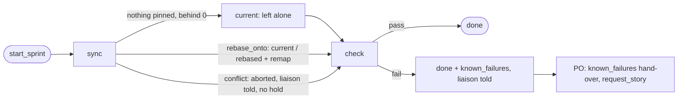

# s152: The sprint start rebases once more, and failures become stories

ADR: [ADR-0077](../../../.team/adr/0077-sprint-start-rebases-and-records-known-failures.md)
(amends ADR-0041 R12 and ADR-0075). Requirements: REQ-088 to REQ-091.
Developer: `developer-cli`.

Only the **start** boundary changes. The end boundary (s151) is untouched,
including its `check` (a failure there is still a DevOps fix step) and its
`rebase` (and the conflict path of s151 AC6, whatever state it is in).

## Rules

- **S1 Start sync rebases (AC1.1).** `_sync` is unchanged (fetch through
  `remote.missing()`, a skip closes the boundary, record the team branch,
  then `SYNCS[b.edge]`). `_start_sync(b)`:
  1. When `b.sync_from` is empty **and** `self.remote.behind() == 0`, the
     branch is already on the target: `_start_current(b)` emits `current`
     with `note=START_CURRENT` and `behind=0`, and advances. **No** git
     rebase runs, no hash changes, nothing is saved but the stage.
  2. Otherwise `_pin_sync_from(b)` (as the end), `result =
     self.remote.rebase_onto(b.sync_from)`, then `START_REBASES[result.outcome]`.
     A pinned `sync_from` always takes this path, so a crash after the
     rebase but before the remap is remapped on resume (as at the end).
  3. `rebased` → the existing `_settle_rebase` (remap every recorded hash
     with `rewrite.remap_state`, `record_checkout`, save, `rebased` event
     with `sha` and `rewritten`, unpin, advance). `current` → the existing
     `_rebase_current`. Same remapping as the end, by the same code.
  4. An `UpstreamError` from `rebase_onto` (git stopped for a reason other
     than a conflict, or a path only one side touched) still holds `error`,
     as at the end: those are safety stops, not test failures.
- **S2 Start conflict holds nothing.** `conflict` → `_start_conflict(b,
  result)`: `rebase_onto` has already aborted the rebase, so the team
  branch is unchanged. Post `START_CONFLICT` to the liaison, emit
  `conflict` (`note` = the same text, `files`, `commit` cut to 12,
  `subject`) with **no hold**, `_unpin(b)`, advance to `check`. No DevOps
  step, no PO hand-over, no `sync_conflict`.
- **S3 Start check failure holds nothing (AC2.1).** `_check` is unchanged
  up to the run (the "already checked at HEAD" skip stays). A failed report
  goes through `CHECK_FAILURES[b.edge]`:
  - `Edge.END` → `_team_fix(b, report)`: today's two lines (a
    `Failure(Stage.CHECK, FixCase.TEAM_CHECK, report.reason())` through
    `_fail`, with `checks=report.summary()`). Unchanged behaviour.
  - `Edge.START` → `_known_failures(b, report)` (S4). No `Failure`, no
    setback, no streak, no rounds, no escalation, no `manager_due`, no
    hold. `upstream.checked` is **not** set (the head did not pass).
- **S4 Known failures (AC2.2).** `_known_failures(b, report)`:
  `ids = report.failing_ids()`, `head = self.runtime.git.head()`,
  `text = KNOWN_FAILURES_NOTE.format(…)`; `self._post(text)`; then
  `self._finish(b, note=text, known_failures=ids, sha=head,
  reason=report.reason(), checks=report.summary())`. The start boundary
  ends with that one `done` event (`state.boundary` is `None`; `_close`
  records nothing for a start). Its last event is the step report's
  `boundary` data, so the hand-over (S5) sees `known_failures`.
  The ids (`CheckReport.failing_ids`): for each failed check in order, the
  JUnit ids of its failed cases (`tests/test_x.py::test_y`), or the check's
  name (`lint`, `static`, `coverage`, `e2e:<env>`) when it has none (no
  JUnit report, a lint failure, a coverage shortfall with no failing
  test). Duplicates go, first place kept. Pending tests are deselected by
  the full checks as today, so a story's own red tests never appear.
- **S5 Hand-over (AC2.3).** New trigger `known_failures`, raised when the
  boundary report's event has a non-empty `known_failures`. Its line tells
  the PO to ask the liaison for a story with `request_story` (unless an
  open story already covers them), with the failing output. The liaison
  writes the story and places it with the existing `agile-team story new
  --request q<N> --sprint current|next|backlog [--after <id>]`: `current`
  adds it at the top of the running sprint (`SprintAdd` → `with_first`),
  the others put it later. Nothing new is needed for the placement: the
  start boundary has finished by then, so `current` is not refused for a
  pending boundary.
- **S6 Where the ids live.** On the start boundary's closing `boundary`
  event (S4), **not** on the `sprint-start` event: `start_sprint` emits
  `sprint-start` before the start boundary runs, events are append-only,
  and the dashboard treats each `sprint-start` as a sprint window (`inSprint`)
  and its goal (`sprintGoal`), so a second one would split the sprint
  (ADR-0077 §6). `sprint-start` is unchanged. This departs from AC2.2's
  wording; it is an open question to the liaison.



## Changes by module

### `agile_team/boundary.py` (texts; tests may assert them exactly)

```python
START_CURRENT = "the team branch is current with {target}"
START_CONFLICT = (
    'Sprint {sprint} start: rebasing {team} onto {target} stopped at {commit} "{subject}" with '
    "conflicts in: {files}. The rebase was aborted, {team} is unchanged and the sprint goes on "
    "from it. The human can rebase {team} by hand; until then the sprint end's PR conflicts "
    "with {target}, so it gets no CI and the end does not rebase."
)
KNOWN_FAILURES_NOTE = (
    "Sprint {sprint} starts with {count} known failures on {team} at {sha}: {ids}. Nothing is "
    "held and the sprint goes on; the PO asks you for a story for them (request_story)."
)
```

`{sha}` in `KNOWN_FAILURES_NOTE` is the head cut to 12. `{files}` is
`", ".join(result.files)`. No new enum values: the outcomes `current`,
`conflict` and `done` exist.

### `agile_team/boundary_runner.py`

Remove `START_NOTES` (its "nothing changes until the next sprint end" text
is wrong now). Import the three texts. Methods (private, one job each,
under 8 lines, at most 2 parameters besides `self`):

| Method | Does |
|---|---|
| `_start_sync(b)` | S1: docstring "AC1.1: rebase the team branch onto the target; a branch already on it is left alone." `if not b.sync_from and self.remote.behind() == 0: return self._start_current(b)`; `_pin_sync_from(b)`; `result = self.remote.rebase_onto(b.sync_from)`; `START_REBASES[result.outcome](self, b, result)` |
| `_start_current(b)` | S1.1: `_emit(b, Out.CURRENT, note=START_CURRENT.format(target=self.target), behind=0)`; `_advance(b)` |
| `_start_conflict(b, result)` | S2: `text = self._start_conflict_text(b, result)`; `_post(text)`; `_emit(b, Out.CONFLICT, note=text, files=list(result.files), commit=result.commit[:12], subject=result.subject)`; `_unpin(b)`; `_advance(b)` |
| `_start_conflict_text(b, result) -> str` | `START_CONFLICT.format(sprint=b.sprint, team=self.mine.team_branch, target=self.target, commit=result.commit[:12], subject=result.subject, files=", ".join(result.files))` |
| `_check(b)` | as today, but the failure branch is `return CHECK_FAILURES[b.edge](self, b, report)` |
| `_team_fix(b, report)` | S3 end: `failure = Failure(Stage.CHECK, FixCase.TEAM_CHECK, report.reason())`; `self._fail(b, failure, checks=report.summary())` |
| `_known_failures(b, report)` | S4 (as written there) |

Tables, next to `AFTER_REBASE` and `SYNCS`:

```python
START_REBASES = {
    SyncOutcome.CONFLICT: BoundaryRunner._start_conflict,
    SyncOutcome.CURRENT: BoundaryRunner._rebase_current,
    SyncOutcome.REBASED: BoundaryRunner._settle_rebase,
}
CHECK_FAILURES = {Edge.START: BoundaryRunner._known_failures, Edge.END: BoundaryRunner._team_fix}
```

`AFTER_REBASE` (the end) is not touched, so s151's `_rebase_conflict`
changes never reach the start. Module docstring: replace "Only the rebase
stage rewrites the team branch" with "Only the start sync and the end's
rebase stage rewrite the team branch, through ``Upstream``."

### `agile_team/fullcheck.py`

- `CheckResult` gains `failed: tuple[str, ...] = ()` after `pending`,
  documented "the JUnit ids of the failed cases".
- `Judging.result` passes `failed=_failed_ids(run)`.
- New `_failed_ids(run: test_reports.TestRun) -> tuple[str, ...]`: `()`
  when `run.report is None`, else `tuple(c.id for c in run.report.failed())`.
- New `CheckReport.failing_ids(self) -> list[str]`, docstring "The known
  failures: each failed check's failed test ids, or its name when it has
  none; no duplicates.": `list(dict.fromkeys(i for r in self.results if not
  r.passed for i in (r.failed or (r.check.name,))))`.
- `summary()` and `reason()` are unchanged.

### `agile_team/handover.py`

- `Trigger.KNOWN_FAILURES = "known_failures"`.
- A rule after `CI_PENDING`:
  `Rule(Trigger.KNOWN_FAILURES, lambda r: bool(_boundary(r).get("known_failures")), KNOWN_LINE)`
  with the line

  ```text
  {story}: sprint {sprint} starts with {known_count} known failures on {team_branch} at {sha}: {known}. Nothing is held and the sprint goes on. Unless an open story already covers them, ask the liaison for a story now with request_story (evidence: the failing output below); the liaison writes it and places it at the top of this sprint or later, and the runner tells you its id. Failing output:
  {boundary_reason}
  ```

  (one Python string; `{known_count}`, `{known}` and `{sha}` are new
  fields).
- `BOUNDARY_TEXT` gains `"sha"`. `_boundary_fields` merges a new
  `_known_fields(boundary) -> dict[str, str]`: `known` =
  `", ".join(boundary.get("known_failures") or [])`, `known_count` = its
  length as text. (Extracting it keeps `_boundary_fields` from growing.)

### `agile_team/stages.py`

Descriptions only (keys and the row count unchanged):

- `BOUNDARY_SYNC`: "Fetch the target and record the team branch; at a
  sprint start, rebase it onto the target; at a sprint end, record the
  sprint's own branch"
- `BOUNDARY_CHECK`: "Lint, static analysis, the full suite with coverage,
  once, and each environment's e2e, on the team branch; at a sprint start a
  failure is recorded as known failures and holds nothing"

### Built-in `agile_team/roles/product-owner.md`

- Replace the bullet "**sync conflict** (sprint start): ask the human to
  rebase …" (wrong since s108) with:

  > - **sync conflict** (only a boundary saved before s151):
  >   `continue_boundary` reruns the rebase.
  > - **known_failures** (sprint start): the full checks failed on the team
  >   branch, and the sprint goes on; nothing is held. Unless an open story
  >   already covers them, `request_story` a story for the failing tests
  >   now, with the failing output as its evidence. The liaison writes it
  >   and places it at the top of this sprint or later; the runner tells
  >   you its id. Never hand the failures to another story's step.

### Not changed

`events.py`, `po_tools.start_sprint` and the `sprint-start` event (S6);
`state.py` (no new field); the dashboard and its fixture (the `done` and
`conflict` boundary events already render with their `note`); the end
boundary.

### `.team/roles/_leadership.md` (the liaison's, outside every role's scope)

Proposed text for AC3.2, which the human approves (it replaces the "Git"
bullet, and keeps s151's wording for the end):

> - **Git: main stays linear.** Code reaches main only by rebase-merge.
>   Within a sprint, never rewrite the team branch's hashes. At the sprint
>   end the runner pushes the team branch as it is to the sprint's PR,
>   waits for green CI, then rebases it onto main (never a merge) and
>   pushes it again to the same PR. At the sprint start it rebases the team
>   branch onto main once more (a branch already on main is left alone) and
>   runs the full checks. A failing start check holds nothing: its failing
>   tests are the sprint's known failures, and the PO asks the liaison for a
>   story for them, which the liaison places at the top of the sprint or
>   later.

## Test checklist

AC3.1: one test per AC id, named `test_ac<major>_<minor>_…`, in a new
`tests/test_s152_start.py` (unit-tester). AC1.1's rebase uses a real
scratch git repo whose `origin` is a bare clone (as
`tests/e2e/test_s59_rebase_e2e.World`, or the scratch-repo helpers of
`test_upstream.py`); the rest may use the fakes of `test_s108_start.py`
(`FakeSystem`, a `PrefixRunner` for the full checks).

- [ ] **AC1.1** Main moved by one commit; a story's recorded `commit` is a
      team commit. One start `sync` step: HEAD is now on `origin/main`
      (`merge-base --is-ancestor`), the story's `commit` is the rebased
      copy's sha, a `rebased` event with `rewritten >= 1`, `sync_from` is
      empty, the stage is `check`. Second case, main not moved: HEAD is the
      same sha, a `current` event with `START_CURRENT`, and the git log
      holds no `rebase` call (the fake records argv, or HEAD's reflog has
      no rebase entry).
- [ ] **AC2.1** A start `check` whose full checks fail: the step leaves
      `boundary` `None`, `hold` never set, no `team-fix` step due
      (`due()` is `None`), no `manager_due` entry, `upstream.checked`
      unchanged. The same failure at an **end** check still makes
      `FixCase.TEAM_CHECK` due (regression guard).
- [ ] **AC2.2** The closing `done` event has `known_failures` equal to the
      failed JUnit ids, in order (a report with two failed cases), plus
      `sha` and `reason`. A failing `lint` with no report gives
      `["lint"]`. Unit tests of `CheckReport.failing_ids` and
      `_failed_ids` (no report → `()`) go in `tests/test_fullcheck.py`.
- [ ] **AC2.3** The step report of that check raises
      `Trigger.KNOWN_FAILURES`, and its line names `request_story`, the
      ids, the count and the failing output. The relay holds
      `KNOWN_FAILURES_NOTE`. A passing start check raises no
      `known_failures`.
- [ ] Unit: S2 a start conflict: HEAD unchanged, a `conflict` event with no
      `hold`, the relay holds `START_CONFLICT`, `sync_from` empty, the
      stage is `check`.
- [ ] Unit: S1.2 with `sync_from` pinned and `behind() == 0` (a crash after
      the rebase), `rebase_onto` is still called and the hashes are
      remapped.
- [ ] Unit: `START_REBASES` and `CHECK_FAILURES` map as above;
      `SYNCS[Edge.START] is BoundaryRunner._start_sync` stays.

Existing tests that pin the old start ("changes nothing"): AC1.1 is the
rule that makes them wrong.

- `tests/test_s108_start.py` (unit-tester): `START_NOTES` and the "main
  ahead changes nothing" and "leaves `sync_from` alone" tests go or change
  to S1; "not ahead says current" changes to `START_CURRENT` on a
  `current` event.
- `tests/e2e/test_s108_start_e2e.py` (integration-tester, at s152's e2e
  step): it asserts the start changes nothing; it changes to a start that
  rebases (or is deleted, with AC1.1 pinned by the new tests).
- Any test asserting that a **start** check failure makes a `team-fix`
  step or escalates: AC2.1 is the rule that makes it wrong.

AC3.2 (review): see the docs checklist.

## Docs checklist (AC3.2, the architect writes them in this step)

`README.md` agile-team row, `SKILL.md` "Sprint boundaries",
`reference/protocol.md` "Sprint boundaries" (start stages, Failures, the
hand-over table), `docs/customer/review-stack.md` and
`docs/customer/runner-stages.md`. `.team/roles/_leadership.md` is the
liaison's: the text above.
