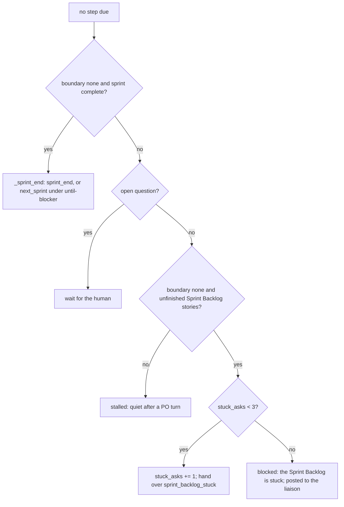

# s156: A stuck Sprint Backlog is reported, not refilled from the Product Backlog

Developer: `developer-cli`. ADR-0082 (amends ADR-0057's "Ready backlog hand-over"
and ADR-0065's rule 5). Requirements: REQ-115 (AC1), REQ-116 (AC2), REQ-117 (AC3),
REQ-118 (AC4), REQ-119 (AC5), REQ-120 (AC6), REQ-121 (AC8). AC7 is covered by
REQ-115 to REQ-120 (one test per AC id, see "Test checklist").

## Rules

| # | Rule | AC |
|---|------|----|
| S1 | **No refill offer.** `Trigger.READY_BACKLOG`, `Router._offer`, `sprint_end.ready_lines`, `sprint_end.READY_ADVICE` and `RunState.offered` are removed. No idle pass lists Product Backlog stories while the Sprint Backlog has unfinished stories. | AC1 |
| S2 | **Order of the idle pass.** `Router._idle` checks, in order: (1) no boundary pending and `sprint_complete()` gives `_sprint_end()` (unchanged); (2) an open question means the run waits (return `None`, as before s124: the question already reached the human); (3) no boundary pending and the Sprint Backlog has unfinished stories gives `_stuck(unfinished)`; (4) anything else (a held boundary, a sprint with no stories) gives today's `_stalled(unfinished)`, which stays quiet after a PO turn. | AC1 |
| S3 | **Stuck hand-over.** `_stuck` hands over `Trigger.SPRINT_BACKLOG_STUCK = "sprint_backlog_stuck"`. Its lines are `SPRINT_STUCK_LEAD`, then one line per unfinished Sprint Backlog story, `"<id> at <step>: <why>"` (today's `_why`: PO hold, hold, unmet dependencies, status), then `SPRINT_STUCK_ADVICE`. Its `stories` are the unfinished ids, as `stalled` names them. It is **not** in `QUIET_AFTER_PO`, under both cadences, so a PO turn that changes nothing gets it again rather than ending the run. | AC1 |
| S4 | **Stuck cap.** `RunState.stuck_asks: int = 0` (persisted; old states load 0). `_stuck` first checks it: below `SPRINT_STUCK_CAP = 3`, it adds 1, saves and hands over. At the cap it hands over nothing: `state.mark(RunStatus.BLOCKED, text)` with `text = sprint_end.stuck_blocked_text(state, reasons)`, `relay.post(Note("blocked", text, []))`, save, `Pass([], [], [])`. The run halts (`BLOCKED` always halts). This applies under both cadences. | AC2 |
| S5 | **What resets the count.** `RunState.clear_stuck()` sets `stuck_asks = 0`. It is called by: (a) `Router._step`, before dispatch, for every step (the Sprint Backlog moved); (b) `Tools` after a call, not refused, of a tool in `po_tools.STUCK_RESETS = frozenset({"continue_story", "release_story", "run_role", "revert_story", "request_cancel", "request_story", "pass_tests"})`, then `runtime.save()`; (c) `RunState.begin_sprint` and `RunState.add_to_sprint`, next to the existing `keep_going_asks = 0`. Nothing else resets it: `ask_user`, `hold_story`, `notify_user` and a delivered human message don't. A resume keeps the count. | AC2 |
| S6 | **Refused means refused.** `runner_tools.is_refused(result)` is true when `result["content"][0]["text"]` parses as a JSON object whose `status` is `"refused"`. Every refusal of the `STUCK_RESETS` tools comes back as `text_result(refused(...))` or, for `run_role`, a report with `status: "refused"`; both read as refused. A result that doesn't parse is not refused. | AC2 |
| S7 | **until-blocker end looks at the Sprint Backlog only.** `sprint_end.keep_going_refusal(state, blocked)` returns `KEEP_GOING_REFUSED` under `until-blocker` when `movable_sprint_backlog(state, blocked)` is non-empty, else `None`. Ready Product Backlog stories never make it refuse. `blocked` is `runtime.relay.blocked_stories()`: a story that waits on an open question can't move. | AC3 |
| S8 | **One "can move" rule.** `sprint_end.can_move(story, state)` is the router's step test without the relay: in the current sprint, status `ACTIVE`, no `hold`, no `po_hold`, no boundary pending, no unmet dependency. `Router._movable` becomes `sprint_end.can_move(story, rt.state) and story.id not in rt.relay.blocked_stories()`. `movable_sprint_backlog` uses `can_move` too. | AC3 |
| S9 | **Next sprint unchanged.** Under `until-blocker`, a complete sprint with no boundary pending and ready Product Backlog stories still hands over `next_sprint` with `NEXT_SPRINT_LEAD`, the ready list (`READY_HEAD`, up to 5 `- sN: <title>`, `- and N more`) and `NEXT_SPRINT_ADVICE`, counted by `keep_going_asks` against `KEEP_GOING_CAP`. Only the words "backlog" in these texts change (S11). | AC4 |
| S10 | **`add_to_sprint` stays, unadvertised.** `add_to_sprint` and its refusals are unchanged. No hand-over line, refusal or role text names `add_to_sprint` as the answer to a stuck Sprint Backlog: `END_REFUSED` loses its `add_to_sprint …` tail, `SPRINT_STUCK_ADVICE` never names it, and the PO role file's stuck and Cadence texts don't either. | AC5 |
| S11 | **Product Backlog or Sprint Backlog.** In every runner name and text listed under "Renames", each "backlog" becomes "Product Backlog" or "Sprint Backlog" (in names: `product_backlog`, `sprint_backlog`). Out of scope: the dashboard's Backlog view (`backlog.py`, the snapshot's `backlog` key, `opinions.py`, `reorders.py`), the liaison's `story new --place backlog` value (`story_drafts.Placing`) and `threads.BACKLOG`. They are interfaces the human and the dashboard use; the charter records that they still say "backlog". | AC6 |

## Texts (constants)

`sprint_end.py`, replacing the module's constants (new or changed ones marked):

```python
END_REFUSED = (  # changed: no add_to_sprint tail
    "sprint {sprint} can't end: {stories} unfinished. Finish them, revert_story(story, reason), "
    "or ask the human to cancel them (request_cancel)"
)
READY_HEAD = "Ready in the Product Backlog (dependencies done, not held):"  # changed
READY_MORE = "- and {count} more"
READY_SHOWN = 5
UNTIL_BLOCKER = "until-blocker"
NEXT_SPRINT_LEAD = (  # changed: second sentence
    "Cadence until-blocker: start the next sprint now with start_sprint(goal, stories). "
    "A sprint end doesn't end the run while the Product Backlog has ready stories."
)
NEXT_SPRINT_ADVICE = (  # changed: "stories are ready" names the Product Backlog
    "Don't end your turn without starting a sprint, and don't notify done or blocked while "
    "Product Backlog stories are ready. A PR waiting for review or merge does not hold the "
    "next sprint."
)
KEEP_GOING_REFUSED = (  # changed: Sprint Backlog only
    "cadence until-blocker: Sprint Backlog stories can still move ({ids}); end your turn and "
    "the runner works on them. Notify done or blocked only when nothing in the Sprint Backlog "
    "can move"
)
KEEP_GOING_CAP = 3
KEEP_GOING_STUCK = (  # changed: next_sprint only
    "The PO did not start a sprint after {count} next-sprint hand-overs; ready in the Product "
    "Backlog: {ids}. Tell the PO what to do with `agile-team tell`, then `start --resume`."
)
SPRINT_STUCK_CAP = 3  # new
SPRINT_STUCK_LEAD = (  # new
    "Nothing in the Sprint Backlog of sprint {sprint} can move. Each story and why:"
)
SPRINT_STUCK_ADVICE = (  # new
    "Stuck hand-over {count} of {cap}. Act on these stories: continue_story or release_story "
    "once the cause is fixed, run_role with your own brief, pass_tests, revert_story, "
    "request_cancel, or request_story for a bug the team can't fix itself; ask_user when only "
    "the human can unblock one. Don't refill the sprint to keep the team busy. After {cap} "
    "stuck hand-overs with none of these, the runner sets the run blocked and tells the human."
)
SPRINT_STUCK_BLOCKED = (  # new
    "Sprint {sprint}: the Sprint Backlog is stuck after {count} hand-overs with no PO action "
    "on its stories: {reasons}. Tell the PO what to do with `agile-team tell`, then "
    "`start --resume`."
)
```

`{reasons}` is the story lines joined by `; `. `{ids}` is `ids_text(...)` as today.

## Renames (AC6)

| Where | Old | New |
|---|---|---|
| `sprint_end.py` | `ready_backlog(stories, queue)` | `ready_product_backlog(stories, queue)` |
| `sprint_end.py` | `_ready`'s local `backlog` | `in_product_backlog` |
| `router.py` | `Router._ready()` | `Router._ready_product_backlog()` |
| `router.py` | `_in_backlog(story)` | `_in_product_backlog(story)` |
| `router.py` `_stall_lines` | `f"Backlog: {…}"` | `f"Product Backlog: {…}"` |
| `handover.py` | `READY_BACKLOG = "ready_backlog"` | removed; `SPRINT_BACKLOG_STUCK = "sprint_backlog_stuck"` added after `STALLED` |
| `state.py` | `offered` | removed; `"offered"` added to `RUN_DROPPED` so old `state.json` files load |
| `gates.py` `_backlog_refusal` | `story {id} is in the backlog; add it to a sprint` | `_product_backlog_refusal`, `story {id} is in the Product Backlog; add it to a sprint` |
| `reverts.py` `NOTICE` | `It is back in the backlog at {step}.` | `It is back in the Product Backlog at {step}.` |
| `po_tools.py` `DASHBOARD_REASON` | `…reorders the backlog the human set on the dashboard.` | `…changes the Product Backlog order the human set on the dashboard.` |
| `po_tools.py` `SCHEMAS["start_sprint"]` | `go back to the backlog` | `go back to the Product Backlog` |
| `po_tools.py` `SCHEMAS["revert_story"]` | `put it back in the backlog` | `put it back in the Product Backlog` |
| docstrings in `sprint_end.py`, `router.py`, `reverts.py` | "ready backlog", "the backlog" | "ready Product Backlog", "the Product Backlog" |

## Changes per module

### `agile_team/sprint_end.py`

Module docstring: `"""When a sprint may end, what is ready for the next one, and the stuck Sprint Backlog (s124, s128, s156). Pure."""`. Constants as in "Texts". Remove `ready_lines` and `READY_ADVICE`.

```python
def can_move(story: StoryState, state: RunState) -> bool:
    """S8: a Sprint Backlog story the router could step now, open questions aside."""

def movable_sprint_backlog(state: RunState, blocked: set[str]) -> list[str]:
    """S7: ids in the current sprint (state.sprint_ids() order) that can_move and aren't blocked."""

def ready_product_backlog(stories: dict[str, StoryState], queue: list[str]) -> list[str]:
    """Ready Product Backlog ids in queue order (renamed from ready_backlog)."""

def keep_going_refusal(state: RunState, blocked: set[str]) -> str | None:
    """S7: KEEP_GOING_REFUSED under until-blocker while a Sprint Backlog story can move."""

def stuck_lines(state: RunState, reasons: list[str]) -> list[str]:
    """S3: SPRINT_STUCK_LEAD, the story lines, SPRINT_STUCK_ADVICE with state.stuck_asks."""

def stuck_blocked_text(state: RunState, reasons: list[str]) -> str:
    """S4: SPRINT_STUCK_BLOCKED for state.sprint and state.stuck_asks."""
```

`end_refusal`, `next_sprint_lines`, `_ready_list` and `ids_text` keep their signatures.

### `agile_team/handover.py`

`Trigger.READY_BACKLOG` removed; `Trigger.SPRINT_BACKLOG_STUCK = "sprint_backlog_stuck"` added after `STALLED`. `QUIET_AFTER_PO` stays `{SPRINT_END, STALLED}`.

### `agile_team/state.py`

- Remove `offered`; `RUN_DROPPED = frozenset({"scribe_due", "offered"})`.
- Add `stuck_asks: int = 0  # stuck Sprint Backlog hand-overs since it last moved (s156 S4)` next to `keep_going_asks`.
- `def clear_stuck(self) -> None: """S5: no stuck Sprint Backlog hand-over is pending."""`.
- `begin_sprint` and `add_to_sprint` call `self.clear_stuck()`.

### `agile_team/runner_tools.py`

```python
def is_refused(result: dict[str, Any]) -> bool:
    """S6: the tool result's JSON text has status "refused"."""
```

### `agile_team/po_tools.py`

- `STUCK_RESETS: frozenset[str]` as in S5, next to `KIND_REFUSALS`.
- `KIND_REFUSALS: dict[str, Callable[[Runtime], str | None]]`: `REPLY: lambda _runtime: USE_REPLY`, `"sprint-end": lambda runtime: sprint_end.end_refusal(runtime.state)`, `"done"` and `"blocked"`: `_keep_going_refusal`, where `def _keep_going_refusal(runtime: Runtime) -> str | None` returns `sprint_end.keep_going_refusal(runtime.state, runtime.relay.blocked_stories())`. `_no_refusal(_runtime)`. `notify_user` calls `KIND_REFUSALS.get(kind, _no_refusal)(self.runtime)`.
- `Tools.noted`'s `call` awaits the method, then calls `self._note_reset(name, result)` and returns the result. `def _note_reset(self, name: str, result: dict[str, Any]) -> None` calls `state.clear_stuck()` and `runtime.save()` when `name in STUCK_RESETS and not is_refused(result)`.
- Texts per "Renames".

### `agile_team/router.py`

```python
def _idle(self) -> Pass | None:
    """S2: sprint end, wait on a question, the stuck Sprint Backlog, or today's stall."""

def _stuck(self, unfinished: list[StoryState]) -> Pass:
    """S3/S4: hand over the stuck Sprint Backlog with each story's reason; past the cap, block."""

def _story_stall_lines(self, unfinished: list[StoryState]) -> list[str]:
    """One "<id> at <step>: <why>" line per story; _stall_lines and _stuck both use it."""

def _block(self, text: str) -> Pass:
    """Mark the run blocked with text, post it to the liaison, save; Pass([], [], [])."""
```

- `_gave_up` (next_sprint cap) keeps its behaviour and uses `_block(text)`.
- `_step` calls `self.runtime.state.clear_stuck()` after `self.steps += 1`.
- `_movable` per S8. Remove `_offer`; rename per "Renames".

### `agile_team/roles/product-owner.md` (the developer edits it; outside the architect's scope)

Hand-over list item 4: replace the **ready backlog** bullet with:

```markdown
   - **Sprint Backlog stuck** (nothing in the sprint can move): act on each story the
     list names: continue_story or release_story once its cause is fixed, run_role,
     pass_tests, revert_story, request_cancel, or request_story for a bug the team can't
     fix; ask_user when only the human can unblock it. Don't refill the sprint from the
     Product Backlog. After 3 of these hand-overs with none of those actions, the runner
     sets the run blocked and tells the human.
```

`## Backlog and sprints`, the `run_role` bullet: `Only stories in the current sprint can move. run_role on a Product Backlog story is refused with "story sN is in the Product Backlog; add it to a sprint".` In the same section, "go back to the backlog" becomes "go back to the Product Backlog", "are in the backlog" becomes "are in the Product Backlog" and "reorders the backlog" becomes "reorders the Product Backlog".

`## Cadence`:

```markdown
- `sprint`: when the sprint's stories are done (the runner hands over sprint complete), `notify_user` with
  kind `sprint-end` and a short review (include the prompt's Review: line,
  pull requests or why nothing was pushed, in the note), then end your turn.
  If the Sprint Backlog is stuck, act on its stories (see the hand-over list); if only
  the human can unblock them, ask_user or notify_user with kind blocked.
- `until-blocker`: at a sprint end with ready Product Backlog stories the runner hands over
  `next_sprint`: start the next sprint with `start_sprint`. Never wait for a PR to be
  reviewed or merged. A stuck Sprint Backlog is reported, not refilled: act on its stories,
  or `notify_user` `done` (everything is done) or `blocked` (the rest needs the human) and
  end your turn. The runner refuses `done` and `blocked` while a Sprint Backlog story can move.
```

## Flow of an idle pass



## Test checklist

New file `tests/test_s156_stuck_sprint_backlog.py`, one test per AC id (named
`test_ac1_…` … `test_ac6_…`; AC7 is these tests), using the s124 helpers
(`tests/test_s124_helpers.py`):

- [ ] **AC1** Sprint 1 holds s2 (PO-held) and s4 (waiting on s9, open in the Product Backlog); s3 in the Product Backlog is ready; no question is open. One router pass gives `[Trigger.SPRINT_BACKLOG_STUCK]`, lines `SPRINT_STUCK_LEAD`, `s2 at …: …`, `s4 at …: waiting on s9`, then the advice; no line holds `s3` or `READY_HEAD`; `Pass.quiet()` is false after a PO turn. `Trigger` has no `READY_BACKLOG` member, and `sprint_end` has no `ready_lines` or `READY_ADVICE`.
- [ ] **AC1** (same test or a second assert) With a question open, the same state gives no hand-over (the router waits).
- [ ] **AC2** Same stuck state, both cadences: three passes hand over with advice counts 1, 2, 3; the fourth returns `Pass([], [], [])`, the status is `blocked`, `status_reason` contains `the Sprint Backlog is stuck` and each story line, and the relay holds one `blocked` note with that text. Then: after a `continue_story` (not refused) the count is 0; after a refused `continue_story` it is unchanged; after `ask_user` it is unchanged; each `STUCK_RESETS` tool resets it (table-driven over the set); a step run resets it; `stuck_asks` survives a save and load, and a state file with `offered` loads.
- [ ] **AC3** `until-blocker`: a movable Sprint Backlog story makes `notify_user` `done` and `blocked` refused with `KEEP_GOING_REFUSED` naming it; with the Sprint Backlog stuck (held, or waiting on an open question) and ready Product Backlog stories, both are accepted. Under `sprint` cadence neither is refused.
- [ ] **AC4** `until-blocker`, complete sprint, closed end boundary, 6 ready Product Backlog stories: `next_sprint` with `NEXT_SPRINT_LEAD`, `READY_HEAD`, 5 story lines, `- and 1 more`, `NEXT_SPRINT_ADVICE`; the fourth such pass blocks with `KEEP_GOING_STUCK`.
- [ ] **AC5** `add_to_sprint(stories, reason)` on a stuck sprint adds the story and resets `stuck_asks`; without a reason it is refused. No string constant in `sprint_end`, no `HANDOVERS` line and no line of a stuck hand-over contains `add_to_sprint`. In `roles/product-owner.md`, the `## Cadence` section has no `add_to_sprint`, and no line containing `stuck` contains it.
- [ ] **AC6** Each "backlog" (case-insensitive) is preceded by `product ` / `sprint ` / `product_` / `sprint_` in: every `Trigger` value, every public name and string constant of `sprint_end`, every `HANDOVERS` line, `gates`' Product Backlog refusal, `reverts.NOTICE`, `po_tools.DASHBOARD_REASON`, `RESTART_NEEDS_REASON` and every `SCHEMAS` description, and the router's stall lines for an empty sprint.

Existing tests that pin the old behaviour change with these rules (the `asserts`
reason is S1–S11): `test_s124_sprint_end.py` (K1–K3 ready backlog,
`READY_BACKLOG`), `test_s128_keep_going.py` (`ready_backlog` repeats, the cap
text, `keep_going_refusal(state)`), `test_s124_helpers.py`, `test_handover.py`
(the trigger list), `test_router.py` (a stuck sprint was quiet `stalled`), and any
test asserting the renamed texts.
