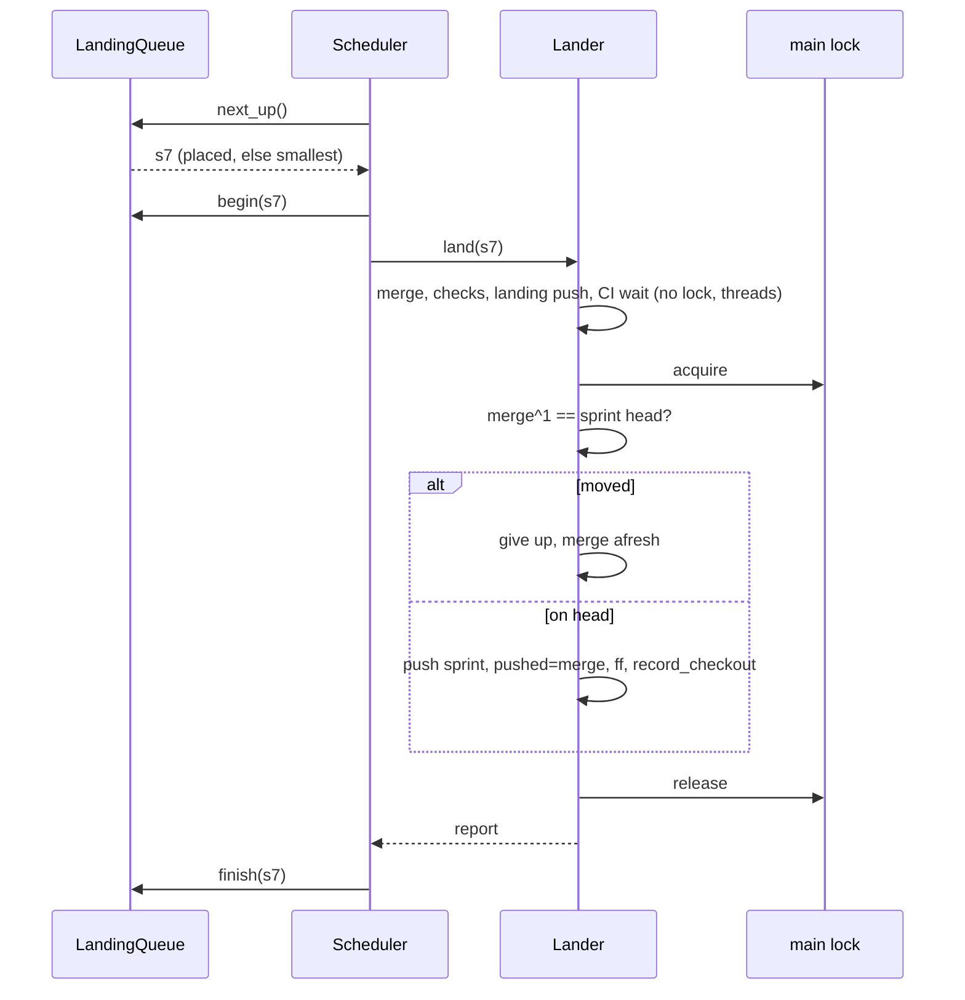

# s163: Stories land one at a time in the PO's order, and parallel runs don't halt or stall

> **Amended by s161 (names).** s161 renamed these names to pass the house
> rules ([design/s161.md](s161.md), N1 table; ADR-0089). Read each old name as
> its new one: `LandingQueue.waiting()` → property `candidates`, `order()` →
> property `order`, `next_up` → `pick_next` (with `_drop_stale_landing`);
> `Upstream.why_in_target` → `classify_in_target`; `Runtime.checkout_lock()`
> → property `checkout_lock`; `_files_reasons` → `_list_files_reasons`; the
> method behind the `order_landings` tool → `Tools.set_landing_order` (the
> tool keeps its name). `arrange`, `place`, `lift`, `lift_due` and `give_up`
> keep their names, and their verbs are in `.house-rules.toml`.

Story: `.team/stories/s163.md` (8 ACs; the sprint-49 review fixes B1, B2, M1
to M4, plus the human's direction on landing order and overlap). Builds on
`design/s159.md`, which keeps every rule this file doesn't change.

ADRs: **ADR-0088** (new: the landing order, `## Files` and the overlap hold).
Amended: **ADR-0084** (a stale merge is given up, merged entries leave the
stack, the switch reads `git cherry`), **ADR-0085** (the main lock covers only
moves, boundary stages run off the loop).

Requirements: REQ-167 to REQ-173 (new). Changed: REQ-152 (s159 AC5.2's order
is replaced), REQ-160 (s159 AC10.1's conditions are replaced), REQ-164 (s159
AC11.5 is narrowed).

Developer: `developer-cli` for all of it. No page work: the new events show in
the dashboard's event feed like any other event.

---

## 1. Words

| Word | Meaning |
|---|---|
| landing | A story's `land` step, or a landing revert (`revert_story` of a landed story, s159 E3). Both use `.team/run/land`. |
| the one now landing | `RunState.landing`: the id whose landing task runs now. `""` when none runs. |
| waiting to land | A story at `land` that `sprint_end.can_move` allows, has no queued `rebase` and isn't the one now landing; or a story with a queued landing revert (`Runtime.revert_queue`) that isn't the one now landing. |
| size | The lines added plus deleted in `git diff --shortstat <base_sha>..<branch>`. For a landing revert: `git diff --shortstat <merge>^1 <merge>` of the landed merge. |
| placed | The ids the PO listed in its last `order_landings` (`RunState.landing_order`). |
| sprint head | `Lander.sprint_head`: the sprint entry's `head` (which follows the main checkout through `record_checkout`), else the main checkout's HEAD. |
| on the head | A merge whose first parent (`git rev-parse <merge>^1`) is the sprint head. |
| give up a merge | Clear `story.landed` (never for a revert), delete the landing branch under its lease, emit `landing-dropped`, and merge afresh when the story's turn comes. |
| Files list | The entries under a design's `## Files` heading. |
| stage task | A boundary stage run as a scheduler task under `BOUNDARY_KEY` (s163 B1). |

## 2. Rules

Each rule is numbered. Tests and reviews cite these numbers.

### The landing queue (AC1; REQ-167, REQ-152)

- **Q1.** Landings stay one at a time (s159 L2). Only `LandingQueue.next_up()`
  may start a landing. `next_up()` is the one now landing if there is one,
  else the first id of `order()`, else `None`.
- **Q2.** `order()` is the placed ids that are still waiting, in the PO's
  order, then every other waiting id smallest first. Smallest first sorts by
  `(size, len(id), id)`: fewest lines first, and ties go by story id in
  number order (`s9` before `s10`).
- **Q3.** The PO sets the order with `order_landings(stories, reason)`. It
  replaces `RunState.landing_order` with the listed ids (duplicates dropped,
  first one kept). It is refused, with nothing changed:
  - for an empty or non-list `stories` (`NO_STORIES`);
  - for an id that is the one now landing (`NOW_LANDING`), checked first;
  - for an id that isn't waiting to land (`NOT_WAITING`, which lists the
    waiting ids);
  - when the resulting `order()` differs from the plain smallest-first order
    of the same stories and `reason` is blank (`ORDER_NEEDS_REASON`), as
    `prioritise` refuses a pull without a reason.

  An accepted call emits `landing-order` (Q6) and returns
  `{"status": "ordered", "order": [...], "sizes": {id: lines}}`.
- **Q4.** Leaving and rejoining. When a landing task returns a report (pass,
  bounce, hold, refusal or a wait), `LandingQueue.finish(id)` clears
  `RunState.landing`, drops the id from `landing_order`, and forgets its
  cached size. The story is waiting again as soon as it is ready (a held
  story after `continue_story`, a bounced one when it is back at `land`). It
  then has no placement, so smallest first places it (Q2). A landing task
  that is cancelled or crashes calls no `finish`, so after `start --resume`
  the one now landing goes first and its pushed merge can be resumed (G1).
- **Q5.** A landing revert takes its turn in the same queue. `start_revert`
  starts only the queued revert whose story is `next_up()`, and only while no
  boundary is due. `begin` and `finish` frame it like a land. If
  `RunState.landing` names a story that is neither at `land` nor has a queued
  revert (the revert queue is in memory and doesn't survive a restart),
  `next_up()` clears it and goes on.
- **Q6.** The event: `landing-order` (actor `po`, no story) with
  `{order, placed, smallest, sizes, reason}`. `order` is the resulting full
  order, `smallest` the plain smallest-first order.
- **Q7.** Sizes are cached per `(id, branch, base_sha)`, or per `(id, merge)`
  for a revert. The cache lives on the scheduler's `LandingQueue`, which
  `Runtime.landings` points to. A `git diff` that fails counts as size 0.
- **Q8.** `RunState.land_queue` goes. An older `state.json` that has it loads
  with the key ignored.

### Files and the overlap hold (AC2; REQ-168)

- **F1.** A design file has a `## Files` heading. Under it, until the next
  line that starts with `#`, each non-blank line is one entry: drop a
  leading `- ` or `* `, take the first whitespace-separated token, and strip
  backticks around it. An entry is a repo-relative path or an `fnmatch`
  glob (`*` matches across `/`, so `dir/**` is everything under `dir`).
- **F2.** The design gate (`Checks.designed`) bounces a `done` design whose
  file has no `## Files` heading or no entry under it (`FILES_MISSING`), with
  its other reasons. The gate now applies to every `done` design, not only to
  reverted, traced or shared ones.
- **F3.** The overlap check runs when a story passes at `design` while story
  branches are on (`RunState.story_branches`). It runs in
  `Runtime._advance_and_log` before the outcome is routed, for a `PASS` at
  `design` whose author isn't `Author.RUNNER` (the runner's own lift pass,
  F6, isn't checked again). It compares this story with every other story in
  the current sprint whose status isn't finished and which is past `design`
  (`Pipeline.is_past_design`):
  - **ours**: this story's Files list, read from its design file;
  - **theirs**: the other story's Files list, read with
    `git show <other.branch>:<docs>/design/<other>.md`, plus
    `git diff --name-only <other.base_sha>..<other.branch>`.
    An other story with no branch, or whose design has no `## Files` (it
    was designed before s163), contributes what it has, which may be nothing.
- **F4.** What overlaps. Entries and paths that match `IGNORED` are dropped
  from both sides first: `.team/**`, `<docs>/architecture.md`,
  `<docs>/design/**` and `<docs>/requirements/**`. Every design writes these,
  their clashes are line-local, and a landing conflict on them goes through
  the story rebase (s159 L6). A pair `(a, b)` from ours and theirs overlaps
  when `fnmatchcase(a, b)` or `fnmatchcase(b, a)` holds. It is listed as `a`
  when `a == b`, else as `a ~ b`. The list is de-duplicated and sorted.
- **F5.** On any overlap, the outcome becomes
  `Outcome(Verdict.HOLD, OVERLAP_HOLD…, overlap={…})` and the story stays at
  `design`. The gate dict carries
  `overlap: {"files": ours, "with": [{"story", "files", "overlap"}, …]}`,
  one entry per overlapping story. `StoryState.overlap_with` records their
  ids. The new `Trigger.OVERLAP` row matches a report whose gate has
  `overlap`. It is `Scope.STORY` in `handover.SCOPES`, so `story.hold`
  becomes `"overlap"`. `GATE_HOLD` doesn't match such a report, because its
  line would say `continue_story`.
- **F6.** The runner lifts the hold. On each tick, `Overlaps.lift_due()` lifts
  every story held as `overlap` whose `overlap_with` stories have all
  landed, left the sprint or been cancelled. Landed means status `done`. Left
  means `sprint != state.sprint` or the story is gone from the run. Cancelled
  means status `cancelled`. A lift:
  1. clears `hold` and `overlap_with`;
  2. drops the worktree (`Runtime.drop_worktree`, the branch stays), so the
     next step's `prepare_story` replays the branch onto the current sprint
     head when its base is older (s159 R8; a conflict queues a story
     rebase);
  3. advances the story past `design` through
     `_advance_and_log(make_runner_plan(story), Outcome(Verdict.PASS,
     "overlap lifted", author=Author.RUNNER))`;
  4. emits `overlap-lifted` `{with, by: "runner", reason}` with
     `reason = RUNNER_LIFT`.
- **F7.** `release_story(story, reason)` lifts it early. On a story whose
  `hold == "overlap"`, `Tools.release_story` calls `Overlaps.release`
  instead of the s53 clerk. A blank reason is refused (`NO_REASON`, "a reason
  is required"). Otherwise it is F6's lift with `by: "po"` and the PO's
  reason in `overlap-lifted`. The result is
  `{"status": "released", "story", "step"}`. On any other story,
  `release_story` is the s53 tool, unchanged.
- **F8.** `continue_story` on a story held as `overlap` is refused
  (`OVERLAP_CONTINUE`), so the hold can't be dropped without a reason.

### A landing never pushes a stale merge (AC3; REQ-169, REQ-164)

- **G1.** Resuming. `run_land` on a story with `landed.pushed` set resumes
  that landing (its CI read again at the same sha, no new merge) only while
  the merge is on the head. Otherwise it gives up the merge (`why:
  "sprint head moved"`) and merges afresh at once: it is the one now
  landing, so this is its turn.
- **G2.** The resumed path and a first landing share one loop:
  `run_attempts` calls `finish_pushed` when `attempt.merge` is set (a
  resume), else `run_attempt`. Any `None` (start again) clears
  `attempt.merge` and re-reads `attempt.head = sprint_head`. `MAX_RESTARTS`
  still caps it with the same hold.
- **G3.** A held landing CI (`hold_ci`) keeps `landed` as today, so a
  `continue_story` resumes it through G1. The landing branch is already
  deleted after every CI verdict (s159 L8), so a resume reads the checks of
  the sha. Giving up deletes it again under
  `Lease(landing branch, merge, "")`. A refusal there (the branch is gone) is
  ignored.
- **G4.** After a refused sprint push (L5), the landing always gives up its
  merge (`why: "sprint push refused"`). It then follows or halts:
  - The remote head `R` (after a fetch) descends from `entry.pushed`
    (`is_ancestor(entry.pushed, R)`, which includes `R == entry.pushed`):
    - when `R` is already in the main checkout (`is_ancestor(R, HEAD)`), there
      is nothing to follow: `entry.pushed = R`, and `head` stays;
    - when HEAD is an ancestor of `R`, the main checkout fast-forwards to `R`,
      `record_checkout` runs, and `entry.head = entry.pushed = R` (R2);
    - in both cases `run_attempts` merges afresh onto the sprint head
      (`None`, start again).
  - Otherwise, or when `R` is empty, or when the fast-forward fails, the run
    halts as checkout drift (`SPRINT_BRANCH_DIVERGED`, both heads named), as
    today. `landed` is already cleared, so a resume merges afresh.
- **G5.** The event: `landing-dropped` (actor `runner`, the story) with
  `{merge, why, sprint_head}`.

### Stack entries main already has (AC4; REQ-170, REQ-160)

- **S1.** In `start_sprint`, after the sprint, dependency and leaving checks
  and before the switch check, the runner drops each stack entry that main
  already has. The runner calls `Upstream.missing()` (which fetches) and reads
  `Upstream.why_in_target(entry.head)` for each entry in a worker thread. On
  the loop it then removes the matching entries from
  `state.upstream.stack` and emits `stack-dropped` for each one.
  `is_in_target(head)` is true when `merge-base --is-ancestor <head> <target>`
  exits 0, or when `git cherry <target> <head>` lists no `+` line.
- **S2.** An entry with no `head`, or whose check raises `GitError`, stays.
  With no upstream, or when `missing()` gives a reason, nothing is dropped.
  This runs at every `start_sprint`, before and after the switch.
- **S3.** The switch's "ahead of the target" count is
  `Upstream.count_unpicked("HEAD")`: the `+` lines of
  `git cherry <target> HEAD`. `SwitchFacts.stack` is the length of the stack
  after S1. So the switch refuses only on an entry main lacks or on a commit
  main lacks by patch. Nobody has to edit the state by hand.
- **S4.** The event: `stack-dropped` (actor `po`, no story) with
  `{sprint, branch, head, pr, why}`, where `why` is `"contained"` (ancestor)
  or `"patch-equivalent"` (cherry).

### The main lock (AC5, AC7; REQ-171)

- **K1.** A landing doesn't hold the main lock for its merge, its checks or
  its CI wait. Those run in `.team/run/land` and worker threads. While a
  landing waits for CI, the tick applies the request queues (tells, answers,
  story requests, `accept-checkout --story`), storyless steps start, and PO
  turns run and settle.
- **K2.** The lock is taken only around the move, on a first landing and a
  resumed one alike (`Lander.move_sprint`). Under the lock, in this order:
  1. check that the merge is on the head; if not, give up the merge
     (`why: "sprint head moved"`) and start again (G2), with no push;
  2. push the sprint branch (`Lease(entry.branch, entry.pushed, merge)`);
     a refusal goes to G4, still under the lock;
  3. `entry.pushed = merge` (R1);
  4. fast-forward the main checkout (`git merge --ff-only <merge>`); a
     failure halts as drift (`halt_diverged`);
  5. `record_checkout()` (`entry.head` follows to `merge`).

  The sprint PR, the story PR's close and `story-landed` come after the lock
  is released (`complete`). `record_landed` no longer calls
  `record_checkout`.
- **K3.** Local mode (`land_locally`) takes the same lock: on-head check (a
  stale merge is given up and merged again), fast-forward, `entry.head`,
  `record_checkout`.
- **K4.** `land_revert` loses its outer `async with self.lock`. The revert's
  move goes through K2. `Scheduler.run_revert` keeps the lock around
  `Reverter.finish_landing`.
- **K5.** One rule for which steps own the main checkout:
  `Runtime.uses_main_checkout(request)` (moved from `Scheduler`, same logic:
  the Manager with story branches on doesn't; the Manager, a storyless step,
  or a story step with no worktree does). `Runtime.lock_for(request)` returns
  `main_lock` when that is true and a lock is set, else
  `contextlib.nullcontext()`. `Scheduler.dispatch` and the PO's
  `Tools.run_role` both run the step inside `async with
  runtime.lock_for(request)` (AC7).
- **K6.** A story-admin commit, a settle or a storyless step's commit made
  while a landing waits for CI moves the sprint head. K2 step 1 then gives up
  that landing's merge, and the landing merges, checks and runs CI again.
  This is what AC5 asks for: a landing never pushes a merge made on an older
  head.

### Boundary stages off the event loop (AC6; REQ-172)

- **B1.** A due boundary stage is a task. `Scheduler.start_one` launches
  `StepKind.BOUNDARY` work like any other work (key `BOUNDARY_KEY`), but only
  when no task other than the Manager review runs (s159 C7). `dispatch`
  awaits `router.boundaries.run_step()`. Its report goes through
  `report_back` as today.
- **B2.** `BoundaryRunner.run_step()` is the stage, as a coroutine. The stage
  runners in `STAGE_RUNNERS` and the methods between them and a blocking call
  become `async def`. The blocking calls run in worker threads through
  `await self.run_off(fn, *args)` (`system.in_thread`):
  - the fetch (`Upstream.missing`, `_fetch`), `behind`, `has_story_merges`,
    `rebase_onto`, `move_team_branch`, `reset_team_branch`, `fast_forward`,
    `remote_head`;
  - every push and delete (`Upstream.push`, `delete`) and every `Prs` call
    (create, ready, close, checks, rerun);
  - the full checks (`_run_checks`);
  - the CI wait (`CiWatch.results`) and its re-runs (`CiWatch.rerun`);
  - the replay (`Replayer.run`) and the scratch replay's `prepare` and
    `find_refusal`.

  A single quick local read (`git rev-parse`, `git.head()`, `merge-base`)
  may stay on the loop, as it does in `Lander`.
- **B3.** A worker thread never reads or writes `RunState`. It gets values
  (shas, paths, copies) and returns data. The stage then applies that data
  on the loop. In particular:
  - `CiWatch.results` gets `[copy.copy(e) for e in watched]`, and the stage
    sets `entry.ci` after the await.
  - `Replayer.run` works on `copy.deepcopy(progress)`. Its `save` callback is
    `lambda: writer.call_from_thread(lambda: self.keep_progress(b, snapshot))`,
    so each checkpoint is copied into `b.replay` and saved on the loop. The
    stage sets `b.replay` from the returned progress after the await.
- **B4.** The main lock. The SYNC and REPLAY stages run their git work, from
  the fetch to the team-branch move, inside
  `async with runtime.checkout_lock()`. Every other fast-forward or
  team-branch move takes it around the move (`run_follow`). CHECK, PUSH,
  OPEN, CI, PUSH_REPLAYED and CI_REPLAYED take no lock. The lock is taken
  only in the stage runner or in `run_follow`, never in a helper they call,
  because `asyncio.Lock` isn't re-entrant.
- **B5.** While a stage task runs, the tick doesn't apply the request queues,
  so no story-admin commit moves the main checkout in the middle of a stage
  (a boundary ran inline before, so this keeps today's order). PO turns,
  `queue_news`, story-CI polls and the writer keep going.
- **B6.** The R9 follow (`follow_remote`: `ls-remote`, fetch, fast-forward)
  becomes `async run_follow()`. The scheduler runs it at most once per beat
  as its own task (`Scheduler.follow_task`, like `ci_task`), and only while
  no `BOUNDARY_KEY` task runs. Its fast-forward takes the lock.
- **B7.** `BoundaryRunner.step()` and `follow_remote()` stay as sync
  wrappers for callers with no running loop (the CLI and tests):
  `asyncio.run(self.run_step())` and `asyncio.run(self.run_follow())`.
  Outside a scheduler `runtime.main_lock` is `None`, so `checkout_lock()` is
  a `nullcontext`, and the writer writes at once.
- **B8.** `stop --now` cancels a stage task like a land. Its worker thread
  finishes its git call. The pinned state (`sync_from`, `replay`) lets
  `start --resume` run the stage again.

### The sprint branch's records (AC8; REQ-173)

- **R1.** After a successful sprint-branch push, `entry.pushed = merge` is set
  before the fast-forward (K2 step 3). So if the fast-forward fails and the
  run halts, the record still names what the remote has.
- **R2.** After a followed remote (G4), `entry.head` and `entry.pushed` both
  equal `R`: `record_checkout()` runs after a fast-forward whose result was
  checked, then `entry.pushed = R`. The next landing's lease names the sha
  the remote has.

---

## 3. Data

### `RunState` (`state.py`)

| Field | Type | Default | Meaning |
|---|---|---|---|
| `landing_order` | `list[str]` | `[]` | Q3: the PO's placed ids |
| `landing` | `str` | `""` | Q1: the one now landing |
| ~~`land_queue`~~ | | | removed (Q8); the loader ignores the key |

### `StoryState` (`gates.py`)

| Field | Type | Default | Meaning |
|---|---|---|---|
| `overlap_with` | `list[str]` | `[]` | F5: the stories the overlap hold waits for |

### `Outcome` (`gates.py`)

`overlap: dict[str, Any] | None = None`. When it is set,
`dispatch._collect_outcome_fields` adds `"overlap"` to the gate dict.

### Events (`events.EventKind`)

| Kind | Value | Actor, story | Data |
|---|---|---|---|
| `LANDING_ORDER` | `landing-order` | `po`, none | `order, placed, smallest, sizes, reason` |
| `LANDING_DROPPED` | `landing-dropped` | `runner`, story | `merge, why, sprint_head` |
| `OVERLAP_LIFTED` | `overlap-lifted` | `runner` or `po`, story | `with, by, reason` |
| `STACK_DROPPED` | `stack-dropped` | `po`, none | `sprint, branch, head, pr, why` |

The hold itself is the gate's hold event, which now carries `overlap`.

### Hand-over (`handover.py`)

`Trigger.OVERLAP = "overlap"`, `Scope.STORY`. Its fields come from the gate's
`overlap`: `overlap_files` (ours, joined with `, `), `overlap_with` (ids, joined),
`overlap_text` (per other: `<id> changes <files>; both: <overlap>`, joined with
`; `).

### PO tool (`po_tools.SCHEMAS`)

`"order_landings": (ORDER_LANDINGS_HELP, {"stories": list, "reason": str})`.
`release_story`'s help text gains the overlap case. Both name stories, so the
turn snapshot (s159 C9) covers them.

---

## 4. Changes by module

### `landing_queue.py` (new)

```python
"""The landing queue (s163 Q1 to Q8): who lands next, in the PO's order, then smallest first."""

@dataclass(frozen=True)
class Candidate:
    """A story waiting to land and its size."""
    story: str
    size: int

@dataclass(frozen=True)
class Placement:
    """An order_landings call: the ids in the PO's order and its reason."""
    stories: list[str]
    reason: str

def count_lines(shortstat: str) -> int            # insertions + deletions; 0 for ""
def rank_smallest_first(candidates: Sequence[Candidate]) -> list[str]   # key (size, len(id), id)
def arrange(candidates: Sequence[Candidate], placed: Sequence[str]) -> list[str]

class LandingQueue:
    def __init__(self, runtime: Runtime) -> None
    def waiting(self) -> list[Candidate]          # Words: waiting to land
    def order(self) -> list[str]                  # Q2
    def next_up(self) -> str | None               # Q1, Q5 (clears a stale landing)
    def begin(self, story_id: str) -> None        # state.landing = id; save
    def finish(self, story_id: str) -> None       # Q4
    def place(self, placement: Placement) -> dict[str, Any]   # Q3, Q6: a refusal or the result
    def measure(self, candidate_id: str) -> int   # Q7, cached
```

`waiting` reads `state.stories`, `sprint_end.can_move`, `story.rebase` and
`runtime.revert_queue`. `measure` runs `git diff --shortstat` with
`runtime.git.attempt`. The functions at the top of the module are pure.

### `overlaps.py` (new)

```python
"""Designs that overlap open work wait at design (s163 F3 to F8)."""

IGNORED = (".team/**", "{docs}/architecture.md", "{docs}/design/**", "{docs}/requirements/**")

def drop_ignored(entries: Sequence[str], docs_dir: str) -> list[str]
def match_pairs(ours: Sequence[str], theirs: Sequence[str]) -> list[str]     # F4

@dataclass(frozen=True)
class Lift:
    """Who lifts an overlap hold and why."""
    by: str        # "runner" or "po"
    reason: str

class Overlaps:
    def __init__(self, runtime: Runtime) -> None
    def screen(self, story: StoryState, outcome: Outcome) -> Outcome    # F3, F5
    def lift_due(self) -> None                                           # F6
    def release(self, story: StoryState, reason: str) -> dict[str, Any]  # F7
    def lift(self, story: StoryState, lift: Lift) -> None                # F6 steps 1 to 4
```

`screen` returns `outcome` unchanged unless F3 applies and something
overlaps. Then it sets `story.overlap_with` and returns the HOLD outcome.

### `design_files.py` (new, pure)

```python
"""The design's ## Files section (s163 F1)."""
FILES_HEADING = "## Files"
def parse_files(text: str) -> list[str]
```

### `gates.py`

- `Outcome.overlap`; `StoryState.overlap_with` (section 3).
- `FILES_MISSING` text; `Checks._files_reasons(story) -> list[str]` uses
  `design_files.parse_files(self.read(self.design_file(story.id)) or "")`;
  `designed` lists it with the other reasons (F2).
- `Pipeline._design_gate`: `applies = story.step == "design" and
  handoff.status == "done"` (F2). `_has_shares` stays for its other caller,
  or goes if `_design_gate` was its only caller.
- `continue_refusal`: `story.hold == "overlap"` →
  `OVERLAP_CONTINUE.format(id=…, ids=…)` (F8).

### `dispatch.py`

- `make_runner_plan(story)` moves here from `scheduler.py` (the scheduler
  imports it), so `overlaps` can use it.
- `_advance_and_log`: first line `outcome = Overlaps(self).screen(story,
  outcome)` (F3).
- `_advance_story`: the `land_queue.append` lines go (Q8).
- `Runtime.landings: LandingQueue | None = None` (Q7).
- `Runtime.uses_main_checkout(self, request: StepRequest) -> bool` and
  `Runtime.lock_for(self, request: StepRequest) -> AbstractAsyncContextManager[Any]`
  (K5). `Runtime.checkout_lock(self) -> AbstractAsyncContextManager[Any]`:
  `main_lock` or `contextlib.nullcontext()` (B4).

### `landing.py`

- `run_land`: G1 (resume on the head, else give up), then `find_wait`,
  then `run_attempts(attempt)` with no lock (K1).
- `run_attempts`: G2.
- `async def is_on_head(self, merge: str) -> bool`: `rev-parse <merge>^1`
  (in a thread) equals `self.sprint_head`.
- `async def give_up(self, attempt: Attempt, why: str) -> None`: G3 and G5.
  It clears `story.landed` unless `attempt.revert_of`, deletes the landing
  branch, emits `landing-dropped`, clears `attempt.merge` and saves.
- `push_sprint` → `async def move_sprint(self, attempt, result)` with K2's
  body under `async with self.lock`, then `complete`. `OUTCOMES[GREEN]`
  points to it.
- `follow_remote`: G4, R2. It is called under the lock and takes none.
- `land_locally`: K3. `land_revert`: K4. `record_landed`: no
  `record_checkout` (K2).
- Texts: `GIVE_UP_MOVED = "sprint head moved"`,
  `GIVE_UP_REFUSED = "sprint push refused"` (the `why` values).

### `scheduler.py`

- `self.landings = LandingQueue(runtime)`; `runtime.landings = self.landings`.
- `check_land`: the queue's `next_up()` replaces `land_queue[0]` (Q1).
- `land`: `self.landings.begin(story.id)` before the lander, `finish` on
  every returned report (`settle_land`, `pass_unbranched`, a wait). This
  replaces `reorder_queue`, which goes.
- `start_revert`: Q5 (only `next_up()`'s revert, never while a boundary is
  due); `run_revert` calls `begin` and `finish`.
- `dispatch`: `async with self.runtime.lock_for(request)` (K5).
  `uses_main_checkout(work, request)` delegates to the runtime.
- Boundaries: `start_one` launches BOUNDARY work through `launch` when only
  the Manager review runs (B1). `dispatch` awaits `run_step()` for it.
  `run_boundary` goes, or becomes that check.
- `tick`: apply the queues only when `not self.main_lock.locked()` and no
  BOUNDARY stage task runs (B5). Then `Overlaps(rt).lift_due()` (F6).
- `follow_boundary`: starts `run_follow()` as `follow_task` (B6), and
  re-raises a finished task's exception as `check_ci_task` does.

### `boundary_runner.py`

- `async def run_step(self) -> dict[str, Any]` (B2), with `step()` as the
  sync wrapper (B7). `_step` and every `STAGE_RUNNERS`, `SYNCS`,
  `AFTER_REBASE`, `START_REBASES`, `CI_OUTCOMES` and `REBASED_OUTCOMES` entry
  on a path to a blocking call become `async def`. A table's entries are
  either all async or all sync, so callers never test which.
- `async def run_off(self, call, *args)` (`system.in_thread`).
- B3 for `_read_ci` and `_make_replay` (`keep_progress(b, progress)`).
- B4: `async with self.runtime.checkout_lock()` in `_sync` and `_replay`.
- `async def run_follow(self) -> None` (B6), with `follow_remote()` as the
  sync wrapper (B7).

### `router.py`

`_run`: `return await self.boundaries.run_step()`.

### `run_writer.py`

`def call_from_thread[T](self, change: Callable[[], T]) -> T`. From a worker
thread while bound, it runs `change` on the loop and blocks until it has run
(`asyncio.run_coroutine_threadsafe(self.apply(change), loop).result()`). On
the loop's own thread, or unbound, it calls `change()` at once.

### `po_tools.py`

- `order_landings(args)`: builds a `Placement` and calls
  `(runtime.landings or LandingQueue(runtime)).place(placement)` (Q3).
- `release_story(args)`: F7's branch to `Overlaps.release`, else the clerk.
- `run_role(args)`: inside `async with self.runtime.lock_for(request)` (K5).
- `start_sprint`: S1 runs as an `await` between the leaving check and
  `_switch_refusal`. `_drop_merged_entries()` uses `switchover.find_merged`
  in a thread and `switchover.drop_entries` on the loop.
- `SCHEMAS["order_landings"]`; `release_story`'s help text (section 5).

### `switchover.py`

- `def find_merged(upstream: Upstream, heads: Sequence[str]) -> dict[str, str]`:
  `{head: why}` for each head that `why_in_target` places in the target, or
  `{}` when `missing()` gives a reason. A head whose check raises
  `GitError` is left out (S1, S2). It runs in a worker thread and touches no
  state.
- `def drop_entries(runtime: Runtime, merged: Mapping[str, str]) -> list[StackEntry]`:
  removes the entries whose `head` is in `merged` and emits `stack-dropped`
  for each one, with `why` from the map (S4).
- `count_ahead`: `runtime.upstream.count_unpicked("HEAD")` (S3).

### `upstream.py`

- `def count_unpicked(self, head: str) -> int`: the `+` lines of
  `git cherry <target> <head>`.
- `def why_in_target(self, head: str) -> str | None`: S1. It returns
  `"contained"` when `is_ancestor(head, target)`, else `"patch-equivalent"`
  when `count_unpicked(head) == 0`, else `None`. (S1's `is_in_target` is
  this being non-`None`; it gets no method of its own.)

### `handover.py`

`Trigger.OVERLAP`, its `HANDOVERS` row and `SCOPES` entry, its fields in
`report_fields` (section 3), and `_gate_held` that skips a gate with
`overlap` (F5).

### `events.py`

The four kinds in section 3.

### `state.py`

`landing_order` and `landing`, loaded with their defaults. `land_queue` is
removed and ignored on load. `overlap_with` is loaded in `_story`.

### `roles/architect.md`, `roles/product-owner.md` (runner role files)

- Architect: every design has a `## Files` section, one path or glob per
  line, naming the files the story's build changes (not the design's own
  docs, F4).
- PO: `order_landings` (when, smallest-first default, a reason when it
  departs), the overlap hold, and `release_story` with a reason to lift it.

---

## 5. Texts (tests may assert them exactly)

```
NO_STORIES = "list the ids of the stories waiting to land"
NOW_LANDING = "{id} is landing now; order only the stories waiting behind it"
NOT_WAITING = "{id} is not waiting to land; waiting: {ids}"
ORDER_NEEDS_REASON = "this order departs from smallest first ({smallest}); give a reason"
FILES_MISSING = (
    "{file} has no ## Files section: list the files this story changes under it, "
    "one path or glob per line"
)
OVERLAP_HOLD = (
    "the design overlaps {ids}: {pairs}; the story waits at design until they have landed, "
    "left the sprint or been cancelled"
)
OVERLAP_CONTINUE = (
    "story {id} is held as overlap with {ids}; it goes on when they land, or release_story "
    "lifts it with a reason"
)
RUNNER_LIFT = "every overlapping story has landed, left the sprint or been cancelled: {ids}"
```

The `OVERLAP` hand-over line:

```
{story}: held at design as overlap. It changes {overlap_files}. {overlap_text}. It goes on by
itself once {overlap_with} have landed, left the sprint or been cancelled; release_story lifts
the hold early, with a reason.
```

`ORDER_LANDINGS_HELP`:

```
Set the order in which the stories waiting to land land, after the one landing now: the listed
ids first, in that order; every other waiting story follows, smallest first (fewest lines
changed since its base). Smallest first is the default because the team of a larger story has
more context to resolve a merge conflict. An order that departs from smallest first needs a
reason. Refused for a story that isn't waiting to land or is landing now. The result lists the
order and each story's size.
```

`release_story` help gains: `" A story held as overlap (its design overlaps
another open story's files) goes past design; the reason is required and
recorded."`

---

## 6. Data flow



---

## 7. Test checklist

One test per bullet at least. Unit tests use the existing fakes. The `e2e`
ones use a scratch repo and a bare remote, as the s159 landing e2e tests do.

**AC1 (Q1 to Q8)**
- `count_lines` on insert-only, delete-only, both, and empty `--shortstat`.
- `rank_smallest_first` sorts by size, and a tie sorts `s9` before `s10`.
- `arrange`: placed ids first in the PO's order; a placed id that no longer
  waits is skipped; the rest smallest first.
- `order_landings` is refused for: an empty list; the one now landing
  (`NOW_LANDING`); a story at `implement`, a held one at `land`, and an
  unknown id (`NOT_WAITING`, listing the waiting ids). Each refusal leaves
  `landing_order` unchanged.
- An order that departs from smallest first with a blank reason is refused
  (`ORDER_NEEDS_REASON`). The same order with a reason is accepted. The
  smallest-first order with no reason is accepted.
- An accepted call emits `landing-order` with `order, placed, smallest,
  sizes, reason`.
- Two stories at `land` with no placement: the smaller lands first, the
  other waits with `waits to land after <id>`.
- A story whose land holds leaves `landing_order`. After `continue_story`
  it rejoins by size, not at its old place.
- A bounced story back at `land` rejoins by size.
- A queued landing revert waits behind the one now landing, and goes in size
  order with the stories at `land`. A revert and a land never run at once.
- `RunState.landing` survives a save and load. After a resume, the
  interrupted landing goes first.
- A stale `landing` (a done story with no queued revert) is cleared by
  `next_up()`.
- An older `state.json` with `land_queue` loads.

**AC2 (F1 to F8)**
- `parse_files`: bullets, backticks, trailing notes, a section that ends at
  the next heading, a missing heading, an empty section.
- The design gate bounces a `done` design with no `## Files` section, and
  lists `FILES_MISSING` with the other reasons. It passes one that has the
  section.
- `match_pairs`: equal paths, path against glob both ways, no overlap, and
  `IGNORED` entries dropped on both sides.
- A story passing `design` while another sprint story is at `implement` with
  an overlapping Files list holds at `design` as `overlap`. The gate dict
  has `overlap` with both stories' files and the overlap. The hand-over is
  `overlap` (not `gate_hold`), and only that story waits.
- The other story's changed files (`base_sha..branch`) count even when its
  design has no `## Files` section.
- No overlap: the story passes on to its next step.
- No check when story branches are off, when the other story is still at
  `design`, or when it is done or cancelled.
- Lift by the runner: the other story lands, and on the next tick the held
  story moves past `design`, its worktree is dropped, and `overlap-lifted`
  has `by: "runner"`. The same for the other story leaving the sprint, and
  for it being cancelled.
- After the lift, the next step replays the branch onto the current sprint
  head (base updated, a `story-branch` `replayed` event).
- `release_story` on an overlap hold: a blank reason is refused; with a
  reason it lifts, and `overlap-lifted` has `by: "po"` and the reason.
  `release_story` on a PO hold is unchanged.
- `continue_story` on an overlap hold is refused with `OVERLAP_CONTINUE`.

**AC3 (G1 to G5)**
- The B2 scenario, end to end: s1's landing CI holds (`pending`) with
  `landed.pushed` set; s2 lands; s1 is continued. s1 gives up its merge
  (`landing-dropped`, `why: "sprint head moved"`), merges afresh onto s2's
  merge, runs its checks and CI again, and lands. The run doesn't halt.
  (e2e)
- A resume with the merge still on the head reads CI at the same sha and
  makes no new merge (s159 L11 still holds).
- Giving up deletes the landing branch with its lease, and a branch that is
  already gone is not an error.
- A refused sprint push whose remote is the runner's `pushed` gives up and
  merges afresh, with no halt.
- A refused sprint push whose remote moved ahead (a fix pushed): the main
  checkout fast-forwards, `head == pushed == R`, and the landing merges
  afresh on `R`.
- A refused push whose remote doesn't descend from `pushed` halts as
  checkout drift with `landed` cleared.
- No landing ever pushes a merge whose first parent isn't the sprint head:
  the fake upstream asserts it on every sprint push.

**AC4 (S1 to S4)**
- An entry whose head is an ancestor of the target is dropped at
  `start_sprint`, with `stack-dropped` `why: "contained"`.
- An entry whose commits were rebased onto main (patch-equivalent, new shas)
  is dropped with `why: "patch-equivalent"`. (real git, scratch repo)
- An entry with a commit main lacks stays, and the switch is refused naming
  the stack.
- A team branch whose commits main has only as rebased copies passes the
  switch's ahead check (`count_unpicked == 0`). One real extra commit
  refuses it.
- The sprint-49 case from the review: a merged-by-rebase entry plus a
  rebased team branch switches with no state edit.
- No upstream, or a failed fetch: nothing is dropped.

**AC5 (K1 to K4, K6)**
- While a land waits for CI (a fake `ShaWatch` blocked on an event):
  `main_lock` is free; a tell, an answer, a story request and
  `accept-checkout --story` are applied; a storyless step starts; a PO turn
  runs and settles.
- The fast-forward and `record_checkout` run under the lock, on a first
  landing and on a resumed one (a lock probe in the fake upstream).
- A story-admin commit made during the CI wait makes the landing give up its
  merge before the push. The sprint branch is never pushed with the stale
  merge.
- Local mode: the same on-head check and lock.
- A landing revert's move goes through the same lock, and it has no outer
  lock.

**AC6 (B1 to B8)**
- During a boundary CHECK whose fake checks block, a PO turn completes, the
  writer drains (`state.json` is written), and a story-CI poll runs.
- During a boundary CI wait (blocked fake `CiWatch`), the same.
- The SYNC stage holds the main lock while it rebases. CHECK and CI don't
  hold it.
- A REPLAY checkpoint saves through `call_from_thread`. No `WrongWriter`
  is raised. After a crash mid-replay, `b.replay` holds the last checkpoint.
- The request queues aren't applied while a stage task runs, and are
  applied after it.
- `BoundaryRunner.step()` still works with no running loop (the existing
  boundary tests pass through it).
- `run_follow` fast-forwards under the lock and doesn't block the loop.

**AC7 (K5)**
- The PO's `run_role` on a storyless step holds `main_lock` for the step. A
  story step with a worktree doesn't. The same rule decides for the
  scheduler (one shared table test over Manager, storyless, worktree and
  no-worktree story steps).

**AC8 (R1, R2)**
- After a successful sprint push, `entry.pushed == merge` even when the
  fast-forward then fails, and the halt names it.
- After a followed remote, `entry.head == entry.pushed == R`. The next
  landing's lease `expect` is `R`.
- A follow whose fast-forward fails halts. It doesn't record `head` and
  `pushed` apart.

---

## 8. Known limits

- Overlap matching is by `fnmatch` on the two lists, not by expanding globs
  over the tree. Two globs that cover the same new file without matching each
  other (`a/*.py` and `a/b*`) aren't caught. The landing conflict path (s159
  L6) still catches a real clash.
- A story-admin commit or a storyless step's commit during a landing's CI
  wait costs that landing a fresh merge, checks and CI (K6).
- G4: when the remote moved (someone pushed a fix) and the main checkout
  also has commits the remote lacks (story-admin commits made since the last
  landing), neither side can fast-forward. The run halts as checkout drift,
  as s159 L10 did, and the halt note names both heads.
- The landing revert queue is in memory, as it was in s159. A revert asked
  for just before a crash is lost, and the PO asks again.
- `stop --now` can't interrupt a worker thread's git call. It finishes, and
  the resume re-runs the stage (B8).
- G4, ruled at design review: a sprint push refused for another reason
  (branch protection, auth, the network) while the remote still equals
  `pushed` re-lands, because `push()` can't tell it from a lease refusal. Up
  to `MAX_RESTARTS` attempts run, then the landing holds with "the sprint
  branch kept moving". A push that reports a refusal but reached the remote
  (`R == merge`) is followed and ends in the same loop and hold. Both are
  bounded and don't halt the run. Fixing them narrows AC3, so it is a new
  story (ADR-0084, s163 known limits).
- After a crash, `RunState.landing` names the interrupted story while it
  stays at `land`. If the PO holds it there, the other landings wait until
  it moves (Q5 clears `landing` only when the story leaves `land`).
- B4: REPLAY holds the main lock for the whole stage, including a rebase
  fix's check run. A stage task can start while an R9 follow task runs
  (ADR-0085, s163 known limits).
- F3: an other story with no branch is read with `git show :<path>`, the
  main checkout's index. Changed files are split on whitespace, so a path
  with a space counts as two paths.

## 9. Docs (written by the architect at design-review, after the code)

- `agile-team/reference/protocol.md`: the landing queue and `order_landings`;
  `## Files` and the overlap hold; the narrowed main lock; boundary stages as
  tasks; stack entries dropped at the start; the new events and the
  `overlap` hand-over.
- `agile-team/SKILL.md`: the PO's `order_landings` and the overlap case of
  `release_story`, in the tools list.
- `agile-team/docs/architecture.md`: the components rows for
  `landing_queue.py`, `overlaps.py` and `design_files.py`.
- `README.md`: the agile-team row, if it lists landing behaviour.

## 10. Requirements traced

| AC | Requirement |
|---|---|
| AC1 | REQ-167 (new); REQ-152 changed (the order part of s159 AC5.2 is replaced) |
| AC2 | REQ-168 (new) |
| AC3 | REQ-169 (new); REQ-164 changed (narrowed) |
| AC4 | REQ-170 (new); REQ-160 changed (its stack and ahead conditions) |
| AC5 | REQ-171 (new) |
| AC6 | REQ-172 (new) |
| AC7 | REQ-171 (new) |
| AC8 | REQ-173 (new) |

## 11. Build order (each slice green before the next)

1. AC8 and AC3 in `landing.py` (R1, R2, G1 to G5), with the lock left as it
   is.
2. AC5 and AC7: the narrowed lock (K1 to K6) and `Runtime.lock_for`.
3. AC1: `landing_queue.py`, the scheduler and the revert queue, and
   `order_landings`.
4. AC4: `Upstream.count_unpicked`/`why_in_target`, `switchover`,
   `start_sprint`.
5. AC2: `design_files.py`, the gate, `overlaps.py`, the hand-over,
   `release_story`, `continue_story`, the role files.
6. AC6: `call_from_thread`, the async boundary runner, the stage task, the
   follow task.

## Files

- `agile-team/runner/agile_team/landing_queue.py`
- `agile-team/runner/agile_team/overlaps.py`
- `agile-team/runner/agile_team/design_files.py`
- `agile-team/runner/agile_team/landing.py`
- `agile-team/runner/agile_team/scheduler.py`
- `agile-team/runner/agile_team/boundary_runner.py`
- `agile-team/runner/agile_team/router.py`
- `agile-team/runner/agile_team/run_writer.py`
- `agile-team/runner/agile_team/dispatch.py`
- `agile-team/runner/agile_team/po_tools.py`
- `agile-team/runner/agile_team/switchover.py`
- `agile-team/runner/agile_team/upstream.py`
- `agile-team/runner/agile_team/gates.py`
- `agile-team/runner/agile_team/handover.py`
- `agile-team/runner/agile_team/events.py`
- `agile-team/runner/agile_team/state.py`
- `agile-team/runner/agile_team/roles/architect.md`
- `agile-team/runner/agile_team/roles/product-owner.md`
- `agile-team/runner/tests/**`
- `agile-team/reference/protocol.md`
- `agile-team/SKILL.md`
- `README.md`
