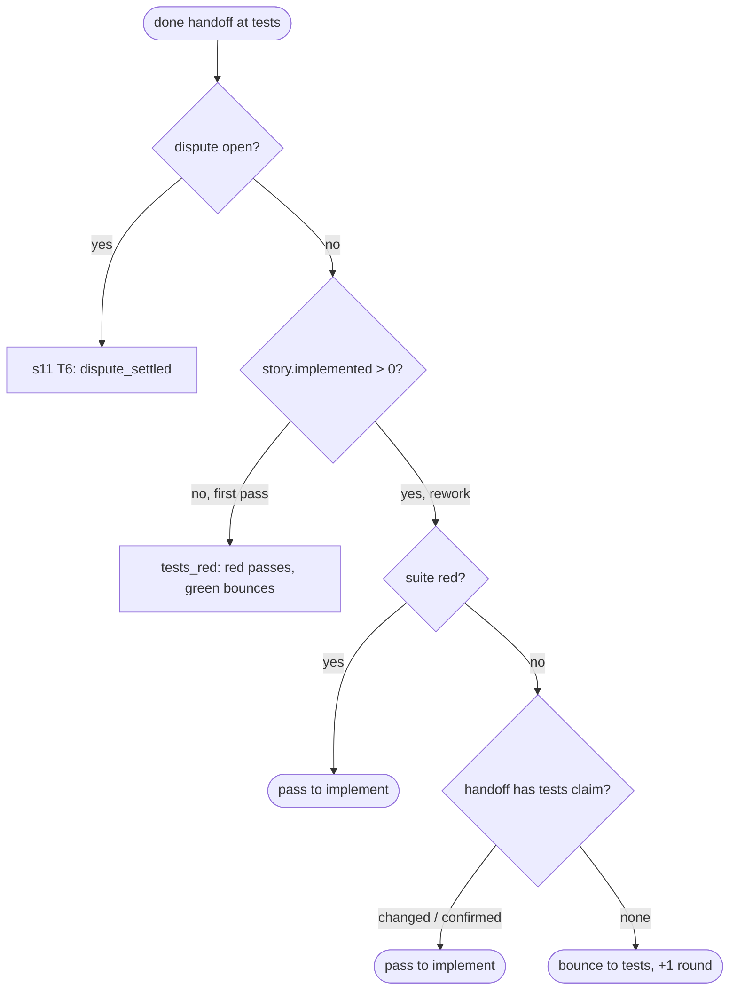

# s24: Tests gate on reworked stories; clearing a hold on a done story

Developer: **developer-cli** (runner Python: `roles.py`, `gates.py`,
`state.py`, `dispatch.py`, `po_tools.py`, and the built-in role files
`unit-tester.md` and `product-owner.md`). In this design step the Architect
has already updated `reference/protocol.md` ("Back at tests with the code
in", the handoff block, holds, and `state.json` fields), `SKILL.md`,
`docs/customer/routing.md` and the index in `architecture.md`. The README
row does not change.

Story: `.team/stories/s24.md`. Builds on s11 (`design/s11.md`, rules T6–T8)
and s19 (`design/s19.md`, rules R6 and R12).

## The problem

1. **Stranded at `tests` (AC1).** The `tests` gate (`Checks.tests_red`)
   passes only when the suite fails. That is right on a story's first pass,
   before any code exists. But a story can come back to `tests` after its
   code is in: a `revise_design` or `rescope` ruling, a reviewer's
   `changes_requested` with `next_role: unit-tester` or `architect`, or a
   dispute that has been closed. Its suite is then green, and the gate bounces
   it again and again until the round cap. s19 had to be moved to
   `implement` by hand.
2. **A hold on a done story cannot be cleared (AC2, s11 review F1).**
   `note_step` can set a hold on a done story, for example
   `ruling_not_applied` after the PO runs the Manager on it.
   `continue_story` refuses done stories, so the PO cannot "drop it" as
   `product-owner.md` says. The Scribe picker already ignores such a hold
   (s19 R12), but the hold stays in `state.json` forever and the PO has no
   way to acknowledge the hand-over.

## The route at `tests`



A `changes_requested` at `tests` on a reworked story (or with a dispute open)
goes through `_handoff_outcome`, as the dispute gate does today. On a first
pass, `tests_red` still runs for every status. That is today's behaviour, and
s24 does not change it.

## Rules

| # | Rule | AC |
|---|---|---|
| G1 | **Implementation marker.** `StoryState.implemented: int = 0` counts how many times the story has passed the `implement` gate. `Pipeline._forward` adds 1 when it moves a story forward **from** `implement`, including when `implement` is the last enabled step and the story becomes `DONE`. Nothing resets it: rulings, bounces, disputes and returns leave it alone, because the code stays in the history. | AC1 |
| G2 | **Older state.** A story saved without `implemented` loads with `1` when its `step` is after `implement` in `config.PIPELINE_STEPS` (`quality`, `review`, `design-review`, `e2e`, `acceptance`, done stories included), and with `0` otherwise. That covers s11 and s25, which are at `e2e` today. A pre-s24 story that has already gone back to `design` or `tests` loads with `0`. If it strands, the liaison moves it to `implement` once, as before. | AC1 |
| G3 | **Tests claim in the handoff.** A handoff may carry `"tests": "changed"` or `"tests": "confirmed"`. `changed` means the unit-tester changed tests for this story on this pass. `confirmed` means it checked that the existing tests already cover the story as designed now. Any other value (including `""`) is a malformed handoff with the message `handoff tests must be one of ('changed', 'confirmed')`. Any role may send it, but only G4 reads it. The `step-end` event and `handoff_report` do not carry it, so the fixture is unchanged. | AC1 |
| G4 | **Rework gate.** At `tests`, with no open dispute, `story.implemented > 0` and a `done` handoff, the gate is `checks.tests_reworked(handoff.tests)`. It runs the test command once. A red suite gives exactly the `tests_red` outcome (`PASS`, reason `""`). A green suite with a claim gives `PASS` with reason `tests pass on code from an earlier pass; tests {claim}`. A green suite without a claim gives `BOUNCE` (back to `tests`, round counted) with reason `REWORK_UNCLAIMED` (exact text below). | AC1 |
| G5 | **First pass unchanged.** With `story.implemented == 0`, the `tests` step runs `tests_red` exactly as today, whatever the handoff's status. A claim is ignored: a green suite bounces with `tests pass before implementation; write a failing test`. | AC1 |
| G6 | **Precedence.** An open dispute (s11 T6) wins over G4: `dispute_settled` decides, whatever `implemented` is. A non-`done` handoff on a reworked story goes to `_handoff_outcome`, exactly as with an open dispute. | AC1 |
| G7 | **Brief.** While `story.step == "tests"`, `story.implemented > 0` and `story.dispute is None`, `Runtime.user_prompt` adds `REWORK_BRIEF` (exact text below) after the `Story …` line, the way T9 adds the dispute line. | AC1 |
| G8 | **Clearing a hold on a done story.** `continue_story(story, note)` no longer refuses a done story. For any known story it sets `hold = None` and `note = args.get("note", "")`, saves, and returns `{"status": "continued", "story": id, "step": story.step}`. The unknown-id refusal is unchanged. On a done story the note reaches the Scribe's standard brief if the Scribe is still due (s19 R4 clears it after that step). Otherwise nothing reads it. | AC2 |
| G9 | **Consistency with s19 R12.** The Scribe picker (`router._scribable`) and `note_step` do not change. A done story's hold never stops its Scribe step. G8 only gives the PO a way to acknowledge the hand-over and clear the stale hold. A done story still never moves: `dispatch_refusal` still refuses every gated role on it, and rulings still refuse it (s11 T10). | AC2 |

### Exact strings (tests may assert them)

```python
# gates.py
REWORK_UNCLAIMED = (
    "tests pass on code from an earlier pass; write a failing test, "
    'or hand off "tests": "changed" or "tests": "confirmed"'
)
REWORK_PASS = "tests pass on code from an earlier pass; tests {claim}"

# dispatch.py
REWORK_BRIEF = (
    "Code from an earlier pass is in, so the suite may already be green. "
    'If it is once the tests are right, say so in your handoff: "tests": "changed" '
    '(you changed tests for this story) or "tests": "confirmed" '
    "(you checked the existing tests already cover it)."
)
```

## Changes by module

Every function stays at 8 lines or fewer, with at most 2 parameters besides
`self` and no boolean parameters.

| Module | Change |
|---|---|
| `roles.py` | `class TestClaim(StrEnum)`: `CHANGED = "changed"`, `CONFIRMED = "confirmed"`. `TEST_CLAIMS = tuple(map(str, TestClaim))`. `Handoff.tests: TestClaim \| None = None`, the last field. A new `HANDOFF_RULES` row, last: `(lambda d: d.get("tests") in (None, *TEST_CLAIMS), f"tests must be one of {TEST_CLAIMS}")`. `_handoff_from` passes `tests=_claim(data.get("tests"))`, where `_claim(value)` returns `TestClaim(value)` or `None` when `value` is `None`. `handoff_report` is unchanged. |
| `gates.py` | Import `TestClaim` from `.roles`. `StoryState.implemented: int = 0`, after `disputes`. Constants `REWORK_UNCLAIMED` and `REWORK_PASS`. `Checks.tests_reworked(claim: TestClaim \| None) -> Outcome` (G4): `red = self.tests_red()`; return `red` if it passed; `BOUNCE` with `REWORK_UNCLAIMED` when `claim is None`; else `PASS` with `REWORK_PASS.format(claim=claim)`. `Pipeline._gate_for` gets a second branch after the dispute one: `if story.step == "tests" and story.implemented: return self._rework_gate(handoff)`. `Pipeline._rework_gate(handoff)`: `None` unless `handoff.status == "done"`, else `lambda: self.checks.tests_reworked(handoff.tests)`. `Pipeline._forward` adds 1 to `story.implemented` when `story.step == "implement"`, before it moves the story (G1). |
| `state.py` | `from .config import PIPELINE_STEPS` (no cycle: `config` imports only `providers`). `PAST_IMPLEMENT = frozenset(PIPELINE_STEPS[PIPELINE_STEPS.index("implement") + 1 :])`. `_story` passes `implemented=data.get("implemented", _legacy_implemented(data))`. `_legacy_implemented(data) -> int`: `1` if `data.get("step") in PAST_IMPLEMENT` else `0` (G2). |
| `dispatch.py` | `REWORK_BRIEF`. `_story_lines(story)` builds `[story line, *_dispute_lines(story), *_rework_lines(story)]` and joins them with `"\n"` as today. `_dispute_lines` holds today's T9 line. `_rework_lines` returns `[REWORK_BRIEF]` under G7's condition, else `[]`. |
| `po_tools.py` | `Tools.continue_story`: refuse only when `story is None` (G8). Its `SCHEMAS` description becomes `Release a story the runner handed to you (a done story too, to clear its hold); your note is added to its next step's standard brief.` |

### Role files (built-in)

- `unit-tester.md`. In "Deliverables", the red bullet gets one more
  sentence: `On a story whose code is already in (the brief says "Code from
  an earlier pass is in"), the suite may be green; see below.` Add a section
  after "A test dispute":

  ```markdown
  ## A story that comes back with its code in

  When the brief says `Code from an earlier pass is in`, the story has been
  through implement before (a ruling, a review or a closed dispute sent it
  back). Update the tests to the current design. If that leaves the suite
  red, hand off `done` as usual. If it is green, hand off `done` with
  `"tests": "changed"` when you changed tests for this story, or
  `"tests": "confirmed"` when you checked the existing tests already cover
  it. Without either, a green suite bounces back to you.
  ```

- `product-owner.md`. Line "**ruling not applied**: run the manager on the
  story it meant, or drop it." becomes `**ruling not applied**: run the
  manager on the story it meant, or drop it (continue_story clears the hold,
  even on a done story).` Item 5 gains a sentence: `A done story's hold
  never stops its scribe; continue_story clears it.`

## Test checklist (for the Unit Tester)

Contract changes (these do not weaken tests): `continue_story` on a done
story used to be refused with `story sN is done`. It now continues (G8).
`test_po_tools.py` line 302 (`done == {"status": "refused", "reason":
"story s2 is done"}`) must expect `{"status": "continued", "story": "s2",
"step": …}` and a cleared hold instead. Fix it at this tests step.

1. **G3** (`test_roles.py`): `"tests": "changed"` and `"confirmed"` parse to
   `TestClaim.CHANGED` and `CONFIRMED`. Without the key it is `None`.
   `"tests": "yes"`, `"tests": ""` and `"tests": 1` each raise
   `HandoffError("handoff tests must be one of ('changed', 'confirmed')")`.
   `handoff_report` has no `tests` key.
2. **G1** (`test_gates.py`): a `PASS` at `implement` raises `implemented`
   from 0 to 1, and a second pass makes it 2. A pass at any other step, a
   bounce, a return, a dispute and every ruling leave it unchanged. With
   `steps` ending at `implement`, the pass marks the story `DONE` and still
   counts.
3. **G4** (`test_gates.py`, stub `run`): story at `tests`, `implemented = 1`,
   no dispute, `done`:
   - test command exits non-zero → `PASS`, reason `""`, moves to
     `implement`;
   - exits 0 with `tests="changed"` → `PASS` with
     `tests pass on code from an earlier pass; tests changed`, and likewise
     for `confirmed`;
   - exits 0 with no claim → `BOUNCE` to `tests` with `REWORK_UNCLAIMED`,
     and `rounds` goes up by 1;
   - the test command runs exactly once, and the coverage command never
     runs.
4. **G5**: `implemented = 0`, exit 0, `tests="changed"` → `BOUNCE` with
   `tests pass before implementation; write a failing test`. A first-pass
   `changes_requested` still runs `tests_red` (today's behaviour, pinned).
5. **G6**: `implemented = 1` with an open dispute → `dispute_settled`
   decides (stub the diff exit), and the claim and test command are not
   used. `implemented = 1`, `changes_requested`, `next_role: architect` →
   `_handoff_outcome`: `design`, +1 round, and the test command does not
   run.
6. **G2** (`test_state.py`): state JSON without `implemented` loads `1`
   for steps `quality` … `acceptance` (parametrized) and `0` for `design`,
   `tests` and `implement`. An explicit `"implemented": 0` on a story at
   `e2e` stays `0`. The value round-trips.
7. **G7** (`test_dispatch.py`): the `tests`-step prompt holds
   `REWORK_BRIEF` when `implemented > 0` and no dispute. It does not hold it
   on a first pass, while a dispute is open (that prompt has the dispute line
   instead), or at another step.
8. **AC1 end to end** (`test_router.py`, s19's fakes): a story reaches
   `review` (implemented 1). A Manager `revise_design` ruling sends it to
   `design`. Then `architect` done → `tests` (`unit-tester` done with
   `"tests": "confirmed"`, stub suite green) → `implement` (green) → on
   down the pipeline, with no hand-over to the PO and no manual state edit.
   The same route with no claim bounces once at `tests` with
   `REWORK_UNCLAIMED` in the next standard brief's "Sent back" line.
9. **G8** (`test_po_tools.py`): a done story held with `ruling_not_applied`
   → `continue_story(story, note)` returns `continued`, sets `hold` to
   `None` and `note` to the note, and saves. An unknown id is still refused
   with the exact text. A done story's note reaches the Scribe's standard
   brief when `scribe_due` holds it, and is cleared after that step.
10. **G9** (`test_router.py`): a held done story in `scribe_due` is still
    scribed (s19's test stays). A done story never becomes movable after
    `continue_story`. `run_role` of a gated role on it is still refused with
    `story sN is done`.
11. Coverage ≥ 95% (target 100%); `ruff check` and `ruff format --check`
    clean (AC3).

## Out of scope

- Checking that a `changed` claim matches a real change to test files. The
  runner trusts the claim like a handoff status. The code reviewer sees the
  diff, and a wrong `confirmed` shows up as missing coverage of the story's
  rules at review.
- Marking stories that went back to `design` or `tests` before s24 (G2).
- Not setting holds on done stories at all. That is s11 F1's other option.
  It would hide a done story's hand-over reason from `status`, so G8 keeps
  the hold and lets the PO clear it.
