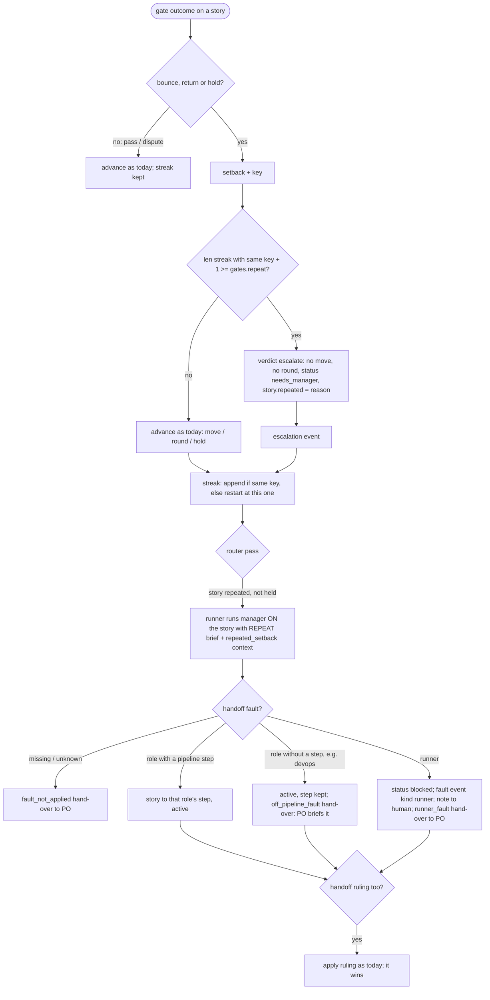

# s27: A repeated setback escalates instead of looping

Developer: **developer-cli**. The work is runner Python (new `loops.py`,
plus `gates.py`, `state.py`, `config.py`, `cli.py`, `dispatch.py`,
`router.py`, `handover.py`, `roles.py`, `events.py`, `dashboard/snapshot.py`),
the dashboard page `dashboard/index.html` with its fixture
`dashboard/fixtures/snapshot.json`, and the built-in role files `manager.md`
and `product-owner.md`. In this design step the Architect has already
updated `reference/protocol.md`, `SKILL.md`, the README row,
`docs/customer/routing.md` and `architecture.md`.

Story: `.team/stories/s27.md`. Builds on s19 (`design/s19.md`: hand-overs,
holds, `previous`), s11 (`design/s11.md`: rulings, disputes), s24 (rulings
reset counters) and s26 (`design/s26.md`: the e2e trial and `NotUp`
returns).

## The problem

In sprint 8 (events e451–e458) s4 went acceptance → e2e → acceptance →
e2e. The Proxy found no server, the integration-tester passed e2e again,
and the Proxy found no server again. The real cause was the runner's own
failed start, and neither role could fix it. Three things let the loop
run:

1. Nothing compares one setback with the last one. Only the round cap
   stops a loop, and only after `round_cap` rounds.
2. A `return` (s13/s26: an unpresented story, or a delivery that did not
   start for the Proxy) counts **no** round. A loop of returns never
   reaches the cap.
3. A bad handoff bounces without a gate event, so its reason is never
   logged next to the others.

## Vocabulary

- **Setback**: a gate outcome that sends a story back or holds it:
  verdict `bounce`, `return` or `hold`, including a gated role's malformed
  handoff (a bounce). A `pass` is not a setback. Neither is a `dispute`,
  which has its own free count (s11).
- **Author**: who wrote a setback's reason. `role` means a role's handoff:
  its `changes_requested` summary, a `blocked`/`failed` hold, or a
  malformed handoff. `runner` means the runner's own check or setup: a
  command gate, the presentation check or trial, a `NotUp` return, or a
  port hold.
- **Key**: `"<step>><to_step> <normalised reason>"`, for example
  `acceptance>e2e story <id> presentation is not up: …`.
- **Streak**: the setbacks recorded on a story since its key last changed.
- **Repeat**: a setback whose key equals the key of the last setback in
  the streak.

## Flow



## Rules

| # | Rule | AC |
|---|---|---|
| L1 | **Setbacks.** Each gate outcome with verdict `bounce`, `return` or `hold` on a story is recorded as a `Setback(step, to_step, role, verdict, author, reason, event)`. `step` is the story's step before the gate. `to_step` is `outcome.bounce_to or step`. `role` is the role whose step it was (the Proxy for a return). `event` is the id of the event that logged it. These go through `Runtime._advance_and_log`, which every gate outcome already uses. A gated role's malformed handoff (`Runtime._bounce`) now goes through `_advance_and_log` too, so it is gated, logged and recorded like any other bounce. | AC1 |
| L2 | **Key.** `loops.normalise(reason)` lowercases the reason, applies `loops.NORMALISE` in order (`re.sub` per row) and strips the result. `Setback.key` is `f"{step}>{to_step} {normalise(reason)}"`, set in `__post_init__` and always recomputed, so a stored key is never trusted. The table is data. To strip something new, add a row (AC4). | AC1, AC4 |
| L3 | **Streak.** `StoryState.streak: list[Setback]`. After each setback, `loops.extend(streak, setback)` returns `[*streak, setback]` when the streak's last key equals the setback's key, else `[setback]`. A pass, a dispute, a hand-over and a PO `continue_story` leave it alone, so a ping-pong through a passing step still counts. A different key restarts the count at 1 (AC4). A Manager ruling or fault (L8, L10) clears it. | AC1, AC4 |
| L4 | **Repeat rule.** `Pipeline.repeat: int` comes from `[gates] repeat` (default `2`; config check: `gates.repeat must be at least 2`). Before the story moves, `Pipeline.screen(story, setback)` returns an `ESCALATE` outcome when `loops.repeats(story.streak, setback) + 1 >= self.repeat`, else `None`. `repeats` is `len(streak)` when the last key matches, else `0`. With the default, the second setback in a row with the same key escalates. | AC1 |
| L5 | **Escalation in code.** `Verdict.ESCALATE = "escalate"`. `Outcome(ESCALATE, setback.reason, setback.step, author=setback.author)`. `Pipeline.advance` on `ESCALATE`: `status = NEEDS_MANAGER` and `story.repeated = outcome.reason`. The step does not change, `rounds` does not change, and the story is not sent round again. It is logged as an `escalation` event instead of a `gate` event (like `test-dispute`). The data is the gate fields plus `key`, `author`, `count` (streak length including this one) and `history` (the earlier streak's event ids). The setback is then added to the streak with this event's id. | AC2, AC3 |
| L6 | **Zero rounds.** Escalating adds no round to anyone. The Manager step it triggers is ungated and counts none. Applying a fault (L8) resets `rounds`, `disputes` and `dispute` the way every ruling does, so no role keeps a round for the loop. | AC3 |
| L7 | **The runner runs the Manager.** Router picker `_repeat_work`, after `_manager_work` and before `_scribe_work`, picks the first story with `repeated` set, `status == NEEDS_MANAGER`, in the current sprint, `hold is None` and not blocked by an open question. It runs `manager` **on that story** with `repeat_brief` (exact text below). `Runtime.user_prompt` adds a `repeated_setback` entry to the Manager's runner context when the plan's story has `repeated`: `{"story", "reason" (story.repeated, verbatim: the last job or gate output), "key", "count", "author", "history" (each streak setback as a dict: step, to_step, role, verdict, author, reason, key, event), "events"}`. `events` holds every event for that story whose id number is at least the first history event's, of kind `gate`, `step-end`, `test-dispute`, `escalation`, `ruling` or `fault`, as dicts. Step briefs (`step-start`) are left out. `stories_at_round_cap` leaves out stories with `repeated` set. | AC2 |
| L8 | **Fault.** A Manager handoff may carry `"fault": "<role name>" \| "runner"` (a non-empty string; otherwise it is malformed: `handoff fault must be a role name or "runner"`). On a story with `repeated` set, `fault` is required and its effect goes by `Pipeline.fault_kind(fault)` (`loops.Fault`). `runner` → `RUNNER`: status `BLOCKED`, step kept. A role with an enabled step (`step_for_role`) → `PIPELINE`: step = that role's step, status `ACTIVE`. Any other role the book knows → `OFF_PIPELINE`: status `ACTIVE`, step kept. `Pipeline.apply_fault(story, fault)` then clears `rounds`, `disputes`, `dispute`, `streak` and `repeated`. | AC2 |
| L9 | **Fault refusals.** A missing fault gives `FAULT_MISSING`, and a name that is neither `runner` nor in `book.names()` gives `FAULT_UNKNOWN` (texts below). The story is not changed and stays `needs_manager` with `repeated`. The report carries `"fault": {"fault", "applied": false, "why"}`, and a `ruling` in the same handoff is **not** applied. | AC2 |
| L10 | **A ruling with a fault.** When the fault applied and the handoff also has `ruling`, the existing `_rule` runs after it, so the ruling's move wins (`rescope`, `revise_design`, `escalate`; `upgrade_model` keeps the step and sets `ACTIVE`). `apply_ruling` also clears `streak` and `repeated`. A story without `repeated` is ruled exactly as today, and `fault` is ignored there. | AC2 |
| L11 | **Fault report and event.** An applied fault adds `"fault": {"fault", "kind", "applied": true, "reason", "now_at"}` to the Manager's report. `reason` is the repeated reason. It also emits a `fault` event with `{fault, kind, reason, now_at}`. This event is where a runner fault is flagged (`kind: "runner"`). | AC3 |
| L12 | **Runner fault: human and PO.** On kind `runner`, the runner posts `Note("update", RUNNER_FAULT_NOTE…, [story])` to the outbox, so the liaison relays it. The `runner_fault` hand-over row gives the PO the same story and reason. The story stays `blocked` until a Manager ruling moves it. That is the PO's job once the runner is fixed. | AC3 |
| L13 | **Hand-overs.** New `HANDOVERS` rows, after `ruling_not_applied`: `runner_fault` (applied, kind `runner`), `off_pipeline_fault` (applied, kind `off_pipeline`) and `fault_not_applied` (applied false). The `round_cap` row no longer matches a gate whose verdict is `escalate`. An escalation itself is **not** a hand-over, and the runner goes on to the Manager. If the escalating step's report matches other rows (questions, `stopped`, quarantine), the story is held as usual, the PO gets it first, and L7 waits for `continue_story`. | AC2, AC3 |
| L14 | **Refusal while escalated.** `dispatch_refusal` checks `_repeat_refusal` before `_status_refusal`. A story with `repeated` refuses every gated role with `story {id} repeated a setback ({key}); the manager rules on it first`. | AC2 |
| L15 | **The next brief.** `previous` keeps the escalating step (the Manager is ungated). `router._history_lines` reads a `SENT_BACK_LINES` table by verdict: `bounce` and `return` → `- Sent back to this step: {reason}` (unchanged). `escalate` → `- The same setback repeated, so the manager ruled on it: {reason}`. The Manager tells the fault role what to fix through `followups` (an existing mechanism). | AC2 |
| L16 | **State and status.** `StoryState.streak` (list, default `[]`) and `StoryState.repeated` (`str \| None`) are saved in `state.json`. Older files load with `[]` and `None`. `agile-team status` shows both, because it dumps each story with `asdict`. | AC1 |
| L17 | **Dashboard.** The snapshot's story dict gains `"repeated": story.repeated`. Board: a story with `repeated` shows the pill `⚑ needs manager · repeat` (tone `serious`) in place of `⚑ needs manager`, and a line under the title, `repeated: <first line of the reason, at most 140 chars>`, with the full reason in its `title` attribute. Flow tab timeline: an `escalation` row and a `fault` row (below). The mock replay treats `escalation` and `fault` events like gate events for position and status. | AC5 |
| L18 | **Docs.** `protocol.md` ("Repeated setbacks" under "Pipeline and gates", the handoff block, Rulings, Routing order, hand-over table, `state.json` fields, `[gates] repeat`), `SKILL.md`, the README row and `customer/routing.md` describe the rule. They are already updated in this design step. | AC5 |

### The normalisation table (exact; order matters)

Applied to `reason.lower()`. Then the result is `.strip()`ped.

```python
# loops.py
NORMALISE: tuple[tuple[re.Pattern[str], str], ...] = (
    # ISO date-times: 2026-10-10t12:00:00.5+02:00
    (re.compile(r"\d{4}-\d{2}-\d{2}[t ]\d{2}:\d{2}(?::\d{2}(?:\.\d+)?)?(?:z|[+-]\d{2}:?\d{2})?"), "<time>"),
    (re.compile(r"[a-z][a-z0-9+.-]*://\S+"), "<url>"),  # URLs, before host:port and paths
    (re.compile(r"\b[\w.-]+:\d{2,5}\b"), "<host>"),  # host:port, 127.0.0.1:8799
    (re.compile(r"\b\d{1,2}:\d{2}(?::\d{2})?(?:\s*[ap]m)?\b"), "<time>"),  # clock times
    (re.compile(r"[\w.~@+-]*/[\w.~@+/-]*"), "<path>"),  # anything with a slash
    (re.compile(r"\b[a-z]\d+\b"), "<id>"),  # s4, e451, m3, q3
    (re.compile(r"\b(?=[0-9a-f]*\d)[0-9a-f]{7,40}\b"), "<sha>"),  # commit shas
    (re.compile(r"(?<![a-z_])\d+(?:\.\d+)?"), "<n>"),  # counts, codes, durations, pids
    (re.compile(r"\s+"), " "),
)
```

Worked examples (tests may assert them):

| Reason | `normalise(reason)` |
|---|---|
| `tests fail:\n FAILED tests/test_x.py::test_a - assert 3 == 4\n1 failed in 0.42s` | `tests fail: failed <path>::test_a - assert <n> == <n> <n> failed in <n>s` |
| `coverage 93.5% is below 95.0%` | `coverage <n>% is below <n>%` |
| `story s4 presentation is not up: delivery 'cli' did not start: the start command exited with code 1 before http://127.0.0.1:8799/api/snapshot answered. Last output:\nOSError: [Errno 48] Address already in use` | `story <id> presentation is not up: delivery 'cli' did not start: the start command exited with code <n> before <url> answered. last output: oserror: [errno <n>] address already in use` |
| `nothing is listening at 127.0.0.1:8799 (connection refused)` | `nothing is listening at <host> (connection refused)` |
| `e2e passed at 2:20pm on 2026-10-10T14:20:00Z` | `e2e passed at <time> on <time>` |

The same reason with other numbers, ports, paths, ids or times gives the
same key. `tests fail` on two different test names gives two keys.

### Exact strings

```python
# router.py
REPEAT_HEADING = (
    "Story {id} hit the same setback {count} times in a row, so the runner stopped the loop. "
    "Find who owns the fault and rule on it: hand off \"fault\" (the role at fault, or "
    "\"runner\") and, if needed, a \"ruling\". The repeated reason, the history and the last "
    "output are in the runner context under repeated_setback."
)
SENT_BACK_LINES = {
    "bounce": "- Sent back to this step: {reason}",
    "return": "- Sent back to this step: {reason}",
    "escalate": "- The same setback repeated, so the manager ruled on it: {reason}",
}

# gates.py
REPEAT_REFUSAL = "story {id} repeated a setback ({key}); the manager rules on it first"

# dispatch.py
FAULT_MISSING = 'story {id} repeated a setback; name its fault: "fault": a role or "runner"'
FAULT_UNKNOWN = 'unknown fault {fault!r}; name a role or "runner"'
RUNNER_FAULT_NOTE = (
    "Runner fault on {story}: the same setback repeated and no role can fix it: {reason}. "
    "The manager says: {summary} The story is blocked until the runner is fixed."
)

# handover.py rows (trigger, line)
# runner_fault:
"{story}: runner fault: {fault_reason}; the story is blocked and the human was told. "
"Open a story to fix the runner; once it is fixed, run the manager on {story} with a ruling"
# off_pipeline_fault:
"{story}: the manager puts the repeated setback ({fault_reason}) on {fault}, which owns no "
"pipeline step; brief {fault} yourself, then continue_story"
# fault_not_applied:
"{story}: the manager's ruling on the repeated setback was not applied: {fault_why}; "
"run the manager on {story} again"
```

`repeat_brief(config, story)` = `REPEAT_HEADING.format(id=…, count=len(story.streak))`,
then the standard path lines (`_path_lines`), joined with `\n`.

## Changes by module

Every function stays at 8 lines or fewer, with at most 2 parameters besides
`self` (constructors excepted) and no boolean parameters.

| Module | Change |
|---|---|
| `loops.py` (new) | Module docstring: repeated-setback detection. Imports only stdlib (and `events.Event` for typing). `class Author(StrEnum)`: `ROLE = "role"`, `RUNNER = "runner"`. `class Fault(StrEnum)`: `RUNNER = "runner"`, `PIPELINE = "pipeline"`, `OFF_PIPELINE = "off_pipeline"`. `NORMALISE` (above). `normalise(reason: str) -> str`. `@dataclass Setback`: `step: str`, `to_step: str`, `role: str`, `verdict: str`, `author: Author`, `reason: str`, `event: str = ""`, `key: str = ""`. `__post_init__` coerces `author` with `Author(...)`, coerces `verdict` with `str(...)`, and sets `key` (L2). `repeats(streak, setback) -> int` and `extend(streak, setback) -> list[Setback]` (L3, L4). `HISTORY_KINDS = frozenset({"gate", "step-end", "test-dispute", "escalation", "ruling", "fault"})`. `manager_view(story, events: list[Event]) -> dict` builds L7's `repeated_setback` (`count` = `len(story.streak)`, `key`/`author` from the last setback). `_number(event_id) -> int` returns `int(event_id[1:])`. |
| `gates.py` | Import `Author`, `Fault`, `Setback` from `.loops`. `Verdict.ESCALATE` (with a docstring line: stays put, no round, the Manager rules). `StoryState.streak: list[Setback] = field(default_factory=list)` and `repeated: str \| None = None`, the last fields. `Outcome.author: Author = Author.RUNNER`, the last field. `Author.ROLE` is set on the `STOPPED_HANDOFFS` hold in `evaluate`, in `_handoff_outcome`, and in `_raise`. `REPEAT_REFUSAL` and `_repeat_refusal(story)` go first in `dispatch_refusal`'s chain (L14). `Pipeline.repeat: int = 2` after `checks`. `Pipeline.screen(story, setback) -> Outcome \| None` (L4). In `advance`, a `moves` row `Verdict.ESCALATE: lambda: self._escalate(story, outcome)`. `_escalate` sets `NEEDS_MANAGER` and `repeated`. `fault_kind(fault) -> Fault`: `RUNNER` if `fault == "runner"`, `PIPELINE` if `step_for_role(fault)`, else `OFF_PIPELINE`. `FAULT_STATUS = {RUNNER: BLOCKED, PIPELINE: ACTIVE, OFF_PIPELINE: ACTIVE}`. `apply_fault(story, fault)`: step = `step_for_role(fault) or story.step`, status from `FAULT_STATUS`, then `_clear(story)`. `_clear(story)` resets `rounds`, `disputes`, `dispute`, `streak` and `repeated`, and `apply_ruling` uses it in place of its reset line. |
| `state.py` | `_story` loads `streak=[Setback(**s) for s in data.get("streak", [])]` (a nested list, so it is not in `NESTED`). `repeated` loads through `**data`, with the dataclass default when it is missing. |
| `config.py` | `Gates.repeat: int = 2`. `GATE_RULES` row: `(lambda g: g.repeat >= 2, "gates.repeat must be at least 2")`. |
| `cli.py` | `_pipeline` builds `gates.Pipeline(list(config.gates.steps), config.gates.round_cap, checks, config.gates.repeat)`. |
| `events.py` | `EventKind.ESCALATION = "escalation"`, `EventKind.FAULT = "fault"`. `EventLog.emit` already returns the `Event`. |
| `roles.py` | `Handoff.fault: str \| None = None`, the last field. `HANDOFF_RULES` row, last: `(lambda d: d.get("fault") is None or _text(d.get("fault")), 'fault must be a role name or "runner"')`. `_handoff_from` passes `fault=data.get("fault")`. `handoff_report` is unchanged. |
| `dispatch.py` | `GATE_EVENTS[Verdict.ESCALATE] = EventKind.ESCALATION`. `Runtime.emit` returns the `Event` from `self.events.emit`. `SETBACKS = frozenset({Verdict.BOUNCE, Verdict.RETURN, Verdict.HOLD})`. `_setback(plan, outcome) -> Setback \| None` (L1). `_advance_and_log`: build the setback; `outcome = self.pipeline.screen(story, setback) or outcome` when there is one; advance and build `result` as today; add `_setback_fields(setback, story.streak)`, which returns `{}` for no setback, else `{"key", "author", "count", "history"}`. `history` is `[s.event for s in streak]` when `loops.repeats(streak, setback)`, else `[]`, and `count` is `len(history) + 1`. So every setback's gate or escalation event carries all four. Then `event = self.emit(...)`; then `story.streak = loops.extend(story.streak, replace(setback, event=event.id))`. `_bounce(plan, reason)`: when the role fits the step, `self._advance_and_log(plan, Outcome(BOUNCE, reason, story.step, author=Author.ROLE))` and return its result. `_apply` puts it in the `bad_handoff` report as `"gate"` when there is one. `_manager_context(story)` takes the plan's story: it adds `repeated_setback` (L7) and filters `stories_at_round_cap`. `apply_manager`: after the queues and followups, `return self._rulings(plan, handoff)`. That is `_rule_repeat` when `plan.story` has `repeated`, else today's `_rule` path. `_rule_repeat` = `_fault(plan, handoff)`, then `_rule(plan, handoff.ruling)` merged in only when the fault applied and a ruling is given (L9, L10). `_fault_refusal(story, fault) -> str \| None` (L9). `_fault` applies the fault, emits `EventKind.FAULT` and returns L11's dict. On kind `runner` it posts `RUNNER_FAULT_NOTE` with `summary=handoff.summary` (L12). |
| `router.py` | `REPEAT_HEADING`, `repeat_brief(config, story)`, `SENT_BACK_LINES` in place of `SENT_BACK` in `_history_lines`. `Router._repeat_work` and `_escalated(story)` (L7). `PICKERS = (_manager_work, _repeat_work, _scribe_work, _story_work)`. The `next_work` docstring names the order. |
| `handover.py` | `Trigger.RUNNER_FAULT = "runner_fault"`, `OFF_PIPELINE_FAULT = "off_pipeline_fault"`, `FAULT_NOT_APPLIED = "fault_not_applied"`. `_fault(report) -> dict` returns `report.get("fault") or {}`. Three rows, appended after `RULING_NOT_APPLIED` (L13). `ROUND_CAP` applies only when `story_status == NEEDS_MANAGER and verdict != "escalate"`. `report_fields` adds `fault`, `fault_reason` and `fault_why`. `previous_step`'s `bad_handoff` branch takes `verdict` from `_gate(report)` when present, else `"bounce"`. |
| `dashboard/snapshot.py` | `_story` adds `"repeated": story.repeated`. |
| `dashboard/fixtures/snapshot.json` | Every story gets `"repeated": null`. Add one story that is `needs_manager` with a `repeated` reason, an `escalation` event and a `fault` event (`kind: "runner"`) for it, and a gate event that carries `key`, `author`, `count` and `history`. |
| `dashboard/index.html` | `STATUS_TONE.escalate = "serious"`. In `storyCard`, the pill and the `repeated:` line (L17). `TIMELINE.escalation`: `{from: "gate", to: "manager", what: "repeat → needs manager", tone: "serious", body: e.data.reason, meta: \`${e.data.step} · ${e.data.count}× in a row · by ${e.data.author} · no round\`}`. `TIMELINE.fault`: `{from: "manager", to: kind === "runner" ? "you" : e.data.fault, what: kind === "runner" ? "runner fault" : \`fault: ${e.data.fault}\`, tone: kind === "runner" ? "critical" : "warning", body: e.data.reason, meta: \`now at ${e.data.now_at}\`}`. In `replayStories`, an `escalation` sets `status: "needs_manager"` and `repeated: e.data.reason`. A `fault` sets `step: now_at`, `status` (`blocked` for kind `runner`, else `active`), `rounds: 0` and `repeated: null`. In `asOf`, `manager_due` says `story X repeated a setback` for a capped story that has `repeated`. In `flowStats`, an `escalation` adds 1 to `stuck` for `e.role`. |
| `roles/manager.md` | Description and "You are consulted" mention repeated setbacks. A new section, **A repeated setback**: the runner ran you on the story because the same setback repeated (`repeated_setback` in the context: reason, history, events, last output). Decide who owns the fault: the role it was sent back to, another role, or `runner` (the runner's own setup or a gate no role can satisfy, e.g. a failed prepare line or a delivery that never starts; `author: "runner"` hints at this but does not prove it). Hand off `"fault"`, and optionally a `"ruling"`, which wins. Use `followups` to tell the fault role what to fix. Handoff section: add `"fault"`. |
| `roles/product-owner.md` | Item 4 gains: **runner fault**: tell the human what the note says, open a story for the runner fix (often devops or developer-cli), and run the manager on the blocked story with a ruling once it is fixed. **repeated setback put on a role with no step**: `run_role` that role, then `continue_story`. **fault ruling not applied**: run the manager on the story again. |

## Test checklist (for the Unit Tester)

Contract changes (these do not weaken tests):

- A gated role's malformed handoff now emits a `gate` event (verdict
  `bounce`, `author: "role"`), and its report carries `"gate"`. A test that
  asserted no gate event there must expect one.
- A bad handoff that reaches the round cap now hands over `round_cap`
  (before s27 its report had no gate, so the row never matched).
- `Pipeline(...)` gains `repeat` (default 2). A test that bounces the same
  reason twice and expects the second bounce to move the story or count a
  round must set `repeat` high, or change the reason. Keep its intent.

1. **L2 normalise** (`test_loops.py`): each worked example row exactly. The
   same reason with different numbers, port, path, id, sha and time gives
   one key. Two different test names give two keys. `Setback(...).key`
   starts with `"<step>><to_step> "`. A stored `key` is recomputed on load.
2. **L3 streak**: `extend` appends on the same key and restarts on a
   different key. `repeats` is 0 for an empty streak or a different last
   key, else `len(streak)`.
3. **L4/L5 repeat** (`test_gates.py`): with `repeat=2`, the first setback
   bounces as today (moves, +1 round). The second same-key setback →
   `screen` returns `ESCALATE`, `advance` leaves `step` and `rounds`
   unchanged, sets `NEEDS_MANAGER` and `repeated` = the full reason. With
   `repeat=3`, escalation comes on the third. A different reason in between
   resets (AC4). A pass in between does **not** reset. A dispute is never a
   setback.
4. **L1 every setback kind** (`test_dispatch.py`, stub query): a
   `changes_requested` bounce (author `role`), a command-gate bounce (author
   `runner`), a `blocked` hold (author `role`), a `NotUp` return at the
   Proxy (author `runner`) and a malformed handoff (author `role`) each land
   in `story.streak` with the gate event's id. Their gate events carry `key`,
   `author`, `count` (1) and `history` (`[]`). A repeat of each escalates.
5. **L5 event**: an escalation logs `escalation` (no `gate` event for that
   outcome) with `step`, `verdict: "escalate"`, `reason`, `now_at` (=
   step), `story_status: "needs_manager"`, `rounds` (unchanged), `key`,
   `author`, `count` and `history` (the earlier event ids).
6. **L6 zero rounds**: rounds before and after the escalation are equal.
   The Manager step adds none. After an applied fault `rounds == 0`,
   `disputes == 0`, `streak == []` and `repeated is None`.
7. **L7 hand-over to the Manager** (`test_router.py`, s19's fakes): s4-like
   route: Proxy bounces `acceptance → e2e` (reason A), tester passes e2e,
   Proxy bounces again with A (other port). The next step the router runs
   is `manager` on s4 with `REPEAT_HEADING` (count 2) and no PO turn in
   between. A held escalated story is not picked until `continue_story`,
   and one blocked by an open question is not picked either. `manager_due`
   still goes first.
8. **L7 attached history**: the Manager's prompt has `repeated_setback`
   with `reason` (verbatim), `key`, `count`, `author`, `history` (both
   setbacks: roles, steps, event ids) and `events` (the story's gate,
   step-end and escalation events from the first setback on, with no
   `step-start`, and none from another story). `stories_at_round_cap` leaves
   out the repeated story.
9. **L8 faults** (`test_dispatch.py`): `fault: "integration-tester"` →
   step `e2e`, `active`, a `fault` event with `kind: "pipeline"`, and the
   report's `fault.applied` is true. `fault: "devops"` → step kept,
   `active`, the `off_pipeline_fault` hand-over. `fault: "runner"` →
   `blocked`, a `fault` event with `kind: "runner"`, one outbox `update`
   note naming the story that holds `RUNNER_FAULT_NOTE`'s text, and the
   `runner_fault` hand-over line with the reason.
10. **L9**: no fault → `FAULT_MISSING`. `fault: "nobody"` → `FAULT_UNKNOWN`.
    Either way the story is unchanged, a `ruling` is not applied, and
    `fault_not_applied` hands over. `"fault": ""` or `"fault": 3` is a
    malformed handoff with the exact message.
11. **L10**: `fault: "developer-cli"` plus `ruling: "revise_design"` → step
    `design` (the ruling wins), and both `fault` and `ruling` are in the
    report. On a story without `repeated`, a `fault` is ignored, and the
    ruling behaves as today.
12. **L13**: an escalation report triggers no hand-over by itself
    (`handover.triggers` is empty). `round_cap` does not match it. A
    bounce that reaches the cap still matches `round_cap`.
13. **L14**: `run_role(developer, s4)` while it is escalated is refused
    with `REPEAT_REFUSAL`, and `manager` is not refused.
14. **L15**: after a fault moves the story, the next standard brief has
    the `escalate` line with the reason.
15. **L16** (`test_state.py`): `streak` and `repeated` round-trip. An older
    state without them loads `[]` and `None`.
16. **Config**: `gates.repeat = 1` fails `config check` with the exact
    message, and the default is 2. `cli` passes it to `Pipeline`.
17. **L17 dashboard** (`test_snapshot.py`, `test_dashboard_ui.py`): stories
    in the snapshot have `repeated`, and the fixture matches the builder's
    keys. The page has `TIMELINE` entries for `escalation` and `fault`, the
    board renders `needs manager · repeat` and the reason for the fixture's
    repeated story, and the replay handles both kinds.
18. Coverage ≥ 95% (target 100%); `ruff check` and `ruff format --check`
    clean.

## Known limits

- **Role prose rarely repeats word for word.** A key is the normalised
  reason. Two Proxy summaries that say the same thing in different words
  ("nothing is listening at …" against "Dashboard is not running at …"),
  as in e451/e457, give two keys. The round cap still applies to them.
  Since s26 that case is caught anyway: the e2e trial and the Proxy's
  prepare report a `NotUp` in a fixed template, which normalises to one
  key. Matching on the step and target alone was rejected because AC4 says
  a different reason resets the count. See the open question in the
  handoff.
- Refusals and crashes (`refused`, `error` reports) are not gate outcomes,
  so they are not setbacks. The PO already gets each one.
- The normalisation can over-merge, for example two different `/`-paths
  in the same sentence. The fault ruling clears the streak, so an
  over-merge costs at most one Manager step.
