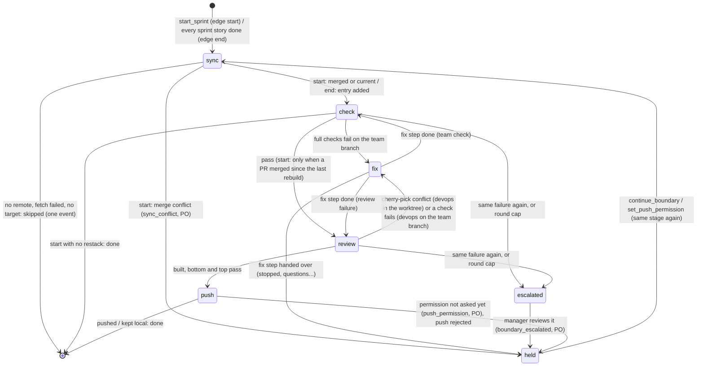

# s29: Keep the team's work in sync with upstream, and deliver each sprint as a rebased stacked PR

Developer: **developer-cli**. The work is runner Python: new modules
`upstream.py`, `stack.py`, `fullcheck.py`, `boundary.py` and
`boundary_runner.py`, plus changes to `git_ops.py`, `config.py`, `state.py`,
`events.py`, `preflight.py`, `dispatch.py`, `router.py`, `handover.py`,
`po_tools.py`, `cli.py` and `dashboard/snapshot.py`. It also covers the
dashboard page `dashboard/index.html`, its fixture
`dashboard/fixtures/snapshot.json`, and the built-in role files `devops.md`
and `product-owner.md`. After that, **devops** makes the CI workflow change
and sets the `e2e` delivery lines (see "DevOps change"). Developer roles
cannot write `.github/**`.

In this design step the Architect has already updated `reference/protocol.md`,
`SKILL.md`, the README row, `docs/customer/review-stack.md`,
`docs/adr/ADR-005-sync-and-review-stack.md` and `architecture.md`.

Story: `.team/stories/s29.md`. Builds on s19 (`design/s19.md`: router,
hand-overs, holds), s27 (`design/s27.md`: `loops.Setback`, keys, escalation
to the Manager) and s3 (sprints).

## Decisions (ADR-005)

1. **The team branch is never rewritten.** At sprint start the runner merges
   `<remote>/<branch>` into it, which may add a merge commit. Role steps and
   boundary fixes add commits on top. Every hash in `state.json`, reviews
   and designs stays valid.
2. **Review branches are derived, never edited.** At each rebuild the runner
   makes every review branch again from the team branch: it cherry-picks
   each sprint's own unmerged commits onto the latest main, in a scratch
   worktree. Because a fix made only on a review branch would be lost at the
   next rebuild, check fixes go on the **team branch**. Conflict
   resolutions are made in the worktree and replayed by `git rerere`.
3. **One PR per sprint, stacked.** The bottom PR is based on main and is
   ready. The others are drafts, each based on the review branch below it.
   CI skips drafts, so it runs once per merge.
4. **Boundaries are code.** The sync, the full checks, the rebuild and the
   push run in a runner step that no prompt can skip. A failed check
   becomes a DevOps fix step. A repeat of the same failure escalates to the
   Manager, using s27's keys.

## Vocabulary

- **Team branch**: the branch checked out in the repo (`git symbolic-ref
  --short HEAD`), where every role step commits.
- **Target**: `<remote>/<branch>` from `[upstream]`, by default
  `origin/main`.
- **Boundary**: the runner's own work at a sprint's **start** or **end**
  edge. It is saved as `RunState.boundary` until it finishes. It has
  stages: `sync` → `check` → `review` → `push`.
- **Full checks**: lint, static, test and the coverage gate from
  `[toolchain]`, then each delivery's `e2e` command.
- **Stack**: `RunState.upstream.stack`, one `StackEntry` per sprint whose
  changes are not in the target yet, bottom first.
- **Review branch**: `<prefix><sprint>` (default `team/sprint-<N>`), built
  in the worktree `.team/run/review/`.
- **Range** of an entry: the team commits in `start..end` (no merges)
  whose patch is not in the target yet. These are the entry's **picks**.

## Flow



The router runs one stage per tick, so `stop` takes effect between stages.

## Rules

| # | Rule | AC |
|---|---|---|
| U1 | **Opening a boundary.** `start_sprint` (after its refusals pass) sets `state.boundary = Boundary(Edge.START, state.sprint)` and `state.goal = goal`. The router opens `Boundary(Edge.END, sprint)` in `_idle` when every story of the current sprint is done, `state.boundary is None` and `state.upstream.closed < state.sprint`. `_idle` then returns `None`, so the loop goes on and picks the boundary. `start_sprint` is refused while a boundary is pending (`SPRINT_REFUSAL_BOUNDARY`). | AC1, AC3 |
| U2 | **Boundary first.** `Router.PICKERS = (_boundary_work, _manager_work, _repeat_work, _scribe_work, _story_work)`. `_boundary_work` asks `BoundaryRunner.due()`. That returns `None` when there is no boundary or it is held. It returns a fix `Due` when `boundary.failure` is set (U9), and otherwise `Due(StepKind.BOUNDARY, BOUNDARY_ROLE, "")`. `_movable` also requires `state.boundary is None`. `Runtime._story_refusal` refuses any role that is not in `UNGATED_ROLES` on a story of the current sprint while a boundary is pending (`BOUNDARY_REFUSAL`). So no sprint story moves before the start checks pass. | AC1, AC2 |
| U3 | **A boundary step.** `Router._dispatch` on a `StepKind.BOUNDARY` work calls `BoundaryRunner.step()` in place of `run_role`. `step()` runs `STAGE_RUNNERS[boundary.stage]` once. Any exception is caught, its traceback goes to `crash.log` (`halt.log_traceback`), and the boundary is held with `BoundaryHold.ERROR` and `reason = f"{type(exc).__name__}: {exc}"`. Each step emits one `boundary` event, and its report is `{"role": "runner", "status": "boundary", "boundary": <that event's data>}`, saved. Boundary steps count in `Router.steps`. The report goes through `handover.triggers` like any step. | AC2, AC7 |
| U4 | **Skip.** The `sync` stage first checks, in order: `[upstream] remote` is `""` (`SYNC_OFF`), `git remote get-url <remote>` fails (`NO_REMOTE`), `git fetch --quiet --prune <remote>` fails (`FETCH_FAILED`, with git's message), and `git rev-parse --verify --quiet <target>` fails (`NO_TARGET`). The first that applies **skips the rest of the boundary**: one `boundary` event (`outcome: "skipped"`, `note: <why>`), `state.boundary = None`. At an end edge it also sets `upstream.closed = sprint` and `upstream.report = SKIPPED_REPORT`. This is not an error, and no hand-over follows. Exception: at an end edge whose fetch failed, the sprint's stack entry is still added (U6), so the next end rebuilds it. | AC7 |
| U5 | **Start sync: merge in.** `upstream.team_branch` is set from `git symbolic-ref --quiet --short HEAD` (a detached HEAD raises `UpstreamError(DETACHED)`, which becomes an `error` hold through U3). The runner drops entries that are already merged (U8), then runs `Upstream.merge_in(MERGE_MESSAGE)`: `git merge --no-edit --no-verify -m <message with the co-author trailer> <target>`. If it exits 0 and HEAD did not change → `current`, with no commit. If HEAD changed → `merged` (`sha`). A fast-forward counts as `merged`. If it exits non-zero, the files from `git diff --name-only --diff-filter=U` are kept, then `git merge --abort` runs. With files → `conflict`: hold `sync_conflict`, and the team branch is unchanged. With no files → `GitError` (an `error` hold). Nothing ever rebases, resets or amends the team branch. | AC1 |
| U6 | **End sync: add the entry.** `upstream.team_branch` is set as in U5. The runner drops merged entries (U8). Then, if `HEAD != start`, it appends `StackEntry(sprint, branch=prefix+str(sprint), start, end=HEAD, title=SPRINT_TITLE, stories=<ids of this sprint's done stories>)`, where `start = upstream.last_end or git merge-base HEAD <target>`, and sets `upstream.last_end = HEAD`. The team branch is not merged at an end edge. | AC3, AC4 |
| U7 | **Full checks** (`fullcheck.py`). `full_checks(config)` gives, in order, the configured `lint`, `static`, `test` and `coverage` toolchain commands (judge `exit`; `coverage` uses judge `coverage`), then one `e2e:<delivery>` check (judge `exit`) for each `[[delivery]]` with a non-empty `e2e`. Unset commands are left out. `run_checks(checks, judging)` runs **every** check (none is skipped after a failure) with `judging.run` (a `CommandRunner` bound to the tree being checked). `exit` passes on exit code 0. `coverage` passes on exit 0 and `gates.parse_coverage(output) >= judging.required`, where `required` is `pipeline.checks.required_coverage()`, so a baseline applies as at the implement gate. A failed check's `why` is `exit <code>`, `coverage <pct>% is below <required>%` or `could not read a coverage total`. `CheckReport.reason()` joins `CHECK_FAILED` for each failed check with a blank line. | AC2 |
| U8 | **Merged entries drop out.** `Rebuilder.unmerged(top_end)` = the set of `git log --no-merges --right-only --cherry-pick --format=%H <target>...<top_end>`, where `top_end` is the last entry's `end`. `picks(entry, unmerged)` = `git rev-list --reverse --no-merges <entry.start>..<entry.end>`, filtered by `unmerged`, in order. An entry with no picks is in the target already: its PR was rebase-merged, or its changes landed some other way. It is removed from the stack, with a `boundary` event note `MERGED_NOTE`. At a start edge, if any entry was removed and the stack is not empty, `boundary.restack = True`. An entry whose build leaves its head equal to its base (every pick came out empty) is removed the same way. This needs no `gh`. | AC4, AC5 |
| U9 | **Failures and fixes.** A failed check or a rebuild conflict sets `boundary.failure = Failure(stage, case, reason, branch, files, commit)` with `case` from `FixCase`: `team_check` (full checks on the team branch), `review_check` (full checks on a review branch) or `review_conflict` (a cherry-pick conflict). `due()` then returns a fix: role `devops`, kind `FIX_KINDS[case]` (`team_check` and `review_check` → `StepKind.TEAM_FIX`, `review_conflict` → `StepKind.REVIEW_FIX`), and brief `fix_brief(...)` (exact text below). The brief quotes the failing output. The router runs it through `run_role(StepRequest("devops", brief, None, kind))`. | AC2, AC3 |
| U10 | **Fix scopes.** `Runtime.plan` applies `FIX_SETUPS[request.kind]`. `TEAM_FIX`: the role's scope plus the **positive** globs of `{source}`, `{tests}` and `{e2e}` (so `!` globs from those lists are dropped), in the repo as usual. Settle commits it as usual (`chore(team): devops step`, body = summary), with quarantine for anything else. `REVIEW_FIX`: `Scope("devops", repo=<run_dir>/review, write=failure.files, read=role read, secrets)`, so the step's cwd is the worktree, and writes outside the conflicting files (or outside the worktree) are denied by the guard. Settle audits the main repo as usual, which normally finds nothing. Fix kinds are exempt from the `manager review due` run refusal, because `start_sprint` queues the Manager before the start checks pass. | AC2, AC3 |
| U11 | **After a fix step.** `BoundaryRunner.after_fix(report)` runs once the fix step's report is back. On `status == "halted"` it changes nothing. Otherwise, for a `review_conflict` it calls `Rebuilder.record(failure.files)` (`git add -- <files>`, `git rerere`, `git cherry-pick --abort` in the worktree). Then `rounds += 1`, `failure = None`, `note = ""` and `hold = handover.hold_reason(report)`. With no hold, the next tick reruns the failed stage. A `team_check` reruns `check`. The review cases rerun `review`, which rebuilds every branch from scratch, and rerere replays the recorded resolution. | AC2, AC3 |
| U12 | **Repeats escalate** (s27). Each failure is a setback, `Setback(step=edge, to_step=stage, role="runner", verdict="bounce", author=Author.RUNNER, reason=failure.reason)`, so its key is `"<edge>><stage> <normalised reason>"`. The failure **escalates** when `loops.repeats(boundary.streak, setback) + 1 >= pipeline.repeat` (the same failure again) or when `boundary.rounds >= pipeline.cap` (`round_cap` fix steps did not fix it). On escalation: `hold = escalated`, `escalated = failure.reason`, `failure` is set as usual, `state.manager_due.append(BOUNDARY_DUE)`, and the event has `outcome: "escalate"`. Every failure event carries `key`, `count` and `history` like s27's gate events, and the setback is then added with `loops.extend(streak, replace(setback, event=event.id))`. An escalation is not a hand-over. The Manager runs next through `manager_due`. | AC2 |
| U13 | **The Manager on a boundary.** While `boundary.escalated` is set, `Runtime._manager_context` adds `"repeated_boundary": boundary.manager_view(b, events)`. That holds `edge`, `sprint`, `stage`, `reason` (verbatim), `key`, `count` (streak length), `history` (the streak as dicts) and `events`. `events` lists every `boundary` event and every story-less `devops` `step-end` event whose id number is at least the first history event's. `apply_manager` then adds `"boundary": {**b's report fields, "reviewed": true}` to its report and sets `hold = reviewed`. The `boundary_escalated` row hands it to the PO. Manager `followups` for `devops` reach the next fix brief through the existing mechanism. | AC2 |
| U14 | **Check stage.** Team check: if `git rev-parse HEAD == upstream.checked`, it passes with `note: "already checked at <sha>"`. Otherwise it runs U7 with `runtime.shell(config.repo)`. A pass sets `upstream.checked = HEAD`. A fail goes through U9 with case `team_check`. At an end edge, and at a start edge with `restack`, the stage then moves to `review`. Otherwise the boundary finishes. | AC2 |
| U15 | **Review stage.** (1) At an end edge, the top entry's `end` and `upstream.last_end` are set to the team HEAD, so fix commits made after U6 are included. (2) `Rebuilder.prepare()`: if `<run_dir>/review/.git` is missing, `git worktree prune`, then `git worktree add --detach <dir> <target>`. Otherwise, in the worktree: `git cherry-pick --abort` (failure ignored), `git checkout --detach --force <target>`, `git clean -fd`. (3) `unmerged` once (U8). (4) For each entry in order, with base = the previous entry's new `head` (the target for the bottom): drop it if it has no picks (U8). Otherwise run `build(entry, base, picks)`, which checks out the base, cherry-picks (U16) and runs `git branch --force <entry.branch> HEAD`. It sets `entry.head`. A head equal to the base drops the entry. A `Conflict` → U9 `review_conflict` (branch, commit, subject, files, output). (5) It checks the bottom and the top entry (one check if they are the same), skipping an entry whose `checked == head`. For each one: `checkout(branch)` (`checkout --detach --force`, `clean -fd`), run U7 with `runtime.shell(worktree)`, and set `entry.check` to `pass` (with `checked = head`) or `fail`. The first fail → U9 `review_check`. (6) All passed → stage `push`, outcome `built`, with `branches`. An empty stack after the drops also goes to `push`, which finishes. | AC3, AC4 |
| U16 | **Cherry-pick loop.** The worktree's `Git` carries `REVIEW_GIT` options (`-c rerere.enabled=true -c rerere.autoUpdate=true -c core.editor=true -c core.hooksPath=/dev/null`). It runs `git cherry-pick <picks…>`. While it exits non-zero, and for at most `len(picks) + 1` turns: if `git rev-parse -q --verify CHERRY_PICK_HEAD` fails, there is no pick in progress → `GitError(output)`. If `git diff --name-only --diff-filter=U` lists files → return `Conflict`. If `git diff --cached --quiet` exits 0, the pick came out empty (already in the base) → `git cherry-pick --skip`. Otherwise rerere resolved it → `git cherry-pick --continue`. Author and message are kept. Nothing is autosquashed. | AC3 |
| U17 | **Push stage.** If the stack is empty → finish. If `prs.missing()` returns a reason → outcome `local`, and the note `LOCAL_REPORT` with that reason is posted. If `upstream.push` is `unasked` → hold `push_permission`, outcome `held`, with `branches`. If it is `no` → `local` (`NOT_PERMITTED`). If it is `yes`, for each entry bottom to top: if `entry.pushed != entry.head`, `Upstream.push(Lease(branch, entry.pushed))`. That is `git push --porcelain --no-verify --force-with-lease=refs/heads/<b>:<expect> <remote> refs/heads/<b>:refs/heads/<b>` (an empty `expect` means the remote branch must not exist yet). A non-zero exit → hold `push_rejected` (branch, output), and nothing after it is pushed. Success → `entry.pushed = head`. Then the PR (U18). When every entry is done → outcome `pushed`, the note `PUSHED_REPORT` is posted, and the boundary finishes. `local` posts its note and finishes too. | AC4, AC6 |
| U18 | **PRs.** `spec = PrSpec(branch, base, title, body, mode)`. The bottom entry has base = `[upstream] branch` and mode `ready`. Every other entry has base = the previous entry's branch and mode `draft`. `body = PR_BODY` (with `STACKED_LINE` for every entry but the bottom). The runner calls `pr = prs.find(branch)`. With none → `prs.create(spec)`. If one is `open` → `prs.edit(pr, spec)`, which changes only what differs (base, then ready or draft). If one is `closed` or `merged` (merged somewhere other than main) → left alone: `entry.mode = closed` and a `boundary` event note `CLOSED_NOTE`. The entry then records `pr`, `url`, `base` and `mode`. After the bottom PR merges, the next rebuild (U8) drops it, and this rule retargets the next PR to main and marks it ready. | AC4, AC5 |
| U19 | **Push safety.** `Upstream.push` raises `UpstreamError(REFUSED_PUSH)` without running git when the branch equals `[upstream] branch` or `upstream.team_branch`, or does not start with `[upstream] prefix`. The runner never pushes the team branch and never pushes to main. The only forced push is the lease on a review branch. | AC6 |
| U20 | **Permission is asked once.** The PO tool `set_push_permission({"answer": "yes" \| "no"})` sets `upstream.push`. It refuses any other value with `PERMISSION_REFUSAL`. It emits a `boundary` event (`outcome: "permission"`, `answer`), and if the boundary's hold is `push_permission`, it clears it. `upstream.push` is saved in `state.json` and never asked again while it is `yes` or `no`. The tool may change it. | AC6 |
| U21 | **Releasing a hold.** The PO tool `continue_boundary({"note"})` refuses with `NO_BOUNDARY` when there is no boundary, and with `NOT_HELD` when it is not held. Otherwise: `hold = None`, `failure = None`, `note = note`. If the hold was `escalated` or `reviewed`, it also clears `streak`, `rounds` and `escalated`. The stage then reruns. It emits a `boundary` event (`outcome: "continued"`, `note`). | AC1, AC2 |
| U22 | **Finishing.** Past the last stage (`STAGES`, with `review` and `push` skipped at a start edge without `restack`), `state.boundary = None`, and the runner emits a `boundary` event with `outcome: "done"`. At an end edge it sets `upstream.closed = sprint`, and `upstream.report` keeps that end's report (`PUSHED_REPORT`, `LOCAL_REPORT` or `SKIPPED_REPORT`; `NOTHING_REPORT` when the stack ended up empty). `_idle`'s sprint-end pass adds the line `Review: <report>` when the report is set. | AC3, AC4 |
| U23 | **Held boundary in `_idle`.** If a boundary is pending (so it is held, or U2 would have picked it): with open questions the router waits (as today). Otherwise it returns `STALLED` with `Nothing in sprint {n} can move.` and `BOUNDARY_STALL`. | AC1 |
| U24 | **The narrow interface.** All remote access goes through `upstream.Upstream` (git) and the `upstream.Prs` protocol (`missing`, `find`, `create`, `edit`). `GhPrs(run: Exec)` implements it with `gh`, and `NoPrs(why)` always reports `why`. `Runtime` gains `upstream: Upstream \| None = None` (built from `git` and `config.upstream` in `__post_init__` when `None`), `prs: Prs = NoPrs(NO_PR_SERVICE)` and `shell: Callable[[Path], CommandRunner] = shell_runner`. Only `cli.make_runtime` passes `GhPrs(command_runner(repo))`. Tests use bare repos in `tmp_path` as `origin`, and a fake `Prs`. A test never runs `gh` or touches a real remote. | AC7 |
| U25 | **Snapshot and dashboard.** The snapshot gains a top-level `upstream` section (shape below). The Board tab shows a **Review stack** card above the columns, and the timeline shows `boundary` events. The fixture holds a two-entry stack, a held end boundary and a few `boundary` events. | AC8 |
| U26 | **Status.** `agile-team status` and the PO's `story_status` add `boundary` (`asdict` or `null`). `status` also adds `upstream` (`asdict`). | AC4 |
| U27 | **State.** `RunState` gains `boundary: Boundary \| None = None`, `upstream: UpstreamState` (default empty) and `goal: str = ""`. `from_json` converts both nested values. An older `state.json` loads with no boundary, an empty stack, `push: "unasked"`, `closed: 0` and `last_end: ""`. On the first end edge after the upgrade, the first entry's range therefore starts at `merge-base(HEAD, target)`, so every unmerged team commit lands in that first PR. | AC4 |

### Stage table

```python
# boundary.py
STAGES = (Stage.SYNC, Stage.CHECK, Stage.REVIEW, Stage.PUSH)
RESTACK_ONLY = frozenset({Stage.REVIEW, Stage.PUSH})   # skipped at a start edge unless restack
FIX_KINDS = {
    FixCase.TEAM_CHECK: StepKind.TEAM_FIX,
    FixCase.REVIEW_CHECK: StepKind.TEAM_FIX,
    FixCase.REVIEW_CONFLICT: StepKind.REVIEW_FIX,
}
# boundary_runner.py
STAGE_RUNNERS = {Stage.SYNC: _sync, Stage.CHECK: _check, Stage.REVIEW: _review, Stage.PUSH: _push}
SYNCS = {Edge.START: _merge_in, Edge.END: _add_entry}   # what sync does after U4 and U8
```

`next_stage(b)` = the first stage after `b.stage` in `STAGES` that is not
in `RESTACK_ONLY` when `b.edge is Edge.START and not b.restack`, or `None`
(finish).

### Event and report data

Every `boundary` event has `edge`, `sprint`, `stage` and `outcome`. It adds
only the fields that apply: `note`, `reason`, `sha`, `files`, `branch`,
`branches`, `commit`, `checks` (`[{name, passed, why}]`), `hold`, `answer`,
`key`, `count` and `history`. The event's `role` is `"runner"`. When an
event marks a hold, `hold` is that hold's value.

`outcome` is one of: `skipped`, `current`, `merged`, `conflict`, `pass`,
`fail`, `escalate`, `built`, `held`, `pushed`, `local`, `error`, `done`,
`continued`, `permission`. `BoundaryOutcome(StrEnum)` holds these values.

### Snapshot `upstream` section

```json
"upstream": {
  "remote": "origin", "branch": "main", "team_branch": "agile-team",
  "push": "yes", "report": "Sprint 9 is up for review: #12 (ready) …",
  "boundary": {"edge": "end", "sprint": 10, "stage": "push", "hold": "push_permission",
               "failure": null, "rounds": 0},
  "stack": [
    {"sprint": 9, "branch": "team/sprint-9", "base": "main", "pr": 12,
     "url": "https://github.com/o/r/pull/12", "mode": "ready", "check": "pass", "head": "<sha>"},
    {"sprint": 10, "branch": "team/sprint-10", "base": "team/sprint-9", "pr": null,
     "url": "", "mode": "none", "check": "pass", "head": "<sha>"}
  ]
}
```

`boundary` is `null` when none is pending. Its `failure` is the first line
of `failure.reason`, or `null`.

## Exact strings

```python
# boundary.py
BOUNDARY_ROLE = "runner"
FIX_ROLE = "devops"
MERGE_MESSAGE = "chore(team): merge {target} at sprint {sprint} start"
SPRINT_TITLE = "Sprint {sprint}: {goal}"
SYNC_OFF = "[upstream] remote is empty"
NO_REMOTE = "no remote {remote!r}"
FETCH_FAILED = "git fetch {remote} failed: {error}"
NO_TARGET = "{target} does not exist"
DETACHED = "the repo is on a detached HEAD; check out the team branch"
MERGED_NOTE = "sprint {sprint} is in {target}; dropped from the stack"
CLOSED_NOTE = "PR #{pr} for sprint {sprint} is {state}; left alone"
BOUNDARY_DUE = "sprint {sprint} {edge} boundary failed {count} times at {stage}; see repeated_boundary"
BOUNDARY_STALL = "Sprint {sprint} {edge} is held at {stage} ({hold}); continue_boundary once it is resolved."
SKIPPED_REPORT = "sync and pull requests skipped: {why}"
NOTHING_REPORT = "nothing to review: every sprint is in {target}"
PUSHED_REPORT = (
    "Sprint {sprint} is up for review: {prs}. Merge the ready one with \"Rebase and merge\"; "
    "the next one becomes ready after it."
)   # prs: "; ".join(f"#{pr} ({mode}, {branch}) {url}")
LOCAL_REPORT = "Sprint {sprint}'s review branches are built and checked but not pushed ({why}): {branches}."
NOT_PERMITTED = "the human said no to pushing"
CHECK_FAILED = "{name} failed ({why}): {command}\n{tail}"   # tail: last 30 lines (gates._tail, made public as gates.tail)

FIX_HEADING = (
    "Sprint {sprint} {edge} boundary: the runner's {stage} stage failed, and the sprint's "
    "stories wait until it passes. Fix it, then hand off."
)
FIX_LINES = {
    FixCase.TEAM_CHECK: (
        "The full checks failed on the team branch {team} at {sha}.",
        "Fix it on the team branch. In this step you may edit source, tests, e2e tests, CI and "
        "the [toolchain] and [[delivery]] config. The runner commits your changes and runs "
        "the full checks again.",
    ),
    FixCase.REVIEW_CHECK: (
        "The full checks failed on review branch {branch} (sprints {sprints} rebased onto "
        "{target}), checked out in {worktree}. Read that copy to diagnose; do not edit it.",
        "Fix it on the team branch (this repo). In this step you may edit source, tests, e2e "
        "tests, CI and the [toolchain] and [[delivery]] config. The runner rebuilds the review "
        "branches from the team branch and checks them again.",
    ),
    FixCase.REVIEW_CONFLICT: (
        "Rebuilding review branch {branch} onto {target} stopped: commit {commit} ({subject}) "
        "conflicts in {files}. You work in {worktree}, a scratch copy with the cherry-pick in "
        "progress.",
        "Resolve the conflict markers in exactly those files, keeping both sides' intent. "
        "Nothing else you change is kept. The runner records your resolution (git rerere), so "
        "every later rebuild reuses it.",
    ),
}
OUTPUT_BLOCK = "Output:\n```\n{output}\n```"
# fix_brief = "\n\n".join([FIX_HEADING, *FIX_LINES[case], OUTPUT_BLOCK]) + ("\n\nFrom the PO: " + note if note)
# {sprints}: the sprint numbers from the bottom up to that branch, joined with ", ".
# {output}: failure.reason.

PR_BODY = (
    "Sprint {sprint} of the agile team.\n\n{stories}\n\n{stacked}"
    "Rebuilt by agile-team from {team} onto {target}. Merge with \"Rebase and merge\"."
)   # stories: one "- sN: title" line each; stacked: STACKED_LINE or ""
STACKED_LINE = "Stacked on {base} (#{base_pr}): review and merge that one first.\n\n"

# dispatch.py
BOUNDARY_REFUSAL = "sprint {sprint} {edge} boundary is at {stage}{held}; the sprint's stories move once it passes"
# held: f", held: {hold}" when held, else ""

# po_tools.py
SPRINT_REFUSAL_BOUNDARY = "sprint {sprint} {edge} boundary is still pending ({stage}{held}); finish it first"
NO_BOUNDARY = "no sprint boundary is pending"
NOT_HELD = "the sprint {sprint} {edge} boundary is not held; the runner is on it"
PERMISSION_REFUSAL = 'answer must be "yes" or "no"'

# upstream.py
NO_GH = "gh is not installed"
GH_LOGGED_OUT = "gh is not logged in"
NO_PR_SERVICE = "no pull request service is configured"
REFUSED_PUSH = "refusing to push {branch}: only review branches ({prefix}*) are pushed"
```

### Hand-over rows (`handover.py`, appended after `FAULT_NOT_APPLIED`)

`_boundary(report)` is `report.get("boundary") or {}`. The first four rows
match on `_boundary(r).get("hold")` equal to the hold. The last matches on
`_boundary(r).get("reviewed") is True`.

| Trigger | Line |
|---|---|
| `sync_conflict` | `{story}: sprint {sprint} start: merging {target} into {team_branch} conflicts in {files}; the merge was aborted and the team branch is unchanged. Ask the human to merge {target} into {team_branch} by hand and commit it, then continue_boundary` |
| `push_permission` | `{story}: sprint {sprint}'s review branches are built and checked: {branches}. Ask the human once: may the team push review branches and open or update pull requests? Then set_push_permission with "yes" or "no"; it applies to every later sprint` |
| `push_rejected` | `{story}: pushing {branch} was rejected and nothing after it was pushed: {boundary_reason}. Tell the human (someone else may have pushed to it), then continue_boundary` |
| `boundary_error` | `{story}: sprint {sprint} {edge} boundary failed at {stage}: {boundary_reason}; details in .team/run/crash.log. Fix it, then continue_boundary` |
| `boundary_escalated` | `{story}: sprint {sprint} {edge} boundary failed the same way again at {stage}; the manager reviewed it: {summary}. Once something has changed (a fix, the human's answer), continue_boundary(note); your note reaches the next devops fix` |

`report_fields` adds `sprint`, `edge`, `stage`, `target`, `team_branch`,
`branch`, `boundary_reason` (the boundary's `reason`), and `files` and
`branches` (joined with `", "`), all `""` when missing. `{story}` is `run`
for these story-less reports. A fix step (devops, story-less) hands over
through the existing rows (`stopped`, `questions`, `quarantine`, `refused`,
`error`), and U11 holds the boundary with the same reason.

## Changes by module

Every function stays at 8 lines or fewer, with at most 2 parameters besides
`self` (constructors excepted) and no boolean parameters. Boolean
**fields** (`restack`, `Pr.draft`) are fine.

| Module | Change |
|---|---|
| `git_ops.py` | `Git.options: tuple[str, ...] = ()`, prepended to every command (`["git", *options, *args]`). `Git.attempt(*args) -> tuple[int, str]`: the exit code and stdout+stderr, never raises. `Git.branch() -> str \| None`: `symbolic-ref --quiet --short HEAD`, or `None`. |
| `config.py` | `@dataclass UpstreamSettings(remote="origin", branch="main", prefix="team/sprint-")`. `Config.upstream`. `_upstream(raw)` filters the known keys, like `_gates`. `UPSTREAM_RULES`: `(lambda u: not u.remote or bool(u.branch), "upstream.branch must be set")`, `(lambda u: bool(SAFE_BRANCH.fullmatch(u.prefix)), "upstream.prefix must be a branch name prefix")` with `SAFE_BRANCH = re.compile(r"[A-Za-z0-9][A-Za-z0-9._/-]*")`. `validate` includes them. `Delivery.e2e: str = ""`. |
| `preflight.py` | `toolchain()` also checks each delivery's non-empty `e2e` executable: `delivery.<name>.e2e: \`<exe>\` not found on PATH`. |
| `upstream.py` (new) | Module docstring: the one narrow interface to the remote (git) and the PR service (gh). `UpstreamError`. `MergeOutcome(StrEnum)`: `current`, `merged`, `conflict`. `@dataclass(frozen) Merge(outcome, sha="", files=(), output="")`. `@dataclass(frozen) Lease(branch, expect)`. `PrState(StrEnum)`: `OPEN`, `CLOSED`, `MERGED` (gh's values). `PrMode(StrEnum)`: `none`, `draft`, `ready`, `closed`. `@dataclass(frozen) Pr(number: int, url: str, state: PrState, draft: bool, base: str)`. `@dataclass(frozen) PrSpec(branch, base, title, body, mode: PrMode)`. `class Prs(Protocol)` with `missing() -> str \| None`, `find(branch) -> Pr \| None`, `create(spec) -> Pr`, `edit(pr, spec) -> None`. `Exec = Callable[[list[str]], tuple[int, str]]`. `command_runner(repo) -> Exec` (`subprocess.run(argv, cwd=repo, capture_output, text, timeout=120)`; `FileNotFoundError` → `(127, str(exc))`). `@dataclass NoPrs(why: str = NO_PR_SERVICE)`: `missing()` returns `why`, and the other methods raise `UpstreamError(why)`. `@dataclass GhPrs(run: Exec)`: `missing` (`gh --version` ≠ 0 → `NO_GH`; `gh auth status` ≠ 0 → `GH_LOGGED_OUT`); `find` (`gh pr list --head <b> --state all --json number,url,state,isDraft,baseRefName --limit 1`; `[]` → `None`); `create` (`gh pr create --head <b> --base <base> --title <t> --body <body>` plus `--draft` for `draft`; the number is the last path segment of the URL on the last line of stdout; returns `Pr(n, url, OPEN, mode is draft, base)`); `edit` (`gh pr edit <n> --base <base>` when the base differs; `gh pr ready <n>` when it is a draft and the spec is `ready`; `gh pr ready <n> --undo` when it is ready and the spec is `draft`). A non-zero `gh` exit raises `UpstreamError(output)`. `@dataclass Upstream(git: Git, settings: UpstreamSettings)`: `target` property (`f"{remote}/{branch}"`); `missing() -> str \| None` (U4 order, fetch included; any `GitError` message goes into `FETCH_FAILED`); `team_branch() -> str` (raises `UpstreamError(DETACHED)`); `merge_in(message) -> Merge` (U5); `merge_base() -> str`; `push(lease) -> str \| None` (U17, U19: `None` when pushed, else git's output). |
| `stack.py` (new) | Docstring: rebuilds the review branches in a scratch worktree. `REVIEW_DIR = "review"`. `REVIEW_GIT` (U16). `@dataclass(frozen) Conflict(branch, commit, subject, files: tuple[str, ...], output)`. `@dataclass Rebuilder(git: Git, worktree: Path, target: str)` with `wt` = `Git(worktree, REVIEW_GIT)` built in `__post_init__`: `prepare()`, `unmerged(top_end) -> set[str]`, `picks(entry, unmerged) -> list[str]`, `build(entry, base_and_picks: Build) -> Conflict \| None` (`Build(base: str, picks: list[str])` keeps it to 2 parameters), `checkout(branch)`, `record(files)` (U15, U16, U11). |
| `fullcheck.py` (new) | `Judge(StrEnum)`: `exit`, `coverage`. `TOOLCHAIN_CHECKS = (("lint", Judge.EXIT), ("static", Judge.EXIT), ("test", Judge.EXIT), ("coverage", Judge.COVERAGE))`. `@dataclass(frozen) FullCheck(name, command, judge=Judge.EXIT)`. `@dataclass(frozen) Judging(run: CommandRunner, required: float)`. `@dataclass(frozen) CheckResult(check, code, why, tail)` with `passed` (`why == ""`). `@dataclass(frozen) CheckReport(results: tuple[CheckResult, ...])` with `passed`, `reason()` and `summary() -> list[dict]` (`name`, `passed`, `why`). `full_checks(config) -> list[FullCheck]`. `run_checks(checks, judging) -> CheckReport`. `JUDGES = {Judge.EXIT: _exit_why, Judge.COVERAGE: _coverage_why}`. |
| `boundary.py` (new) | Pure data and texts, with no I/O. Enums: `Edge` (`start`, `end`), `Stage` (`sync`, `check`, `review`, `push`), `StepKind` (`role`, `boundary`, `team-fix`, `review-fix`), `BoundaryHold` (`sync_conflict`, `escalated`, `reviewed`, `push_permission`, `push_rejected`, `error`), `BoundaryOutcome` (above), `FixCase` (`team_check`, `review_check`, `review_conflict`), `Permission` (`unasked`, `yes`, `no`), `CheckState` (`unchecked`, `pass`, `fail`). Dataclasses: `Failure(stage, case, reason, branch="", files=[], commit="", subject="")`; `Boundary(edge, sprint, stage=SYNC, hold: str \| None = None, failure=None, streak=[], rounds=0, escalated: str \| None = None, restack=False, note="")`, where `__post_init__` coerces the enums; `StackEntry(sprint, branch, start, end, title="", stories=[], head="", checked="", check=UNCHECKED, pushed="", pr: int \| None = None, url="", base="", mode=PrMode.NONE)`; `UpstreamState(team_branch="", push=UNASKED, stack=[], last_end="", checked="", closed=0, report="")`; `Due(kind, role, brief)`. The tables and strings above. Functions: `next_stage(b) -> Stage \| None`; `setback(b, failure) -> Setback`; `fix_brief(b, context: FixContext) -> str`, where `@dataclass(frozen) FixContext(team, target, worktree, sha, sprints)` carries the placeholders; `manager_view(b, events) -> dict` (U13); `held_text(b) -> str` (`", held: <hold>"` or `""`). |
| `boundary_runner.py` (new) | `@dataclass BoundaryRunner(runtime)`. It uses `runtime.upstream`, `runtime.prs` and `runtime.shell`, and builds `rebuilder = Rebuilder(runtime.git, runtime.config.run_dir / REVIEW_DIR, runtime.upstream.target)` in `__post_init__`. Public: `due() -> Due \| None` (U2, U9), `step() -> dict` (U3), `after_fix(report)` (U11), `open_end() -> bool` (U1). Stage functions as in the stage table. Helpers: `_finish(b)` (U22), `_fail(b, failure) -> dict` (U12), `_hold(b, hold, data) -> dict`, `_drop_merged(b) -> list[int]` (U8), `_check_team`, `_check_entry(entry) -> CheckReport \| None`, `_push_entry(entry, below) -> dict \| None`, `_pr(entry, below)` (U18), `_post(text)` (an outbox `update` note), `_emit(data) -> Event`. |
| `state.py` | U27. `from_json`: `data["boundary"] = _boundary(data.get("boundary"))` (nested `Failure` and `Setback` list) and `data["upstream"] = _upstream_state(data.get("upstream"))` (a list of `StackEntry`). Both return defaults when the key is missing. |
| `events.py` | `EventKind.BOUNDARY = "boundary"`. |
| `loops.py` | `_number` becomes public as `event_number` (used by `boundary.manager_view`). Its callers are updated. |
| `gates.py` | `_tail` becomes public as `tail` (used by `fullcheck`). Its callers are updated. |
| `dispatch.py` | `StepRequest.kind: StepKind = StepKind.ROLE` (last field). `FIX_KINDS_SET = frozenset({StepKind.TEAM_FIX, StepKind.REVIEW_FIX})`. `_run_refusal` skips the `manager_due` refusal for fix kinds (U10). `_story_refusal` adds `_boundary_refusal(story, role)` after the unknown/blocked checks (U2). `plan(request)` applies `FIX_SETUPS` for fix kinds (U10). `FIX_GLOBS = ("{source}", "{tests}", "{e2e}")`. `_manager_context` merges `_boundary_context()` (U13). `apply_manager` merges `_boundary_review()`, which returns `{}` unless `state.boundary` is held `escalated`. Otherwise it sets `reviewed` and returns `{"boundary": {...}}`. `Runtime` gains `upstream`, `prs` and `shell` (U24). |
| `router.py` | `Work.kind: StepKind = StepKind.ROLE` (last field). `Router.boundaries: BoundaryRunner` (`field(init=False)`, set in `__post_init__`). `_boundary_work` first in `PICKERS` (U2). `_dispatch` calls `boundaries.step()` for `BOUNDARY`, else `run_role(StepRequest(role, brief, story_id, work.kind))`, then `boundaries.after_fix(report)` for fix kinds. `_movable` requires no pending boundary. `_idle` handles U23 first, then U1/U22 for a complete sprint. `next_work`'s docstring names the new order. |
| `handover.py` | `Trigger.SYNC_CONFLICT`, `PUSH_PERMISSION`, `PUSH_REJECTED`, `BOUNDARY_ERROR` (`"boundary_error"`), `BOUNDARY_ESCALATED`. `_boundary(report)`. The five rows and the `report_fields` additions above. |
| `po_tools.py` | `_sprint_refusal` refuses while a boundary is pending (U1). `_begin_sprint` sets `state.goal` and `state.boundary`. New tools `continue_boundary` (U21) and `set_push_permission` (U20), with `SCHEMAS` rows: `"continue_boundary": ("Release a held sprint boundary (sync, checks, review branches, push) so the runner retries its stage; your note reaches the next devops fix.", {"note": str})` and `"set_push_permission": ("Record the human's answer to: may the team push review branches and open or update PRs? answer is \"yes\" or \"no\"; it applies to every later sprint.", {"answer": str})`. `story_status_data` adds `boundary`. |
| `cli.py` | `make_runtime` passes `prs=GhPrs(command_runner(place.repo))`. `status_report` adds `boundary` and `upstream` (U26). |
| `dashboard/snapshot.py` | `SECTIONS["upstream"] = _upstream` (shape above). |
| `dashboard/fixtures/snapshot.json` | Add `upstream` as above: entry 9 `ready`/`pass` with a PR, entry 10 `none`/`pass` with no PR, and the boundary held `push_permission`. Add `boundary` events: `sync` `merged` (sha), `check` `fail` (checks, reason, key, count 1), `check` `pass`, `review` `built` (branches) and `push` `held` (hold `push_permission`). |
| `dashboard/index.html` | `<div class="card" id="stack-card"></div>` before `#board` in `#tab-board`. `renderStack(view)` is called from `renderBoard`. When `view.upstream` is missing, or has no stack and no boundary, it hides the card. Otherwise it renders the heading `Review stack` and a sub line `<team_branch> → <remote>/<branch> · push: <push>`. When a boundary is pending, a line `Sprint N <edge>: <stage>` follows, plus a pill: `held: <hold>` (tone `warning`), or `running` (tone `accent`). Then one row per entry, bottom first: `sprint N`, the branch in `<code>`, `#pr` linked to `url` (or `no PR`), a mode pill (`STACK_TONE`: `ready` good, `draft` "", `none` warning, `closed` critical) and a check pill (`pass` good, `fail` critical, `unchecked` ""). Every string goes through `esc`, and rendering is defensive (ADR-0006). `TIMELINE.boundary = (e) => ({from: "runner", to: BOUNDARY_TO[e.data.outcome] ?? null, what: \`sprint ${e.data.sprint} ${e.data.edge} · ${e.data.stage}: ${e.data.outcome}\`, tone: BOUNDARY_TONE[e.data.outcome] ?? "", body: e.data.reason \|\| e.data.note \|\| "", meta: e.data.branch \|\| (e.data.files ?? []).join(", ")})`. `BOUNDARY_TONE = {pass: "good", merged: "good", built: "good", pushed: "good", done: "good", local: "warning", held: "warning", fail: "serious", conflict: "serious", escalate: "serious", error: "critical"}`. `BOUNDARY_TO = {fail: "devops", conflict: "devops", escalate: "manager", held: PO, error: PO}`. The Flow chart and `replayStories` ignore `boundary` events. |
| `roles/devops.md` | New section **Boundary fixes** (the text is under "Role file text"). Forbidden becomes: `Editing production code or tests, except in a boundary fix step, where the brief says what you may edit.` |
| `roles/product-owner.md` | Item 4 gains the five boundary hand-overs. **Backlog and sprints** gains: `start_sprint` is refused while a boundary is pending. **Cadence**: the sprint-end prompt's `Review:` line goes into the sprint-end note. (Text under "Role file text".) |

### Role file text

`devops.md`, after "Onboarding sprint":

```markdown
## Boundary fixes

At each sprint's start and end the runner syncs with upstream and runs the
full checks (lint, static, tests, the coverage gate, each delivery's e2e).
When one fails, it runs you with a brief that quotes the output:

- **Checks failed on the team branch, or on a review branch**: fix it on the
  team branch. For this step only you may also edit source, tests and e2e
  tests. The runner commits your work and checks again (for a review branch
  it rebuilds the review branches from the team branch first). Never edit
  the review worktree for a check failure; it is rebuilt from scratch.
- **A review branch rebuild conflicts**: you work in the review worktree
  with a cherry-pick in progress. Resolve the conflict markers in exactly
  the files the brief lists. The runner records the resolution with
  `git rerere`, so later rebuilds reuse it.

If the fix needs a decision (a design change, a new story, the human), hand
off `blocked` with `open_questions`; the PO gets it. The same failure twice
in a row goes to the Manager.
```

`product-owner.md`, item 4, after "sent back for a role with no pipeline
step":

```markdown
   - **sync conflict** (sprint start): ask the human to merge upstream into
     the team branch by hand and commit; once they say it is done,
     `continue_boundary`.
   - **push permission**: ask the human exactly once whether the team may
     push review branches and open or update pull requests, then
     `set_push_permission` with "yes" or "no". It applies to every later
     sprint.
   - **push rejected** or **boundary failed**: tell the human what the line
     says; `continue_boundary` once it is fixed.
   - **boundary escalated**: the same check failure repeated after a devops
     fix and the manager reviewed it. Decide what changes (ask the human,
     open a story), then `continue_boundary(note)`.
```

And in "Backlog and sprints": `- While the runner's sprint boundary (sync,
checks, review branches) is pending, start_sprint is refused and the
sprint's stories wait.` In "Cadence", `sprint`: `include the prompt's
Review: line (pull requests, or why nothing was pushed) in the sprint-end
note.`

## DevOps change (after the developer)

1. **Drafts skip CI** (AC5). In `.github/workflows/agile-team.yml`,
   `unattended.yml` and `ci.yml`, give `pull_request` the trigger
   `types: [opened, synchronize, reopened, ready_for_review]` (keep
   `paths`), and give every job
   `if: github.event_name != 'pull_request' || github.event.pull_request.draft == false`.
   A draft then starts no job. Marking it ready (`ready_for_review`) runs
   CI once.
2. **e2e lines** (AC2). Set `e2e` on each `[[delivery]]` in
   `.agile-team.toml` that has an e2e suite. For this repo: `cli` →
   `uv run --directory agile-team/runner pytest -q tests/e2e`. `dashboard`
   and `unattended` have no separate suite, so leave them unset.
   `[upstream]` keeps its defaults (`origin`, `main`, `team/sprint-`) and is
   not written.

## Test checklist (for the Unit Tester)

Contract changes (these do not weaken tests):

- `start_sprint` now opens a start boundary, and the first sprint-complete
  pass opens an end boundary. In a repo with no `origin` remote, each one is
  a single router step with a `boundary` event (`outcome: "skipped"`). A
  test that asserts the exact steps, event list or `Pass.steps` around
  `start_sprint` or the sprint end must allow for that one step and event.
- A sprint-end pass now comes one tick later (after the end boundary), and
  its lines may include `Review: …`.

Scratch remotes: create `origin.git` with `git init --bare` in `tmp_path`
and clone it as the repo (with `user.name` and `user.email` set locally),
or `git remote add origin <path>`. Use a `FakePrs` that records calls and
holds PRs in a dict. Never call `gh` or a network remote. Keep
`AGILE_TEAM_HOME` pointed at scratch as today.

1. **U4 skip** (`test_boundary_runner.py`): no remote, an empty `remote`,
   a fetch that fails (remote URL pointing at a missing path) and a missing
   target each give one `skipped` event with the exact note and no other
   stage. At an end edge, `closed == sprint` and the report is
   `SKIPPED_REPORT`. Stories then move.
2. **U5 merge in**: an upstream commit merges, so HEAD moves and `merged`
   carries the sha. Run again with nothing new → `current`, HEAD unchanged,
   no new commit. Every sha recorded before is still an ancestor of HEAD
   (`git merge-base --is-ancestor`). On a conflicting upstream change →
   hold `sync_conflict`, files listed, HEAD and tree unchanged, no
   `MERGE_HEAD`, and the `sync_conflict` hand-over line is exact. A
   detached HEAD → `error` hold.
3. **U2 gating**: while a start boundary is pending, `run_role(developer,
   <sprint story>)` is refused with `BOUNDARY_REFUSAL`, `manager` is not,
   and the router picks the boundary before `manager_due`. A held boundary
   picks nothing, and the router hands over `stalled` with
   `BOUNDARY_STALL` (or waits when a question is open).
4. **U7 full checks** (`test_fullcheck.py`): the order is lint, static,
   test, coverage, then `e2e:<delivery>`. Unset commands are left out.
   Every check runs even after one fails. Coverage below the required
   value, or unreadable, fails with the exact `why`, and a baseline lowers
   the required value. `reason()` holds only the failed checks, in
   `CHECK_FAILED` format.
5. **U9/U10/U11 team fix**: a failing team check sets `failure` (case
   `team_check`). The next work is `devops`, kind `team-fix`, with a brief
   that starts with `FIX_HEADING` and holds the output. It is not refused
   while `manager_due` is set. Its scope can write a `{source}` and a
   `{tests}` path, and a write outside them is still quarantined. After a
   `done` handoff, `rounds == 1`, the check reruns, and a pass moves on. A
   `blocked` handoff holds the boundary with the hand-over reason.
6. **U12 escalation**: the same failing output twice (different durations
   or paths, the same test) → the second gives `escalate`, hold
   `escalated`, `manager_due` holds `BOUNDARY_DUE`, and `count`/`history`
   are on the event. A different failure restarts the streak. Reaching
   `round_cap` fix steps escalates too.
7. **U13 manager**: the Manager's context has `repeated_boundary` (reason
   verbatim, key, count, history, events). Its report has `boundary.reviewed`,
   the hold becomes `reviewed`, and the `boundary_escalated` line holds the
   Manager's summary. `continue_boundary(note)` clears the streak, rounds
   and hold, and the note appears in the next fix brief.
8. **U6/U8 stack** (`test_stack.py`): over three sprints with bare
   origin, sprint 1's end adds an entry whose range starts at the
   merge-base, and later entries start at the previous `end`. After sprint
   1's commits are rebase-merged into origin/main (cherry-pick them onto
   origin's main in a second clone and push), the next sync drops entry 1
   (`MERGED_NOTE`) and sets `restack` at a start edge. Merge commits and
   main's own commits are never in `picks`.
9. **U15/U16 rebuild**: each review branch's commits are exactly its
   sprint's picks, on top of the branch below (the bottom on
   origin/main). The team branch's HEAD and every sha in state are
   unchanged. A pick that is already in main is skipped. A real conflict
   → `review_conflict` failure with branch, commit, subject and files.
   The `review-fix` scope's cwd is the worktree, and only the files are
   writable. After a resolution (the test writes the file) and
   `after_fix`, the rebuild from scratch passes with no fix step: rerere
   replayed it. Bottom and top are checked once each. `checked == head`
   skips a check.
10. **U17/U19 push**: with permission `unasked` → hold `push_permission`,
    nothing pushed, exact hand-over line. `set_push_permission("maybe")`
    is refused. `"yes"` releases it, and the branches reach the bare
    origin. A second sprint's end pushes again without asking. `"no"` →
    nothing pushed, the `LOCAL_REPORT` note is in the outbox, and the
    boundary is done. A remote branch moved by someone else (the lease
    fails) → hold `push_rejected`, and the upper branches are not pushed.
    `Upstream.push(Lease("main", ""))`, a push of the team branch and a
    push of a branch without the prefix each raise `UpstreamError`, and
    origin's main never changes.
11. **U18 PRs** (FakePrs): the bottom is created `ready` with base `main`,
    the others `draft` with base = the branch below, and the body has
    `STACKED_LINE` above the bottom. A rerun edits only what differs. After
    the bottom merges (step 8), the next PR's base becomes `main` and it
    becomes ready. A `closed` PR is left alone with `CLOSED_NOTE`. With
    `NoPrs` → `local` with that reason. `GhPrs` with a fake `Exec`: the
    exact argv for `missing`, `find`, `create` (with and without
    `--draft`), `edit` (base, ready, `--undo`), the number parsed from the
    URL, and `UpstreamError` on a non-zero exit.
12. **U22 finish**: an end boundary finishes with `done`, `closed ==
    sprint` and the report. Then the router's sprint-end pass has `Review:
    <report>`. A start boundary without `restack` finishes after `check`.
13. **U3 errors**: an exception inside a stage → hold `error`, a traceback
    in `crash.log`, and the `boundary_error` line. `continue_boundary`
    reruns the stage.
14. **U21 refusals**: `continue_boundary` with no boundary → `NO_BOUNDARY`,
    and on an unheld one → `NOT_HELD`. `start_sprint` while a boundary is
    pending → `SPRINT_REFUSAL_BOUNDARY`, with nothing changed.
15. **U27 state**: `boundary` (failure, streak) and `upstream` (stack,
    push) round-trip. An older state loads `None` and an empty
    `UpstreamState`.
16. **Config**: `[upstream]` defaults, the rules' exact messages,
    `Delivery.e2e` loads, and preflight reports a missing `e2e` executable.
17. **U25 dashboard**: the snapshot has `upstream` with the shape above,
    and the fixture's keys match the builder's. The page renders the
    Review stack card (sprint, branch, `#pr`, mode and check pills, the
    held boundary line) from the fixture, hides it without a stack, and
    the timeline has `boundary` rows.
18. Coverage ≥ 95% (target 100%); `ruff check` and `ruff format --check`
    clean.

## Known limits

- **A check that fails only on a lower review branch.** A fix lands on the
  team branch, so it reaches the top review branch, not one below it. If
  the bottom PR fails because newer main conflicts in meaning with that
  older sprint's code, the same failure repeats and escalates. The human
  then decides (for example, merge the stack in one go). Carrying fixes per
  review branch was left out to keep review branches derived.
- **Merges must be rebase merges.** A squash merge changes the patch ids,
  so the entry is not dropped by U8 until a rebuild leaves it empty. Its
  picks then come out empty one by one (U16), or conflict and go to
  DevOps.
- **rerere replays identical conflicts only.** A resolution is reused while
  the same commit meets the same base hunk. A changed main can bring a new
  conflict, which is a new fix step.
- The review worktree lives in `.team/run/review/` (gitignored, under a
  dot directory). pytest skips dot directories and ruff honours
  `.gitignore`. A tool that walks into dot directories from the repo root
  could see the worktree's files.
- A `web` delivery's trial (s26) is not part of the full checks. The
  `e2e` command is the delivery's own suite.
