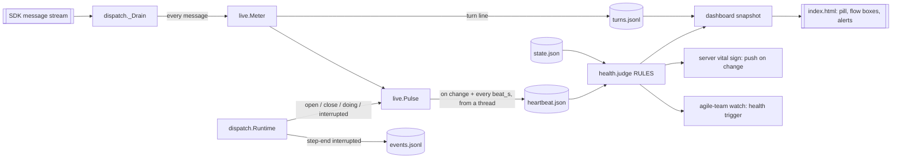

# s44: Live spend meter and runner health on the dashboard

Story: `.team/stories/s44.md`. Developer: **developer-api** (runner Python,
snapshot, server) — the same developer also owns `dashboard/index.html` and
the fixture script (no separate GUI step; the UI is a pure view over the
snapshot fields defined here).

The runner, never an agent, measures every turn of every query it drains,
keeps a heartbeat file fresh, and closes a step that ends without a handoff
with an `interrupted` `step-end`. One Python table judges health. The
dashboard, the server's push and `agile-team watch` all read that one judgement.



## Decisions

- **D1 Turns go to `turns.jsonl`, not `events.jsonl` (AC1).** A step makes
  tens to hundreds of turns. The event log stays one line per step, gate and
  ruling. The snapshot reads only the tail of `turns.jsonl` (S2).
- **D2 The heartbeat is written by a daemon thread, not an asyncio task
  (AC2).** Gate and check commands (`commands.CommandShell.run`) block the
  event loop for up to `[gates] command_timeout_s`, so an asyncio task would
  stop beating during the tests gate and turn the run falsely red. A thread
  keeps beating through runner-side work and through an agent's long tool. It
  still stops when the process dies (kill, crash), which is what "stale"
  must catch. The AC's intent ("keeps beating while a tool runs") is met. The
  Scribe should record this as ADR-0028 (heartbeat thread).
- **D3 One health judgement, in Python (AC4).** `health.RULES` is the only
  place thresholds are applied. The snapshot carries the verdict. The server
  pushes a new snapshot when the verdict changes, even if no file changed
  (a killed runner writes nothing). The UI only ticks ages between pushes.
- **D4 A halted run is red; a graceful stop is not (AC3, AC10; PO ruling,
  round 1).** `stop --now`, a limit, a crash, a budget or checkout halt, a
  PO `blocked` or `failed`, and a dead runner (`interrupted`) all show red
  with the halt reason. This is what the human wants to see "from across
  the room". A graceful `agile-team stop` is something the human asked for,
  so it is **neutral**: `stopped` with no halt behind it is `idle` (a plain
  pill reading `● stopped`, no `⚠`, no notification, no watch `health`
  trigger), and a stale heartbeat does not turn it red (R15). `idle`,
  `done` and `sprint-end` are not red either. Both kinds of stop store
  status `stopped`. The persisted `state.halt_kind` (R15) is what tells
  them apart.
- **D5 Box totals come from the ledger only (AC6).** The active step's live
  tokens and estimated dollars show on a separate line of its box and in the
  pill. They are never added to the totals, so totals match the ledger
  exactly.
- **D6 Live dollars are an estimate.** `live.RATES` ($/Mtok by model family,
  the same figures as the fixture script's `PRICE`) prices each turn. A
  provider with `billing = "free"` estimates 0, and an unknown family
  estimates `null` (shown `—`). The ledger's `ResultMessage` cost stays the
  truth. The UI prefixes estimates with `≈`.
- **D7 The PO's queries are metered too.** `po_tools` drains through
  `collect` like a role step. Meters nest: a role step runs inside the PO's
  `run_role` tool call. The heartbeat shows the innermost open meter.
- **D8 The quiet clock restarts when control comes back to the model
  (review D2).** "Quiet" measures how long the model has had the floor
  without answering. It does not measure time since its last turn. A meter
  whose model waits on the runner (an inner step, a chore) or on a tool is
  not quiet. So each reading keeps `quiet_since`, which a turn, a tool's end,
  the close of the meter above it, or the end of a chore moves to `now`
  (H7). Without this rule, the PO meter is red for a moment after every role
  step longer than 10 min.
- **D9 Waiting for the human is a chore (review D1).** `wait_for_answers`
  runs inside `pulse.doing(...)` (H5), so the quiet rules do not apply while
  the runner polls the inbox. R4 and R6 still apply, so a dead runner is
  still red. `run_role` is **not** a chore: a chore silences the quiet
  rules, and that would hide a hung inner step.

## Review status (brief for round 2)

The quality czar's round-0 review is `.team/reviews/s44.md`. The PO ruled
that nothing in it is deferred: D3 is required for AC10 (coverage measures
Python only), and D5 is fixed before shipping. The table shows each item's
status as of the round-1 code. Work every **open** row. Do not reopen a
**fixed** row.

| Item | What | Status | Rule | Owner in round 2 |
|---|---|---|---|---|
| D1 | `wait_for_answers` goes red while it waits for the human | **fixed** | D9, H5 | — |
| D2 | the PO meter is red after a role step longer than 10 min | **fixed** | D8, H7 | — |
| D3 | AC10's UI (node) and E2E tests are missing | **open** (not deferred) | U1–U3, test checklist "UI" and "E2E" | developer: the U1 seam. unit-tester: UI tests. integration-tester: E2E tests |
| D4 | H3/H5/D7 wiring is not asserted | **fixed** (tests in round 1) | test checklist "Wiring" | — |
| D5 | `smartPill` puts `view.health.level` into HTML unmapped | **open** (fix before shipping) | P2 (`healthLevel` whitelist) | developer |
| C1 | `config._health` copies `_gates` | **open** | C1 | developer |
| C2 | `live.estimate` rebuilds `_counts` | **open** | C2 | developer |
| C3 | `Reading` scans for `ToolUseBlock` twice | **open** | C3 | developer |
| C4 | R5/R8 share `_quiet_words` | **fixed** | C4 | — |
| C5 | `who(step)` in `index.html` | **open** | C5 | developer |
| C6 | `approxUsd(cost)` in `index.html` | **open** | C6 | developer |

D5 in the code today: `index.html` `smartPill` has `` class="pill smart
h-${view.health.level}" `` and `flowContext` has `level: view.health.level`.
Both must read `healthLevel(view)` (P2). `applyAlert` compares the level
only, so it may keep `view.health.level`, but it should use `healthLevel`
too, for one source.

### UI test seam (D3)

The page boots at load (`boot().catch(…)` on its last line), so node cannot
load it to call its functions. These rules make the pure functions callable
under node without a browser.

- **U1 Boot guard (developer).** The last statement becomes `if
  (!globalThis.AGILE_TEAM_NO_BOOT) boot().catch(…)`, with the same body.
  Nothing else at top level may touch the network or the DOM beyond what U2
  stubs. Today the top level has `new URLSearchParams(location.search)`,
  `location.protocol` and three `document.addEventListener` calls.
- **U2 Harness (unit-tester), `tests/dashboard_node.py`.** It has one
  public function, `run_page(driver: str) -> Any`. It writes one `.js` file
  to a temp dir and runs `node` on it with `timeout=30`. The file has three
  parts, in order:
  1. A prelude that sets every stub as a property of `globalThis` (a
     `class` declaration alone is not one, so `"Notification" in window`
     would be false): `AGILE_TEAM_NO_BOOT = true`. `location = {search:
     "", protocol: "http:"}`. A `document` with `title: ""`, a no-op
     `addEventListener`, and `querySelector`/`getElementById` that return
     `null`. A `window` that is `globalThis`, with `isSecureContext = true`. A
     `Map`-backed `localStorage`. A `Notification` class that records each
     `new` in `globalThis.made` and has a settable static `permission`.
     A `fetch` that pushes its URL to `globalThis.fetched` and returns a
     rejected promise.
  2. The inline `<script>` of `index.html`, pulled out with the same
     `PageParts` parser as `test_dashboard_ui.py`. Do not copy the parser:
     move it to the helper, and import it from both.
  3. `driver`, a JS snippet whose last statement is
     `console.log(JSON.stringify(result))`.

  `run_page` parses stdout as JSON. A non-zero exit raises `AssertionError`
  with the stderr. Each test that uses it carries `@pytest.mark.skipif(
  shutil.which("node") is None, reason="node not installed")`. The fixture
  is read from `agile_team/dashboard/fixtures/snapshot.json` and inlined in
  the driver as JSON.
- **U3 Time is passed in.** Tests call `tokensPerMin`, `sparkline`,
  `pillText`, `pillDetails` and `smartPill` with an explicit `now` (the
  fixture's `generated_at`). Nothing under test reads `Date.now()` except
  `clockNow` and `adopt`.

## Rules

### Turns (AC1)

- **T1** `collect(query_fn, plan)` passes every message to `plan.meter` when
  it is set (`_Drain.take`). The meter (`live.Meter.take`) ignores all
  messages except `AssistantMessage` and `UserMessage`.
- **T2 Turn = one model response = one `message_id`.** Claude Code may split
  one response into several `AssistantMessage`s with the same `message_id`.
  The first one with a given id starts a new turn (`turn` += 1). Later ones
  fold into that turn. A message with `message_id is None` is always a new
  turn.
- **T3 Tokens counted once.** For each id the meter remembers the tokens it
  has counted (`Tokens.from_usage(message.usage)`). A message adds only the
  per-field excess over what was counted (`max(0, new - counted)`) to the
  step totals.
- **T4 Turn line.** A message writes one line to `<run_dir>/turns.jsonl` when
  it starts a turn, adds tokens, or carries a `ToolUseBlock`. Otherwise it
  writes nothing. Line (keys in this order):

  ```json
  {"at": 1791800000.0, "role": "developer-cli", "story": "s29", "step": "implement", "turn": 12, "model": "claude-sonnet-4-5-20250929", "tokens": {"input": 3, "output": 412, "cache_read": 81234, "cache_creation": 1200}, "tools": ["Bash"], "cost_usd": 0.0313, "message_id": "msg_01…"}
  ```

  `tokens` is the excess from T3 (so the line `tokens` sum to the step's
  meter). `tools` holds the `name` of each `ToolUseBlock`, in order (`[]` if
  none). `cost_usd` is `0.0` when the role's billing is `Billing.FREE`,
  else `live.estimate(model, tokens)`: a float, or `null` for an unknown
  family. `story` and `step` are `null` off a story
  (PO, Manager, Scribe without a story).
- **T5 Tools.** Each `ToolUseBlock` opens a tool `{id → (name, started_at)}`.
  A `ToolResultBlock` in a later `UserMessage` with the same `tool_use_id`
  closes it. The **current tool** is the open one with the earliest
  `started_at`, or none.
- **T6 Model.** `AssistantMessage.model` of the latest message is the
  answering model.
- **T7 Clock.** Every time comes from `Pulse.pace.now()` (injected), never
  from the message.

### Heartbeat (AC2, AC8)

- **H1 File.** `<run_dir>/heartbeat.json`, written atomically (write
  `heartbeat.json.tmp`, then `replace`), as `state.save` does. Shape:

  ```json
  {
    "version": 1,
    "pid": 4242,
    "beat": "beating",
    "at": 1791800020.0,
    "started_at": 1791799000.0,
    "chore": {"what": "settling developer-cli on s29", "since": 1791800010.0},
    "step": {
      "role": "developer-cli", "story": "s29", "step": "implement",
      "started_at": 1791799500.0, "turn": 12,
      "model": "claude-sonnet-4-5-20250929", "configured_model": "sonnet",
      "last_turn_at": 1791800012.5, "quiet_since": 1791800012.5,
      "tool": {"name": "Bash", "started_at": 1791800013.0},
      "tokens": {"input": 30, "output": 5120, "cache_read": 912340, "cache_creation": 40100},
      "cost_usd": 0.4213
    }
  }
  ```

  `beat` is `beating` or `ended`. `at` is the time of this write.
  `started_at` (top level) is when this runner's `Pulse` was made.
  `chore` is runner-side work in progress (H5), else `null`. `step` is the
  innermost open meter (D7), else `null`. Inside it, `model` is `null` until
  the first answer, `last_turn_at` is `null` until the first turn,
  `quiet_since` follows H7 (never `null`), `tool`
  follows T5 (`null` when none), and `cost_usd` is the summed estimate
  (`null` once any turn was unpriced).
- **H2 When it is written:** when a meter opens or closes, after every
  message that wrote a turn line or closed a tool, when a chore starts or
  ends, every `[health] beat_s` (default 20) from the beat thread, and once
  at `end()`.
- **H3 Lifecycle.** `cli._po_until_sigterm` calls `runtime.pulse.start()`
  before `run_po` and `runtime.pulse.end()` in a `finally`. `start()` writes
  at once and starts the daemon thread. `end()` stops and joins the thread,
  then writes `beat: "ended"` with `step: null` and `chore: null`. After
  `end()` every later write keeps `beat: "ended"`, so a late `close` cannot
  bring it back to `beating`. A `kill -9` leaves `beating` behind, and it goes
  stale. That is the signal.
- **H4 Thread safety.** All `Pulse` state (open readings, chore, beat) is
  read and changed under one `threading.Lock`. An `OSError` while writing is
  swallowed (comment: the next beat retries). A heartbeat must never crash
  the runner.
- **H5 Chores.** `Pulse.doing(what)` is a context manager. It sets `chore`
  (saving any previous one and restoring it on exit), and writes on entry
  and exit. The runner wraps its own blocking work in it:
  `Runtime.settle` (`"settling <role> on <story>"`, using `salvage.label`),
  `BoundaryRunner.step` (`"sprint boundary: <stage>"`) and
  `PoTools.wait_for_answers` (`WAIT_CHORE.format(ids=", ".join(ids) or
  "—")`, with `WAIT_CHORE = "waiting for answers to {ids}"` in `po_tools`;
  D9). These are the only chores. `run_role` must not be one (D9). While a
  chore runs, the quiet rules (R5, R7, R8) do not apply, and R9 applies
  instead.
- **H6 No real waits in tests.** `live.Pace(now, wait)`. `wait(event,
  seconds) -> bool` returns `True` to stop. The default is
  `threading.Event.wait`. `Pulse.beats()` is the thread body:
  `while not pace.wait(self._stop, beat_s): self.write()`.
- **H7 Quiet clock (D8).** `Reading.quiet_since: float` starts at
  `started_at`. `Reading.wake(now)` sets it to `now`. It is called:
  1. in `_line`, whenever a turn line is made (alongside `last_turn_at`);
  2. in `_close_tools`, when a `ToolResultBlock` removes a tool that was
     open (an unknown `tool_use_id` does not wake);
  3. in `Pulse.close`, on the reading that is innermost *after* the
     removal, if there is one;
  4. in `Pulse.doing`, on exit (also on an exception), on the innermost
     reading, if there is one.

  The last two run under the pulse lock (H4) through one private helper,
  `Pulse._wake_innermost()`, which reads `pace.now()`. A chore's *start*
  does not wake (a chore already silences the quiet rules). A tool's
  *start* is a turn, so it wakes through (1). `view()` adds `"quiet_since"`
  after `last_turn_at`.

### Interrupted steps (AC3)

- **I1 Exactly one `step-end` per `step-start`.** The meter of a role step
  (`Runtime.step_meter`) is the token of an open step. Whoever emits that
  step's `step-end` first takes the meter (`Runtime._end_meter()`, which sets
  it to `None` and closes it in the pulse). Normal settle does this in
  `_emit_step_end`. Any later attempt finds `None` and emits nothing.
- **I2 Where an interruption closes the step.** Every stop path already
  calls `Runtime.save_interrupted(cause)`: a non-limit error in
  `_step_failed`, every `halt_run` (limit, budget, checkout, and SIGTERM or
  crash from `cli._halt_exit`). Its first line becomes
  `self._close_interrupted(cause)`. This runs *before* the checkout check,
  so a checkout halt (which skips salvage, K5) still closes the step.
- **I3 Event.** `EventKind.STEP_END` attributed to the step's role and story,
  with data:

  ```json
  {"status": "interrupted", "reason": "exit 143 (SIGTERM)", "cause": "sigterm", "halt": "stopped by stop --now", "turns": 7, "tokens": {"input": 0, "output": 0, "cache_read": 0, "cache_creation": 0}, "estimate_usd": 0.0812, "model": "claude-sonnet-4-5-20250929"}
  ```

  `reason` is `salvage.STOP_REASONS[cause]`. `halt` is
  `runtime.halted_by.reason` when the run halted, else `null`. `turns`,
  `tokens`, `estimate_usd` and `model` come from the meter. There is no
  `cost_usd`: nothing was ledgered.
- **I4 Killed outright.** No Python ran, so the step is closed on the next
  `start --resume`. `recovery.recover_killed` (named `recover_cut` once s62
  lands) emits, before `Salvager.save`, a `step-end` with
  `live.interrupted_data(live.Stop(Cause.KILLED))` for `state.in_flight`,
  when that is set. It carries no meter fields. Until then, health shows red
  (R2, R3).
- **I5 `STOP_REASONS`** (new table in `salvage.py`, one row per `Cause`):

  | cause | reason |
  |---|---|
  | `error` | `error in the step (details in crash.log)` |
  | `limit` | `usage limit` |
  | `crash` | `runner crash (details in crash.log)` |
  | `sigterm` | `exit 143 (SIGTERM)` |
  | `budget` | `budget ceiling reached` |
  | `checkout` | `the checkout moved` |
  | `killed` | `the runner was killed (no clean exit)` |

- **I6 Consumers.** `insights._after_last_manager` ignores a Manager
  `step-end` whose `status` is `interrupted`: an interrupted Manager did not
  review. `loops` and `boundary` history keep it (it is useful context).
- **I7 Restarted.** A `step-start` is a restart when the last `step-end`
  before it for the same role and story has `status: "interrupted"`. Only
  the UI derives this (P6). No new field is stored.

### Health (AC4)

- **R0 Inputs (`health.Vitals`).** `now`; the shown status
  (`state.shown_status`) and `status_reason`; the parsed heartbeat (or
  `None`: missing, torn or not an object); `runner` (`Runner.UP` or
  `Runner.GONE`, from `state.pid_alive(heartbeat["pid"])`; `UP` with no
  heartbeat); `limits` (`config.HealthLimits`); `halt_kind`
  (`state.halt_kind`, R15). Derived:
  - `resting`: status `stopped` and `halt_kind is None` (a graceful stop,
    R15).
  - `beating`: heartbeat present, `beat == "beating"`, and not `resting`.
  - `beat_age`: `now - heartbeat.at`.
  - `step`: the heartbeat `step` when beating, else `None`.
  - `chore`: the heartbeat `chore` when beating, else `None`.
  - `quiet_for`: with a step and no chore, `now - step.quiet_since` (H7).
    For a heartbeat without `quiet_since` (an older runner), it falls back
    to `step.last_turn_at or step.started_at`. Otherwise `None`.
  - `halted`: the status is in `HALTED = {blocked, failed, stopped,
    checkout-changed}`, and not `resting`.
- **R1 Table.** `health.RULES` is a tuple of `Rule(level, test, words)`. A
  test and words each take only `Vitals`. `judge` collects every rule whose
  test is true, takes the worst level among them (`IDLE < GREEN < AMBER <
  RED`), and joins the words of the matching rules *at that level*, in table
  order, with `", "`. The last row always matches, so there is always a
  verdict.

  | # | level | test | words |
  |---|---|---|---|
  | R2 | red | `halted` | `halted: {status_reason or status}` |
  | R3 | red | `halted` and `step` and the step's `last_turn_at` is within `stale_s` of `now` | `turns arriving while the run is {status}` |
  | R4 | red | status `interrupted`, or `beating` and `runner` is `GONE` | `the runner is not running (pid {pid})`; without a heartbeat pid: `the runner is not running` |
  | R5 | red | `quiet_for > red_quiet_s` | `no turn for {age(quiet_for)}` |
  | R6 | red | `beating` and `beat_age > stale_s` | `heartbeat {age(beat_age)} old` |
  | R7 | amber | `step.tool` and `quiet_for > amber_tool_s` | `no turn for {age} while {tool name} runs` |
  | R8 | amber | no `step.tool` and `quiet_for > amber_quiet_s` | `no turn for {age}` |
  | R9 | green | `chore` | `runner: {chore.what} for {age(now - chore.since)}` |
  | R10 | green | `step` and no `chore` | `turns arriving` |
  | R11 | idle | always | `{status_reason or status}` |

  Example: a step quiet for 11 min with a heartbeat 4 min old gives red,
  `no turn for 11 min, heartbeat 4 min old`. R5 and R8 share one words
  function, `_quiet_words(v) = f"no turn for {age(v.quiet_for or 0)}"`, and
  `_tool_words` builds on it. "No turn" means "no turn since the model last
  had the floor" (H7). The words are unchanged.
- **R12 `age(seconds)`:** under 90 s gives `"{int} s"`, under 90 min gives
  `"{floor(min)} min"`, otherwise `"{h} h {m} min"`.
- **R13 Thresholds** (`[health]` in `.agile-team.toml`, all seconds, all
  positive): `beat_s = 20`, `stale_s = 90`, `amber_tool_s = 180`,
  `amber_quiet_s = 300`, `red_quiet_s = 600`. Validation adds
  `health.<key> must be positive`, `health.beat_s must be below
  health.stale_s`, and `health.amber_tool_s and health.amber_quiet_s must
  not exceed health.red_quiet_s`. The snapshot and the server re-read the
  file (`fresh_config`). The runner reads `beat_s` at start.
- **R14 Model note.** `health.model_note(step)`: `None` when either model is
  missing or both have the same `live.family`. Otherwise
  `"configured {family(configured)}, answering {family(answering)}"`, for
  example `configured sonnet, answering opus`. `family(name)` is the first of
  `opus`, `sonnet`, `haiku` found in the lowercased name, else the name
  itself.
- **R15 A graceful stop is neutral (D4, PO ruling).**
  - **State.** `RunState.halt_kind: str | None = None` holds the
    `HaltKind` value of the halt that set the current status, and is `None`
    when no halt did. `RunState.mark(status, reason)` clears it, as it
    clears `status_reason`. So every status change made through `mark`
    (run start, `accept-checkout`, `PoRun._set_status`) leaves it `None`.
    `Runtime.halt_run` sets it right *after* its `mark`:
    `self.state.halt_kind = self.halted_by.kind.value`. A legacy
    `state.json` loads `None`.
  - **Which stops are neutral.** A graceful stop (the PO's `notify_user`
    with kind `stopped` after `agile-team stop`) leaves `halt_kind` at
    `None`. The run started with `mark(RUNNING)`, and `notify_user` sets
    `status` only. So does `accept-checkout` (`mark(STOPPED,
    ACCEPTED_REASON)`), which is also the human's own act. `stop --now` and
    any other SIGTERM go through `halt_run` with `HaltKind.SIGTERM`. So
    `halt_kind == "sigterm"`, and they stay red (R2).
  - **Health.** With `resting`, `halted` and `beating` are false (R0), so
    R2–R10 cannot match, whatever the heartbeat says (stale, beating with a
    dead pid, an old step). The verdict is R11: `idle`,
    `{status_reason or status}`, for example `stopped`.
  - **UI.** `idle` gives the plain pill (P2, P3), no `⚠` (A1), no
    notification (A2), and no watch `health` trigger (W2).

### Snapshot and server (AC4, AC7, AC9)

- **S1 New sections** (in `SECTIONS`, after `upstream`): `turns`,
  `heartbeat`, `health`. `RunFiles` gains `now: float` (`time.time()` in
  `load`). `generated_at` returns `files.now`, so ages and the verdict use
  the same instant.
- **S2 `turns`.** The last `TURN_TAIL_BYTES = 262_144` bytes of
  `turns.jsonl`, with the first (possibly partial) line dropped when the read
  did not start at byte 0. Torn or non-object lines are skipped. Only lines
  with `at >= now - TURN_WINDOW_S` (600) are kept, at most the last
  `TURNS_SHOWN = 500`, oldest first. Missing file gives `[]`.
- **S3 `heartbeat`.** The file as parsed (`live.read_heartbeat`), or `null`.
- **S4 `health`.** `{"level": "green", "reason": "turns arriving",
  "model_note": null}`, from `health.judge(Vitals.read(files.config,
  files.now))` plus `model_note`.
- **S5 Watched files.** `RUN_FILES` gains `heartbeat.json` and `turns.jsonl`.
- **S6 Push on verdict change.** `Dashboard` gains `vital_sign: Callable[[],
  str]` (default `lambda: ""`). `for_run` sets it to
  `partial(snapshot.vital_sign, config)`, which returns
  `health.current(fresh_config(config)).key()` (`"{level}|{reason}"`).
  `_pump` compares `(fingerprint(app.watched()), app.vital_sign())` with the
  last one. A change sends a snapshot, otherwise a keepalive. So a killed
  runner turns red within about a second of crossing a threshold.
- **S7 URLs (AC7).** `server.dashboard_urls(host, port) -> Urls` replaces
  `display_url`. `Urls` is a `NamedTuple(local: str, lan: str | None)`.
  - All interfaces (`0.0.0.0`, `""`): `local = http://localhost:{port}/`,
    `lan = http://{lan_name()}:{port}/`.
  - Loopback (`127.0.0.1`, `localhost`, `::1`): `local =
    http://localhost:{port}/`, `lan = None`.
  - Any other host: `local = http://{host}:{port}/`, `lan = None`.

  `lan_name()` is `socket.gethostname()` if it contains a dot, else
  `"{name}.local"`. `cmd_dashboard` prints `dashboard: {local}`, then (when
  `lan`) `from other machines: {lan}`, both with flush. It opens `local` in
  the browser. Listening is unchanged (`default_host`).

### The smart pill (AC5, AC3)

- **P1 Placement.** `renderStatusRow` keeps the connection and run-status
  pills. The old `▶ role on story · ago` pill becomes `smartPill(view)`.
- **P2 Colour.** The pill element has classes `pill smart h-{level}`, where
  `level` goes through a whitelist: `healthLevel(view)` returns
  `view.health.level` when `HEALTH_LEVELS` includes it, else `"idle"`.
  Every use of the level in HTML or Mermaid text (`smartPill`,
  `flowClassLines`, `applyAlert`) reads it through `healthLevel` (ADR-0005:
  no snapshot field reaches HTML unescaped or unmapped). For
  `green`, `amber` and `red`, CSS sets both `background` (tinted, as
  `.tone-*`) and `border-color` to `--good`, `--warning` and `--critical`,
  plus a 2px border. `idle` looks like a plain pill. The dot uses the same
  colour.
- **P3 Text.**
  - With a live step (`liveStep(view)`, the heartbeat `step` while
    `beat == "beating"` and `healthLevel(view) !== "idle"`; R15 makes a
    graceful stop idle, so a leftover beating heartbeat shows no live
    step): `● {who(step)} · {rate}/min
    {spark} · {age since last_turn_at or started_at}`, plus ` · ↻
    restarted` when P6 holds. Example: `● developer-cli on s29 · 3.2k/min
    ▂▃▅▇▆▅▃▂▁▂ · 8 s`.
  - Without a live step: `● {health.reason}` (for example `● halted:
    session limit, resets 9pm (Europe/Berlin)`). If `activeStep(events)`
    still finds an open step (an old runner with no heartbeat), use the old
    `▶` text instead.
- **P4 Rate and sparkline.** Both use all of `view.turns` (the whole team's
  spend). Token counts are `sumTok`, all four kinds, as on the Tokens tab.
  - `tokensPerMin(turns, now)`: the sum over turns with `at > now - 300`,
    divided by 5.
  - `sparkline(turns, now)`: 10 one-minute buckets ending at `now`. Each
    bucket is one of `▁▂▃▄▅▆▇█`, scaled to the largest bucket. A zero bucket
    is `▁`. With no turns it is ten `▁`.
  - `rate` uses `fmt.tok`.
- **P5 Details (hover, tap).** The pill is a `<button data-live-details>`.
  Hover shows the details with `showTip`. A click or tap toggles the same
  lines in `#live-details`, a new element under the status row. Lines:
  `step {step.step or "—"} · turn {turn}`; `model {model}` plus ` —
  {model_note}` when set; `{fmt.tok(sumTok(tokens))} tokens · ≈{usd or —}`
  for the step; `tool {name} for {age}` or `no tool running`; `last turn
  {fmt.time(last_turn_at)}`; and, when amber or red, `health: {reason}`.
- **P6 Restarted.** `restarted(events, act)` holds when the last `step-end`
  for `act.role` and `act.story` before `act` has `data.status ===
  "interrupted"`. The timeline's `step-start` row reads `brief (restarted)`
  in that case.
- **P7 Clock.** `onStreamMessage` sets `data.skew = snap.generated_at -
  Date.now()/1000` (in `adopt`), and `clockNow(view)` returns `Date.now()/1000 + data.skew`. A
  1-second `setInterval` re-runs `renderStatusRow` and `applyAlert` with the
  last rendered view (`data.view`, set in `render`). It does not redraw the
  flow chart. `fmt.age(seconds)` follows R12.
- **P8 Interrupted on the timeline.** A `step-end` with `status:
  "interrupted"` has tone `critical` (already in `STATUS_TONE`). Its body is
  the `summary`, or else `reason` and `halt` joined by ` — `. Its meta shows
  `≈$` and `estimate_usd`. `flowStats` does not count it as a handoff, but it
  counts it in `stuck`.

### Flow chart stats (AC6)

- **F1 Scope toggle.** A `.seg` group `#flow-scope` above `#flow` with
  buttons `data-scope="story|sprint|run"` (labels Story, Sprint, Run). It
  works like `#unit`. `ui.scope` defaults to `story` and is saved in
  `localStorage["agile-team-flow-scope"]` on click. It is restored at boot
  the same way as the theme (storage errors are ignored).
- **F2 Story in focus.** A `<select id="flow-focus">` beside the toggle,
  shown only in Story scope. Its options are `auto` and every story id.
  `focusStory(view)` returns `ui.focus` when set. Otherwise it returns the
  first of: `liveStep(view)?.story`, `activeStep(view.events)?.story`, the
  story of the last `step-end` that has one, or `""`.
- **F3 Entries in scope** (`scopeEntries(view)`, over `view.ledger`):
  - `run`: all entries.
  - `story`: entries with `story === focus`.
  - `sprint`: the sprint `S` is the focus story's `sprint`, else
    `view.run.sprint`. Entries count when their story is a story of `S`, or
    when they have no story and their `at` is in `S`'s window. The window
    runs from the `sprint-start` event whose `data.sprint === S` to the next
    `sprint-start`, or open-ended.
- **F4 Box text.** Each role box shows `{model} · {fmt.tok(tokens)} ·
  {fmt.usd(cost)}`, summed over F3 for that role. In Story scope the PO box
  shows `—` (PO entries carry no story). The `↩ bounced` line stays.
- **F5 Dimmed.** In Story scope, a role with no ledger entry and no
  `step-start` on the focus story gets `class <id> idle`. The PO is never
  dimmed. In Sprint and Run scope the existing rule stays (no stats means
  idle).
- **F6 Active box live stats.** The node of `liveStep(view).role` (falling
  back to the existing `activeNodeId`) gets two more label lines,
  `{rate}/min {spark}` (P4 over that role's turns only) and `turn {turn}[ ·
  {tool name}]`, and one more line `step ≈{estimate} · {tokens}`. It also gets
  `class <id> live_{level}`, where `classDef live_green|live_amber|live_red`
  sets the stroke (3px) and a tinted fill from `--good`, `--warning` and
  `--critical`. The scope total in F4 stays ledger-only (D5).
- **F7 Totals match the ledger.** For every scope, the sum of the role
  totals is the sum of `cost_usd` (and of `sumTok(tokens)`) over F3's
  entries. The test checklist pins this.

### Alerts (AC7)

- **A1 Title.** While `health.level === "red"`, `document.title` is `⚠ ` +
  the base title (`agile-team dashboard`). Otherwise it is the base title.
  This happens in every context, secure or not.
- **A2 Notification.** On a change of level into `red` after the first
  snapshot (`data.lastLevel` was set and was not `red`), the dashboard calls
  `new Notification("agile-team: red", {body: reason, tag:
  "agile-team-health"})`. It does so only when `window.isSecureContext`,
  `"Notification" in window` and `Notification.permission === "granted"`.
- **A3 Asking once.** On the first click anywhere on the page, the dashboard
  calls `Notification.requestPermission()` once and records
  `localStorage["agile-team-notify-asked"] = "1"`. It does so only in a
  secure context with `Notification.permission === "default"` and the key
  unset. Browsers need a user gesture for the prompt, so it is not asked on
  load.
- **A4** `applyAlert(view)` holds A1 and A2. It runs from `render` and from
  the 1-second tick.

### Watch (AC8)

- **W1** In `watch.py` (s62), `Look` and `Seen` gain `health: str = ""` (a
  level). `look` fills it with `health.current(config).level`. When `look`
  has only `run_dir`, it loads the config from `run_dir.parents[1]`
  (`config.load`), falling back to `HealthLimits()` on `ConfigError`.
- **W2** `TRIGGERS` gains a third row, `("health", lambda seen, now:
  now.health == "red" and seen.health != "red")`. The V6 line gains
  `"health": {"level", "reason"}`. `Seen.save` persists `health`.
- **W3** s44's implement step needs s62's `watch.py` in the branch. If it is
  not there, stop and say so in the handoff (open question). Do not
  re-create `watch.py`. `.team/run/liaison/watch-team.sh` belongs to the
  liaison and is replaced by `agile-team watch` (s62). protocol.md documents
  the heartbeat for any other watcher.

### Review round 1 cleanups (C1–C6)

Behaviour does not change. Existing tests must pass unchanged.

- **C1** `config._section(cls: type[T], raw: dict[str, Any]) -> T` replaces
  both `_gates` and `_health`. It keeps the keys `cls` declares and builds
  `cls(**kept)`, as `_gates` does today.
- **C2** `live.estimate` prices the tuple that `live._counts(tokens)`
  returns. It does not rebuild the tuple.
- **C3** `Reading` scans `message.content` for `ToolUseBlock` once, in
  `_answer`. A private frozen `live.News(extra: Tokens, uses:
  list[ToolUseBlock], now: float)` carries the scan to `_line(self,
  message: AssistantMessage, news: News) -> Turn`. This keeps the house
  limit of 2 parameters. `Turn.tools` is `[u.name for u in news.uses]`.
- **C4** `health._quiet_words` (R1 note) is used by R5 and R8.
  `_tool_words` is `f"{_quiet_words(v)} while {name} runs"`.
- **C5** `index.html`: `who(step)` returns `short(step.role) + (step.story ?
  " on " + step.story : "")`. It is used by `pillText` (both branches) and by
  the old `▶` text.
- **C6** `index.html`: `approxUsd(cost)` returns `"≈" + (cost == null ? "—" :
  fmt.usd(cost))`. It is used by `pillDetails` and `liveLines`.

## Changes per module

### `agile_team/state.py` (R15)

- `RunState.halt_kind: str | None = None`. Its docstring note: "the
  `HaltKind` value of the halt that set the status (s44)".
- `RunState.mark`: `self.status, self.status_reason, self.halt_kind =
  status, reason, None`. Update the docstring: "no reason clears the old
  one; any halt kind is cleared".


### `agile_team/config.py`

```python
@dataclass
class HealthLimits:
    """``[health]``: when the live meter turns amber or red, and the heartbeat pace (s44)."""
    beat_s: float = 20.0
    stale_s: float = 90.0
    amber_tool_s: float = 180.0
    amber_quiet_s: float = 300.0
    red_quiet_s: float = 600.0

Config.health: HealthLimits = field(default_factory=HealthLimits)
def _health(raw: dict[str, Any]) -> HealthLimits   # like _gates
HEALTH_RULES: tuple[Rule, ...]                      # R13 messages
validate(...)  # adds *broken(HEALTH_RULES, config.health)
```

`from_raw` adds `health=_health(raw.get("health", {}))`.

### `agile_team/events.py`

`INTERRUPTED = "interrupted"  # step-end status of a step cut short (s44)`.

### `agile_team/salvage.py`

`STOP_REASONS: dict[Cause, str]` (I5). Every `Cause` has a row (test).

### `agile_team/providers.py`

`Providers.billing(self, role: Any) -> Billing`: `Billing.REPORTED` for the
default provider, else `self.get(role.provider).billing`. `cost_of` may use
it.

### `agile_team/live.py` (new)

```python
"""The live meter (s44): turns from a query's stream, the heartbeat file, open steps and chores."""

TURNS = "turns.jsonl"
HEARTBEAT = "heartbeat.json"
HEARTBEAT_VERSION = 1
RATES: dict[str, tuple[float, float, float, float]] = {   # $/Mtok: input, output, cache read, cache write
    "opus": (5, 25, 0.5, 6.25), "sonnet": (3, 15, 0.3, 3.75), "haiku": (1, 5, 0.1, 1.25),
}

class Beat(StrEnum): BEATING = "beating"; ENDED = "ended"

def family(model: str) -> str                                    # R14
def estimate(model: str, tokens: Tokens) -> float | None         # RATES; None for an unknown family
def read_heartbeat(run_dir: Path) -> dict[str, Any] | None       # missing/torn/non-object -> None

@dataclass(frozen=True)
class Who:
    """What a meter measures."""
    role: str
    story: str | None
    step: str | None
    configured_model: str
    billing: Billing

@dataclass(frozen=True)
class Stop:
    """Why a step was cut short: the cause and the run's halt reason, if any."""
    cause: Cause
    halt: str | None = None

def interrupted_data(stop: Stop) -> dict[str, Any]   # {"status": INTERRUPTED, "reason", "cause", "halt"}

@dataclass(frozen=True)
class Turn:
    """One line of turns.jsonl (T4)."""
    at: float; role: str; story: str | None; step: str | None; turn: int
    model: str; tokens: Tokens; tools: list[str]; cost_usd: float | None
    message_id: str | None
    def line(self) -> str                              # json, keys in T4 order

@dataclass
class Reading:
    """The counts of one open query (pure: no I/O)."""
    who: Who
    started_at: float
    turns: int = 0
    tokens: Tokens = field(default_factory=Tokens)
    cost_usd: float | None = 0.0
    model: str | None = None
    last_turn_at: float | None = None
    tools: dict[str, tuple[str, float]] = field(default_factory=dict)
    counted: dict[str, Tokens] = field(default_factory=dict)
    quiet_since: float = field(init=False)                     # H7; __post_init__ sets started_at
    def wake(self, now: float) -> None                         # H7: quiet_since = now
    def take(self, message: Any, now: float) -> Turn | None   # T1–T6; also closes tools on UserMessage (wakes, H7)
    def tool(self) -> dict[str, Any] | None                    # T5 current tool
    def view(self) -> dict[str, Any]                           # heartbeat "step" (H1)
    def interrupted(self, stop: Stop) -> Event                 # I3

@dataclass(frozen=True)
class Pace:
    """Clock and wait, injectable so tests never sleep (H6)."""
    now: Callable[[], float] = time.time
    wait: Callable[[threading.Event, float], bool] = threading.Event.wait

@dataclass(frozen=True)
class Meter:
    """A handle on one open reading in its pulse; what ``collect`` feeds."""
    pulse: Pulse
    reading: Reading
    def take(self, message: Any) -> None     # pulse.take(self, message)

@dataclass
class Pulse:
    """The heartbeat writer and the stack of open readings (H1–H6)."""
    run_dir: Path
    beat_s: float = 20.0
    pace: Pace = field(default_factory=Pace)
    pid: int = field(default_factory=os.getpid)
    def open(self, who: Who) -> Meter
    def close(self, meter: Meter) -> None                   # removes that reading wherever it is; wakes the new innermost (H7); writes
    def take(self, meter: Meter, message: Any) -> None      # reading.take; append turn line; write per H2
    @contextmanager
    def doing(self, what: str) -> Iterator[None]            # H5; on exit wakes the innermost (H7)
    def _wake_innermost(self) -> None                       # caller holds the lock; no-op with nothing open
    def start(self) -> None                                 # write, start the daemon thread
    def end(self) -> None                                   # stop + join, write ended (H3)
    def beats(self) -> None                                 # thread body (H6)
    def write(self) -> None                                 # atomic; OSError swallowed (H4)
    def heartbeat(self) -> dict[str, Any]                   # the H1 dict
```

Imports: `from .events import INTERRUPTED, Event, EventKind`, `from
.ledger import Tokens`, `from .providers import Billing`, `from .salvage
import STOP_REASONS, Cause`, and from `claude_agent_sdk`:
`AssistantMessage, UserMessage, ToolUseBlock, ToolResultBlock`.
`Reading.take` prices a turn as `0.0` when `who.billing is Billing.FREE`,
else `estimate(model, tokens)` (T4).

### `agile_team/health.py` (new)

```python
"""Runner health for the live meter (s44): the RULES table over the heartbeat and run status."""

class Level(StrEnum): IDLE = "idle"; GREEN = "green"; AMBER = "amber"; RED = "red"
RANK: dict[Level, int]
class Runner(StrEnum): UP = "up"; GONE = "gone"
HALTED: frozenset[RunStatus]

@dataclass(frozen=True)
class Vitals:
    now: float
    status: RunStatus
    reason: str | None
    beat: dict[str, Any] | None
    runner: Runner
    limits: HealthLimits
    halt_kind: str | None = None                            # R15; default keeps hand-built Vitals valid
    @classmethod
    def read(cls, config: Config, now: float) -> Vitals    # state.load + shown_status, live.read_heartbeat, pid_alive, state.halt_kind
    # properties/methods: resting, beating, beat_age, step, chore, quiet_for, tool, halted, pid (R0)

@dataclass(frozen=True)
class Rule:
    level: Level
    test: Callable[[Vitals], bool]
    words: Callable[[Vitals], str]

RULES: tuple[Rule, ...]                     # R2–R11, in that order

@dataclass(frozen=True)
class Health:
    level: Level
    reason: str
    model_note: str | None = None
    def key(self) -> str                    # f"{level}|{reason}"

def judge(vitals: Vitals) -> Health         # R1, plus model_note(vitals.step)
def age(seconds: float) -> str              # R12
def model_note(step: dict[str, Any] | None) -> str | None   # R14
def current(config: Config) -> Health       # judge(Vitals.read(config, time.time()))
```

### `agile_team/dispatch.py`

- `Plan.meter: live.Meter | None = None`.
- `_Drain.meter: live.Meter | None = None`. In `take`, the first line is
  `if self.meter: self.meter.take(message)`. `collect` builds
  `_Drain(meter=plan.meter)`.
- `Runtime.pulse: live.Pulse = field(init=False)`, set in `__post_init__` to
  `live.Pulse(self.config.run_dir, self.config.health.beat_s)`.
  `Runtime.step_meter: live.Meter | None = field(default=None, init=False)`.
- `Runtime.who(self, plan: Plan) -> live.Who`: role name, story id, story
  step, `plan.role.model`, `self.providers.billing(plan.role)`.
- `_take_off`: also `plan.meter = self.step_meter =
  self.pulse.open(self.who(plan))`.
- `settle(plan, result)` → `with self.pulse.doing(f"settling
  {salvage.label(...)}"): return self._settle(plan, result)`. The body is
  unchanged, moved to `_settle`.
- `_emit_step_end`: calls `meter = self._end_meter()` first. It adds
  `model=meter.reading.model if meter else None` to the event data.
- `_end_meter(self) -> live.Meter | None`: swap `step_meter` to `None`;
  `pulse.close` the old one; return it.
- `_close_interrupted(self, cause: Cause) -> None`: `meter =
  self._end_meter()`. If set, emit `meter.reading.interrupted(live.Stop(cause,
  self.halted_by.reason if self.halted_by else None))` through
  `self.events.emit`.
- `save_interrupted`: the first line is `self._close_interrupted(cause)`
  (I2).
- `halt_run`: after `self.state.mark(...)`, set `self.state.halt_kind =
  self.halted_by.kind.value` (R15), then `save()` as today.

### `agile_team/po_tools.py`

`_collect(plan)`: `plan.meter = self.runtime.pulse.open(self.runtime.who(plan))`
before `collect`, and `self.runtime.pulse.close(plan.meter)` in a `finally`.
The PO's query has no `step-start`, so it never gets a `step-end`.

`WAIT_CHORE = "waiting for answers to {ids}"`. In `wait_for_answers`, the
polling loop runs inside `with self.runtime.pulse.doing(WAIT_CHORE.format(
ids=", ".join(ids) or "—")):` (H5, D9). Collecting and marking the answers
stays outside the `with`. `run_role` is unchanged (no chore).

### `agile_team/boundary_runner.py`

`BoundaryRunner.step`: the body runs inside
`self.runtime.pulse.doing(f"sprint boundary: {b.stage}")`.

### `agile_team/recovery.py`

`recover_killed` (or s62's `recover_cut`, on its `Cause.KILLED` branch):
before `Salvager.save`, when `state.in_flight` is set, emit
`Event(EventKind.STEP_END, step.role, step.story,
live.interrupted_data(live.Stop(Cause.KILLED)))` (I4).

### `agile_team/insights.py`

`_after_last_manager`: skip ends with `e.data.get("status") == INTERRUPTED`
(I6).

### `agile_team/cli.py`

- `_po_until_sigterm`: `runtime.pulse.start()` before
  `await run_po(...)`, and `runtime.pulse.end()` in `finally` (H3).
- `cmd_dashboard`: S7 (two lines, opens `local`).

### `agile_team/dashboard/snapshot.py`

`RunFiles.now`, `RUN_FILES` (S5), `TURN_TAIL_BYTES`, `TURN_WINDOW_S`,
`TURNS_SHOWN`, `read_tail(path: Path, size: int) -> list[dict]`, and
sections `_turns`, `_heartbeat`, `_health` (S1–S4).
`vital_sign(config: Config) -> str` (S6).

### `agile_team/dashboard/server.py`

`Dashboard.vital_sign`, `_pump` (S6), `Urls`, `LOOPBACK`, `lan_name`,
`dashboard_urls`. `display_url` is removed (S7).

### `agile_team/watch.py` (s62)

W1–W2.

### `agile_team/dashboard/index.html`

- Constants: `HEALTH_LEVELS = ["idle", "green", "amber", "red"]`, `SPARK =
  "▁▂▃▄▅▆▇█"`, `SCOPES = [["story", "Story"], ["sprint", "Sprint"], ["run",
  "Run"]]`, `BASE_TITLE = "agile-team dashboard"`.
- `normalize`: `LIST_KEYS` gains `"turns"`. The defaults are `heartbeat:
  null` and `health: {level: "idle", reason: "", model_note: null}`.
- New pure functions (each documented, each testable under node):
  `clockNow(view)` (P7; round 1 named it `nowS()`, the code's name stands),
  `fmt.age(s)`, `liveStep(view)`, `tokensPerMin(turns, now)`,
  `sparkline(turns, now)`, `restarted(events, act)`, `pillText(view, now)`,
  `pillDetails(view, now)` (an array of lines), `focusStory(view)`,
  `scopeEntries(view)`, `scopeTotals(view)` (`{role: {tokens, cost}}`),
  `touchedFocus(view, role)`, `healthLevel(view)` (P2), `who(step)` (C5),
  `approxUsd(cost)` (C6).
- Changed: `renderStatusRow` (P1), `smartPill(view)` (P2–P5), `flowStats`
  (P8), `nodeLabel` and `flowSource` (F4–F6; they take the context object
  from `flowContext(view)`: `{stats, totals, focus, liveRole, level}`),
  `TIMELINE["step-start"]` and `TIMELINE["step-end"]` (P6, P8), `render`
  (sets `data.view`, calls `applyAlert`), `onStreamMessage` (skew), the
  click handler (`data-scope`, `data-live-details`, the A3 permission ask),
  boot (restore the scope, start the 1 s tick).
- CSS: `.pill.smart`, `.h-green`, `.h-amber`, `.h-red` (P2), and
  `#live-details`.
- Round 2: the U1 boot guard. `smartPill`, `flowContext` and `applyAlert`
  read `healthLevel(view)` (D5). Add `who` (C5) and `approxUsd` (C6).

### `scripts/make_dashboard_fixture.py` and `fixtures/snapshot.json`

- About 40 `turns` over the 10 minutes before `generated_at`, for the active
  step (`developer-cli` on a sprint story) and a few PO turns. `cost_usd`
  comes from the existing `PRICE`.
- A `heartbeat`: beating, that step, `turn` 14, a `Bash` tool started 40 s
  earlier, `configured_model: "sonnet"`, and the answering model a sonnet id.
- `health`: `{"level": "green", "reason": "turns arriving", "model_note": null}`.
- One `step-end` with `status: "interrupted"`, `reason: "exit 143
  (SIGTERM)"`, `halt: "stopped by stop --now"`, followed by a `step-start`
  for the same role and story (it shows as restarted).
- Regenerate the fixture with the script. Do not hand-edit it.

## Test checklist

Unit (Python, no real waits, no real home):

- [ ] `_Drain` with fake `AssistantMessage`s, each with a distinct
      `message_id`, `usage`, `model` and a `ToolUseBlock`, writes one
      `turns.jsonl` line each. Tokens, `tools`, `model` and `turn` (1, 2, 3)
      are right.
- [ ] Two `AssistantMessage`s with the same `message_id` and the same usage
      make one turn. The step totals count the usage once (T2, T3). A larger
      usage on the second adds only the excess, on a line with the same
      `turn`.
- [ ] A `UserMessage` with a `ToolResultBlock` closes the tool. The
      heartbeat `tool` goes back to `null`. With two open tools, the earlier
      one is current (T5).
- [ ] `estimate`: sonnet, opus and haiku rates. An unknown family gives
      `None` and makes the step `cost_usd` `null`. `Billing.FREE` gives 0.
- [ ] The heartbeat is written on open, on a turn, on a tool end and on
      close. Its shape matches H1, keys included. It is written atomically
      (no `.tmp` left).
- [ ] `Pulse.beats()` with a fake `Pace` (wait returns `False` three times,
      then `True`; the clock advances 20 s each time) writes three times,
      each `wait` call with `beat_s` 20. The `tool` stays in every write
      while the fake tool is open (a long tool).
- [ ] `end()` writes `beat: "ended"`. A `close` after `end()` keeps it ended.
      An `OSError` from writing does not raise.
- [ ] `doing()` sets and restores `chore`, nested too.
- [ ] Nested meters: the PO meter opens, then a role meter. The heartbeat
      `step` is the role. After the role closes, it is the PO.
- [ ] Interrupted: a step whose query raises a non-limit error emits exactly
      one `step-end` with `status: "interrupted"`, `cause: "error"`, the
      meter's turns and tokens, and no `cost_usd`. A limit halt gives
      `cause: "limit"` with `halt` set. `CancelledError` through
      `cli._halt_exit` gives `"exit 143 (SIGTERM)"`. A checkout halt still
      emits it (I2). A crash after the normal `step-end` (for example in the
      gate) emits no second one (I1).
- [ ] `recover_killed` with `in_flight` set emits `step-end` interrupted
      with cause `killed` before saving. With no `in_flight` it emits none.
- [ ] `STOP_REASONS` has a row for every `Cause`.
- [ ] `insights.friction_since_review` ignores an interrupted Manager end.
- [ ] Health: one test per `RULES` row (R2–R11), each with `Vitals` built
      by hand. Plus: the worst level wins; words join only at that level, in
      table order (`no turn for 11 min, heartbeat 4 min old`); a chore
      silences R5, R7 and R8; no heartbeat means status-only rows.
- [ ] `age`: 8 → `8 s`, 89 → `89 s`, 90 → `1 min`, 660 → `11 min`, 5400 →
      `1 h 30 min`.
- [ ] `model_note`: same family gives `None`; sonnet configured with opus
      answering gives `configured sonnet, answering opus`; a missing model
      gives `None`.
- [ ] Config: `[health]` parses, the defaults hold, and each R13 validation
      message appears.
- [ ] Snapshot: `turns` keeps the window, drops a torn first line from a tail
      read and caps at 500. `heartbeat` is `null` when missing or torn.
      `health` matches `judge`. `generated_at == RunFiles.now`.
- [ ] Server: `_pump` sends a snapshot when only `vital_sign` changes (the
      watched files are unchanged). `dashboard_urls` covers all interfaces,
      loopback and a named host. `lan_name` adds `.local` only without a
      dot. `cmd_dashboard` prints the two lines and browses `local`.
- [ ] Watch: `health` fires on a change into red and not on red → red. The
      line carries `health`.

Unit, added in round 1 (review D1, D2, D4; PO ruling):

- [ ] Quiet clock (H7, `live`): `quiet_since` starts at `started_at`. A turn
      moves it. A `ToolResultBlock` for an open tool moves it, and one for an
      unknown id does not. The heartbeat `step` carries `quiet_since`.
- [ ] Nested close (review D2): the PO meter opens and takes a turn at
      t=0. A role meter opens at t=10 and closes at t=1510. The PO reading's
      `quiet_since` is 1510. `health.judge` at t=1520, with no chore and
      the PO's `run_role` tool still open, is green (`turns arriving`), not
      red.
- [ ] Chore end wakes: inside `doing`, then after it at t+X, the innermost
      reading's `quiet_since` is the exit time, also when the body raises.
      With nothing open, `doing` exit does not fail.
- [ ] `wait_for_answers` (review D1): with a fake `sleep` that advances a
      fake pace by `POLL_S`, the heartbeat during the wait has `chore.what
      == "waiting for answers to m1, m2"`. `Vitals` built from it with
      `quiet_for` over 11 min are green (R9), not red. After it returns,
      `chore` is back to `None`.
- [ ] `run_role` is not a chore: during a fake role step the heartbeat
      `chore` is `None` until settle starts.
- [ ] `Vitals.quiet_for` with a heartbeat that has no `quiet_since` falls
      back to `last_turn_at or started_at`.
- [ ] **Graceful stop pins (R15):** `Vitals` with status `stopped`,
      `halt_kind=None`, `reason=None`, and a `beating` heartbeat 20 min
      stale with a dead pid and a step quiet for 30 min, judge to
      `Health(IDLE, "stopped")`. The same with `halt_kind="sigterm"` and
      reason `stopped by stop --now` is red, `halted: stopped by stop
      --now, …`. Status `stopped` with `ACCEPTED_REASON` and no halt kind
      is idle.
- [ ] `RunState.mark` clears `halt_kind`. `Runtime.halt_run(SIGTERM)` leaves
      `halt_kind == "sigterm"` in the saved `state.json`, and a later
      `PoRun.run` start clears it. A legacy `state.json` without the key
      loads `None`.
- [ ] Watch: a change from green to a graceful `stopped` does not fire
      `health`.
- [ ] Wiring (review D4): `cli._po_until_sigterm` calls `pulse.start()`
      before the PO runs and `pulse.end()` when `run_po` raises (spy pulse;
      the heartbeat file ends `beat: "ended"`). `BoundaryRunner.step` runs
      with `chore.what == "sprint boundary: <stage>"` (read the heartbeat
      inside a fake stage). `PoRun._collect` opens a PO meter (heartbeat
      `step.role == "product-owner"` during the query) and closes it after
      a normal result and after a `ResultError`.

UI (node, `skipif` no node, in `tests/test_dashboard_live_ui.py`, calling
the page's functions through `dashboard_node.run_page` (U2)). **These
sections are required for AC10. In round 0 they were missing (review D3).
Each item below is open.**

- [ ] The harness loads the page without booting it (U1). `typeof boot ===
      "function"`, and `globalThis.fetched` is empty (the prelude's `fetch`
      stub was never called).
- [ ] `tokensPerMin`, `sparkline` (10 chars, scaled, all `▁` when empty),
      `fmt.age`, `restarted`.
- [ ] `pillText` over the fixture: `● developer-cli on sN · …/min … · … s`.
      `smartPill` has class `h-green`. With `health.level` red and no live
      step, the text is `● {reason}` with class `h-red`.
- [ ] `pillDetails` includes the model note when it is set.
- [ ] `scopeTotals` for story, sprint and run equals the Python sums of the
      fixture ledger over F3's entries (F7). In Story scope `flowSource` has
      `class <id> idle` for a role that never touched the focus story, and
      never for the PO.
- [ ] `applyAlert` sets `⚠ ` on red and clears it otherwise. A
      `Notification` is made only on a change into red, in a secure context,
      with permission granted (stubbed globals).
- [ ] Graceful stop (R15): `health {level: "idle", reason: "stopped"}`
      with a leftover beating heartbeat step. `pillText` is `● stopped`,
      `smartPill` has class `h-idle`, `applyAlert` leaves the base title,
      and no `Notification` is made.
- [ ] `healthLevel` maps an unknown level (`"<b>x"`) to `idle`, and the
      `smartPill` HTML contains no `<b>`.

E2E (`tests/e2e/test_dashboard_e2e.py`, real server subprocess; read
`/api/stream` with a socket timeout and a bounded number of events, never an
open wait. **Each item below is open (review D3).** The scope-toggle item
runs the page's `scopeTotals` through `dashboard_node.run_page` (U2)):

- [ ] A fake step process opens a `Pulse` and meter, streams fake
      `AssistantMessage`s, then goes silent. `state.json` says running, and
      `runner.pid` and the heartbeat hold its pid. The config sets
      `[health] beat_s = 0.5, stale_s = 30, amber_quiet_s = 2, amber_tool_s
      = 1, red_quiet_s = 4`. `/api/stream` shows `health.level` green, then
      amber, then red (`no turn for …`).
- [ ] SIGKILL the fake step process with `stale_s = 2`. The stream turns red
      with `the runner is not running`, and then `heartbeat … old`.
- [ ] Graceful stop (R15): the same killed setup, but `state.json` has
      status `stopped` and no `halt_kind`. The stream stays `idle`
      (`stopped`) past `stale_s` and never shows red.
- [ ] The scope toggle: the served snapshot, run through the page's
      `scopeTotals` under node for story, sprint and run, matches the
      ledger, with an idle role dimmed.
- [ ] `agile-team dashboard` prints `dashboard: http://localhost:<port>/`
      first, then `from other machines: http://<host>:<port>/`.
- [ ] Coverage ≥ 95%, ruff check and ruff format clean.

Manual (Customer Proxy, on the presentation): watch the pill and the active
flow box during a real step. `stop --now` turns the pill red and the title
`⚠`, with a notification on `localhost`, and over the LAN address only the
title changes. A graceful `stop` ends with a plain `● stopped` pill: no
`⚠` and no notification.

## Docs (done in this design step; keep them true)

`reference/protocol.md` (relay files, Live meter and health, Watch
`health`, Dashboard URLs and snapshot keys, `[health]`), `SKILL.md` (the
localhost link, the watch `health` trigger), `docs/customer/dashboard.md`,
and the README row.
