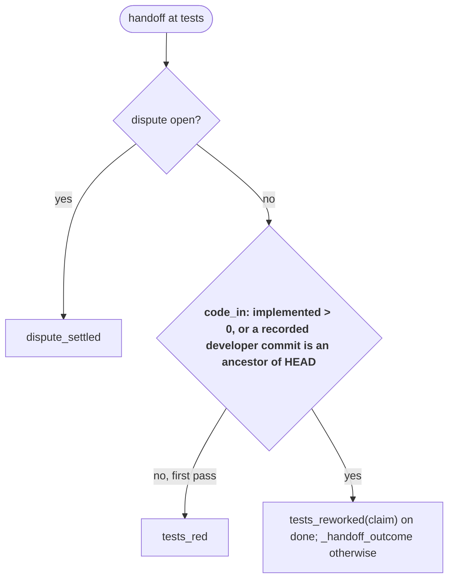

# s46: Code already in passes the tests gate; an `advance` ruling; dispute output

Developer: **developer-cli** (runner Python: `gates.py`, `roles.py`,
`dispatch.py`; the built-in role files moved to s54, see below). In this
design step the Architect has already updated
`reference/protocol.md` (handoff block, "What the Manager sees", "Rulings",
"Back at tests with the code in", "Test disputes", `state.json` fields),
`docs/customer/routing.md` and the index in `architecture.md`. `SKILL.md`
and the README row do not change (neither names rulings or the tests gate).

Story: `.team/stories/s46.md`. Builds on s24 (`design/s24.md`, G1–G7), s11
and s30 (disputes), s27 and s45 (faults and rulings).

## The problem (sprint 16, s40, events e945–e1000)

1. **Code in, `implemented == 0` (AC1, AC3).** The developer committed s40's
   code at `implement` (e945, commit `b1cdc43`) and raised a dispute in the
   same handoff. A dispute skips the implement gate, so `implemented` stayed
   0. Once the dispute was cleared, the story was back at `tests` with a
   green suite, and `tests_red` bounced it twice with `tests pass before
   implementation; write a failing test`. The s24 claim (`"tests":
   "confirmed"`) was ignored because s24 reads only `implemented`. The
   Manager could only name the runner at fault, and the human moved the story
   by hand.
2. **No ruling moves a story forward (AC2).** `rescope` and `revise_design`
   move a story back, and `escalate` blocks it. Nothing moves it past a gate
   that no role can satisfy.
3. **A dispute brief names only the test (AC4).** The unit-tester got the
   test id, the rule and the developer's reason, but not what failed. In
   s40 the named test was not failing, so the tester rightly changed nothing,
   and the gate bounced it twice.

## Rules

| # | Rule | AC |
|---|---|---|
| K1 | **Code commits are recorded.** `StoryState.code_commits: list[str]` (default `[]`) holds the sha of every commit the runner makes for a **developer** role's step on the story (`role_fits_step(role, "implement")`), whatever the step's outcome (pass, bounce, dispute, review fix). `Runtime.commit_step` appends it. Nothing removes entries. Older `state.json` files load `[]` (the `StoryState(**data)` load already defaults it; `state.py` does not change). | AC1 |
| K2 | **Code is in.** `Checks.code_in(story)` is `True` when `story.implemented > 0`, or when any sha in `story.code_commits` is an ancestor of `HEAD` (`git merge-base --is-ancestor <sha> HEAD` exits 0). It short-circuits: with `implemented > 0` or an empty list, no git command runs. A sha git does not know (exit 128) is not in. | AC1 |
| K3 | **Rework gate on code in.** `Pipeline.reworked(story)` is `story.step == "tests" and story.dispute is None and checks.code_in(story)`. `_gate_for` uses it in place of s24's `story.implemented` test. From there on, s24 G4/G6 apply unchanged: a red suite passes, a green suite passes with a `tests` claim (`REWORK_PASS`) and bounces without one (`REWORK_UNCLAIMED`). A non-`done` handoff goes to `_handoff_outcome`. An open dispute still wins (its branch comes first). | AC1 |
| K4 | **First pass unchanged.** With `implemented == 0` and no recorded code commit in the branch, `tests_red` runs exactly as today (s24 G5). | AC1 |
| K5 | **Brief on code in.** The unit-tester's (any role's) prompt carries `REWORK_BRIEF` exactly when `Pipeline.reworked(story)` holds, so the brief and the gate never disagree. | AC1 |
| K6 | **Manager sees the code.** `repeated_setback` in the Manager's runner context gains `"code": {"implemented": <int>, "code_commits": [<shas in the branch>], "code_in": <bool>}`. `code_commits` lists only the recorded shas that are ancestors of `HEAD`, in recorded order. `code_in` is `implemented > 0 or code_commits != []` (same answer as K2). | AC3 |
| A1 | **`advance` ruling.** `roles.RULINGS` becomes `("rescope", "upgrade_model", "revise_design", "escalate", "advance")`. `advance` clears the story's loop exactly like the other rulings (`_clear`: rounds, disputes, open dispute, streak, run, repeated, escalated_by), sets it `active`, then moves it **one enabled step forward from where it is when the ruling applies** with `Pipeline._forward`. Moving forward from `implement` adds 1 to `implemented` (s24 G1). | AC2 |
| A2 | **Fault first, then advance.** On the fault path (s45) the fault applies first, then the ruling. So `"fault": "runner", "ruling": "advance"` on a story stuck at `tests` blocks it, posts the runner-fault note to the human, then advances it to `implement` and sets it `active`. A fault that names a pipeline role moves the story to that role's step first, and `advance` moves on from there. | AC2 |
| A3 | **Advance cannot finish a story.** At the last enabled step, `advance` is refused: `{"ruling": "advance", "applied": false, "why": ADVANCE_LAST}`. The story does not change, and the PO gets the existing `ruling_not_applied` hand-over. The s11 refusals (no story, done story) come first. | AC2 |
| A4 | **Ruling reason in the log.** A handoff may carry `"ruling_reason": "<text>"`. It must be a string (else a malformed handoff: `handoff ruling_reason must be a string`). It defaults to the handoff's `summary` when absent or empty (as a dispute's reason does). Every applied ruling's `ruling` event logs `{ruling, reason, now_at}`, where `reason` is `handoff.ruling_reason`. The Manager's report (`{"ruling", "applied", "now_at"}`) does not change. | AC2 |
| D1 | **Dispute output at raise.** When a dispute opens (after its file resolves and its baseline is taken, s30), the runner runs the `test` command once and stores `OpenDispute.output` (default `""`, so older disputes load). A rejected dispute (untracked file) runs nothing. | AC4 |
| D2 | **What is stored.** Exit 0: `TEST_GREEN.format(test=<test id>)`. Non-zero: `excerpt(output, test_name(test))`, the output from the first line that contains the name, `EXCERPT_LINES` (40) lines, followed by every later line that contains the name (pytest's `FAILED …::name - AssertionError: …` summary line). When no line contains the name: `TEST_NOT_IN_OUTPUT.format(name=…, tail=tail(output))`. `test_name(test)` is the part after the last `::` (the whole id when there is none). | AC4 |
| D3 | **Dispute brief.** While the dispute is open, the line after the T9 `Test dispute (…)` line is `DISPUTE_OUTPUT.format(output=dispute.output)`, only when `output` is not empty. Every role run on the story while the dispute is open gets it (unit-tester and architect). | AC4 |

### Exact strings (tests may assert them)

```python
# gates.py
ANCESTOR_COMMAND = "git merge-base --is-ancestor {sha} HEAD"
ADVANCE_LAST = "story {id} is at {step}, its last step; advance cannot mark it done"
EXCERPT_LINES = 40
TEST_GREEN = "the test command passes, so {test} is not failing"
TEST_NOT_IN_OUTPUT = "the test command fails, but its output never names {name}; its tail:\n{tail}"

# dispatch.py
DISPUTE_OUTPUT = "Output of the test command when the dispute was raised:\n```\n{output}\n```"
```

`REWORK_BRIEF`, `REWORK_PASS` and `REWORK_UNCLAIMED` are unchanged.

## Flow at `tests` (changed branch in bold)



## Changes by module

Every function stays at 8 lines or fewer, with at most 2 parameters besides
`self` and no boolean parameters.

| Module | Change |
|---|---|
| `roles.py` | `RULINGS` gains `"advance"` (last). `Handoff.ruling_reason: str = ""`, the last field. New `HANDOFF_RULES` row after the `ruling` row: `(lambda d: isinstance(d.get("ruling_reason", ""), str), "ruling_reason must be a string")`. `_handoff_from` passes `ruling_reason=data.get("ruling_reason") or str(data.get("summary", ""))`. `handoff_report` is unchanged. |
| `gates.py` | Constants above. `OpenDispute.output: str = ""`, after `stage`. `StoryState.code_commits: list[str] = field(default_factory=list)`, after `implemented`. Module functions `test_name(test: str) -> str` and `excerpt(output: str, name: str) -> str \| None` (D2; `None` when no line names it). `Checks.landed(sha: str) -> bool`: `self.run(ANCESTOR_COMMAND.format(sha=shlex.quote(sha)))[0] == 0`. `Checks.code_in(story) -> bool` (K2): `story.implemented > 0 or any(map(self.landed, story.code_commits))`. `Checks.code_facts(story) -> dict[str, Any]` (K6). `Checks.test_output(test: str) -> str` (D2). `Pipeline.reworked(story) -> bool` (K3). `Pipeline._gate_for`: the second branch becomes `if self.reworked(story): return self._rework_gate(handoff)`. `Pipeline._open`: when the baseline exists, return `OpenDispute(d.test, d.rule, d.reason, path, baseline, output=self.checks.test_output(d.test))`; otherwise `None` as today (the test command does not run). `Pipeline.apply_ruling(story, ruling)` becomes: `self._clear(story)`, the status (`BLOCKED` for `escalate`, else `ACTIVE`), then `self._move_for(story, ruling)`. `Pipeline._move_for(story, ruling) -> None`: a table `{"rescope": …first step, "revise_design": …design (or first), "advance": lambda: self._forward(story)}`. Other rulings leave the step alone. `Pipeline.ruling_move_refusal(story, ruling) -> str \| None`: `ADVANCE_LAST.format(id=story.id, step=story.step)` when `ruling == "advance"` and `story.step == self.steps[-1]`, else `None`. |
| `dispatch.py` | `DISPUTE_OUTPUT`. `commit_step` calls `_record_code(plan, sha)` after setting `story.commit`. `_record_code(plan, sha) -> None`: append `sha` to `plan.story.code_commits` when `plan.story` is set and `role_fits_step(plan.role.name, "implement")`. `user_prompt`: `parts.extend(_story_lines(plan.story, self._rework_lines(plan.story)))`. `Runtime._rework_lines(story: StoryState \| None) -> list[str]`: `[REWORK_BRIEF] if story and self.pipeline.reworked(story) else []`. The module `_rework_lines` goes. `_story_lines(story, rework: list[str])` builds `[head, *_dispute_lines(story), *rework, *_interrupted_lines(story)]`. `_dispute_lines` appends `DISPUTE_OUTPUT.format(output=d.output)` when `d.output` (D3). `_repeated_context`: `{"repeated_setback": {**loops.manager_view(story, events), "code": self.pipeline.checks.code_facts(story)}}`. `_rulings` / `_rule_after_fault` pass `handoff` to `_rule`. `_rule(plan, handoff)`: `why = ruling_refusal(plan.story) or self.pipeline.ruling_move_refusal(plan.story, handoff.ruling)`. The ruling event emits `ruling=…, reason=handoff.ruling_reason, now_at=…`. The report is unchanged. |
| `loops.py`, `state.py`, `handover.py`, `router.py` | No change. |

### Role files (built-in)

Not part of s46. The Manager rescoped them to follow-up story **s54** (see
"Scope ruling" in `.team/stories/s46.md`): `unit-tester.md` learns that code
may be in from a disputed commit and that the dispute brief quotes the test
output; `manager.md` learns the `advance` ruling, `ruling_reason` and
`repeated_setback.code`. s54's design carries the exact wording. No s46 test
asserts role-file text.

## Test checklist (for the Unit Tester)

Contract changes (these do not weaken tests): the `ruling must be one of
(…)` message gains `'advance'`. `ruling` events gain `reason`. A raised
dispute now runs the test command once more (stub runners that count test
runs, or that assert the command list, at a dispute raise must expect it).
`_story_lines` takes a second argument.

Older tests that the developer's code fails for these reasons alone, and
that the Unit Tester updates to the new contract (assert the `reason` key on
`ruling` events; let the stub runner answer, and expect, the one extra test
run at a dispute raise):

- `tests/e2e/test_dispute_e2e.py::test_ruling_below_the_cap_moves_the_story_and_resets_counters`
- `tests/test_dispatch.py::test_manager_rules_on_capped_story`
- `tests/test_disputes.py::test_a_dispute_at_implement_moves_to_tests_without_running_gates`
- `tests/test_disputes.py::test_a_dispute_moves_to_tests_and_stores_it`
- `tests/test_disputes.py::test_a_developer_dispute_logs_one_dispute_event_and_no_gate`
- `tests/test_disputes.py::test_a_dispute_does_not_run_the_implement_gate`
- `tests/test_disputes.py::test_a_ruling_applies_at_any_step_on_an_active_story`

"Without running gates" still holds: the extra command is the dispute's own
test command (D2), not a gate. Those tests keep asserting that no gate ran
and that no `gate` event was logged; only the count or list of run commands
changes.

1. **K1** (`test_dispatch.py` or `test_s46.py`): a `developer-cli` step on a
   story that commits appends the sha to `code_commits` (also when it raises a
   dispute or bounces). An architect, unit-tester or scribe commit does not. A
   step with nothing to commit appends nothing. A legacy story dict without
   the key loads `[]`, and the value round-trips through `state.json`.
2. **K2** (stub `run`): `implemented = 1` → `True`, no command run. `[]` and
   `implemented = 0` → `False`, no command run. Two shas where the ancestor
   command exits 1 then 0 → `True`. All non-zero (including 128) → `False`.
   The command is exactly `git merge-base --is-ancestor <sha> HEAD`.
3. **K3/K4** (`test_gates.py`): story at `tests`, `implemented = 0`,
   `code_commits = ["abc1234"]` in the branch, no dispute, `done`:
   green + `"tests": "confirmed"` → `PASS` with `REWORK_PASS`, moves to
   `implement`; green without a claim → `BOUNCE` with `REWORK_UNCLAIMED`;
   red → `PASS`. The same story with the sha **not** in the branch → green
   bounces with `tests pass before implementation; write a failing test`
   (K4). An open dispute still goes to `dispute_settled`, and the ancestor
   command does not run.
4. **AC1 end to end** (`test_router.py` fakes, the s40 route): the developer
   commits and raises a dispute at `implement`. A Manager fault on
   `unit-tester` clears the dispute, leaving the story at `tests` with
   `implemented == 0`. Then, with a green suite, a
   `"tests": "confirmed"` handoff passes to `implement` with no hand-over and
   no state edit.
5. **K5** (`test_dispatch.py`): the tests-step prompt holds `REWORK_BRIEF`
   when `implemented = 0` and a recorded code commit is in the branch. It
   does not when the commit is not in, on a story with no code commits, while
   a dispute is open, or at another step.
6. **K6**: a Manager step on an escalated story has
   `repeated_setback.code == {"implemented": 0, "code_commits": [<in-branch
   shas only>], "code_in": true}`. With no commits it is `{…, "code_commits":
   [], "code_in": false}`. With `implemented = 2` and no commits, `code_in` is
   `true`. `loops.manager_view` is unchanged.
7. **A1** (`test_gates.py`): `apply_ruling(st, "advance")` at `tests` →
   `implement`, `active`, rounds/disputes/dispute/streak/run/repeated/
   escalated_by cleared. From `implement` → `quality` and `implemented` +1.
   From `needs_manager` and `blocked` → `active`. The other rulings keep
   their s11 moves (the existing parametrized tests stay).
8. **A2** (`test_dispatch.py`/`test_s45.py` style): a Manager handoff
   `{"fault": "runner", "ruling": "advance"}` on a story escalated at `tests`
   → a `fault` event (`kind: runner`), the runner-fault note to the human,
   then a `ruling` event with `now_at: "implement"`; the story is `active` at
   `implement`. `{"fault": "unit-tester", "ruling": "advance"}` on a story at
   `implement` → `tests` then `implement`.
9. **A3**: `advance` on a story at the last enabled step → report
   `{"ruling": "advance", "applied": false, "why": ADVANCE_LAST…}`, story
   unchanged, no `ruling` event, and the router's hand-over is
   `ruling_not_applied`. On a done story the s11 text (`story sN is done; a
   ruling cannot move it`) wins.
10. **A4** (`test_roles.py`): `"ruling": "advance"` parses. `"ruling_reason":
    "x"` → `"x"`. Absent or `""` → the summary. `"ruling_reason": 3` →
    `HandoffError("handoff ruling_reason must be a string")`. The `ruling`
    event's data is `{"ruling", "reason", "now_at"}` with the reason (any
    ruling, not only `advance`).
11. **D1/D2** (`test_gates.py`, stub `run`): raising a dispute on a
    tracked file runs the test command once and stores:
    - exit 0 → `TEST_GREEN` with the test id;
    - exit 1 with output naming `test_x` → the lines from the first match (at
      most 40) plus a later `FAILED …::test_x - AssertionError` line beyond
      the 40;
    - exit 1 without the name → `TEST_NOT_IN_OUTPUT` with the 30-line tail.
    An untracked (rejected) dispute runs no test command. `test_name("a.py")
    == "a.py"`, `test_name("a.py::C::t[1]") == "t[1]"`. A saved dispute
    without `output` loads `""`.
12. **D3** (`test_dispatch.py`): with `output` set, the unit-tester's prompt
    has the `Test dispute (raised)` line followed by `DISPUTE_OUTPUT` with
    the output. With `output == ""` the prompt has no `Output of the test
    command` line.
13. Coverage ≥ 95% (target 100%); `ruff check` and `ruff format --check`
    clean (AC5).

## Out of scope

- Backfilling `code_commits` for stories saved before s46 from the event log.
  For those, the Manager uses `advance` (AC2).
- Rejecting a dispute whose test is not failing. D1–D3 show the output, and
  the unit-tester and architect decide.
- Checking that a `changed` claim matches a real test change (as in s24).
- Advancing a story to done. Acceptance stays with the Proxy or the human.
