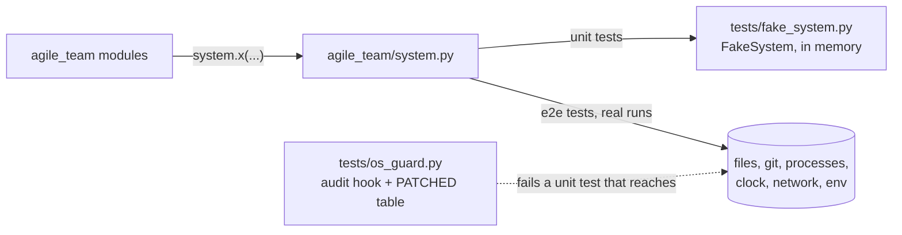

# s71: Unit tests run no shell commands and touch no OS

Story: `.team/stories/s71.md`. Plan and call table:
`.team/run/liaison/plans/unit-test-isolation.md` (read its tables; not restated).
ADR: `docs/adr/ADR-011-one-os-seam.md`. Developer: `developer-cli`.
DevOps: ruff config in phase P3 only.

## The shape in one paragraph

`agile_team/system.py` is the only code that touches the OS. Every other module
does `from agile_team import system` and calls `system.read_text(path)`,
`system.run(command)`, `system.now()`. Unit tests never see the real OS: an
autouse fixture swaps every function in `system.__all__` for the in-memory
`tests/fake_system.FakeSystem`, and an audit hook plus a patch table fail any
unit test that reaches the real OS anyway. Real files, real git and real
processes live only in `tests/e2e/`.



## Rules

| # | Rule | AC |
|---|---|---|
| O1 | **One seam.** Only `agile_team/system.py` calls the OS: files, processes, signals, process ids, the clock, sleeps, the network, the environment, the browser. Its functions are thin (one call, maybe one line of shaping) and hold no logic. Each has a docstring. Its public names are listed in `system.__all__`. | 2 |
| O2 | **Import the module, never a name.** Other modules write `from agile_team import system` (inside the package: `from . import system`) and call `system.name(...)` at the call site. `from agile_team.system import x` / `from .system import x` is banned: it binds the real function at import and the test swap never reaches it. Types and constants (`system.Command`, `system.TimeoutExpired`, …) are also reached as `system.X`. | 2 |
| O3 | **No OS object is a parameter.** No constructor, dataclass field or function parameter carries a filesystem, process runner, clock, sleep, pid, `environ`, `which` or browser. The fields that exist today for that are **removed** (table below) and the code calls `system` at the use site. A field may still default to a function **of its own module** (it calls `system` when run, so the swap reaches it): `Preparer.runner = run_shell`, `Preparer.probe = http_answers`, `Preparer.listening = port_in_use`, `upstream.command_runner`, `gates.Checks(runner=…)` stay. | 2 |
| O4 | **Nothing holds a `system` function from import time.** No module-level constant, dataclass default, `default_factory`, `partial` or argparse default may hold `system.x` or its result. Read it when the code runs (`cli`'s `--home` default becomes `None`, see P3). | 2 |
| O5 | **Behaviour does not change.** Each conversion keeps the exact semantics: same exceptions (`FileNotFoundError`, `PermissionError`, `OSError`, `system.TimeoutExpired`), same atomic tmp-then-replace writes, same `missing_ok`, same encodings and `errors="replace"`. | 2 |
| O6 | **The fake swaps everything.** An autouse fixture installs a fresh `FakeSystem` for every unit test with `monkeypatch.setattr(system, name, …)` for each function in `system.__all__`. A unit test asserts the fake implements every name in `system.__all__` (so a new `system` function cannot be forgotten). No pyfakefs, no new dependency. | 3 |
| O7 | **The fake can fail.** It records every write; it can make a path missing (just don't put it), unreadable (`deny(path)` → `PermissionError` on read), and the disk full (`fill_disk()` → `OSError(errno.ENOSPC)` on every write, append, replace, make_dirs, copy). Git and every other command go through `system.run`, so they answer from the fake's reply table. | 3 |
| O8 | **The audit hook.** `tests/conftest.py` installs `os_guard.hook` with `sys.addaudithook` once per process. It acts only while a unit test (not `tests/e2e/`) is in its setup, call or teardown. An event in `AUDITED` (a dict, event → category) fails the test unless the frame that made the call belongs to an `EXEMPT_CALLERS` module (the import machinery, `linecache`, `coverage`, xdist). | 4 |
| O9 | **The patch table.** Calls with no audit event are listed in `PATCHED` (rows of module, name, category): pid and process-group ids, `os.wait*`, `os.setsid`/`setpgid`, `signal.signal`/`alarm`/`setitimer`, `time.sleep`, `shutil.which`, `shutil.disk_usage`, `platform.*`, `os.uname`, `os.cpu_count`, `os.getuid`…, `os.getcwd`, `os.stat`, `os.lstat` (the last two catch `Path.exists`, `is_file`, `stat` and `resolve`). While a unit test runs, each is patched to a wrapper that raises when the caller is `agile_team.*` or `tests.*`, and calls the real function otherwise (the stdlib's own uses, such as `logging` reading the pid, must keep working). | 4 |
| O10 | **The error.** Both mechanisms raise `os_guard.RealOsCall` (a `BaseException` subclass, so `except Exception` / `except OSError` in the code under test cannot swallow it) with the text `unit test reached the real OS: {call} ({category}); inject it, or move the test to tests/e2e/`. `{call}` is the audit event name or `module.name`. Each violation is also recorded; if the code under test swallowed it anyway, the wrapper fails the test with the same text when the phase ends. | 4 |
| O11 | **Tables, not branches.** `AUDITED`, `PATCHED`, `EXEMPT_CALLERS`, `GUARDED_CALLERS`, `PASS_THROUGH` and (during migration) `LEGACY` are data. The world a test runs in is a `World` enum chosen by one function. | 4 |
| O12 | **Static ban.** Ruff `TID251` (`banned-api`) bans the OS calls listed under "Ruff config" everywhere except `agile_team/system.py`, `tests/e2e/**`, `tests/os_guard.py`, `tests/fake_system.py`, `tests/conftest.py` and `scripts/**`. Lands in P3 when no module needs an exception. O2 (no `from …system import name`) cannot be a `banned-api` row: banning `agile_team.system.read_text` would also flag `system.read_text(...)`. `tests/e2e/test_seam_e2e.py` checks it with `ast` instead (P1). | 2, 4 |
| O13 | **A test that proves logic uses the fake; a test that proves the OS moves to e2e.** A unit test checks what the runner decides and which calls it makes. A test whose point is how the real OS or real git behaves (a new-session child leads its own group, a revert really restores files, `ps` reports a fresh child, rerere replays, a real HTTP server answers, node renders the UI, collection in two processes) moves to `tests/e2e/`. No test is weakened, skipped or deleted overall; each keeps what it proves. | 5 |
| O14 | **Who moves a test to e2e.** The unit-tester cannot write `tests/e2e/`. In the tests step it removes the test from the unit file and lists its node id in its handoff summary as `moves to e2e: <node id> (<what it proves>)`. In the same story's e2e step the integration-tester recreates each one under `tests/e2e/test_<origin>_e2e.py` from the tests-step commit (`git show <sha>:<path>`, read-only git), on real files with `tmp_path`. The design-review step checks the two lists match. | 5 |
| O15 | **Test helpers write through `system`.** Fixtures and helpers that lay out files (`present`, the repo seed) call `system.make_dirs` / `system.write_text`, so the same helper serves the fake world and the real one. | 3 |
| O16 | **Migration keeps the suite green.** Until P3 ends, `os_guard.LEGACY` (a frozenset of unit-test file names) lists the files not yet migrated. They run in the real world exactly as today (no swap, no guard). Each phase removes rows; P3 deletes the table. | 5 |
| O17 | **s41's G1 moves with the seam (from P2).** Only `system.py` calls `os.killpg`. No module but `process_groups` calls `system.killpg`, except `sandbox._ends_within`'s liveness poll `system.killpg(pgid, 0)` (signal 0 only, as today). | — |

## Phases (each keeps the suite green)

The work is too large for one tests step and one implement step. It is cut
into three phases. **Recommendation to the PO:** run each phase as its own
story through the whole pipeline, P1 as s71 and P2, P3 as follow-ups (see
the handoff). If s71 is run whole, the unit-tester and the developer do P1,
P2, P3 in that order inside their one step each.

Each phase pairs source conversions with the tests that reach them, so the
tests step is red for a real reason: a migrated test runs in the fake world,
the module still calls the OS, and the guard fails it.

| Phase | Developer converts (and the `system` functions it adds) | Unit-tester migrates | e2e step adds |
|---|---|---|---|
| **P1** seam, files, clock | `system.py` (P1 rows, `__all__`), then: `state`, `ledger`, `events`, `relay`, `results`, `watch` (drops `Pace`), `halt`, `config`, `keys`, `roles`, `po_session`, `onboard`, `presentation`, `paths`, `health`, `gates`, `dashboard/snapshot`, `dispatch`, `router` (file call only), `checkout`, `stack`, `runner_tools`; built-in `roles/unit-tester.md` (AC6) | builds `tests/fake_system.py`, `tests/os_guard.py`, the conftest wiring, `LEGACY` = every pre-s71 `tests/test_*.py` minus the files below; new `test_system_fake.py`, `test_os_guard.py`, `test_s71_seam.py`; migrates at least `test_state`, `test_ledger`, `test_events`, `test_relay`, `test_s62_watch`, `test_config`, `test_keys`, `test_roles`, `test_paths`, `test_onboard`, `test_presentation`, `test_po_session`, `test_snapshot`, `test_insights`, `test_fingerprint`, `test_handover`, `test_providers`, `test_priority`, `test_gates`, `test_s68`, `test_s27` | `tests/e2e/test_system_e2e.py` (P1 functions on the real OS); `tests/e2e/test_seam_e2e.py` (O2, O17 by `ast`); the P1 moves |
| **P2** processes, signals, network | `system.py` (P2 rows), then: `process_groups`, `commands`, `sandbox` (drops `popen`, `sleep`), `kill_check`, `live` (drops `Pace`, `Pulse.pid`), `dashboard/server`, `guard`, `git_ops`, `upstream`; `cli`'s one `DashboardServer(...)` call site | at least `test_process_groups`, `test_sandbox`, `test_service_presentation`, `test_s43`, `test_server`, `test_s44_live`, `test_s44_round1`, `test_kill_check`, `test_guard`, `test_forbidden_roots`, `test_git_ops`; `test_s70_ids`, `test_dashboard_ui`, `test_dashboard_live_ui`, `test_docs_commands` move whole to e2e | P2 functions in `test_system_e2e.py`; the P2 moves |
| **P3** the fake repo, runtime, close | `system.py` (P3 rows), then: `router` and `po_tools` (drop `sleep`), `cli` (drops `browse`, `cmd_stop`'s `kill`; `--home` default), `preflight` (drops `which`, `environ`) | every file still in `LEGACY`; then delete `LEGACY` and its world row | P3 functions in `test_system_e2e.py`; the P3 moves |
| **P3, DevOps** | `pyproject.toml`: `TID251` (below) | | |

"At least" means: migrate those; a file may also migrate earlier if every
module it reaches is converted (the guard says so when it is not). A file that
reaches an unconverted module stays in `LEGACY` until a later phase. A file may
be split: tests that are ready migrate, the rest stay.

**Tests that patch an OS name through a converted module** (for example
`monkeypatch.setattr(sandbox.time, "sleep", …)`,
`monkeypatch.setattr("agile_team.process_groups.os.getpgid", …)`, or a test
that passes a removed field such as `Pace(...)`, `Preparer(popen=…)`) break when
that module converts. The unit-tester updates them in the same phase, migrated
or not: in a migrated file, script the fake; in a `LEGACY` file, patch
`system.<name>` instead. Find them with
`Grep "setattr\(.*\.(os|time|subprocess|shutil|socket|signal|webbrowser)\b|Pace\(|popen=|sleep=|which=|browse=|kill="`.

## `agile_team/system.py` (new)

Module docstring: the O1/O2 rule in two sentences. Imports: `asyncio`,
`os`, `shutil`, `socket`, `subprocess`, `time`, `urllib.request`,
`webbrowser`, `collections.abc`, `dataclasses`, `http.server`
(`BaseHTTPRequestHandler`, `ThreadingHTTPServer`), `pathlib.Path`,
`threading`, `typing.NamedTuple`.

Types and constants are public but **not** in `__all__`; `__all__` lists
exactly the functions the fake swaps:

```python
class Completed(NamedTuple):
    """A finished command: exit code, stdout, stderr."""
    code: int
    out: str
    err: str

@dataclass(frozen=True)
class Command:
    """An argv to run without a shell."""
    argv: tuple[str, ...]
    cwd: Path | None = None
    timeout: float | None = None

@dataclass(frozen=True)
class ShellCommand:
    """A shell command line, where it runs, and its environment (None inherits)."""
    text: str
    cwd: Path
    env: Mapping[str, str] | None = None

class FileStat(NamedTuple):
    """What the runner reads from ``stat``: mtime (s and ns), size, permission bits."""
    mtime: float
    mtime_ns: int
    size: int
    mode: int          # stat.S_IMODE(st_mode)

class HttpReply(NamedTuple):
    """An HTTP response: status, content type (no parameters), body."""
    status: int
    content_type: str
    body: bytes

TimeoutExpired = subprocess.TimeoutExpired
Process = subprocess.Popen
```

Functions. Each is one call; "Wraps" is the whole body. At most two
parameters (house rule), hence `Command` / `ShellCommand`.

| Phase | Signature | Wraps |
|---|---|---|
| P1 | `read_text(path: Path) -> str` | `path.read_text()` |
| P1 | `read_bytes(path: Path) -> bytes` | `path.read_bytes()` |
| P1 | `read_end(path: Path, size: int) -> tuple[bytes, int]` | open `rb`, `end = seek(0, SEEK_END)`, `seek(max(0, end - size))`, return `(read(), end)` |
| P1 | `write_text(path: Path, text: str) -> None` | `path.write_text(text)` |
| P1 | `append_text(path: Path, text: str) -> None` | `with path.open("a") as fh: fh.write(text)` |
| P1 | `replace(source: Path, target: Path) -> None` | `os.replace(source, target)` |
| P1 | `make_dirs(path: Path) -> None` | `path.mkdir(parents=True, exist_ok=True)` |
| P1 | `remove(path: Path) -> None` | `path.unlink(missing_ok=True)` |
| P1 | `remove_tree(path: Path) -> None` | `shutil.rmtree(path)` |
| P1 | `copy_tree(source: Path, target: Path) -> None` | `shutil.copytree(source, target, symlinks=True)` |
| P1 | `is_file(path: Path) -> bool` / `is_dir` / `exists` | `path.is_file()` / … |
| P1 | `list_dir(path: Path) -> list[Path]` | `sorted(path.iterdir())` |
| P1 | `glob(path: Path, pattern: str) -> list[Path]` | `sorted(path.glob(pattern))` |
| P1 | `stat(path: Path) -> FileStat` | `os.stat` → `FileStat(st.st_mtime, st.st_mtime_ns, st.st_size, S_IMODE(st.st_mode))` |
| P1 | `resolve(path: Path) -> Path` | `path.resolve()` |
| P1 | `expand_user(path: Path) -> Path` | `path.expanduser()` |
| P1 | `now() -> float` | `time.time()` |
| P1 | `monotonic() -> float` | `time.monotonic()` |
| P1 | `local_time(fmt: str) -> str` | `time.strftime(fmt)` |
| P1 | `sleep(seconds: float) -> None` | `time.sleep(seconds)` |
| P1 | `pid() -> int` | `os.getpid()` |
| P1 | `kill(pid: int, sig: int) -> None` | `os.kill(pid, sig)` |
| P2 | `pgrp() -> int` | `os.getpgrp()` |
| P2 | `pgid(pid: int) -> int` | `os.getpgid(pid)` |
| P2 | `killpg(pgid: int, sig: int) -> None` | `os.killpg(pgid, sig)` |
| P2 | `run(command: Command) -> Completed` | `subprocess.run(list(argv), cwd=…, timeout=…, capture_output=True, text=True, check=False)` → `Completed(rc, stdout, stderr)` |
| P2 | `run_shell(command: ShellCommand) -> int` | `subprocess.run(text, shell=True, cwd=…, env=…, check=False).returncode` |
| P2 | `spawn_piped(command: ShellCommand) -> Process` | `subprocess.Popen(text, shell=True, cwd=…, env=…, stdin=DEVNULL, stdout=PIPE, stderr=STDOUT, text=True, errors="replace", start_new_session=True)` (today's `commands.POPEN_OPTS`) |
| P2 | `spawn_logged(command: ShellCommand, log: Path) -> Process` | `with log.open("wb") as out: return Popen(text, shell=True, cwd=…, env=…, start_new_session=True, stdout=out, stderr=STDOUT)` |
| P2 | `wait_event(event: threading.Event, timeout: float) -> bool` | `event.wait(timeout)` |
| P2 | `environ() -> Mapping[str, str]` | `os.environ` |
| P2 | `http_get(url: str, timeout: float) -> HttpReply` | `urllib.request.urlopen(url, timeout=…)`; `HttpReply(r.status, r.headers.get_content_type(), r.read())` inside the `with` |
| P2 | `connect(address: tuple[str, int]) -> None` | `socket.create_connection(address, timeout=1).close()` |
| P2 | `hostname() -> str` | `socket.gethostname()` |
| P2 | `listen_http(address: tuple[str, int], handler: type[BaseHTTPRequestHandler]) -> ThreadingHTTPServer` | `server = ThreadingHTTPServer(address, handler)`; `server.daemon_threads = True`; return it |
| P3 | `async_sleep(seconds: float) -> None` (`async def`) | `await asyncio.sleep(seconds)` |
| P3 | `which(name: str) -> str \| None` | `shutil.which(name)` |
| P3 | `home() -> Path` | `Path.home()` |
| P3 | `cwd() -> Path` | `Path.cwd()` |
| P3 | `open_browser(url: str) -> bool` | `webbrowser.open(url)` |
| P3 | `on_signal(sig: int, callback: Callable[[], object]) -> None` | `asyncio.get_running_loop().add_signal_handler(sig, callback)` |

Add each phase's rows in that phase only (an unused function lowers coverage
until the e2e step covers it).

## Changes per module

Every change below is a like-for-like swap (O5). "→" means "becomes".

### P1

- `state.py`: `load`: `system.is_file` / `system.read_text`. `save`:
  `system.make_dirs(run_dir)`, `system.write_text(tmp, …)`,
  `system.replace(tmp, run_dir / STATE_FILE)`. Liveness `os.kill(pid, 0)` →
  `system.kill(pid, 0)` (same `except`).
- `ledger.py`, `events.py`: `time.time()` → `system.now()`; `mkdir` →
  `system.make_dirs(path.parent)`; `with path.open("a") as fh: fh.write(line)` →
  `system.append_text(path, line)`; reads → `system.is_file` /
  `system.read_text`.
- `relay.py`: `make_dirs`; draft name `f".draft-{system.pid()}"`;
  `write_text`, `remove` (was `unlink(missing_ok=True)`), `is_dir`,
  `list_dir` (was `iterdir`), `now`, `append_text`, `is_file`/`read_text`.
- `results.py`: `make_dirs`, `write_text`, reads via `system`.
- `watch.py`: delete `Pace` and `DEFAULT_PACE`; `Watcher` loses `pace`.
  `Watcher` calls `system.sleep(...)` and `system.monotonic()` where it called
  `self.pace.sleep` / `self.pace.clock`. `Seen.load` / `save` through
  `system.read_text`, `make_dirs`, `write_text`, `replace`. `cli` builds
  `Watcher(run_dir)` (drop any `pace=`).
- `halt.py` (crash log): `system.make_dirs(run_dir)`;
  `system.local_time("%Y-%m-%d %H:%M:%S")`; build the whole entry as one
  string and `system.append_text(run_dir / CRASH_LOG, entry)`.
- `config.py`: `system.is_file`, `system.read_text`.
- `keys.py`: `system.is_file`; mode check `system.stat(path).mode ==
  REQUIRED_MODE`; `system.read_text(path).strip()`; `system.resolve(p)`.
- `roles.py`: `system.is_dir`, `system.glob(directory, "*.md")`,
  `system.read_text`, `system.make_dirs`, `system.is_file`;
  `user_roles_dir`: `system.expand_user(Path(custom))`.
- `po_session.py`: `system.is_file`, `system.read_text`, `system.remove`.
- `onboard.py`: `PRESETS = Path(__file__).parent / "presets.toml"` (module
  constant, a path only) and `system.read_text(PRESETS)` replaces
  `resources.files(...)`; drop the `resources` import. Other calls:
  `is_file`, `read_text`, `append_text`, `exists`, `make_dirs`,
  `write_text`.
- `presentation.py`: `is_dir`, `make_dirs` (was `workspace.mkdir()`; the
  parent is fresh, so `exist_ok` changes nothing), `is_file`/`read_text`,
  `list_dir` (was `iterdir`). `copy_into`: `target = root / PRESENTATION_DIR`;
  `system.copy_tree(source, target)`; `return target`.
- `paths.py`: `system.expand_user(Path(raw))`; `.resolve()` →
  `system.resolve(...)` (both sites).
- `health.py`: `time.time()` → `system.now()`.
- `gates.py`: `read_repo_file`: `system.is_file(target)`, then
  `system.read_bytes(target).decode("utf-8", errors="replace")`. Line ~322:
  `system.is_file` / `system.read_text`.
- `dashboard/snapshot.py`: `time.time()` → `system.now()`; `read_jsonl` via
  `system.is_file` / `read_text`; `read_tail`: `data, end =
  system.read_end(path, size)` inside the same `try/except OSError`, then
  `cut = end > size` and decode as today; `watched_files` and the
  requirement list use `system.glob(dir, pattern)` (already sorted).
- `dispatch.py`: config re-read `system.read_text(git.repo / CONFIG_NAME)`;
  stop file `system.exists(...)`.
- `router.py`: `system.is_file(config.repo / p)` (the `sleep` field stays
  until P3).
- `checkout.py`: `system.exists(git_dir / path)`.
- `stack.py`: `system.exists(self.worktree / ".git")`.
- `runner_tools.py`: `system.is_file(repo / f)`; `time.monotonic()` →
  `system.monotonic()`.
- `roles/unit-tester.md` (built-in role text; AC6). Replace the bullet
  "Mock anything that touches production systems (…)" with:

  > - Unit tests run no shell command and touch no OS: no process (git
  >   included), signal, real pid, clock, sleep, network, environment or
  >   filesystem, a temp dir included. Mock them at the repo's OS seam (in
  >   the agile-team runner: `agile_team.system` and the `fake` fixture). A
  >   test that needs the real OS is an e2e test: remove it from the unit
  >   suite and list it in your handoff summary as
  >   `moves to e2e: <test id> (<what it proves>)`; the integration-tester
  >   writes it under the e2e glob.

### P2

- `process_groups.py`: drop `os`, `subprocess`, `time` imports.
  `os.getpgrp()` → `system.pgrp()`, `os.getpgid(pid)` → `system.pgid(pid)`,
  `os.killpg` → `system.killpg`, `RunnerIds.current()` →
  `cls(system.pid(), system.pgrp())`. `_elapsed`:
  `system.run(system.Command((*ETIME_COMMAND, str(pid)), timeout=PS_TIMEOUT_S))`,
  catching `(OSError, system.TimeoutExpired)`; return `done.out if done.code
  == 0 else None`. `started_at`: `system.now() - elapsed`.
- `commands.py`: drop `subprocess` and `POPEN_OPTS`. `CommandShell.run`:
  `with system.spawn_piped(system.ShellCommand(command, self.repo)) as proc:`;
  `except system.TimeoutExpired`. `kill_group` / `drain` take
  `proc: system.Process` and catch `system.TimeoutExpired`.
- `sandbox.py`: drop `os`, `shutil`, `socket`, `subprocess`, `time`,
  `urllib.request` imports (keep `signal` for its constants).
  - `Prepared.process: system.Process | None`; `stop` catches
    `system.TimeoutExpired`.
  - `_placeholders`: `system.resolve(self.repo)`, `system.resolve(self.root)`.
  - `_recorded`: `Recorded(int(system.read_text(pid_file).strip()),
    system.stat(pid_file).mtime)`.
  - `_ends_within`: `system.monotonic()`, `system.killpg(pgid, 0)`,
    `system.sleep(0.05)`.
  - `stop_stale`: `system.remove(pid_file)`.
  - `http_answers`: `reply = system.http_get(url, PROBE_TIMEOUT_S)`; `False`
    unless `reply.status == 200`; `json.loads(reply.body)` when
    `reply.content_type == "application/json"`; same `except (OSError,
    ValueError)`.
  - `port_in_use`: `system.connect((host, port))` in the same `try`.
  - `run_shell`: `return system.run_shell(system.ShellCommand(command,
    prepared.repo, prepared.env))`.
  - `fresh_dir`: `if system.exists(path): system.remove_tree(path)`;
    `system.make_dirs(path)`.
  - `sandbox_env`: `env = dict(system.environ())`.
  - `Preparer`: **remove `popen` and `sleep`** (and the `Popen` alias).
    `_start`: `prepared.process = system.spawn_logged(system.ShellCommand(
    prepared.expand(command), prepared.repo, prepared.env),
    prepared.log_file())`, then `system.write_text(prepared.pid_file(),
    str(prepared.process.pid))`. `_await_answer`: `system.sleep(PROBE_EVERY_S)`.
  - `_log_tail`: `system.is_file` / `system.read_bytes`.
  - Every other file call in the module (`layout`, settings files) through
    `system` the same way.
- `kill_check.py`: `os.getpgrp()` → `system.pgrp()`. `os.path.basename` is
  string work and stays.
- `live.py`: delete `Pace`. `Pulse` loses `pace` and `pid`.
  `self.pace.now()` → `system.now()`; `beats`: `while not
  system.wait_event(self._stop, self.beat_s): self.write()`; the heartbeat's
  pid → `system.pid()`; `_log` → `system.append_text(self.run_dir / TURNS,
  turn.line() + "\n")` in the same `try/except OSError`; `write` →
  `system.write_text(tmp, …)` + `system.replace(tmp, …)`. Drop every
  `pace=` / `pid=` at `Pulse(...)` call sites.
- `dashboard/server.py`: `INDEX = Path(__file__).parent / "index.html"`;
  `_index` sends `system.read_bytes(INDEX)`. `_stat`: `info =
  system.stat(path)`; return `(str(path), info.mtime_ns, info.size)`.
  `_pump`: `system.sleep(app.poll_seconds)`. `lan_name`: `system.hostname()`.
  Replace class `DashboardServer` with:

  ```python
  def open_server(address: tuple[str, int], app: Dashboard) -> ThreadingHTTPServer:
      """A threaded HTTP server for ``app`` (daemon threads; the handler reads ``server.app``)."""
  ```
  body: `server = system.listen_http(address, Handler)`; `server.app = app`
  (`# type: ignore[attr-defined]`); return it. `serve(server:
  ThreadingHTTPServer)` unchanged. `cli`'s call site uses `open_server`.
- `guard.py`: the three `.resolve()` calls → `system.resolve(...)`.
- `git_ops.py`: drop `subprocess`. `_exec(*args) -> system.Completed`:
  `system.run(system.Command(("git", *self.options, *args), self.repo))`.
  `run`: `proc.code`, `proc.err`, `proc.out`; `attempt`: `(proc.code,
  proc.out + proc.err)`; `is_repo`: `system.is_dir(self.repo) and
  self._exec("rev-parse", "--git-dir").code == 0`; `is_ignored`: `.code == 0`.
- `upstream.py`: drop `subprocess`. `command_runner`'s `run`:
  `done = system.run(system.Command(tuple(argv), repo, GH_TIMEOUT))`, same
  `except FileNotFoundError` → `127`; return `done.code, done.out + done.err`.

### P3

- `router.py`, `po_tools.py`: **remove the `sleep` field** (and the `Sleep`
  alias if unused); `await self.sleep(s)` → `await system.async_sleep(s)`.
- `preflight.py`: **remove `which` and `environ`** (and the `Which` alias).
  Use `system.which(name)` and `system.environ()`; `locations().resolve()`
  is a `keys` call and unchanged.
- `cli.py`:
  - `Path(args.repo).resolve()` → `system.resolve(Path(args.repo))`.
  - `os.environ` (three sites) → `system.environ()`.
  - SIGTERM: `system.on_signal(signal.SIGTERM, task.cancel)`.
  - Pid file: `system.make_dirs(run_dir)`, `system.write_text(path,
    str(system.pid()))`, `system.remove(path)`.
  - `-` source stays `sys.stdin.read()`; a file source →
    `system.read_text(Path(source))`.
  - `cmd_stop(args: argparse.Namespace) -> int` (**drop `kill`**):
    `system.is_file(pid)`, `system.kill(int(system.read_text(pid)),
    signal.SIGTERM)`.
  - The dataclass field `browse` is **removed**; the dashboard command calls
    `system.open_browser(url)`.
  - Other `mkdir` → `system.make_dirs`.
  - `--home`: the option table default becomes `None` (O4: the table is
    built at import). Add `home_of(args: argparse.Namespace) -> Path`:
    `Path(args.home) if args.home else system.home()`; every read of
    `args.home` goes through it.

## Test infrastructure (unit-tester, P1)

### `tests/fake_system.py`

```python
FAKE_ROOT = Path("/fake")
FAKE_REPO = FAKE_ROOT / "repo"
FAKE_HOME = FAKE_ROOT / "home"
FAKE_HEAD = "c0ffee0000000000000000000000000000000000"
FAKE_IDS = (4242, 4243)          # the runner's pid and pgrp in the fake (as s70's FAKE)
START_CLOCK = 1_800_000_000.0

class Done(NamedTuple):           # one scripted command result
    code: int = 0
    out: str = ""
    err: str = ""

class FakeSystem:
    """In-memory stand-in for every function in ``agile_team.system.__all__``."""
```

What it must do (method names are the unit-tester's choice unless given):

- **Files.** Paths normalise with `posixpath.normpath` against `cwd`
  (`FAKE_REPO`); never call a real `Path` method that touches the OS
  (`absolute`, `resolve`, `exists`…), the guard would fail the fake itself.
  Files are `bytes` with an mtime (the clock at the write) and a mode
  (`0o644` unless given). Directories are explicit; writing under a missing
  directory raises `FileNotFoundError` like the real OS; `put(path, text,
  mode=…, mtime=…)` creates parents. Reads of a missing file raise
  `FileNotFoundError`; `list_dir` returns direct children sorted; `glob`
  matches direct children with `fnmatch` (the runner uses no `**`);
  `remove_tree` of a missing path raises `FileNotFoundError`; `copy_tree`
  onto an existing target raises `FileExistsError`; `resolve` returns the
  normalised absolute path; `expand_user` maps `~` to `FAKE_HOME`;
  `read_end` returns the last `size` bytes and the length.
- **Failures (O7).** `deny(path)`: reads raise `PermissionError`.
  `fill_disk()`: every write, append, replace, make_dirs and copy raises
  `OSError(errno.ENOSPC, "No space left on device")`.
- **Record.** `ops: list[tuple[str, Path]]` in call order, the op being the
  `system` function name (`write_text`, `append_text`, `replace`, …).
- **Package data.** Seeded at construction from a module-level snapshot taken
  once at import of `fake_system` (collection time, before any guard): the
  bytes of `agile_team/roles/*.md`, `agile_team/presets.toml` and
  `agile_team/dashboard/index.html`, at their real absolute paths. The
  runner reads its built-in roles, presets and UI through `system`, so the
  fake must hold them.
- **Commands.** `commands: list[Command | ShellCommand]` records every `run`,
  `run_shell`, `spawn_*`. `reply(words: tuple[str, ...], *results)` adds a
  rule; a rule matches when its words appear in the argv **in order**
  (a subsequence, so git's `-c x=y` options don't matter). The rule added last
  wins. Its results are used in turn and the last one repeats; a result is a
  `Done` or an exception instance (raised: `FileNotFoundError` for a missing
  binary, `system.TimeoutExpired(...)` for a hang). No rule: `Done()`. Shell
  commands match on `text.split()`. `run_shell` returns the result's `code`.
- **Processes.** `spawn_piped` / `spawn_logged` return a `FakeProcess`
  (scripted per command like replies): `pid`, `returncode`, `poll()`,
  `wait(timeout)`, `communicate(timeout)` (returns `(output, None)` or raises
  `system.TimeoutExpired` while it is scripted to hang), context manager.
  `spawn_logged` writes the scripted output to the log path in the fake FS.
- **Ids and signals.** `pid()`/`pgrp()` return `FAKE_IDS`. `groups: dict[int,
  int]` maps live pids to their group; `pgid(pid)` raises
  `ProcessLookupError` for an unknown pid. `kill`/`killpg` record
  `(name, id, sig)` in `signals`; signal `0` raises `ProcessLookupError`
  unless the pid / group is live; other signals to a dead one raise
  `ProcessLookupError` too.
- **Clock.** One timeline from `START_CLOCK`: `now()` and `monotonic()` read
  it; `sleep(s)` and `async_sleep(s)` record `s` in `slept` and advance it;
  `local_time(fmt)` formats it with `time.strftime(fmt, time.gmtime(clock))`
  (pure). `wait_event(event, timeout)` returns `True` at once if the event is
  set; otherwise it advances the clock by `timeout` and returns `False` while
  `ticks > 0` (decrementing), then `True`. `ticks` defaults to `0`, so a
  heartbeat thread stops at its first wait unless a test asks for beats.
- **Environment and machine.** `env: dict[str, str]` (empty by default) is
  what `environ()` returns; `programs: dict[str, str]` answers `which`;
  `home()` is `FAKE_HOME`, `cwd()` is `FAKE_REPO`; `opened: list[str]` records
  `open_browser`; `handlers: list[tuple[int, Callable]]` records `on_signal`.
- **Network.** `web: dict[str, HttpReply | Exception]` answers `http_get`
  (missing URL: `ConnectionRefusedError`); `listening: set[tuple[str, int]]`
  answers `connect` (otherwise `ConnectionRefusedError`); `hostname()` is
  `"fakehost"`; `listen_http` returns a small fake server (context manager,
  `serve_forever()` returns at once, `app` settable) and records the address.
- **Install.** `install(monkeypatch)`: `monkeypatch.setattr(system, name,
  getattr(self, name))` for every `name` in `system.__all__`.

### `tests/os_guard.py`

```python
GUIDANCE = "inject it, or move the test to tests/e2e/"
MESSAGE = "unit test reached the real OS: {call} ({category}); " + GUIDANCE

class RealOsCall(BaseException): ...

class World(Enum):
    FAKE = "fake"      # unit tests: the fake is installed and the guard is on
    REAL = "real"      # tests/e2e/ (and LEGACY files until P3)

AUDITED: dict[str, str]            # audit event -> category
PATCHED: tuple[Patched, ...]       # Patched(module: str, name: str, category: str)
PASS_THROUGH: frozenset[str]       # stdlib wrappers skipped when finding the caller
EXEMPT_CALLERS: tuple[str, ...]    # callers whose audited events are allowed
GUARDED_CALLERS = ("agile_team", "tests")
LEGACY: frozenset[str]             # file names, P1 to P3 only

def world_of(item: pytest.Item) -> World: ...
def hook(event: str, args: tuple) -> None: ...          # the audit hook
@contextmanager
def watching(world: World) -> Iterator[None]: ...        # on for FAKE, nothing for REAL
```

- `AUDITED` holds every event of the plan's tables, at least: `open`,
  `os.mkdir`, `os.listdir`, `os.scandir`, `glob.glob`, `os.rename`,
  `os.remove`, `os.rmdir`, `shutil.copyfile`, `shutil.copytree`,
  `shutil.rmtree`, `shutil.move`, `os.chmod`, `os.chown`, `os.symlink`,
  `os.link`, `os.utime`, `os.chdir`, `tempfile.mkdtemp`,
  `tempfile.mkstemp`, `subprocess.Popen`, `os.system`, `os.exec`,
  `os.spawn`, `os.posix_spawn`, `os.fork`, `os.forkpty`, `os.kill`,
  `os.killpg`, `signal.pthread_kill`, `time.sleep`, `socket.connect`,
  `socket.bind`, `socket.getaddrinfo`, `socket.gethostname`,
  `socket.gethostbyname`, `urllib.Request`, `webbrowser.open`. Categories:
  `filesystem`, `process`, `signal`, `clock`, `network`, `machine`.
- `PATCHED` rows (O9): `os`: `getpid`, `getppid`, `getpgrp`, `getpgid`,
  `getsid`, `setsid`, `setpgid`, `setpgrp`, `wait`, `waitpid`, `wait3`,
  `wait4`, `waitid`, `getuid`, `geteuid`, `getgid`, `uname`, `cpu_count`,
  `getcwd`, `stat`, `lstat`; `signal`: `signal`, `alarm`, `setitimer`;
  `time`: `sleep`; `shutil`: `which`, `disk_usage`; `platform`: `system`,
  `machine`, `node`, `platform`, `release`, `version`, `uname`,
  `processor`; `getpass`: `getuser`. Not `asyncio.sleep` (tests yield with
  `asyncio.sleep(0)`) and not the clock (asyncio reads it).
- **Finding the caller:** walk `sys._getframe()` outward, skip frames whose
  `f_globals["__name__"]` is in `PASS_THROUGH` (`os`, `posixpath`,
  `genericpath`, `pathlib`, `io`, `shutil`, `subprocess`, `glob`,
  `fnmatch`, `tempfile`, `socket`) or is `os_guard` itself; the first other
  frame is the caller.
- `EXEMPT_CALLERS` prefixes: `importlib._bootstrap`,
  `importlib._bootstrap_external`, `zipimport`, `linecache`, `tokenize`,
  `coverage`, `execnet`, `xdist`, `_pytest.capture`, `_pytest.logging`.
  Never `_pytest` as a whole, `_pytest.tmpdir` or `_pytest.monkeypatch`:
  `tmp_path` and `monkeypatch.chdir` must fail. If another plugin's own
  bookkeeping trips the hook, add that module with a one-line comment, and
  say so in the handoff.
- `hook`: return at once unless the guard is on and `event in AUDITED` (a
  dict lookup first: the hook sees every event in the process). Then exempt
  or record and raise.
- `watching(World.FAKE)`: patch the `PATCHED` rows with its own
  `pytest.MonkeyPatch`, switch the hook on, yield; finally switch off, undo,
  and if a violation was recorded and the body raised nothing, `pytest.fail(
  message, pytrace=False)`. `watching(World.REAL)` does nothing. A dict maps
  `World` to the context to enter.
- `world_of(item)`: `REAL` when `item.path` is inside `tests/e2e/` or its name
  is in `LEGACY`; else `FAKE`. (P3 deletes the `LEGACY` half.)

### `tests/conftest.py`

- At import: `sys.addaudithook(os_guard.hook)`.
- Three wrappers, one per phase:

  ```python
  @pytest.hookimpl(wrapper=True, trylast=True)
  def pytest_runtest_setup(item):   # same for _call and _teardown
      with os_guard.watching(os_guard.world_of(item)):
          return (yield)
  ```
  `trylast=True` makes ours the innermost wrapper, so other plugins' wrapper
  work (capture, logging) runs outside the guarded window.
- Fixtures; each picks by `world` through a dict, not an `if`. **A `REAL` row
  that needs `tmp_path` asks for it inside the row**
  (`request.getfixturevalue("tmp_path")`), never in the fixture's signature:
  a signature `tmp_path` is created in a fake-world setup and trips the guard.
  - `world(request) -> World`.
  - `fake(world, monkeypatch) -> FakeSystem | None` (**autouse**): `FAKE`:
    a new `FakeSystem`, installed; `REAL`: `None`.
  - `isolated_global_roles`: `FAKE`: `fake.env["AGILE_TEAM_HOME"] =
    str(FAKE_HOME / "agile-team")` and the same `monkeypatch.setenv` (code
    not yet converted reads `os.environ`); `REAL`: today's `tmp_path` body.
  - `repo`: `FAKE`: seed `FAKE_REPO` (`.gitignore` with `.team/run/`,
    `src/app.py`, a `.git` dir) through `system` (O15) and script git's
    baseline: `("git", "rev-parse", "--git-dir")` → `Done(0, ".git\n")`,
    `("git", "symbolic-ref")` → `Done(0, "main\n")`, `("git", "rev-parse",
    "HEAD")` → `Done(0, FAKE_HEAD + "\n")`. `REAL`: today's body.
  - `configured`: writes `.agile-team.toml` through `system.write_text`;
    `REAL` also commits it.
  - `key_home`: `FAKE`: `fake.put(FAKE_HOME / "secrets" /
    "anthropic-api-key", "sk-test\n", mode=0o600)`; `REAL`: today's body.
  - `make_runtime`, `present`, `FakeQuery`, `FakeRunner`: unchanged apart
    from `present` writing through `system` (O15).
- **End state (P3).** `LEGACY` is gone, so `world_of` is "`REAL` inside
  `tests/e2e/`, else `FAKE`". The `REAL` rows stay in this conftest and
  serve the e2e tests (they already use `repo`, `configured`,
  `make_runtime`). No `tests/e2e/conftest.py` is needed.

### Pitfalls

- **Default replies are success.** An unscripted git command returns
  `Done(0, "")`. A flow that branches on git (`merge-base --is-ancestor` for
  "code is in", `status` for a dirty tree, `diff` for conflicts) must script
  the answer the test means.
- **Threads.** A `Pulse` started in a unit test must be `end()`ed in the test;
  after teardown the swap is undone and a stray thread would reach the real
  seam (writing to `/fake/...` fails quietly).
- **`capfd`** creates a temp file: use `capsys`.
- **Exceptions in the fake** must be the real types (`FileNotFoundError`,
  `PermissionError`, `ProcessLookupError`, `system.TimeoutExpired`), so
  production `except` clauses behave as on the OS.
- **Import-time reads** are not guarded (exempt as import). No module may do
  OS work at import (O4).

## Moves to e2e (O13, O14)

Known now (the unit-tester adds any other it finds, with the reason):

| Phase | From | What it proves on the real OS |
|---|---|---|
| P2 | `test_process_groups.py`: tests using `own_group` / `same_group` / `reaped_pid` (real `sleep 30` children): `test_same_group_child_is_never_signalled`, `test_new_session_child_is_signalled`, `test_leads_own_group`, `test_in_runner_group`, `test_started_at_of_a_fresh_child`, `test_started_at_of_a_reaped_pid`, `test_recorded_is_ours`, `test_stale_pid_reused_after_the_file_was_written_is_left_alone`, `test_stop_stale_ends_a_group_it_recorded`, `test_kill_group_kills_a_new_session`, … | the kernel's group, session and `ps` answers |
| P2 | `test_process_groups.py::test_no_other_module_calls_killpg` | reads the sources; becomes O17's check in `test_seam_e2e.py` |
| P2 | `test_s70_ids.py` (whole) | two real pytest processes collect the same IDs |
| P2 | `test_dashboard_ui.py`, `test_dashboard_live_ui.py` (node), `test_docs_commands.py` (reads docs) | real node / real files |
| P2 | `test_server.py` tests that bind a socket | a real server answers |
| P2 | `test_git_ops.py` tests on a real repo | git's real behaviour (porcelain, rename pairs, revert) |
| P3 | real-git flows in `test_s9`, `test_s61`, `test_s62_resume`, `test_stack`, `test_upstream`, `test_boundary_runner` that check git's result (a revert restores files, cherry-pick reuse, rerere replay, a moved HEAD is seen) | git, not the runner's choices |

The pid-file tests in `test_process_groups.py`
(`test_stop_stale_never_signals_the_runner`,
`…_signals_a_pid_the_ids_do_not_name`, `…_defaults_to_the_live_runner_ids`,
`test_is_ours_is_not_asked_when_the_ids_name_the_pid`,
`test_stop_stale_ignores_unreadable_pid_files`, the SIGKILL pair) **move to
the fake**: the pid file is `fake.put(...)`, groups are `fake.groups`, sent
signals are `fake.signals`, `STOP_WAIT_S` needs no patch (the fake clock
advances on `sleep`). `test_runner_ids_current_reads_the_live_process`
becomes `RunnerIds.current() == RunnerIds(*FAKE_IDS)`.

## Ruff config (DevOps, P3)

In `agile-team/runner/pyproject.toml`:

```toml
[tool.ruff.lint]
extend-select = ["TID251"]

[tool.ruff.lint.flake8-tidy-imports.banned-api]
"subprocess".msg = "Call agile_team.system (s71)"
"shutil".msg = "Call agile_team.system (s71)"
"socket".msg = "Call agile_team.system (s71)"
"tempfile".msg = "Call agile_team.system (s71)"
"webbrowser".msg = "Call agile_team.system (s71)"
"platform".msg = "Call agile_team.system (s71)"
"urllib.request".msg = "Call agile_team.system (s71)"
"http.server.ThreadingHTTPServer".msg = "Call agile_team.system (s71)"
"builtins.open".msg = "Call agile_team.system (s71)"
"io.open".msg = "Call agile_team.system (s71)"
"os.environ".msg = "Call agile_team.system (s71)"
"os.getenv".msg = "Call agile_team.system (s71)"
"os.getcwd".msg = "Call agile_team.system (s71)"
"os.chdir".msg = "Call agile_team.system (s71)"
"os.kill".msg = "Call agile_team.system (s71)"
"os.killpg".msg = "Call agile_team.system (s71)"
"os.getpid".msg = "Call agile_team.system (s71)"
"os.getppid".msg = "Call agile_team.system (s71)"
"os.getpgrp".msg = "Call agile_team.system (s71)"
"os.getpgid".msg = "Call agile_team.system (s71)"
"os.getsid".msg = "Call agile_team.system (s71)"
"os.setsid".msg = "Call agile_team.system (s71)"
"os.system".msg = "Call agile_team.system (s71)"
"os.popen".msg = "Call agile_team.system (s71)"
"os.fork".msg = "Call agile_team.system (s71)"
"os.wait".msg = "Call agile_team.system (s71)"
"os.waitpid".msg = "Call agile_team.system (s71)"
"os.replace".msg = "Call agile_team.system (s71)"
"os.rename".msg = "Call agile_team.system (s71)"
"os.remove".msg = "Call agile_team.system (s71)"
"os.unlink".msg = "Call agile_team.system (s71)"
"os.mkdir".msg = "Call agile_team.system (s71)"
"os.makedirs".msg = "Call agile_team.system (s71)"
"os.listdir".msg = "Call agile_team.system (s71)"
"os.scandir".msg = "Call agile_team.system (s71)"
"os.walk".msg = "Call agile_team.system (s71)"
"os.stat".msg = "Call agile_team.system (s71)"
"os.chmod".msg = "Call agile_team.system (s71)"
"os.utime".msg = "Call agile_team.system (s71)"
"os.path.exists".msg = "Call agile_team.system (s71)"
"os.path.isfile".msg = "Call agile_team.system (s71)"
"os.path.isdir".msg = "Call agile_team.system (s71)"
"os.path.expanduser".msg = "Call agile_team.system (s71)"
"os.path.realpath".msg = "Call agile_team.system (s71)"
"time.time".msg = "Call agile_team.system (s71)"
"time.monotonic".msg = "Call agile_team.system (s71)"
"time.perf_counter".msg = "Call agile_team.system (s71)"
"time.sleep".msg = "Call agile_team.system (s71)"
"time.strftime".msg = "Call agile_team.system (s71)"
"asyncio.sleep".msg = "Call agile_team.system (s71)"
"asyncio.create_subprocess_exec".msg = "Call agile_team.system (s71)"
"asyncio.create_subprocess_shell".msg = "Call agile_team.system (s71)"
"signal.signal".msg = "Call agile_team.system (s71)"
"signal.alarm".msg = "Call agile_team.system (s71)"
"signal.setitimer".msg = "Call agile_team.system (s71)"
"signal.pthread_kill".msg = "Call agile_team.system (s71)"
"datetime.datetime.now".msg = "Call agile_team.system (s71)"
"datetime.datetime.today".msg = "Call agile_team.system (s71)"
"datetime.date.today".msg = "Call agile_team.system (s71)"
"pathlib.Path.home".msg = "Call agile_team.system (s71)"
"pathlib.Path.cwd".msg = "Call agile_team.system (s71)"

[tool.ruff.lint.per-file-ignores]
"agile_team/system.py" = ["TID251"]
"tests/e2e/**" = ["TID251"]
"tests/os_guard.py" = ["TID251"]
"tests/fake_system.py" = ["TID251"]
"tests/conftest.py" = ["TID251"]
"scripts/**" = ["TID251"]
```

To verify while building (record the result in the handoff): whether ruff
resolves `builtins.open` and `io.open`; if not, drop those rows (the audit
hook covers `open`). Unit tests that need `TimeoutExpired` use
`system.TimeoutExpired` (the `subprocess` row bans the module in tests too).
O2 is not a ruff row (see O12).

Path methods (`Path.read_text`, `.exists`, …) can't be banned statically
(ruff has no types); the audit hook and the `os.stat` / `os.lstat` patches
catch them at run time.

## Docs (done in this design step)

ADR-011; `reference/protocol.md` ("Unit tests touch no OS"); `docs/guidelines.md`
(Quality bar); `architecture.md` (index, `system.py` row). The built-in
`roles/unit-tester.md` text is the developer's (P1, above).

## Test checklist

### P1 (unit-tester)

- [ ] `test_system_fake.py`: the fake implements every name in
  `system.__all__` (O6); write → read round trip; write under a missing dir
  raises `FileNotFoundError`; `deny` → `PermissionError`; `fill_disk` →
  `ENOSPC` on write, append, replace, make_dirs; `ops` records in order;
  `replace` moves; `remove` of a missing file is fine; `list_dir` / `glob`
  are sorted, direct children only; `stat` mode and mtime; `read_end` cuts;
  `sleep` advances `now` and `monotonic`; package data is present (a
  built-in role file reads).
- [ ] `test_os_guard.py` (pure, no OS): `world_of` for an e2e path, a
  `LEGACY` name and a plain unit file; the message names the call and
  contains `inject it, or move the test to tests/e2e/`; an `AUDITED` event
  from an `agile_team` caller raises `RealOsCall`; the same event from an
  `importlib._bootstrap` caller does not; a `PATCHED` function raises for a
  `tests` caller and passes for a `logging` caller; `RealOsCall` is not an
  `Exception` subclass; a swallowed violation still fails (call `watching`
  directly around code that catches `BaseException`). Drive `hook` with
  synthetic events; to fake the caller, call through a helper compiled with
  `exec(code, {"__name__": "agile_team.x"})`.
- [ ] `test_s71_seam.py` (fake world): `state.save` then `state.load`
  round-trips through the fake and `ops` shows tmp write then `replace`;
  `ledger` / `events` append via `append_text` with `fake.now()` stamps;
  `relay` draft name uses `FAKE_IDS[0]`; `halt` crash log entry has the
  fake clock's stamp; `roles` loads the built-in roles from package data;
  `config.load(FAKE_REPO)` reads the fake `.agile-team.toml`; a full disk
  during `state.save` raises `OSError` and leaves the old state; `watch`
  times out on the fake clock with `slept` recorded and no real sleep.
- [ ] Every migrated file passes in the fake world: no `tmp_path`, no
  `subprocess`, no real pid (use `FAKE_IDS`), no `os.chmod` (use
  `put(..., mode=)`), no `monkeypatch.chdir`.
- [ ] `LEGACY` holds exactly the pre-s71 unit files not migrated.

### P2 (unit-tester)

- [ ] `process_groups`: decisions on `fake.groups` (own group, same group,
  runner's group, vanished leader → `True`, other `OSError` → `False`);
  `killpg` errors suppressed; `started_at` from a scripted `ps` reply,
  `None` on `FileNotFoundError` / `TimeoutExpired` / exit 1.
- [ ] The s70 pid-file tests on the fake (list above), still parametrized
  with labels `pid` / `pgrp`.
- [ ] `commands`: a scripted hanging process → `TIMED_OUT`, group killed
  (`fake.signals`), drained output kept, hung test named.
- [ ] `sandbox`: service start writes the pid file and the log in the fake;
  probe retries advance the fake clock; `NotUp` reasons; `PortBusy` from
  `fake.listening`; `stop_stale` SIGTERM then SIGKILL on the fake clock.
- [ ] `live`: heartbeat file via `replace`; `ticks = 2` gives two beats;
  `end()` stops the thread; heartbeat pid is `FAKE_IDS[0]`.
- [ ] `server`: `_stat`/`fingerprint` from fake stats; `lan_name` from
  `"fakehost"`; `open_server` sets `app`; index bytes from package data.
- [ ] `git_ops`: argv recorded with `options` first; `run` raises
  `GitError` with stderr; `attempt` joins out and err; porcelain parsing
  unchanged.
- [ ] `upstream.command_runner`: missing binary → 127.
- [ ] `moves to e2e:` list in the handoff.

### P3 (unit-tester)

- [ ] Router and PO loop waits are `fake.slept` entries, no real wait.
- [ ] `cli`: `stop --now` sends `SIGTERM` to the pid in the fake pid file;
  `dashboard` opens the browser (`fake.opened`) unless `--no-open`;
  `--home` absent → `FAKE_HOME`; SIGTERM handler registered
  (`fake.handlers`).
- [ ] `preflight`: missing binary from `fake.programs`; tokens from
  `fake.env`.
- [ ] Every remaining file migrated; `LEGACY` deleted.
- [ ] `moves to e2e:` list in the handoff.

### e2e (integration-tester, each phase)

- [ ] `tests/e2e/test_system_e2e.py`: each of the phase's `system`
  functions on the real OS in `tmp_path` (and a real `true` / `sh -c` for
  the process ones, `127.0.0.1` with a free port for the network ones).
- [ ] Every `moves to e2e:` test recreated, proving the same thing.
- [ ] P1: `tests/e2e/test_seam_e2e.py`: with `ast` over every
  `agile_team/**/*.py` except `system.py`, no `ImportFrom` of
  `agile_team.system` or of `system` at level 1 (O2).
- [ ] P2: the same file adds O17: no module but `system.py` references
  `os.killpg`; `system.killpg` appears only in `process_groups.py` and in
  `sandbox.py` as `system.killpg(pgid, 0)`. This replaces
  `test_no_other_module_calls_killpg`, which P2 moves.

### Gate checks (runner)

- [ ] Coverage 95%+ with `-n auto`; ruff check and format clean (P3: with
  `TID251`).

## Out of scope

- A 1 s per-test time limit for unit tests (the plan's "then").
- `unattended/runner`'s tests (same rule, a later story).
- Faking `threading` or `asyncio` internals.
