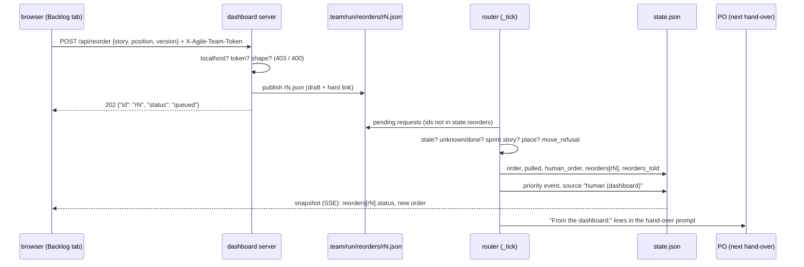

# s83: A Backlog tab to read and reorder

Delivery `dashboard`. The developer is `developer-gui` (the page, the
server, and the runner code behind the reorder). Depends on s15 (`md()` in
`index.html`), which is already done.

## Shape in one paragraph

The dashboard is still a separate process that never touches `state.json`.
The new tab reads every outstanding story from the snapshot. It fetches a
story's files one at a time through a fixed route that serves files by story
id. To reorder, the page POSTs a **request** (story, backlog place, the order
version it saw). The server checks that the request comes from localhost
with the token, then writes the request as one file in
`.team/run/reorders/`. Between steps the **router** applies pending requests
through the PO's priority code. Each applied request becomes a `priority`
event with source `human (dashboard)`. The runner records the outcome in
`state.json`, the snapshot shows it, and the PO hears about it at its next
hand-over. Once the human has ordered the backlog, a PO `prioritise` or
`move_story` that changes that order needs a reason.

## Rules

| # | Rule | AC |
|---|---|---|
| B1 | **Groups.** The tab lists `run.order` (the queue: every story that isn't done, in `Priority.queue` order). A story is in the **Current sprint** when `story.sprint == state.sprint`; every other queued story is in the **Backlog**. `backlog.View.of(state)` is the one definition, and the snapshot carries its result as `run.backlog`. The page never works the groups out for itself. | AC1 |
| B2 | **Row.** Each row shows `#position` (the story's place in the whole queue, the snapshot's `position`), id, title, step, status, delivery, the label pill, and the hold text when `hold` is set. | AC1 |
| B3 | **Label.** `backlog.label(story)`: `"cancelled"` when `hold` starts with `cancelled` (case-insensitive, after stripping). Otherwise `"held"` when `priority.held(story)` is true, else `""`. The snapshot field is `label`. s80's hold `cancelled by the human (t15); not built` gives `cancelled`. | AC1 |
| B4 | **Expand.** Clicking a row (anywhere except a move handle) toggles it. `ui.expanded` is a `Set` of ids. It persists across re-renders and is dropped when the tab is reloaded. | AC2 |
| B5 | **Details.** An expanded row shows: (a) the story file, fetched once from `api/file?kind=story&id=<id>`, cached in `ui.files`, and rendered with `md()`. It reads `loading…` until it arrives and `no story file` on a 404. (b) The state fields `sprint, step, status, rounds, disputes, hold, developer, delivery, commits`. (c) A link for each other kind in the story's `files` (`design`, `review`, `acceptance`) to `api/file?kind=<kind>&id=<id>`, opened in a new tab (`rel="noopener noreferrer"`). (d) Spend and turns: the sums of `cost_usd` and `turns` over `ledger` entries whose `story` is the id. (e) The last 10 `events` whose `story` is the id, newest first, as time, kind, role (or `data.source`). (f) Open questions that name it: `messages` of kind `question` whose `stories` hold the id and whose id is not among `answers`. | AC2 |
| B6 | **File route.** `GET /api/file?kind=K&id=I` serves `text/plain; charset=utf-8` only when K is a key of `story_files.FOLDERS`, I matches `STORY_ID` (`^[A-Za-z][A-Za-z0-9_-]{0,63}\Z`; `\Z`, not `$`, so a trailing newline is refused), I is a story in `state.json`, and `<folder>/<I>.md` is a regular file (`system.is_file`). Anything else gets **404**: an unknown kind, a bad or unknown id, a missing file, a directory, `..`, an absolute path, or a missing parameter. The path is built only from the table and the checked id, never from raw request text (s4's rule stands). | AC3 |
| B7 | **Folders** (`story_files.FOLDERS`): `story` → `config.stories_dir`, `design` → `repo/<docs_dir>/design`, `review` → `repo/.team/reviews`, `acceptance` → `repo/.team/acceptance`. Nothing else. | AC2, AC3 |
| B8 | **Handles.** Only Backlog rows have handles: `↑` (up), `↓` (down), `⤒` (top), plus `draggable="true"` for drag and drop onto another Backlog row. Current-sprint rows have none. `↑`/`⤒` are disabled on the first Backlog row and `↓` on the last. All handles are disabled while this tab has a request pending (B13). | AC4 |
| B9 | **Request.** `{story, position, version}`. `position` is the 1-based **place in the Backlog group** (1 = top of the Backlog), not the queue position. `version` is the `run.order_version` the page rendered. `moveTarget(action, place, count)` gives up → `place-1`, down → `place+1`, top → `1`, or `null` when it would not move or would leave `1..count`. A drop gives the target row's place. | AC4, AC5 |
| B10 | **Order version.** `backlog.order_version(view)` is the first 12 hex digits of `sha256(json.dumps([queue, backlog]))`. Any change to the queue or to sprint membership changes it. | AC5 |
| B11 | **Applied between steps.** `Router._tick` calls `self.desk.apply()` right after the checkout check, before news and work. It applies every pending request in number order. Applying never stops the router and never hands over by itself. A stopped run applies nothing: requests wait for the next `start`. | AC5 |
| B12 | **Apply refusals**, in order (`priority.first_refusal`): (1) stale: `ask.version != view.version` → `STALE`. (2) `priority.order_refusal([story], stories)` (unknown, done). (3) The story is in the queue but not in the Backlog → `SPRINT_STORY`. (4) `position` is not an `int` (a `bool` is not one) in `1..len(backlog)` → `BAD_PLACE`. (5) `prio.move_refusal(view.placement(ask), stories)`. The first refusal is recorded as `state.reorders[id] = <text>`, and nothing else changes. | AC4, AC5 |
| B13 | **Apply.** `placement = view.placement(ask)` = `Placement(story, queue.index(backlog[position-1]) + 1)`. `pull = prio.move_pull(placement, stories)` and `order = prio.with_move(placement, stories)`. Then `state.reorders[id] = APPLIED` and `runtime.reorder(Reorder(Change.MOVE, order, story, HUMAN_REASON.format(id=id), pull, Source.HUMAN))`. Last, `state.human_order = View.of(state).backlog`, append `TOLD.format(...)` to `state.reorders_told`, and `save()`. The human may pull a story ahead of a started one: the request is the human's reason. | AC5 |
| B14 | **Event.** Every `priority` event's data gains `"source"`: `"product-owner"` from the PO's tools, `"human (dashboard)"` from a request. The event's `role` is `"product-owner"` or `None` respectively (`priority.SOURCE_ROLES`). The other data keys are unchanged. | AC5 |
| B15 | **PO told.** `PoRun._hand_over` puts `reorders.told_section(state.reorders_told)` between the lead and `handover.prompt(...)`, then clears the list and saves (the same pattern as `_take_interrupted`). A quiet pass does not reach the PO, so the lines wait for the next real hand-over. | AC5 |
| B16 | **Page outcome.** The snapshot's `reorders` (the last 20 requests) carry `status` `pending`/`applied`/`refused` and `reason`. While the tab's own request is `pending`, its note reads `waiting for the runner: moves apply between steps`. `applied` clears the note. `refused` shows the reason, and when the reason is `STALE` it adds a `reload` button (`location.reload()`). A 403 reads `read-only: open the link the dashboard printed (it carries the token), on this machine`. Any other failure shows its HTTP status. | AC5, AC7 |
| B17 | **The human's order binds the PO.** `guarded = [i for i in state.human_order if i in view.backlog]`. A `prioritise` or `move_story` changes the human's order when `[i for i in before if i in guarded] != [i for i in after if i in guarded]`, where `before` is the current queue and `after` is the queue the change would give. Such a change without a non-blank `reason` is refused with `HUMAN_ORDER`, as a third check after the existing two. With a reason it applies, and the reason is in the event as today. `human_order` is not changed by the PO, and `start_sprint` is not checked. An empty `human_order` (the human never reordered) guards nothing. | AC6 |
| B18 | **Write gate.** `POST /api/reorder` is checked in this order: (1) `client_address[0]` in `WRITE_HOSTS = {"127.0.0.1", "::1"}`, else **403**. (2) The `X-Agile-Team-Token` header equals `app.token` (`hmac.compare_digest` on UTF-8 bytes, and an empty `app.token` never matches), else **403**. (3) `Content-Length` is a whole number from 1 to `MAX_BODY = 4096`, and `reorders.parse_ask(body)` gives an `Ask`, else **400**. (4) Queue it and answer **202** `{"id", "status": "queued"}`. The body is never read before checks 1 and 2 pass. A POST to any other path gets 404. Reads (`GET`) are unchanged and need no token. | AC7 |
| B19 | **Token.** `cmd_dashboard` makes `token = args.token or system.token()` (`secrets.token_urlsafe(16)` in `system`). It prints the local URL as `dashboard: http://localhost:<port>/?token=<token>`. The LAN line is unchanged and carries no token, because LAN writes are refused anyway. The browser opens the tokened URL. The token is in no snapshot, event, ledger, crash log or request file, and `log_message` stays silent. A fixed token comes, in this order, from `--token T`, then from `[dashboard] token` in the **served repo's** `.agile-team.toml` (for presentation workspaces and scripts), else a random one: `token = args.token or config.dashboard.token or system.token()`. The fixed token gets the same treatment as a random one: it goes only into the printed local URL, never into the snapshot or the logs, and writes still need localhost. The team repo's own config never sets it, so real runs stay random. | AC7 |
| B20 | **Page token.** `const TOKEN = PARAMS.get("token") ?? ""`. Every POST sends it as `X-Agile-Team-Token`. With no token, the tab still renders but shows no handles, only the note `read-only: open the link the dashboard printed (it carries the token), on this machine`. | AC7 |

### Texts (tests may assert them exactly)

`backlog.py`:

- `STALE = "the order changed since the dashboard showed it; reload"`
- `SPRINT_STORY = "{story} is in the current sprint; only backlog stories can be moved"`
- `BAD_PLACE = "position must be a whole number from 1 to {count} (the backlog's length)"`
- `HUMAN_ORDER = "this changes the order the human set for the backlog ({stories}); give a reason, or keep their order"`. `{stories}` is the guarded ids, in the before order, whose place in the guarded projection changes, joined by `", "`.
- `CANCELLED = "cancelled"`

`reorders.py`:

- `APPLIED = "applied"`
- `HUMAN_REASON = "moved on the dashboard ({id})"`
- `TOLD = "The human moved {story} to backlog place {position} on the dashboard ({id}). The backlog now reads: {backlog}. Keep it: a prioritise or move_story that changes it needs a reason."` (`{backlog}` is `", "`-joined.)
- `TOLD_HEAD = "From the dashboard:"`. `told_section(lines)` gives `""` for no lines, else the head, one `- <line>` per line, and a blank line.

## Changes by module

### `agile_team/priority.py`

| Change | Detail |
|---|---|
| `class Source(StrEnum)` | `PO = "product-owner"`, `HUMAN = "human (dashboard)"`. |
| `SOURCE_ROLES: dict[Source, str \| None]` | `{Source.PO: "product-owner", Source.HUMAN: None}` |
| `Reorder` | gains `source: Source = Source.PO` (last field). |
| `Reorder.event_data(self, before: list[str], after: list[str]) -> dict[str, Any]` | moves here from `po_tools._priority_data`, plus `"source": str(self.source)`. Docstring: "The data of a `priority` event (G11, B14)." |

### `agile_team/dispatch.py` (`Runtime`)

`def reorder(self, change: Reorder) -> list[str]`: the body of today's
`Tools._reorder`. It takes `before = self.priority().queue(...)`, sets
`state.order` and `state.pulled`, saves, takes `after`, and emits
`Event(EventKind.PRIORITY, SOURCE_ROLES[change.source], change.story,
change.event_data(before, after))`. It returns `after`. Docstring: "Apply a
new order and log it (PO tools and dashboard requests alike)."

### `agile_team/po_tools.py`

- `_reorder(change)` becomes `{"status": "ordered", "order": self.runtime.reorder(change)}`. `_priority_data` is deleted.
- `prioritise` and `move_story` add a third check to their `first_refusal` list:
  `lambda: backlog.human_refusal(self._human_check(order_of(), pull), why)`. Here `order_of`
  is the same `with_first`/`with_move` call the tool makes after its checks.
  It is cheap and pure, so it may be computed twice.
- `def _human_check(self, order: list[str], pull: Pull) -> backlog.HumanCheck`:
  builds `HumanCheck(guarded, before=view.queue, after=Priority(order, prio.repulled(pull, stories)).queue(stories.values()))` with `view = backlog.View.of(state)` and `guarded = backlog.guarded(state.human_order, view)`.
- `PoRun._hand_over`: `lead + self._take_reorders() + handover.prompt(found, state)`.
  `def _take_reorders(self) -> str` returns the section, clears `state.reorders_told` and saves.
- `SCHEMAS`: the `reason` descriptions of `prioritise` and `move_story` add "also required when the change reorders the backlog the human set on the dashboard".

### `agile_team/backlog.py` (new, pure, no I/O)

Module docstring: "The dashboard's Backlog (s83): the groups, the order
version, apply refusals and the human's order rule; no I/O."

| Name | Signature / shape |
|---|---|
| `STORY_ID = re.compile(r"^[A-Za-z][A-Za-z0-9_-]{0,63}\Z")` | the id shape the dashboard accepts (B6, `parse_ask`) |
| `HELD = "held"` | B3's other label, next to `CANCELLED` |
| `View` | `@dataclass(frozen=True)`: `queue: list[str]`, `backlog: list[str]`, `version: str`. `@classmethod of(cls, state: RunState) -> View` (B1, B10). `def placement(self, ask: Ask) -> Placement` (B13; call it only after B12 checks 1-4 pass). |
| `Ask` | `@dataclass(frozen=True)`: `story: str`, `position: Any`, `version: str` |
| `order_version(queue: list[str], backlog: list[str]) -> str` | B10 |
| `label(story: StoryState) -> str` | B3 |
| `stale_refusal(ask: Ask, view: View) -> str \| None` | B12 (1) |
| `sprint_refusal(story: str, view: View) -> str \| None` | B12 (3) |
| `place_refusal(position: Any, view: View) -> str \| None` | B12 (4) |
| `HumanCheck` | `@dataclass(frozen=True)`: `guarded: list[str]`, `before: list[str]`, `after: list[str]` |
| `guarded(human_order: list[str], view: View) -> list[str]` | B17 |
| `human_refusal(check: HumanCheck, reason: str) -> str \| None` | B17 |

### `agile_team/reorders.py` (new)

Module docstring: "Reorder requests from the dashboard (s83): queued as
files by the server, applied between steps by the router."

| Name | Signature / shape |
|---|---|
| `REORDERS_DIR = "reorders"` | under `run_dir`. `REQUEST_NAME = re.compile(r"^r(\d+)\.json$")`. `MAX_VERSION = 64` (`parse_ask`'s version limit). |
| `Request` | `@dataclass(frozen=True)`: `id: str`, `ask: Ask`, `at: float = 0.0`. `to_json(self) -> str`, `@classmethod from_json(cls, rid: str, text: str) -> Request \| None` (None for bad JSON or a bad shape). |
| `parse_ask(body: bytes) -> Ask \| None` | a JSON object with `story` (str matching `backlog.STORY_ID`), `position` (int, not bool), and `version` (str, at most 64 chars). Extra keys are ignored. |
| `Requests` | `@dataclass(frozen=True)`: `run_dir: Path`. `queue(self, ask: Ask) -> Request` publishes `r<N>.json` the way `Relay.tell` does: draft `.draft-<system.token()>`, `hard_link`, next N on `FileExistsError`, remove the draft in `finally`. `all(self) -> list[Request]` lists them in number order and skips unreadable ones. `pending(self, settled: dict[str, str]) -> list[Request]`. |
| `told_section(lines: list[str]) -> str` | B15 |
| `Desk` | `@dataclass`: `runtime: Runtime`. `apply(self) -> None` (B11), `_settle(self, request) -> None` (a refusal is recorded and saved), `_refusal(self, ask) -> str \| None` (B12), `_move(self, request) -> None` (B13), `_told(self, request) -> None` (B13's last line: `human_order`, `reorders_told`, `save`). |

### `agile_team/state.py` (`RunState`)

Three new fields, defaulting to empty, so an older `state.json` loads:
`human_order: list[str]`, `reorders: dict[str, str]` (request id →
`APPLIED` or the refusal text), and `reorders_told: list[str]`.

### `agile_team/router.py`

`desk: Desk = field(init=False)`, set in `__post_init__` with
`Desk(self.runtime)`. `_tick` calls `self.desk.apply()` after the
`checkout_moved` check (B11).

### `agile_team/system.py`

`def token() -> str`: "A random URL-safe token (`secrets.token_urlsafe(16)`)."
Add it to `__all__`. `tests/fake_system.FakeSystem.token` returns
`f"tok{n}"` with a counter (unit-tester).

### `agile_team/dashboard/story_files.py` (new)

Module docstring: "Story files the dashboard may serve (s83, AC3): a fixed
table of folders, by story id only."

| Name | Signature / shape |
|---|---|
| `from ..backlog import STORY_ID` | one definition; the runner never imports from `dashboard` |
| `FOLDERS: dict[str, Callable[[Config], Path]]` | B7, in the order story, design, review, acceptance |
| `FileAsk(NamedTuple)` | `kind: str`, `story: str` |
| `path_of(config: Config, ask: FileAsk) -> Path \| None` | None unless the kind and id pass B6 (the story check included: it loads `state_mod.load(config.run_dir)`) |
| `read(config: Config, ask: FileAsk) -> str \| None` | the text when `path_of` gives a regular file, else None |
| `existing(config: Config, story: str) -> list[str]` | the kinds whose file is a regular file (no state load) |

### `agile_team/dashboard/server.py`

| Change | Detail |
|---|---|
| module docstring | "Dashboard server: the page, the snapshot, the SSE stream, story files by id, and token-gated reorder requests from localhost; stdlib only. Never serves a directory." |
| `Dashboard` | gains `read_file: Callable[[FileAsk], str \| None] = lambda _ask: None`, `queue: Callable[[Ask], Request] \| None = None` and `token: str = ""`. `for_run` binds `partial(story_files.read, config)` and `reorders.Requests(config.run_dir).queue`, and leaves the token empty. The CLI sets it with `dataclasses.replace`. |
| `Body` | gains `status: int = 200`. `_send` uses it and adds `X-Content-Type-Options: nosniff`. |
| `Handler.do_POST` | `POSTS.get(urlsplit(self.path).path, _not_found)(self)` |
| `WRITE_HOSTS`, `TOKEN_HEADER = "X-Agile-Team-Token"`, `MAX_BODY = 4096` | B18 |
| `may_write(handler: Handler) -> bool` | B18 checks 1-2 |
| `_body(handler: Handler) -> bytes \| None` | B18 check 3's length part |
| `_reorder(handler)` | B18. The 202 body is JSON `{"id": request.id, "status": "queued"}`. |
| `_file(handler)` | B6. It reads `kind` and `id` with `parse_qs` (first value, `""` when missing). |
| `ROUTES` | gains `"/api/file": _file`. `POSTS = {"/api/reorder": _reorder}` |
| `with_token(url: str, token: str) -> str` | `f"{url}?token={token}"` |

### `agile_team/dashboard/snapshot.py`

- `watched_files` adds `system.glob(config.run_dir / REORDERS_DIR, "r*.json")`.
- `_run` adds `"order_version": view.version` and `"backlog": view.backlog` (`view = backlog.View.of(files.state)`).
- `_story` adds `"disputes": story.disputes`, `"developer": story.developer`,
  `"commits": [c for c in dict.fromkeys([story.commit, *story.code_commits]) if c]`,
  `"files": story_files.existing(files.config, story.id)`, and `"label": backlog.label(story)`.
- A new top-level key `"reorders"`: the last 20 of `Requests(run_dir).all()`, each
  `{"id", "story", "position", "at", "status", "reason"}`. The status is
  `pending` when the id is not in `state.reorders`, `applied` when its value
  is `APPLIED`, and `refused` (with the value as `reason`) otherwise. `reason`
  is `""` unless refused.

### `agile_team/dashboard/fixtures/snapshot.json` (the contract)

Add `run.order_version` (any 12-hex string) and `run.backlog` (`["s5",
"s6"]`, matching the fixture's sprint-1 stories). Give every story
`disputes`, `developer`, `commits`, `files` and `label`. Add top-level
`reorders` with one `applied` and one `refused` (`STALE`) entry. Add
`"source": "product-owner"` to the data of every `priority` event, and add
one priority event with `"role": null` and `"source": "human (dashboard)"`.

### `agile_team/cli.py`

- `DASHBOARD_ARGS` gains `(("--token",), {"default": None, "help": "fix the write token (default: random each start)"})`.
- `_dashboard_server(args)` makes `app = replace(Dashboard.for_run(...), token=args.token or config.dashboard.token or system.token())`, using the `config` it already loads (B19).
- `cmd_dashboard` prints `dashboard: {server.with_token(urls.local, app.token)}` and opens that URL. Read the token from `httpd.app`. The LAN line is unchanged.

### `agile_team/dashboard/index.html`

| Change | Detail |
|---|---|
| `TABS` | `["backlog", "Backlog"]` after `board`. Add `<section id="tab-backlog" hidden>` holding `

`. |
| `RENDER.backlog = renderBacklog`, `ui.expanded = new Set()`, `ui.files = {}`, `ui.reorder = null` (`{id, story}` of this tab's last request), `ui.note = ""` (the 403 / HTTP-status / network-error text of B16), `ui.drag = ""` (the dragged row's id) | |
| `const TOKEN = PARAMS.get("token") ?? ""` | B20 |
| `LIST_KEYS` + `"reorders"`, `RUN_DEFAULTS` + `order_version: ""`, `backlog: []` | normalize |
| `backlogGroups(view) -> {current, backlog}` | stories that aren't done, in snapshot order, split by `view.run.backlog` |
| `storyLabel(story) -> string` | the `label` pill, or `""` |
| `backlogRow(story, place, count, view) -> string` | B2, B8. The row is `
`. Handles are `<button data-move="up\|down\|top" data-story="ID">`. `place` is null for Current-sprint rows. |
| `storyDetails(story, view) -> string` | B5 |
| `backlogHtml(view) -> string` | both groups, headed `Current sprint` and `Backlog`, with details after each expanded row |
| `renderBacklog(view)` | sets `#backlog` and `#backlog-note` (`reorderNote(view)`) |
| `toggleRow(id)` | flips `ui.expanded`. On expand, calls `loadFile(id, "story")` when it isn't cached, then `render()`. |
| `loadFile(id, kind)` | sets `ui.files[key] = undefined` (loading), then `fetch("api/file?kind=…&id=…")` (with `encodeURIComponent`) → text, `null` on a non-OK answer or an error, then `render()` |
| `moveTarget(action, place, count) -> number \| null` | B9 |
| `postReorder(story, position)` | B9, B16, B20 |
| `reorderNote(view) -> string` | B16, B20 |
| click handler | `[data-move]` first (move, no toggle), then `[data-reload]`, then `[data-expand]` (toggle) |
| drag | `dragstart` on a Backlog row (`[data-place]`) stores its id in `ui.drag`. `dragover` on a Backlog row calls `preventDefault`. `drop` posts the target row's place, but not onto itself and not while `reorderPending(view)` (B8: no move while a request is pending). |
| `moveFromHandle(btn)` | a handle click: the place from `backlogGroups`, then `moveTarget`. It posts only when the target is not `null` and the button is not disabled. |
| `showEvent` / timeline | a `priority` event shows `data.source` when it is set, otherwise its role |

### `agile_team/roles/product-owner.md`

Under "Priority", add: "If the human reorders the backlog on the dashboard,
you are told at your next turn ('From the dashboard: …'). That order binds
you: a `prioritise` or `move_story` that changes it is refused unless you
give a reason, and the reason is logged."

### `agile_team/config.py` (B19)

| Change | Detail |
|---|---|
| `DashboardSettings` | new `@dataclass`: `"""``[dashboard]``: a fixed write token for presentation workspaces (s83 B19); empty means random."""`, one field `token: str = ""`. |
| `Config` | gains `dashboard: DashboardSettings = field(default_factory=DashboardSettings)`. |
| `from_raw` | `dashboard=_dashboard(raw.get("dashboard", {}))`. |
| `_dashboard(raw: dict[str, Any]) -> DashboardSettings` | `_section(DashboardSettings, raw)`, raising `ConfigError(DASHBOARD_TOKEN)` when `token` is not a `str`. |
| `DASHBOARD_TOKEN` | `"[dashboard] token must be a string"` |

No team-repo config change. The presentation workspace's own
`.agile-team.toml` (built by the integration-tester) sets
`[dashboard] token = "presentation"`, and `PRESENTATION.md` links
`http://127.0.0.1:8799/?token=presentation`.

## Test checklist (for the Unit Tester)

Unit (fake world):

1. **Ranking shown (AC8).** Use a state with sprint stories, backlog stories, a done story and s80's cancelled hold. Check that `snapshot.build` puts `run.order` in `Priority.queue` order and `run.backlog` holds exactly the queued stories with `sprint != state.sprint`. Check the s80-like story has `label == "cancelled"`, a not-started story with `hold` "waiting on X" has `held`, and a free one has `""`.
2. **Snapshot fields.** Check `disputes`, `developer`, `commits` (deduped, no `None`), `files` (only existing kinds, in table order) and `order_version` (`backlog.order_version` of the queue and backlog). Check the fixture's keys match `build`'s keys (the existing contract test).
3. **Order version.** It changes when the order changes and when a story joins the sprint, and it is stable for the same state.
4. **Sprint-story refusal (AC8).** A request for a story in the current sprint is recorded as `SPRINT_STORY`, and the order and the events are unchanged.
5. **Stale refusal (AC8).** A request carrying an old version is recorded as exactly `STALE`, and the order is unchanged. Of two requests from the same version, the first applies and the second is `STALE`.
6. **Bad place, unknown, done.** A position of `0`, `len+1`, `True` or `"2"` gives `BAD_PLACE` with the backlog's length. An unknown or done story gives the `order_refusal` text.
7. **Apply.** A Backlog move to place 1 lands at the top of the Backlog. The `priority` event has `role None`, `data.source == "human (dashboard)"`, `reason == "moved on the dashboard (r1)"` and `change == "move"`. `state.human_order` equals the new backlog, `state.reorders["r1"] == "applied"`, and `reorders_told` holds the exact `TOLD` line. A not-started story moved above a started Backlog story is pulled (`data.pulled`).
8. **PO events.** `prioritise`/`move_story` events carry `source "product-owner"` and `role "product-owner"`.
9. **PO reason rule (AC6, AC8).** With `human_order = [s5, s6]`: a `move_story` that swaps them with no reason is refused with exactly `HUMAN_ORDER` (naming `s5, s6`) and nothing changes. The same move with a reason applies, and the event's `reason` is that reason. A move of a sprint story that leaves the s5/s6 order alone needs no reason. An empty `human_order` needs none. `start_sprint` is never refused by this rule.
10. **PO told.** After an applied request, the next `_hand_over` prompt contains `TOLD_HEAD` and the line, and `reorders_told` is then empty and saved.
11. **Router.** `_tick` applies pending requests before it picks work. A request already in `state.reorders` is not applied again.
12. **Requests.** `queue` writes `r1.json`, then `r2.json`, and leaves no draft. A clash on N moves on to N+1. `all` skips unreadable files and other names. `parse_ask` refuses a non-object, a missing key, a bool position, a bad id and a version over 64 chars.
13. **File route (AC3, AC8).** `GET /api/file?kind=story&id=s1` returns the file as text/plain. Each of these gets 404: `kind=secrets`, `id=../state`, `id=/etc/passwd`, `id=s1/..`, `id=s999` (not a story), a missing file, a missing parameter, and a directory named `s1.md` in the design folder. `/.team/stories/s1.md` stays 404.
14. **Write gate (AC7, AC8: the test pins both).** From `127.0.0.1` with the right token you get 202 and a request file. From `10.0.0.5` with the right token you get 403. From `127.0.0.1` with a wrong or missing token you get 403. With an empty `app.token` and an empty header you get 403. None of the 403s write a file or read the body. A bad body or an oversize length gives 400, and a POST elsewhere gives 404. Test it on `Handler` with a fake request object, or with `open_server` on the fake's `HttpServer`, whichever the s76 tests use.
15. **Token never leaks.** After a reorder, the token string is absent from `json.dumps(snapshot)`, `events.jsonl`, the request file and `crash.log`.
16. **CLI.** `cmd_dashboard` prints `dashboard: http://localhost:
/?token=tok1` (fake token), the LAN line has no token, and `--token abc` prints `?token=abc`. With `[dashboard] token = "cfg"` in the repo's config and no `--token`, it prints `?token=cfg`. With both, `--token abc` wins. With `token = ""` it prints the fake random `tok1`.
16a. **Config.** `from_raw` with no `[dashboard]` gives `dashboard.token == ""`, and with `token = "x"` gives `"x"`. `token = 1` raises `ConfigError` with exactly `DASHBOARD_TOKEN`. Test 15 also runs with the token from config and checks it is absent the same way.
17. **State.** An old `state.json` without the three fields loads with empty defaults.

Node harness (`tests/dashboard_node.py`, AC8):

18. **Expand and collapse.** Load the fixture as `data.snap`, then run `toggleRow("s5")`. `backlogHtml(view)` now contains the s5 details (the `loading…` marker and its state fields), and `aria-expanded="true"`. Run `toggleRow("s5")` again and the details are gone. The prelude's `fetch` rejects, so the story file shows `no story file`, which also pins the failure path.
19. **Handles.** Backlog rows have `data-move` buttons and Current-sprint rows have none. Without a `TOKEN`, no row has handles and the note is the read-only text.
20. **`moveTarget`.** Check up, down and top at the edges (`null`).
21. **`reorderNote`.** Check the pending, applied, refused and `STALE` (with `data-reload`) cases.
22. **No drag while pending (review D2).** With this tab's request `pending`, a `drop` on another Backlog row posts nothing.
23. **Commits shown (review D4).** Give one fixture story a commit. Its expanded details list it.

E2E (integration-tester): a real `dashboard --port 0 --token t` with a POST
from `127.0.0.1` gets 202, and a run's router applies it.

## Known limits

- The tab sends one move at a time. Until the runner applies it, which can
  take one whole step, the handles are disabled. A second tab or a PO change
  in between makes a request stale, and the human reloads.
- A PO change made with a reason does not update `human_order`. A later
  change, even one that restores the human's order, also needs a reason.
- The localhost check sees the socket's peer. It does not see past a
  reverse proxy, and none is supported.
- `::ffff:127.0.0.1` is not in `WRITE_HOSTS` (the AC names two addresses).
  If the server ever binds dual-stack, add it there.
- Nothing in code stops a real repo from setting `[dashboard] token`. Only
  docs say not to. A fixed token weakens AC7 only as much as `--token`
  already does, and writes still need localhost.
