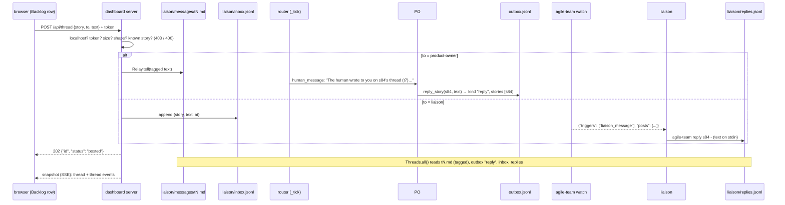

# s84: A story thread with the PO and the liaison

Delivery `dashboard`. The developer is `developer-gui`: the page, the server
route, and the runner code behind it (a new pure-ish module, the relay, the
router, one PO tool, watch and one CLI command). Depends on s83, which is done:
the Backlog tab's expanded row, `may_write`, the token and `POSTS`.

## Shape in one paragraph

A thread is not a new store. It is a **view** over four files that each have
one job, and each AC names its file. (1) A post **to the PO** is a
`Relay.tell` file (`liaison/messages/t<N>.md`) whose first line tags the
story. The router hands it to the PO as today, at its next turn, with a line
that names the story. (2) The PO answers with a new tool, `reply_story`. The
tool appends an outbox message of kind `reply`, tagged with the story. (3) A
post **to the liaison** is one line appended to `liaison/inbox.jsonl`, and
`watch` fires the new trigger `liaison_message` within one poll (2 s). (4) The
liaison answers with `agile-team reply <story> <file|->`, which appends to
`liaison/replies.jsonl`. `threads.Threads(run_dir).all()` reads all four and
gives `Entry` rows (id, story, author, recipient, text, time) in time order.
The snapshot carries them as `thread`, and also merges them into `events` as
`thread` events, the way it already merges the outbox and inbox as
`message`/`answer`. The page shows a story's entries, with a text box and a
recipient picker, under its expanded Backlog row.

## Rules

| # | Rule | AC |
|---|---|---|
| H1 | **Parties.** `threads.Party(StrEnum)`: `HUMAN = "human"`, `PO = "product-owner"`, `LIAISON = "liaison"`. A post's recipient is `PO` or `LIAISON` (`RECIPIENTS`). Every reply goes to `HUMAN`. | AC1, AC4 |
| H2 | **Text.** `text_refusal(text)` refuses a blank text (`EMPTY`) and one longer than `MAX_TEXT = 4000` characters after stripping (`TOO_LONG`). Every writer (server, PO tool, CLI) calls it first and stores `text.strip()`. | AC1-AC3 |
| H3 | **Known story.** `story_refusal(story, stories)` refuses an id that is not a key of `state.stories` (`UNKNOWN_STORY`). A done story is allowed, because the human may discuss it. Every writer calls it. | AC1-AC3 |
| H4 | **Write gate.** `POST /api/thread` is checked in this order: (1) `may_write` (s83 B18 checks 1-2: a localhost peer and the token), else **403**. The body is not read before this passes. (2) `Content-Length` is a whole number from 1 to `BODY_LIMITS["/api/thread"] = MAX_POST_BODY = 32768`, else **400**. (3) `threads.parse_post(body)` gives a `Post`, else **400**. (4) `app.post(post)` gives an `Entry` (the known-story check passes), else **400**. (5) The answer is **202** with JSON `{"id": entry.id, "status": "posted"}`. `/api/reorder` keeps `MAX_BODY = 4096` through the same `BODY_LIMITS` table. | AC1 |
| H5 | **Post shape** (`parse_post`). A JSON object with `story` (a str matching `backlog.STORY_ID`), `to` (`"product-owner"` or `"liaison"`), and `text` (a str that passes H2). Extra keys are ignored. Anything else gives `None`. | AC1 |
| H6 | **To the PO goes through `Relay.tell`.** `Threads.post` with `to == PO` calls `Relay(run_dir).tell(tagged(story, text))`. `tagged` puts `HEAD.format(story=…, at=system.now())` + `"\n\n"` before the text. The `Entry` id is the `Told` id (`t<N>`). A tell from the CLI has no head and is not part of any thread. | AC2 |
| H7 | **Tag.** `HEAD = "<!-- thread story={story} at={at} -->"`. `HEAD_RE = re.compile(r"\A<!-- thread story=([A-Za-z][A-Za-z0-9_-]{0,63}) at=([0-9]+(?:\.[0-9]+)?) -->\n\n")`. `tag_of(told)` reads the file (`OSError` gives `None`) and returns `Tag(story, at, text)` when the head matches, else `None`. The text is what follows the head. | AC2 |
| H8 | **The PO is told the story.** In `Router._told_lines`, each told file becomes `threads.told_line(told, repo)`. That is `THREAD_TOLD_LINE` when the file has a tag, else today's `TOLD_LINE`. `_deliver`'s `Pass.stories` are the answer stories followed by `threads.told_stories(told)` (the tagged stories), deduplicated in order. Delivery timing is unchanged: the next router pass, which is the PO's next turn, or the next `start` for a stopped run. | AC2 |
| H9 | **The PO replies with `reply_story`.** New PO tool `reply_story {story, text}`. Refusals in order: H3, then H2 (`priority.first_refusal`), each giving `text_result(refused(reason))`. Otherwise it calls `relay.post(Note(REPLY, text.strip(), [story]))` and returns `{"status": "posted", "id": msg.id}`. `relay.KINDS` gains `REPLY = "reply"`. `notify_user` with `kind == "reply"` is refused with `USE_REPLY` before anything is posted, so every `reply` message comes from `reply_story` and names one story. | AC2 |
| H10 | **To the liaison: an inbox line.** `Threads.post` with `to == LIAISON` appends `{"story", "text", "at"}` as one JSON line to `run_dir/liaison/inbox.jsonl` (`LIAISON_INBOX`), via `system.append_text` after `make_dirs`. Entry ids come from the line's place: `lp<N>`, where N is the 1-based index among the parsed lines. | AC3 |
| H11 | **Watch trigger `liaison_message`.** `Seen` gains `posts: int = 0`, the count of liaison-inbox entries already reported. `Look` gains `posts: list[Entry]`. `Look.new_posts(seen)` follows `new_since`'s rule: the entries after `seen.posts`, or all of them when the inbox got shorter. `TRIGGERS` gains `("liaison_message", lambda seen, now: bool(now.new_posts(seen)))` after `message`. `line()` gains `"posts": [entry.as_dict() for entry in now.new_posts(seen)]` (or `[]` for a heartbeat). `Look.seen()` records `len(self.posts)`. `Watcher._next` keeps `seen.posts`, the same way it keeps `seen.messages`. A memory file from before s84 loads with `posts = 0`. A first watch (no memory) records the current posts as seen (s67 F2 holds, unchanged). | AC3 |
| H12 | **The liaison replies with the CLI.** `agile-team reply <story> <source>`: `source` is a file, or `-` for stdin (the same `_message_text` as `tell`, so the text is never on a command line). It runs H2, then H3 against `state_mod.load(run_dir).stories`, and raises `CliError(reason)` on a refusal. Otherwise it calls `Threads(run_dir).reply(story, text)`, which appends `{"story", "text", "at"}` to `liaison/replies.jsonl` (`LIAISON_REPLIES`) and gives `Entry("lr<N>", story, LIAISON, HUMAN, text, at)`. It prints `REPLIED.format(id=…, story=…)` and returns 0. It works while the run is stopped. | AC3 |
| H13 | **Reading the thread.** `Threads.all()` = `to_po() + po_replies() + liaison_posts() + liaison_replies()`, sorted by `(at, id)`. `to_po`: the tagged `Relay.told()` files (author HUMAN, to PO, id `t<N>`). `po_replies`: the outbox lines whose `kind == "reply"` and whose `stories` is a non-empty list (author PO, to HUMAN, story `stories[0]`, id `m<N>`). `liaison_posts` / `liaison_replies`: the inbox and replies lines (ids `lp<N>` / `lr<N>`). JSONL is read leniently (`_lines`): blank, torn or non-object lines are skipped, and so are records without a str `story`, a str `text` and a number `at`. Only a last line can be torn (the files are append-only), so earlier ids never shift. | AC2-AC4 |
| H14 | **Events.** Every entry is an event on its story in the snapshot's `events`: `{"id": "thread-<entry id>", "at", "kind": "thread", "role": EVENT_ROLES.get(author), "story", "data": {"entry", "author", "to"}}`, with `EVENT_ROLES = {Party.PO: "product-owner"}`. The events are merged by time with the event log, the outbox and the inbox. Outbox messages of kind `reply` are **not** also merged as `message` events. They appear once, as `thread`. Why not `events.jsonl`: the runner is its only writer (`EventLog` caches its counter, so a second process would reuse ids), and posts and replies are written by the server and the CLI, even while the run is stopped. That is the same reason the outbox and inbox are merged in, not logged (`events.py` docstring). | AC4 |
| H15 | **Snapshot.** A new top-level key `"thread"`: `[entry.as_dict() for entry in Threads(run_dir).all()]`. Each dict is `{"id", "story", "author", "to", "text", "at"}`. `watched_files` adds `threads.watched(run_dir)` (both JSONL files and the `liaison/messages/t*.md` glob), so a post or a reply pushes a new snapshot. | AC2-AC4 |
| H16 | **Page: the thread.** An expanded row (s83 B5) ends with `threadHtml(story, view)`. It lists the story's entries from `view.thread` in snapshot order. Each one shows `WHO[author] → WHO[to]`, the time, and `md(text)`, with `WHO = {human: "you", "product-owner": "PO", liaison: "liaison"}`. An empty thread reads `No messages yet.` With a `TOKEN`, a form follows: a `<textarea data-thread-text="ID" maxlength="4000">` holding `ui.drafts[ID]`, a `<select data-thread-to="ID">` (options `product-owner` "PO" and `liaison` "liaison"; `ui.to[ID]` defaults to `product-owner`), and `<button class="ctl" data-thread-send="ID">send</button>`, disabled while `ui.sending.has(ID)`. Then comes the note `ui.threadNote[ID]`. With no token, no form shows, only the s83 read-only note. | AC1, AC4 |
| H17 | **Page: posting.** `postThread(id)`: (1) A blank draft sets the note `SEND_EMPTY` and posts nothing. (2) Otherwise it POSTs `api/thread` with `{story, to, text}` and the `X-Agile-Team-Token` header, and adds the id to `ui.sending` until the reply comes. (3) A 403 sets `READ_ONLY`, any other non-OK sets `post failed: HTTP <status>`, and a fetch error sets `post failed: <message>`. (4) An OK answer clears the draft and the note. The entry appears with the next snapshot. `input` and `change` events keep `ui.drafts` and `ui.to` up to date. | AC1 |
| H18 | **Typing survives re-renders.** `renderBacklog` goes through `keepFocus(fn)`. When a `[data-thread-text]` has focus, it notes the id and `selectionStart`/`selectionEnd`, runs `fn`, then focuses the new textarea with that id and restores the selection. | AC1 |
| H19 | **Page: timeline.** `TIMELINE.thread = (e, ctx) => ({from: WHO[e.data.author], to: WHO[e.data.to], what: "thread", body: ctx.thread[e.data.entry]?.text ?? ""})`. `ctx.thread` maps the snapshot's `thread` by id, and `"thread"` joins `MARKDOWN_KINDS`. The story chip comes from `e.story`, so the timeline's story filter shows a story's thread. The s83 event list in the expanded row lists `thread` events too, as `kind` and `data.author`. | AC4 |

### Texts (tests may assert them exactly)

`threads.py`:

- `EMPTY = "the message is empty"`
- `TOO_LONG = "the message is longer than {max} characters"` (formatted with `MAX_TEXT`)
- `UNKNOWN_STORY = "no story {story!r}"`
- `THREAD_TOLD_LINE = "The human wrote to you on {story}'s thread ({id}): read {path}. Answer there with reply_story; the reply shows under the story on the dashboard."`
- `REPLIED = "replied {id} on {story}"`

`po_tools.py`:

- `USE_REPLY = "use reply_story to answer on a story's thread"`

`index.html`:

- `SEND_EMPTY = "write a message first"`
- `NO_THREAD = "No messages yet."`

## Changes by module

### `agile_team/threads.py` (new)

Module docstring: "Story threads (s84): the human's posts to the PO or the
liaison and their replies, read from the files each path writes."

Imports: `from . import system`, `from .backlog import STORY_ID`, `from .relay
import LIAISON_DIR, OUTBOX, REPLY, Relay, Told`. It never imports
`dashboard`.

| Name | Signature / shape |
|---|---|
| `Party(StrEnum)` | H1 |
| `RECIPIENTS = frozenset({Party.PO, Party.LIAISON})` | H1, H5 |
| `EVENT_ROLES: dict[Party, str] = {Party.PO: "product-owner"}` | H14 |
| `MAX_TEXT = 4000`, `LIAISON_INBOX = "inbox.jsonl"`, `LIAISON_REPLIES = "replies.jsonl"`, `HEAD`, `HEAD_RE` | H2, H7, H10, H12 |
| texts | as listed above |
| `Post` | `@dataclass(frozen=True)`: `story: str`, `to: Party`, `text: str` |
| `Tag` | `@dataclass(frozen=True)`: `story: str`, `at: float`, `text: str` |
| `Entry` | `@dataclass(frozen=True)`: `id: str`, `story: str`, `author: Party`, `to: Party`, `text: str`, `at: float`. `as_dict(self) -> dict[str, Any]` (enum values as plain str). |
| `text_refusal(text: str) -> str \| None` | H2 |
| `story_refusal(story: str, stories: Mapping[str, Any]) -> str \| None` | H3 |
| `parse_post(body: bytes) -> Post \| None` | H5 |
| `tagged(story: str, text: str) -> str` | H6 (reads `system.now()`) |
| `tag_of(told: Told) -> Tag \| None` | H7 |
| `told_line(told: Told, repo: Path) -> str` | H8. The path is relative to `repo`, like today's `_told_lines`. |
| `told_stories(told: list[Told]) -> list[str]` | H8, deduplicated in order |
| `watched(run_dir: Path) -> list[Path]` | H15 |
| `post_known(run_dir: Path, post: Post) -> Entry \| None` | H4 (4): `None` when `story_refusal(post.story, state_mod.load(run_dir).stories)` refuses, else `Threads(run_dir).post(post)`. The server binds it with `partial`. |
| `Threads` | `@dataclass(frozen=True)`: `run_dir: Path`. Paths: `inbox` and `replies` (properties under `run_dir / LIAISON_DIR`). `post(self, post: Post) -> Entry` dispatches through `SENDERS = {Party.PO: Threads._to_po, Party.LIAISON: Threads._to_liaison}` (a table, not an `if`). `_to_po(self, post) -> Entry` (H6). `_to_liaison(self, post) -> Entry` (H10). `reply(self, story: str, text: str) -> Entry` (H12). `to_po`, `po_replies`, `liaison_posts`, `liaison_replies`, `all` (each `-> list[Entry]`, H13). |
| `_lines(path: Path) -> list[dict]` | H13, lenient (same rules as `snapshot.read_jsonl`; keep a local copy, because the runner never imports `dashboard`) |

The id that `_to_liaison` returns is `lp<N>`, where N is the number of parsed
lines after the append. Two posts in the same instant could both report the
later id (see Known limits). The ids that `liaison_posts` reads are always
right.

### `agile_team/relay.py`

- `REPLY = "reply"`, and `KINDS` gains it (last).
- `tell` names its draft `.draft-{system.token()}` instead of `.draft-{system.pid()}`. The dashboard server is one process with many threads, so two posts at once would share a pid draft. This is the same fix `reorders.Requests.queue` already has.
- Module docstring: add "Story-thread posts to the PO are `tell` files with a thread head (s84, `threads.py`)."

### `agile_team/router.py`

- `_told_lines(told)` → `[threads.told_line(t, self.runtime.config.repo) for t in told]`. `TOLD_LINE` is no longer imported here, because `threads.told_line` uses it.
- `_deliver`: `stories = list(dict.fromkeys([*self._answer_stories(answers), *threads.told_stories(told)]))`.

### `agile_team/po_tools.py`

- `reply_story(self, args) -> dict[str, Any]` (H9). Docstring: "Answer the human on a story's thread (s84)."
- `notify_user`: when `kind == REPLY`, it returns `text_result(refused(USE_REPLY))` before posting.
- `SCHEMAS["reply_story"] = ("Answer the human on a story's thread (shown under the story on the dashboard). Use it when a hand-over says the human wrote to you on a story's thread. Unknown stories and empty or over-long texts are refused.", {"story": str, "text": str})`.

### `agile_team/watch.py`

H11. `look()` reads `Threads(run_dir).liaison_posts()` and passes it as
`posts` (the last field, default `field(default_factory=list)`). `Seen.posts`
is the last field too. The existing positional constructors stay valid.
Module docstring: the triggers now include a post to the liaison.

### `agile_team/cli.py`

- `def cmd_reply(args) -> int` (H12). Docstring: "Reply on a story's thread as the liaison; the text comes from a file or stdin."
- `COMMANDS` gains, after `tell`: `Command("reply", "reply on a story's dashboard thread (a file, or - for stdin)", cmd_reply, ((("story",), {}), (("source",), {"help": "file holding the reply, or - to read stdin"})))`.

### `agile_team/dashboard/server.py`

| Change | Detail |
|---|---|
| module docstring | "… story files by id, and token-gated reorder requests and thread posts from localhost …" |
| `Dashboard` | gains `post: Callable[[Post], Entry \| None] \| None = None`. `for_run` binds `partial(threads.post_known, config.run_dir)`. |
| `MAX_POST_BODY = 32768`, `BODY_LIMITS: dict[str, int] = {"/api/reorder": MAX_BODY, "/api/thread": MAX_POST_BODY}` | H4 |
| `_body(handler)` | the limit is `BODY_LIMITS[urlsplit(handler.path).path]`. Docstring: "… 1 to the route's limit …" |
| `_thread(handler)` | H4. `app.post is None` gives 400 too. |
| `POSTS` | gains `"/api/thread": _thread` |

### `agile_team/dashboard/snapshot.py`

- `SECTIONS` gains `"thread": _thread` (after `answers`). `_thread(files) -> list[dict]` (H15).
- `_events` adds `map(_thread_event, thread entries)`, and maps `_message_event` only over outbox lines whose `kind != "reply"` (H14). `_thread_event(entry: Entry) -> dict`.
- `watched_files` adds `*threads.watched(config.run_dir)`.

### `agile_team/dashboard/fixtures/snapshot.json` (the contract)

Add a top-level `thread` holding four entries on one story (`s5`): `t1`
(human → product-owner), `m<N>` (product-owner → human, which is also an
outbox `messages` entry of kind `reply`), `lp1` (human → liaison) and `lr1`
(liaison → human). Add the four matching `thread` events to `events`, with
`id` `thread-<entry id>`, in time order. Add no `message` event for the
`reply` outbox entry.

### `agile_team/dashboard/index.html`

| Change | Detail |
|---|---|
| `LIST_KEYS` + `"thread"` | normalize |
| `ui.drafts = {}`, `ui.to = {}`, `ui.sending = new Set()`, `ui.threadNote = {}` | |
| `WHO`, `SEND_EMPTY`, `NO_THREAD` | H16, H17 |
| `threadEntries(view, id) -> array` | `view.thread.filter((t) => t.story === id)` |
| `threadHtml(story, view) -> string` | H16. Every text goes through `esc`/`md`, and every id through `esc`. |
| `storyDetails` | appends `threadHtml(story, view)` inside `.bdetail`. `eventLine` shows `e.data?.source ?? e.data?.author ?? e.role ?? ""`. |
| `postThread(id)` | H17 |
| `keepFocus(fn)` | H18. `renderBacklog` becomes `keepFocus(() => { …today's body… })`. |
| click handler | `[data-thread-send]` → `postThread(id)`, checked first. Clicks in the details are outside `[data-expand]`, so they never toggle the row (keep it that way). |
| `input` / `change` listeners | `[data-thread-text]` → `ui.drafts[id]`, `[data-thread-to]` → `ui.to[id]` |
| `TIMELINE.thread`, `MARKDOWN_KINDS`, `ctx.thread` | H19 |
| CSS | `.thread`, `.tmsg` (one block per entry), `.tform` (the text box full width, the select and button under it). Use the existing variables only. |

### `agile_team/roles/product-owner.md`

Under the messages from the human, add: "The human may write to you on a
story's thread on the dashboard. The hand-over then says 'The human wrote to
you on sN's thread (tK)'. Read the file, and answer with `reply_story(story,
text)`. The answer shows under the story. Don't use `notify_user` for it.
The thread is a conversation, not a change order: act on it as you would on
a `tell`."

### Docs (the architect, at design review, once the code is in)

- `agile-team/SKILL.md` step 6: `triggers` also lists `liaison_message` (new
  posts to the liaison under `posts`, each with `id`, `story`, `text`, `at`).
  For each one: answer with `$AT reply <story> -` (text on stdin) or relay it
  to the human. An outbox `reply` message is already on the dashboard, so
  relay it only as a one-line summary. In step 5, the dashboard's writes are
  now the Backlog reorder and thread posts.
- `agile-team/reference/protocol.md`: the watch trigger table and line
  (`posts`), the `reply` CLI command, the `reply_story` tool and the `reply`
  outbox kind, the thread files, `POST /api/thread`, and the snapshot's
  `thread` and `thread` events.
- `agile-team/docs/customer/dashboard.md`: a "Discuss a story" section.
- The README row, if it lists dashboard writes.

## Test checklist (for the Unit Tester)

Unit (fake world):

1. **Text and story checks.** `text_refusal`: `""` and `"  \n"` give `EMPTY`. 4000 characters pass. 4001 give exactly `TOO_LONG` with `4000`. `story_refusal("s9", {})` gives `"no story 's9'"`, and a done story passes.
2. **`parse_post`.** A valid body gives a `Post` (text unstripped is fine; storage strips). Each of these gives `None`: a non-object, a missing key, `to: "manager"`, a bad id (`"../x"`), a non-str text, a blank text, an over-long text.
3. **To the PO (AC2).** `Threads.post(Post("s5", PO, " hi "))` writes `liaison/messages/t1.md` beginning with the exact head and holding `hi`, and returns `Entry("t1", "s5", HUMAN, PO, "hi", at)`. `Relay.told()` lists it, and no draft remains. Two posts give `t1` and `t2`.
4. **The PO is told (AC2).** After a tagged post, the router's next `_tick` delivers a `human_message` pass. Its lines hold exactly `THREAD_TOLD_LINE` (story, id, repo-relative path), and its `stories` include `s5`. A plain `tell` still gives `TOLD_LINE`, and its pass adds no story.
5. **`reply_story` (AC2).** An unknown story gives exactly `UNKNOWN_STORY`, and an empty text gives `EMPTY`. Neither writes to the outbox. A good call appends an outbox message `{kind: "reply", stories: ["s5"], text}` and returns `{"status": "posted", "id": "m<N>"}`. `notify_user(kind="reply")` is refused with `USE_REPLY` and posts nothing.
6. **To the liaison (AC3).** `Threads.post(Post("s5", LIAISON, "x"))` appends one line `{story, text, at}` to `liaison/inbox.jsonl` and returns id `lp1`. A second post gives `lp2`.
7. **Watch trigger (AC3).** With memory saved, a post to the liaison makes `Watcher.until` return `triggers == ["liaison_message"]` and `posts` holding that one entry. The next watch does not report it again. A shorter inbox reports all of its entries. A memory file without `posts` loads (as 0). A first watch takes the existing posts as seen. A heartbeat line has `posts: []`. An outbox `reply` still fires `message`.
8. **Liaison reply (AC3).** `cmd_reply` with `story s5` and a file appends to `liaison/replies.jsonl`, prints `replied lr1 on s5` and returns 0. `-` reads stdin. An unknown story, an empty file and an over-long text each raise `CliError` with the exact texts and write nothing. It works without a running runner.
9. **Thread view and order (AC4).** Make one entry of each kind with distinct `at` values, out of file order. `Threads.all()` gives them sorted by time with the right author and `to`. A torn last line in either JSONL is skipped, and the earlier ids are unchanged. An outbox `reply` without stories is not an entry. A `t*.md` without a head is not an entry.
10. **Snapshot (AC4).** `build` has `thread` (the four dicts) and four `thread` events with `role` `"product-owner"` only for the PO's reply. There is no `message` event for the `reply` outbox line, and the events are sorted by time. The fixture's keys match `build`'s (the existing contract test). `watched_files` includes both JSONL paths and the told files.
11. **Write gate (AC1, AC5: localhost).** `POST /api/thread`: from `127.0.0.1` with the token and a good body, the answer is 202 `{"id": "t1", "status": "posted"}` and the file exists. Each of these gets 403 and writes nothing, and the body is not read: from `10.0.0.5` with the token, from localhost with a wrong or missing token, or with an empty `app.token`. A bad body, an unknown story, `Content-Length` 0 or 32769, or `app.post is None` gets 400 and writes nothing. `/api/reorder` still refuses 4097 bytes.
12. **Token never leaks.** After a post, the token is absent from the snapshot, the told file and the inbox line.
13. **Relay draft.** `tell` leaves no `.draft-*`, and two tells in a row get distinct numbers (the token-named draft).

Node harness (`tests/dashboard_node.py`):

14. **Thread render (AC1, AC4).** With the fixture, `storyDetails(s5)` holds the four entries in order, each with `you → PO`-style labels. A story with none shows `NO_THREAD`. With `TOKEN` set, the textarea, the select (`product-owner` selected by default) and the send button are there. Without it, there is no form and the read-only note shows.
15. **`postThread`.** A blank draft sets `SEND_EMPTY` and does not call `fetch`. A stubbed `fetch` gets `api/thread` with the token header and the JSON body. A 403 sets the read-only note, a 500 sets `post failed: HTTP 500`, and OK clears the draft.
16. **Timeline.** `timelineRowHtml` for a `thread` event shows from/to and the Markdown body.

E2E (integration-tester): a real `dashboard --port 0 --token t`. A POST to
`/api/thread` for the PO from `127.0.0.1` gets 202 and a `t1.md` with the
head. A POST for the liaison makes a real `agile-team watch --timeout 30`
print `liaison_message` within a few seconds. `agile-team reply s5 -` then
shows the reply in `GET /api/snapshot`'s `thread`.

## Known limits

- The PO reads only the new post, not the thread before it. It can ask
  through the thread itself, or the human can quote.
- A post to the PO waits for the PO's next turn. A stopped run delivers it
  at the next `start`, as `tell` does. A post to the liaison wakes only a
  running `watch`.
- The 202 id of a liaison post is computed after the append. Two posts in
  the same instant (two browser tabs) could both report the later id. The
  stored ids, which come from line order, are right.
- An outbox `reply` also fires watch's `message` trigger. The liaison is
  told (SKILL.md) that it is already on the dashboard.
- There is no edge animation for `thread` events on the flow chart.
