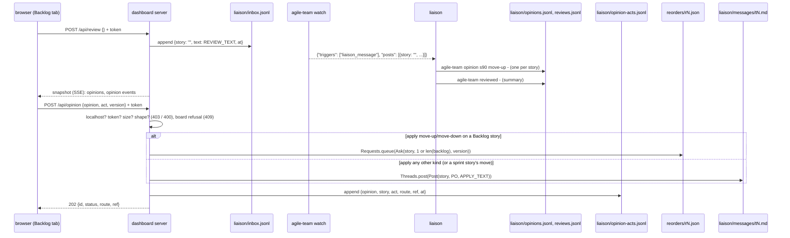

# s85: The liaison's opinions on stories, highlighted in the backlog

Delivery `dashboard`. The developer is `developer-gui`: the page, two server
routes, and the runner code behind them (one new module, two CLI commands,
the snapshot). Depends on s83 (Backlog tab, reorder requests, `may_write`,
the token) and s84 (`threads.Threads`, the liaison inbox, the
`liaison_message` watch trigger, thread posts to the PO). Both are done.
s53 (cancel) is not built: an applied `close` goes to the PO (O10).

## Shape in one paragraph

Opinions are a **view over three append-only JSONL files**, each with one
writer, in `.team/run/liaison/` (the s84 pattern). (1) The liaison records an
opinion with `agile-team opinion <story> <kind> <file|->`, which appends to
`opinions.jsonl`. The latest line per story wins. (2) The liaison closes a
review with `agile-team reviewed <file|->`, a short summary, appended to
`reviews.jsonl`. That gives the tab "last review" and a summary. (3) The
human asks for a review with a button. The server posts an s84 inbox line
with an empty story (`threads.BACKLOG`), so the existing `liaison_message`
trigger wakes the liaison. (4) The human dismisses or applies an opinion.
The server appends the act to `opinion-acts.jsonl`. An applied
`move-up`/`move-down` on a Backlog story queues an s83 reorder request (top or
bottom of the Backlog). Any other applied kind is an s84 thread post to the
PO. The snapshot carries `opinions` (items, last review, last ask) and merges
`opinion` and `opinion-act` events into `events`, the way s84 merges
`thread`. Why not `events.jsonl`: only the runner writes it (s84 H14), and
opinions and acts are written by the CLI and the server, even while the run
is stopped.

## Rules

| # | Rule | AC |
|---|---|---|
| O1 | **Kinds.** `opinions.Kind(StrEnum)`: `KEEP = "keep"`, `MOVE_UP = "move-up"`, `MOVE_DOWN = "move-down"`, `FOLD = "fold"`, `CLOSE = "close"`, `SCOPE = "scope"`, `ASK = "ask"`, in this order. `kind_refusal(kind: str) -> str \| None` gives `UNKNOWN_KIND` for any other string. | AC1 |
| O2 | **Recording.** `agile-team opinion <story> <kind> <source>`. `source` is a file or `-` for stdin, read with `cli._message_text`, so the text is never on a command line (the AC's `<text>` is "for example"; this matches s84's `reply`). Checks in order: `threads.story_refusal(story, state.stories)`, `kind_refusal(kind)`, `threads.text_refusal(text)`. The first refusal raises `CliError(reason)` and writes nothing. Otherwise `Opinions(run_dir).record(story, Kind(kind), text)` appends `{"story", "kind", "text", "at"}` (text stripped, `at = system.now()`) to `liaison/opinions.jsonl` and returns the `Opinion`. The command prints `RECORDED` and returns 0. It works while the run is stopped. A done story is allowed, as in H3. Argparse gets no `choices`, so the refusal text is ours. | AC1 |
| O3 | **Latest wins.** Opinion ids are `o<N>`, where N is the 1-based place among the well-formed lines (s84 H13: blank, torn and non-object lines are skipped, and so are records without a str `story`, a `kind` among `Kind`'s values, a str `text` and a number `at` that is not a bool). `Board.latest()` maps each story to its **last line**: line order decides, not `at`. | AC1 |
| O4 | **Review summary.** `agile-team reviewed <source>` (file or `-`). It checks `text_refusal`, then appends `{"text", "at"}` to `liaison/reviews.jsonl` (ids `v<N>`, read leniently as in O3) and prints `REVIEWED`. The last review is the last line. | AC3 |
| O5 | **Asking for a review.** `Opinions.ask_review()` calls `Threads(run_dir).post(Post(threads.BACKLOG, Party.LIAISON, REVIEW_TEXT))`, with `BACKLOG = ""` (the story of a post about the whole backlog). It is one more line in `liaison/inbox.jsonl`, so `watch` fires `liaison_message` with it under `posts` (`story: ""`). Nothing in `watch.py` changes. `Opinions.asked_at()` is the largest `at` among `liaison_posts()` whose story is `BACKLOG`, or `None`. | AC3 |
| O6 | **Review route.** `POST /api/review`: (1) `may_write`, else **403**, before the body is read. (2) `Content-Length` 1 to `BODY_LIMITS["/api/review"] = MAX_BODY` (4096), and the body is a JSON object (`opinions.is_object(body)`; any keys, ignored), else **400**. `app.opinions is None` gives **400** too. (3) `app.opinions.ask_review()`, then **202** `{"id": entry.id, "status": "asked"}`. | AC3 |
| O7 | **Act shape** (`parse_act(body) -> ActAsk \| None`). A JSON object with `opinion` (a str matching `OPINION_ID = re.compile(r"^o[1-9][0-9]{0,8}\Z")`), `act` (`"dismiss"` or `"apply"`) and `version` (a str of at most `reorders.MAX_VERSION` chars). Extra keys are ignored. Anything else gives `None`. | AC4 |
| O8 | **Act refusals** (`Board.refusal(ask)`, `priority.first_refusal` order): (1) no opinion with that id → `UNKNOWN_OPINION`. (2) it is not its story's latest → `SUPERSEDED`. (3) its kind is `keep` → `NOTHING_TO_ACT`. (4) an act on it already exists → `SETTLED`. Every refusal is pure and writes nothing. | AC4 |
| O9 | **Route.** `route_of(opinion, view) -> Route`: `Route.NONE` for `keep`. `Route.REORDER` when the kind is a key of `MOVES` and the story is in `view.backlog` (s83's Backlog group). Otherwise `Route.PO`. A dismiss always records `Route.NONE`. `MOVES = {Kind.MOVE_UP: lambda view: 1, Kind.MOVE_DOWN: lambda view: len(view.backlog)}`: the Backlog place an applied move asks for (top or bottom). The route is worked out again when the act is posted, from `View.of(state_mod.load(run_dir))`, never taken from the page. | AC4 |
| O10 | **Apply.** `REORDER`: `Requests(run_dir).queue(Ask(story, MOVES[kind](view), ask.version)).id` is the act's `ref` (`r<N>`). The router applies it between steps with every s83 check (B12): a stale version or a sprint story is refused there and shows in the snapshot's `reorders`. `PO`: `Threads(run_dir).post(Post(story, Party.PO, APPLY_TEXT.format(...)))`. That is an s84 tagged tell (`t<N>`), so the PO hears about it at its next turn with `THREAD_TOLD_LINE` and can answer with `reply_story`. Its id is the `ref`. `close` takes this route until s53 ships (then the PO asks the human to cancel with s53's `request_cancel`; no change here). | AC4 |
| O11 | **Recording the act.** After the route ran, `opinion-acts.jsonl` gets `{"opinion", "story", "act", "route", "ref", "at"}` (`route` `""`/`"reorder"`/`"product-owner"`, `ref` `""` for a dismiss). The ids are `a<N>` (read leniently, as in O3: a record needs str `opinion`, `story`, `route`, `ref`, an `act` among `Act`'s values and a number `at`). An act settles its opinion for good: no undo, no second act (O8 (4)). A later opinion on the same story is a fresh one. | AC4 |
| O12 | **Act route.** `POST /api/opinion`: (1) `may_write`, else **403**, before the body is read. (2) `Content-Length` 1 to `BODY_LIMITS["/api/opinion"] = MAX_BODY`, and `parse_act` gives an `ActAsk`, else **400**. `app.opinions is None` gives **400**. (3) `app.opinions.refusal(ask)` gives a reason → **409** with JSON `{"status": "refused", "reason": reason}`. (4) `settled = app.opinions.act(ask)` → **202** `{"id": settled.id, "status": ACT_STATUS[settled.act], "route": str(settled.route), "ref": settled.ref}`. | AC4 |
| O13 | **Snapshot.** New top-level key `"opinions"`: `{"items": [...], "asked_at": float \| None, "review": {"id", "text", "at"} \| None}`. `items` holds **every** opinion in line order (the timeline needs old texts), each `{"id", "story", "kind", "text", "at", "latest": bool, "route": str, "act": {"id", "act", "route", "ref", "at"} \| None}`. `route` is `str(route_of(o, view))` for a latest opinion with no act, else `""`. `watched_files` adds `opinions.watched(run_dir)` (the three JSONL files). | AC2, AC3 |
| O14 | **Events.** Merged by time into the snapshot's `events`, like s84 H14. Each opinion gives `{"id": "opinion-<oN>", "at", "kind": "opinion", "role": None, "story", "data": {"opinion": id, "kind": kind}}`. Each act gives `{"id": "opinion-act-<aN>", "at", "kind": "opinion-act", "role": None, "story", "data": {"opinion", "act", "route", "ref"}}`. s84's `_thread_event` gives `"story": entry.story or None`, so a review request (story `""`) is an event on no story. | AC4 |
| O15 | **Page: badge.** A story's opinion is `storyOpinion(view, id)`: the item with that story and `latest`. It is a **suggestion** when its kind is not `keep` and `act` is `null`. A row with a suggestion shows `pill("liaison: " + kind, "")` after the label pill, in both groups. A settled or `keep` opinion shows no badge. | AC2 |
| O16 | **Page: details.** `opinionHtml(story, view)` goes in `storyDetails` just before `threadHtml`, when the story has a latest opinion: `Liaison's opinion: <kind> · <time>`, then `md(text)`. If settled: `dismissed <time>`, or `applied <time>` with `→ <ref>` and, for a reorder ref, that request's status from `view.reorders` (`pending`/`applied`/`refused: <reason>`). If a suggestion and the page has a `TOKEN`: `<button class="ctl" data-opinion-act="dismiss" data-opinion="oN">dismiss</button>` and `<button class="ctl" data-opinion-act="apply" data-opinion="oN">LABEL</button>`, with LABEL `APPLY_LABEL[kind]` when `route === "reorder"`, else `APPLY_PO`. Both are disabled while `ui.acting.has(oN)`. Apply with route `reorder` is also disabled while `reorderPending(view)` (s83 B8). Then the note `ui.actNote[oN]`. | AC2, AC4 |
| O17 | **Page: filter.** A checkbox `<input type="checkbox" data-suggested>` labelled `only suggestions (N)`, where N is the number of open stories with a suggestion. When checked (`ui.suggested`), each group lists only its rows with a suggestion. **Places stay the full group's**: `groupHtml` works out each row's place and the count from the unfiltered group first, then filters. So `#position`, the handles and `moveTarget` are unchanged. An empty filtered group reads `Nothing here.` | AC2 |
| O18 | **Page: review bar.** `reviewBarHtml(view)` heads the tab (above the groups, inside `#backlog`). It shows `Last review: <time>` and `md(review.text)`, or `NO_REVIEW`. When `asked_at` is set and later than the last review's `at` (or there is no review), it shows `Asked <time>; waiting for the liaison.` With a `TOKEN`: `<button class="ctl" data-ask-review>Ask the liaison to review the backlog</button>`, disabled while waiting or while `ui.asking`, then `ui.reviewNote`. Then the O17 checkbox (shown with or without a token). | AC2, AC3 |
| O19 | **Page: posting.** `postReview()`: sets `ui.asking`, POSTs `api/review` with body `"{}"` and the token header. A 403 sets `READ_ONLY`, any other non-OK `request failed: HTTP <status>`, and a fetch error `request failed: <message>`. OK clears the note. Last, it clears `ui.asking` and calls `render()`. `postOpinionAct(id, act)`: adds the id to `ui.acting`, POSTs `api/opinion` with `{opinion: id, act, version: data.view.run.order_version}`. A 403 sets `READ_ONLY`, a 409 the answer's `reason`, any other non-OK `request failed: HTTP <status>`, and an error `request failed: <message>`. On OK the note clears, and when the answer's `route` is `"reorder"`, `ui.reorder = {id: ref, story}`. That way s83's note and its pending-handle rule follow the request. Last, it removes the id from `ui.acting` and calls `render()`. | AC3, AC4 |
| O20 | **Page: timeline.** `TIMELINE.opinion = (e, ctx) => ({from: "liaison", to: "you", what: "opinion " + e.data.kind, body: ctx.opinions[e.data.opinion]?.text ?? ""})`, where `ctx.opinions` maps `opinions.items` by id. `TIMELINE["opinion-act"] = (e) => ({from: "you", to: ACT_TO[e.data.route], what: "opinion " + e.data.act, body: e.data.opinion + (e.data.ref ? " → " + e.data.ref : "")})`, with `ACT_TO = {"": "liaison", reorder: "runner", "product-owner": "PO"}`. `"opinion"` joins `MARKDOWN_KINDS`. `eventLine` shows `e.data?.source ?? e.data?.author ?? e.data?.act ?? e.data?.kind ?? e.role ?? ""`. | AC4 |

### Texts (tests may assert them exactly)

`opinions.py`:

- `UNKNOWN_KIND = "no opinion kind {kind!r}; use one of: {kinds}"` (`kinds` = `", ".join(Kind)`)
- `UNKNOWN_OPINION = "no opinion {id!r}"`
- `SUPERSEDED = "{id} is no longer the latest opinion on {story}; reload"`
- `NOTHING_TO_ACT = "{id} is keep: there is nothing to dismiss or apply"`
- `SETTLED = "{id} was already {status}"` (`status` = `ACT_STATUS[act]`)
- `ACT_STATUS = {Act.DISMISS: "dismissed", Act.APPLY: "applied"}`
- `RECORDED = "recorded {id}: {kind} on {story}"`
- `REVIEWED = "recorded backlog review {id}"`
- `REVIEW_TEXT = "Please review the backlog. Record an opinion on each story you would change with `agile-team opinion <story> <kind> -` (kinds: keep, move-up, move-down, fold, close, scope, ask), then a short summary with `agile-team reviewed -`."`
- `APPLY_TEXT = "The human applied the liaison's opinion {id} on {story} from the dashboard: {kind}.\n\n{text}"`

`index.html`:

- `NO_REVIEW = "The liaison has not reviewed the backlog yet."`
- `APPLY_LABEL = {"move-up": "apply: move to the top of the backlog", "move-down": "apply: move to the bottom of the backlog"}`
- `APPLY_PO = "apply: send to the PO"`

## Changes by module

### `agile_team/opinions.py` (new)

Module docstring: "The liaison's opinions on stories (s85): recorded by the
CLI, reviewed and acted on from the dashboard; read from the files each
writer appends to."

Imports: `json`, `re`, `from . import system`, `from . import state as
state_mod`, `from .backlog import Ask, View`, `from .relay import
LIAISON_DIR`, `from .reorders import MAX_VERSION, Requests`, `from .threads
import BACKLOG, Party, Post, Threads, append_line, read_lines`, `from
.priority import first_refusal`. It never imports `dashboard`.

| Name | Signature / shape |
|---|---|
| `Kind(StrEnum)` | O1 |
| `Act(StrEnum)` | `DISMISS = "dismiss"`, `APPLY = "apply"` |
| `Route(StrEnum)` | `NONE = ""`, `REORDER = "reorder"`, `PO = "product-owner"` |
| `OPINIONS = "opinions.jsonl"`, `REVIEWS = "reviews.jsonl"`, `ACTS = "opinion-acts.jsonl"`, `OPINION_ID`, `MOVES` | O3, O4, O7, O9, O11 |
| texts | as listed above |
| `Opinion` | `@dataclass(frozen=True)`: `id: str`, `story: str`, `kind: Kind`, `text: str`, `at: float`. `as_dict(self) -> dict[str, Any]` (enum values as plain str). |
| `Review` | `@dataclass(frozen=True)`: `id: str`, `text: str`, `at: float`. `as_dict`. |
| `Settled` | `@dataclass(frozen=True)`: `id: str`, `opinion: str`, `story: str`, `act: Act`, `route: Route`, `ref: str`, `at: float`. `as_dict`. |
| `ActAsk` | `@dataclass(frozen=True)`: `opinion: str`, `act: Act`, `version: str` |
| `kind_refusal(kind: str) -> str \| None` | O1 |
| `parse_act(body: bytes) -> ActAsk \| None` | O7 |
| `is_object(body: bytes) -> bool` | O6: the body parses as a JSON object |
| `route_of(opinion: Opinion, view: View) -> Route` | O9 |
| `watched(run_dir: Path) -> list[Path]` | O13: the three JSONL paths |
| `Board` | `@dataclass(frozen=True)`, pure: `opinions: list[Opinion]`, `acts: list[Settled]`. `latest(self) -> dict[str, Opinion]` (O3). `find(self, oid: str) -> Opinion \| None`. `act_of(self, oid: str) -> Settled \| None` (the first act on it). `refusal(self, ask: ActAsk) -> str \| None` (O8). |
| `Opinions` | `@dataclass(frozen=True)`: `run_dir: Path`. Path properties `opinions_file`, `reviews_file`, `acts_file` (under `run_dir / LIAISON_DIR`). `record(self, story: str, kind: Kind, text: str) -> Opinion` (O2). `review(self, text: str) -> Review` (O4). `all(self) -> list[Opinion]`, `reviews(self) -> list[Review]`, `acts(self) -> list[Settled]` (lenient, O3/O4/O11). `board(self) -> Board`. `ask_review(self) -> Entry` and `asked_at(self) -> float \| None` (O5). `refusal(self, ask: ActAsk) -> str \| None` = `self.board().refusal(ask)`. `act(self, ask: ActAsk) -> Settled` (O9-O11; call only after `refusal` gave `None`). |

`act` dispatches through tables, not `if`s: `DOERS: dict[Act, ...] =
{Act.DISMISS: Opinions._dismiss, Act.APPLY: Opinions._apply}`. Each returns
`(Route, ref)`. `_apply` picks `APPLIERS: dict[Route, ...] = {Route.REORDER:
Opinions._reorder, Route.PO: Opinions._tell_po}` by `route_of(opinion,
view)`. Each applier takes `(self, opinion, ask)` and returns the ref. Then
`_settle` appends the act line and returns the `Settled`. Ids returned by
`record`/`review`/`act` are counted after the append, as in s84 (see Known
limits).

### `agile_team/threads.py`

- `BACKLOG = ""`. Add a sentence to the module docstring: "A post with story `BACKLOG` is about the whole backlog (s85's review request)."
- Rename `_lines` → `read_lines(path: Path) -> list[dict]` and `_append` → `append_line(path: Path, data: dict) -> None`, both with their docstrings, so `opinions.py` reuses them (DRY). No test names them today.

### `agile_team/cli.py`

- `def cmd_opinion(args) -> int` (O2). Docstring: "Record the liaison's opinion on a story; the text comes from a file or stdin."
- `def cmd_reviewed(args) -> int` (O4). Docstring: "Record that the liaison reviewed the backlog, with a summary from a file or stdin."
- `COMMANDS` gains, after `reply`:
  - `Command("opinion", "record the liaison's opinion on a story (a file, or - for stdin)", cmd_opinion, ((("story",), {}), (("kind",), {"help": ", ".join(opinions.Kind)}), (("source",), {"help": "file holding the opinion, or - to read stdin"})))`
  - `Command("reviewed", "record a backlog review's summary (a file, or - for stdin)", cmd_reviewed, ((("source",), {"help": "file holding the summary, or - to read stdin"}),))`

### `agile_team/dashboard/server.py`

| Change | Detail |
|---|---|
| module docstring | "… token-gated reorder requests, thread posts, review requests and opinion acts from localhost …" |
| `Dashboard` | gains `opinions: Opinions \| None = None`. `for_run` sets `Opinions(config.run_dir)`. |
| `BODY_LIMITS` | gains `"/api/review": MAX_BODY`, `"/api/opinion": MAX_BODY` |
| `_review(handler)` | O6 |
| `_opinion(handler)` | O12. The 409 goes through `_send(handler, Body("application/json", data, 409))`. |
| `POSTS` | gains `"/api/review": _review`, `"/api/opinion": _opinion` |

### `agile_team/dashboard/snapshot.py`

- `SECTIONS` gains `"opinions": _opinions` (after `thread`). `_opinions(files) -> dict` (O13), with `_opinion_item(opinion, board, view) -> dict`.
- `_events` adds `map(_opinion_event, …all())` and `map(_act_event, …acts())` (O14).
- `_thread_event`: `"story": entry.story or None`.
- `watched_files` adds `*opinions.watched(config.run_dir)`.

### `agile_team/dashboard/fixtures/snapshot.json` (the contract)

Add `opinions` with `items`, on the fixture's backlog story `s6`: `o1`
(`move-up`, not latest), `o2` (`move-down`, latest, route `reorder`, `act`
null), and on `s5` `o3` (`scope`, latest, settled by `a1`: `apply`, route
`product-owner`, ref a `t<N>` that is also a `thread` entry). Add
`asked_at`, and a `review` `v1` dated after it. Add the three `opinion`
events and one `opinion-act` event, in time order.

### `agile_team/dashboard/index.html`

| Change | Detail |
|---|---|
| normalize | `opinions` defaults to `{items: [], asked_at: null, review: null}`, with `items` through `list` |
| `ui.suggested = false`, `ui.acting = new Set()`, `ui.actNote = {}`, `ui.asking = false`, `ui.reviewNote = ""` | |
| `NO_REVIEW`, `APPLY_LABEL`, `APPLY_PO`, `ACT_TO` | texts above |
| `storyOpinion(view, id)`, `isSuggestion(item) -> boolean`, `reviewWaiting(view) -> boolean` | O15, O18 |
| `opinionBadge(story, view) -> string` | O15, used by `backlogRow` |
| `opinionHtml(story, view) -> string` | O16. Every text goes through `esc`/`md`, every id through `esc`. |
| `groupHtml` | O17: places from the full group, then the filter |
| `reviewBarHtml(view) -> string` | O18; `backlogHtml` starts with it |
| `postReview()`, `postOpinionAct(id, act)` | O19 |
| click handler | `[data-opinion-act]` → `postOpinionAct(btn.dataset.opinion, btn.dataset.opinionAct)` unless disabled, and `[data-ask-review]` → `postReview()` unless disabled. Both are checked before `[data-expand]`. |
| `change` listener | `[data-suggested]` → `ui.suggested = el.checked; render()` |
| `TIMELINE.opinion`, `TIMELINE["opinion-act"]`, `MARKDOWN_KINDS`, `ctx.opinions`, `eventLine` | O20 |
| CSS | `.review-bar` and `.opinion` blocks with the existing variables only |

### `agile_team/roles/product-owner.md`

Under the story-thread paragraph, add: "A thread post that starts 'The
human applied the liaison's opinion' is the human agreeing with the
liaison's suggestion. Treat it as the human's request, and answer with
`reply_story`. For a `close`, the human still decides the cancel."

### Docs (the architect, at design review, once the code is in)

- `agile-team/SKILL.md` step 6: a `posts` entry with an empty `story` is a
  backlog review request. Review the backlog, record an opinion per story
  you'd change (`$AT opinion <story> <kind> <file|->`), then `$AT reviewed
  <file|->` with a summary. The liaison may record opinions unasked too.
- `agile-team/reference/protocol.md`: the `opinion` and `reviewed` commands,
  the three files, `POST /api/review` and `POST /api/opinion`, the snapshot's
  `opinions` and the `opinion`/`opinion-act` events.
- `agile-team/docs/customer/dashboard.md`: a "The liaison's opinions"
  section (badge, filter, review button, dismiss and apply).
- The README row, if it lists CLI commands.

## Test checklist (for the Unit Tester)

Unit (fake world):

1. **Recording (AC1).** `cmd_opinion` with `s5 move-up` and a file appends one line `{story, kind, text, at}` (text stripped), prints `recorded o1: move-up on s5`, and returns 0. `-` reads stdin. An unknown story (`UNKNOWN_STORY`), the kind `"later"` (exactly `UNKNOWN_KIND` with the seven kinds), and an empty text (`EMPTY`) each raise `CliError` and write nothing. A done story is allowed. It works with no runner.
2. **Latest wins (AC1).** Three opinions on `s5` then one on `s6`: `Board.latest()` gives the third for `s5`, even when its `at` is earlier. A torn last line and a line with an unknown kind are skipped, and the earlier ids don't move.
3. **`reviewed` (AC3).** It appends `{text, at}`, prints `recorded backlog review v1`, and refuses an empty text.
4. **Review request (AC3).** `ask_review()` appends `{story: "", text: REVIEW_TEXT, at}` to `liaison/inbox.jsonl` and returns `lp<N>`. With watch memory saved, the next `Watcher.until` returns `triggers == ["liaison_message"]`, with that post under `posts`. `asked_at()` is its `at`. A story post doesn't change `asked_at()`.
5. **`parse_act`.** A valid body gives an `ActAsk`. Each of these gives `None`: a non-object, a missing key, `act: "undo"`, `opinion: "x1"` or `"o0"`, a non-str version, a version of 65 chars.
6. **Refusals (AC4).** Unknown id → `UNKNOWN_OPINION`. A superseded opinion → `SUPERSEDED`. `keep` → `NOTHING_TO_ACT`. A second act → `SETTLED` with `dismissed`/`applied`. Each writes nothing.
7. **Dismiss (AC4).** It appends `{opinion, story, act: "dismiss", route: "", ref: "", at}` and returns `a1`. No reorder and no tell file.
8. **Apply a move (AC4).** `move-up` on the 3rd of 3 Backlog stories queues `r1.json` with `position 1` and the given version. `move-down` queues `position 3`. The act's route is `reorder` and its ref is `r1`. After `Desk.apply()`, the order changes and a `priority` event with source `human (dashboard)` exists. A stale version is refused by the desk (`STALE`), and the act stays.
9. **Apply to the PO (AC4).** `fold`, `close`, `scope`, `ask`, and `move-up` on a current-sprint story each write a tagged `t<N>.md` whose text is exactly `APPLY_TEXT`. The route is `product-owner` and the ref is `t<N>`. The router's next pass lists it with `THREAD_TOLD_LINE`.
10. **Write gate.** `POST /api/review` and `POST /api/opinion`: from `127.0.0.1` with the token, the answers are 202 with the O6/O12 JSON. A non-local peer, a wrong or missing token, or an empty `app.token` each get 403, with the body not read and nothing written. A bad length (0 or 4097), bad JSON, a non-object, or `app.opinions is None` get 400. A refused act gets 409 with `{"status": "refused", "reason": …}`.
11. **Snapshot (AC2-AC4).** `build` has `opinions.items` (all, `latest` set right, `route` only on open latest non-keep items, `act` filled for settled ones), `asked_at`, and `review` (the last). `events` holds `opinion` and `opinion-act` events with `role` `None`, sorted by time, and the review request's `thread` event has `story` `None`. The fixture's keys match `build`'s. `watched_files` includes the three JSONL paths.
12. **Token never leaks.** After both POSTs, the token is in no snapshot, inbox line or act line.

Node harness (`tests/dashboard_node.py`):

13. **Badge and filter (AC2).** With the fixture, `s6`'s row has `liaison: move-down`, and `s5` (settled) has no badge. With `ui.suggested` set, the Backlog lists only `s6`, and its `#position` and place are the unfiltered ones. The checkbox counts 1.
14. **Details (AC2, AC4).** `s6`'s details show the kind, time, text, and (with `TOKEN`) dismiss and `APPLY_LABEL["move-down"]`. `s5`'s show `applied` with its ref. With no token there are no buttons.
15. **Review bar (AC3).** It shows `Last review` with the summary, or `NO_REVIEW`, and `waiting for the liaison` when `asked_at` is later. The button is disabled while waiting and absent with no token.
16. **Posting (AC3, AC4).** A stubbed `fetch` gets `api/review` with the token header and `{}`, and `api/opinion` with `{opinion, act, version}`. A 409 sets the reason from the JSON, a 403 `READ_ONLY`, and a 500 `request failed: HTTP 500`. An OK `reorder` answer sets `ui.reorder`.
17. **Timeline.** `timelineRowHtml` for an `opinion` event shows the text as Markdown, and for an `opinion-act` event shows `you → runner` and the ref.

E2E (integration-tester): a real `dashboard --port 0 --token t`. `POST
/api/review` makes a real `agile-team watch --timeout 30` print
`liaison_message` with a `story: ""` post. Then `agile-team opinion s5
move-up -` and `agile-team reviewed -` show in `GET /api/snapshot`'s
`opinions`. `POST /api/opinion` with `apply` writes `reorders/r1.json`.

## Decisions

- **Opinions are files, not state.** Like s84, three single-writer JSONL
  files. The CLI and the server can write while the run is stopped, and
  `state.json` keeps one writer.
- **A review is closed explicitly** (`reviewed`). The last opinion's time
  would not say "reviewed, nothing to change", and the summary is worth
  showing.
- **A move goes to the top or bottom.** An opinion says the direction, not
  the place. One place up would rarely be what's meant. The handles stay
  for fine-tuning.
- **Close goes to the PO** until s53. Cancelling stays the human's decision
  through the PO's question (s53 AC3). Applying `close` asks the PO to start
  that.

## Known limits

- An act settles its opinion even when the reorder it queued is later
  refused (stale, story moved into the sprint). The details show the
  refusal. The human then uses the handles or the thread.
- Two acts on the same opinion at the same instant (two tabs) could both
  pass the refusal, because the server is threaded and holds no lock. The
  board then reads the first act, and the second is a no-op line.
- Ids returned by `record`, `review`, `ask_review` and `act` are counted
  after the append, as in s84. The stored ids, from line order, are right.
- The liaison is woken only while a `watch` runs. Without one, the request
  waits in the inbox, and the bar keeps saying it's waiting.
- There is no flow-chart edge animation for the new events.
- A REORDER apply reads `state.json` twice (`_apply` for the route,
  `_reorder` for the place). The file is small and the cost is one read.
  Passing the view would need a third applier parameter, against the
  two-parameter rule. Accepted (review m1).
- `opinionHtml` and `reviewBarHtml` wrap `md(...)` in `
`,
  as the s83 story file and the s84 thread already do. It renders right.
  If this is cleaned up, it should be one page-wide change, not part of
  s85 (review m3).

## Design review (round 2)

The code matches O1–O20. The docs are written: `SKILL.md` step 6,
`protocol.md` (the CLI rows, "Liaison opinions", the two routes, the
snapshot's `opinions` and events, and the tab), `docs/customer/dashboard.md`
("The liaison's opinions") and the README row.

One fix for `developer-gui` (review m2; house rules: public names are
documented, DRY):

- `agile_team/threads.py`: add a public `has_time(record: dict) -> bool`
  with the docstring "Whether the record's `at` is a number (a bool is
  not)." Make `_well_formed` use it.
- `agile_team/opinions.py`: delete `_number` and use `threads.has_time`
  (import it with the other `threads` names). Give the three properties
  `opinions_file`, `reviews_file` and `acts_file` one-line docstrings.
  Make `watched(run_dir)` return those three properties of
  `Opinions(run_dir)`, so the paths are built in one place.
- Tests: no behaviour changes, so the existing ones must pass as they
  are (the s84 and s85 lenient-read tests already cover `has_time`
  through `_well_formed` and `_opinion_ok`/`_act_ok`).
