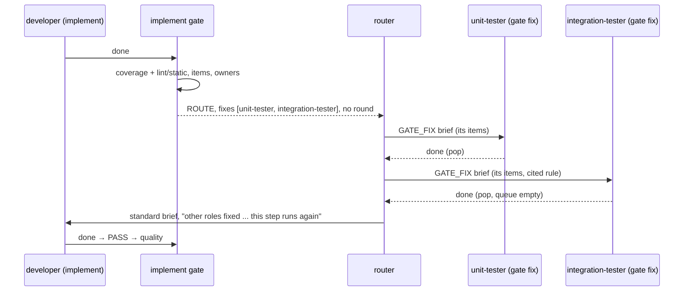

# s92: A gate failure goes straight to the role that owns the failing file

Developer: **developer-cli** (runner Python: `owners.py` (new), `gates.py`,
`dispatch.py`, `router.py`, `state.py`, `roles.py`, `events.py`,
`boundary.py`; two small `dashboard/index.html` table rows; built-in role
prompts `_shared.md`, `developer.md`, `code-reviewer.md`).

Supersedes s48. No new dependency, no ADR (it extends the s11 dispute and
s27 setback patterns). Docs move with the behaviour (§ Docs).

## The idea in one paragraph

Today the implement gate runs the coverage command, and any failure bounces the
story back to implement with a round. If the failing file is one the developer
can't edit (an e2e test, a lint finding in `tests/`), the developer blocks or
disputes, and a Manager ruling follows. With s92 the gate turns its output into
**items** (a failing test, a lint finding) and finds each item's **owner**:
the pipeline role whose write globs match the item's file. These are the same
globs that limit that role's writes. Items owned by another role become
**gate fix steps** for that role, queued on the story in pipeline order. The
story stays at its step, counts no round and opens no dispute. After the last
fix step, the step's own role runs again.

## Rules

| # | Rule |
|---|---|
| R1 | Only the **implement** gate routes. Routing is a pass over the gate's `Outcome` (`Pipeline.route`) that runs after `Pipeline.evaluate`. Every other gate and verdict is unchanged. |
| R2 | **Owners come from one table**: `Owners.writers` is built from the pipeline's steps in order. Each writer is the step's role (`STEP_ROLES`, with `developer` replaced by the story's `developer` when it names a known role), deduplicated by role (first step wins), with the role's **expanded write globs** (`Runtime.scope_for(resolve(role)).write`, the globs the guard enforces). Nothing else says who owns a file. |
| R3 | A file's writer is the step's own writer if its globs match the file. Otherwise it is the first writer in pipeline order whose globs match (`paths.matches`, `!` globs honoured). Otherwise there is none. |
| R4 | Items. **Test items** come from the coverage run's full output (`FINDINGS[Source.TEST]`). **Lint items** come from the output of each configured `lint` and `static` command (`ROUTED_COMMANDS`) that exits neither 0 nor `TIMED_OUT` (`FINDINGS[Source.LINT]`). Findings with the same printed path and source become one `Item`, kept in first-seen order, with at most `ITEM_LINES` (40) output lines. |
| R5 | Placing an item: its printed path is matched against one `git ls-files` listing (`owners.candidates`: the exact path, else every tracked path ending in `/<path>`). If every candidate has the same writer, that writer owns the item. With no candidates, or candidates with different writers, the item is the step's own. |
| R6 | **Handed-on work** (`FIXED_AT` table): an item whose `(source, owner's step)` maps to the gated step stays with the gated step's role. The one row is `(TEST, "tests") → "implement"`: the unit-tester's red tests are the developer's to make green (TDD), as today. A wrong unit test is still a dispute (s11). A lint finding in a unit-test file has no row, so it goes to the unit-tester. |
| R7 | **Lint items count only in files the story touched**: at least one candidate is in `story.files` (every path any step committed on this story). Other lint items are dropped, neither routed nor failing. So a repo with old lint debt is not routed on every story. |
| R8 | Lint items never fail the gate. A lint item that stays with the step role is dropped, and the quality czar judges it as today. Only foreign lint items act, by routing. |
| R9 | **Verdict** (`_routed(base, split)`): no fixes → `base` unchanged. If there are fixes, the verdict is **`BOUNCE`** when the base bounced and either some own item is a test or the split has no test item at all (e.g. a coverage shortfall). Otherwise it is **`ROUTE`**. A route counts no round and moves no step. Either way `outcome.fixes` = the split's fixes. |
| R10 | Reasons. A `ROUTE` reason is `ROUTED` with the owners and files, a stable text the repeat screen can key on. A `BOUNCE` with fixes keeps the base reason and adds `ALSO_ROUTED`. |
| R11 | **Dispute on a foreign test**: at implement, a `DISPUTE` outcome whose test item (`dispute.file`, source TEST) is not the step's own under R3 and R6 becomes a `ROUTE`. It goes to the file's owner, with one item (`dispute.test`, `dispute.output` lines) and the fix's `rule` and `why` taken from the dispute. No dispute is opened (`story.disputes` unchanged). A dispute on a unit-test file is unchanged: R6 makes it the step's own, and s11 sends it to `tests`. |
| R12 | **Queue**: `Pipeline.advance` ends by setting `story.fixes = list(outcome.fixes)`. Every gate result replaces the queue. `_clear` (rulings, faults, `pass_tests`) empties it. A screen escalation has no fixes, so it empties the queue too. |
| R13 | **Repeats**: `ROUTE` joins `dispatch.SETBACKS`. A second identical route in a row escalates to the Manager (s27 repeat screen). It is not counted by the backstop (`to_step == step`). |
| R14 | **Router**: the movable story picked first runs `story.fixes[0].role` as a `StepKind.GATE_FIX` step with `fix_brief` when its queue is not empty. Otherwise it runs its normal step. |
| R15 | **Refusal**: a `GATE_FIX` request is checked with `fix_refusal(role, story)`, which runs the same story checks as `dispatch_refusal` (repeat, status, backlog). In place of the step check, the role must be the head fix's role. |
| R16 | **Set-up**: a `GATE_FIX` step runs with the role's own scope. It skips the role set-ups (`_attach_delivery`, `_lay_out_presentation`) and `STEP_SETUPS`. `_confine_git` still applies. |
| R17 | **Settling a fix step** (`FIX_OUTCOMES` by handoff status). `done`: pop the head and run no gate. `changes_requested`: `BOUNCE` to `story.step` with `FIX_DISAGREES`, which counts a round (the owner says the step's role must fix it). `blocked`/`failed`: `HOLD` with `role reported {status}: {summary}`. The last two go through `_advance_and_log` and so empty the queue (R12). A malformed handoff on a fix step is settled as `failed` with the parse error as its summary. |
| R18 | **Record**: every settled fix step appends a `FixRecord(role, files, commit, asserts, changed)` to `story.fixed` and emits `gate-fix`. `files` lists the items' shown files. `changed` is `owners.asserts_changed(diff)` over the fix commit's diff (`git diff <sha>^ <sha>`), and is `False` when there is no commit. |
| R19 | **AC5**: the handoff gains an optional `"asserts"` string, the AC or design rule that makes an old assertion wrong. The code-reviewer's standard brief lists `story.fixed` with `fix_note(record)`. A fix that changed assertion lines without naming a rule is **flagged for the reviewer, not refused**: a reflowed `assert` cannot be told from a changed one, so the runner flags it and the reviewer judges. |
| R20 | After a route, the step role's next brief says so (`SENT_BACK_LINES["route"]`). A fix step leaves `story.previous` alone on `done`. |

## Data (exact values)

### `owners.py` (new, pure, no I/O)

```python
class Source(StrEnum):
    TEST = "test"
    LINT = "lint"

ITEM_LINES = 40

FINDINGS: dict[Source, tuple[re.Pattern[str], ...]] = {
    Source.TEST: (
        # pytest short summary (default -rfE): FAILED/ERROR path[::test] [- msg]
        re.compile(r"^(?:FAILED|ERROR) (?P<path>[^\s:]+\.\w+)(?:::\S+)?(?: - .*)?$", re.M),
        # jest: FAIL path
        re.compile(r"^\s*FAIL (?P<path>\S+\.\w+)\s*$", re.M),
    ),
    Source.LINT: (
        # ruff concise, flake8, mypy, eslint unix: path:line[:col]: message
        re.compile(r"^(?P<path>[^\s:]+\.\w+):\d+(?::\d+)?: .*$", re.M),
        # ruff full (default since 0.9): "CODE message" then " --> path:line:col"
        re.compile(r"^\S.*\n\s*--> (?P<path>[^\s:]+\.\w+):\d+:\d+\s*$", re.M),
        # ruff format --check
        re.compile(r"^Would reformat: (?P<path>\S+)\s*$", re.M),
    ),
}

FIXED_AT: dict[tuple[Source, str], str] = {(Source.TEST, "tests"): "implement"}

ASSERTION_MARKS: tuple[re.Pattern[str], ...] = (
    re.compile(r"^\s*assert\b"),             # Python
    re.compile(r"\bpytest\.raises\("),
    re.compile(r"\bexpect\("),              # jest
    re.compile(r"\bassert\w*!?\("),          # Rust assert!/assert_eq!, Go/JUnit assertX(
)

FIX_NOTES: dict[tuple[bool, bool], str] = {   # (rule named, assertion lines changed)
    (True, True): "changed what a test asserts because {asserts}",
    (True, False): "named {asserts}, but no assertion line changed",
    (False, True): "assertion lines changed, but no rule was named; check them",
    (False, False): "no assertion change",
}
```

Types and functions (each ≤ 8 lines, ≤ 2 parameters):

| Name | Signature | Does |
|---|---|---|
| `Finding` | `@dataclass(frozen=True) Finding(path: str, lines: tuple[str, ...], source: Source)` | one match: printed path, its matched text split into lines |
| `Item` | `@dataclass Item(path: str, source: Source, files: list[str] = [], lines: list[str] = [])`; property `shown -> str` = `files[0]` if exactly one, else `path` | one failing item placed in the repo |
| `Fix` | `@dataclass Fix(role: str, items: list[Item], rule: str = "", why: str = "")` | one queued gate fix step |
| `FixRecord` | `@dataclass FixRecord(role: str, files: list[str], commit: str \| None, asserts: str = "", changed: bool = False)` | one settled fix step, for the reviewer |
| `Writer` | `@dataclass(frozen=True) Writer(step: str, role: str, write: tuple[str, ...])` | one row of the owners table |
| `Owners` | `@dataclass(frozen=True) Owners(writers: tuple[Writer, ...], step: str, touched: frozenset[str] = frozenset())` | the table for one story at one step |
| `Owners.own` | property `-> Writer \| None` | the writer whose `step == self.step` |
| `Owners.writer_of` | `(self, file: str) -> Writer \| None` | R3 |
| `Owners.owner_of` | `(self, files: list[str]) -> Writer \| None` | R5: the one shared writer of all files, else `None` |
| `Owners.fixer` | `(self, item: Item) -> Writer \| None` | `None` (own) when no owner, owner's step is `self.step`, or `FIXED_AT.get((item.source, owner.step)) == self.step`; else the owner |
| `Owners.counts` | `(self, item: Item) -> bool` | R7: TEST always; LINT only if a file is in `touched` |
| `Split` | `@dataclass Split(own: list[Item], fixes: list[Fix])`; property `tested -> bool` (any TEST item in `own` or in any fix) | the result of `split` |
| `findings` | `(output: str, source: Source) -> list[Finding]` | every `FINDINGS[source]` match |
| `candidates` | `(path: str, listing: str) -> list[str]` | `[path]` if listed, else listed paths ending `"/" + path` |
| `placed` | `(found: list[Finding], listing: str) -> list[Item]` | group by `(path, source)`, first-seen order, lines capped at `ITEM_LINES`, `files = candidates(...)` |
| `split` | `(items: list[Item], owners: Owners) -> Split` | drop items with `not owners.counts(item)`, then own (fixer `None`) vs. one `Fix` per fixer role, ordered by the writer's index in `owners.writers` (AC3); a LINT own item is dropped (R8) |
| `fix_lines` | `(fix: Fix) -> list[str]` | `"Items:"`, then per item `- {shown} ({source})` and its lines indented four spaces; then, if `fix.rule`, `"Design rule the failing step cited: {rule}: {why}"` (`": {why}"` only when set) |
| `asserts_changed` | `(diff: str) -> bool` | removed vs. added lines (`-`/`+`, not `---`/`+++`) that match any `ASSERTION_MARKS`, all whitespace removed, compared as multisets (`Counter`); `True` when they differ |
| `fix_note` | `(record: FixRecord) -> str` | `FIX_NOTES[(bool(record.asserts), record.changed)].format(asserts=record.asserts)` |
| `load_fix` | `(data: dict[str, Any]) -> Fix` | rebuild from `state.json` (items' `source` as `Source`) |

`owners.py` imports only `paths` (and stdlib). It must not import `gates`.

### `gates.py`

- `Verdict.ROUTE = "route"`. Docstring: *stays at the step, counts no round,
  queues gate fix steps for the items' owners (s92)*.
- `ROUTED_COMMANDS = ("lint", "static")`. `dispatch.QUALITY_COMMANDS` is
  removed, and dispatch imports this name (DRY).
- `LS_ALL_COMMAND = "git ls-files"`.
- `ROUTED = "routed to {owners}; the story comes back to this step after their fix steps"`
- `ALSO_ROUTED = "also routed to {owners}; their fix steps run first"`
- `{owners}` is `"; ".join(f"{fix.role} ({', '.join(i.shown for i in fix.items)})")`.
- `StoryState` gains `files: list[str]`, `fixes: list[Fix]`, `fixed: list[FixRecord]` (all `field(default_factory=list)`).
- `Outcome` gains `fixes: list[Fix] = field(default_factory=list)` and `output: str = field(default="", repr=False)` (in memory only; never saved or emitted).
- `pick_tracked(file, listing)` becomes `found = owners.candidates(file, listing); return found[0] if len(found) == 1 else None`. The behaviour is the same.
- `Checks.tests_green_and_covered()` also sets `output=out` unless `code == TIMED_OUT`.
- New `Checks.listing() -> str`: the `LS_ALL_COMMAND` output, `""` on a non-zero exit.
- New `Checks.lint_outputs() -> list[str]`: for each name in `ROUTED_COMMANDS` that `commands.get(name)` configures, run it and keep its output when the code is neither 0 nor `TIMED_OUT`.
- New `Pipeline.route(self, outcome: Outcome, owners: Owners) -> Outcome`. A `DISPUTE` outcome goes to `_route_dispute`. An outcome with `output` goes to `_route_items`. Any other outcome comes back unchanged.
- `_route_items(outcome, owners)`: `items = owners_mod.placed([*findings(outcome.output, TEST), *self._lint_findings()], self.checks.listing())`, then `return _routed(outcome, owners_mod.split(items, owners))`.
- `_lint_findings() -> list[Finding]`: the LINT findings of every `checks.lint_outputs()`.
- `_route_dispute(outcome, owners)`: builds `Item(d.test, TEST, [d.file], d.output.splitlines()[:ITEM_LINES])`. If `owners.fixer(item)` is `None`, it returns `outcome` unchanged. Otherwise it returns `Outcome(Verdict.ROUTE, outcome.reason, author=Author.ROLE, fixes=[Fix(writer.role, [item], d.rule, d.reason)])`.
- Module function `_routed(base: Outcome, split: Split) -> Outcome` (R9, R10). Use `dataclasses.replace`. `bounce_to` is kept: a bounce goes to `base.bounce_to`, which is already the step (`_retry_here`).
- `Pipeline.advance`: at the end, `story.fixes = list(outcome.fixes)` (R12). `Verdict.ROUTE` needs no `moves` row.
- `Pipeline._clear`: also `story.fixes = []`.
- New `fix_refusal(role: str, story: StoryState | None) -> str | None`. Factor `_story_checks(story)` (repeat, status, backlog) out of `dispatch_refusal` and use it in both functions.
  - `FIX_NEEDS_STORY = "a gate fix needs a story"`
  - `FIX_NONE = "story {id} has no gate fix queued"`
  - `FIX_ROLE = "story {id}'s next gate fix is for {role}"`

### `boundary.py`

- `StepKind.GATE_FIX = "gate-fix"`. Docstring: *… or a gate fix (s92)*. It is
  **not** in `dispatch.FIX_KINDS_SET`, which holds only boundary fixes: a gate
  fix gets no `after_fix` and no manager-due exemption.

### `roles.py`

- `Handoff.asserts: str = ""`. A `HANDOFF_RULES` row:
  `(lambda d: isinstance(d.get("asserts", ""), str), "asserts must be a string")`.
  `_handoff_from` sets the field.

### `events.py`

- `EventKind.GATE_FIX = "gate-fix"`, with data `{status, files, commit, asserts, assertions_changed, left}`. `left` is the list of roles still queued.

### `state.py`

- Story loading rebuilds `fixes` with `owners.load_fix` and `fixed` with `FixRecord(**d)`, the way `streak`/`run` are rebuilt. An old `state.json` loads with empty lists.

### `dispatch.py`

- `SETBACKS` gains `Verdict.ROUTE` (R13).
- `Plan` gains `kind: StepKind = StepKind.ROLE`, set in `plan()`, and `commit: str | None = None`, set in `commit_step`.
- `_story_refusal` uses `STORY_REFUSALS.get(request.kind, dispatch_refusal)(request.role, story)`, where `STORY_REFUSALS = {StepKind.GATE_FIX: fix_refusal}`. The boundary refusal is unchanged.
- `_set_up(plan, kind)`: when `kind in BARE_KINDS` (`frozenset({StepKind.GATE_FIX})`), skip the role set-ups and `STEP_SETUPS`, but keep `FIX_SETUPS` and `_confine_git` (R16).
- `_record_commit` also extends `plan.story.files` with the new paths (no duplicates), for every role (R7).
- New `Runtime.owners(self, story: StoryState) -> Owners` (R2): writers for `self.pipeline.steps` in order, one per role, `step=story.step`, `touched=frozenset(story.files)`. The helper `_writer_role(story, step)` gives `story.developer` when `STEP_ROLES[step] == "developer"` and the story's developer is in `self.book.names()`, else `STEP_ROLES[step]`.
- `_evaluate`: inside the gate chore, `return self.pipeline.route(self.pipeline.evaluate(story, handoff), self.owners(story))`.
- `_effects`: the Manager branch stays first. Then `KIND_EFFECTS = {StepKind.GATE_FIX: Runtime._fix_effects}` is looked up by `plan.kind`, and any other kind follows today's path.
- `_apply`: a `HandoffError` on a `GATE_FIX` plan becomes `Handoff("failed", summary=str(err))` and goes through `_effects` (R17). Its report status is `failed`, so the `STOPPED` hand-over tells the PO.
- `_fix_effects(plan, handoff) -> dict` (R17, R18):
  ```
  story, fix = plan.story, plan.story.fixes[0]
  report = {"fix": self._record_fix(plan, handoff, fix)}
  outcome = fix_outcome(story, handoff)          # None on done
  if outcome is None:
      story.fixes.pop(0)
      return report
  return report | {"gate": self._advance_and_log(plan, outcome)}
  ```
- `FIX_OUTCOMES: dict[str, Callable[[StoryState, Handoff], Outcome]]` maps
  `changes_requested` to `Outcome(BOUNCE, FIX_DISAGREES.format(role=…, summary=…), story.step, author=Author.ROLE)`,
  and `blocked`/`failed` to `Outcome(HOLD, f"role reported {status}: {summary}", author=Author.ROLE)`.
  `fix_outcome(story, handoff)` returns `None` for `done`.
  - `FIX_DISAGREES = "{role} says the failure is not theirs to fix: {summary}"`
- `_record_fix(plan, handoff, fix) -> dict` builds the `FixRecord`. The diff is `self.git.run("diff", f"{sha}^", sha)` when `plan.commit` is set, else `""`. It appends the record to `story.fixed`, emits `GATE_FIX` and returns the record as a dict.
- `_advance_and_log` adds `"fixes": [{"role": f.role, "files": [i.shown for i in f.items]} …]` to the gate result when `outcome.fixes` is set.

### `router.py`

- `SENT_BACK_LINES["route"] = "- Other roles fix items in their files first, then this step runs again: {reason}"`.
- `_story_work`: when the picked story has `fixes`, return `self._fix_work(story)`, which is `Work(story.fixes[0].role, story, fix_brief(config, story), StepKind.GATE_FIX)`. Otherwise keep today's code.
- `FIX_HEADING` (exact):
  > Gate fix on story {id}: the {step} gate failed on files you own. Fix only the items below, then hand off done; the story goes back to {step} with no round counted. If a fix changes what a test asserts, put the AC or design rule that makes the old assertion wrong in your handoff's "asserts" field. If the failure is not yours to fix, hand off changes_requested and say why; the story goes back to {step} as a round.
- `fix_brief(config: Config, story: StoryState) -> str` joins `FIX_HEADING`, `owners.fix_lines(story.fixes[0])` and `_path_lines(config, story.id)` with newlines.
- `BRIEF_EXTRAS = {"code-reviewer": _fixed_lines}`. `standard_brief` appends `BRIEF_EXTRAS.get(work.role, _no_lines)(story)`. `_fixed_lines(story)` gives one line per record:
  `- Gate fix by {role} (commit {sha[:12] or "none"}) on {", ".join(files)}: {owners.fix_note(record)}`.

### `dashboard/index.html`

- `STATUS_TONE.route = "warning"`.
- `TIMELINE.gate`: when `verdict === "route"`, `what` is `` `${step} → fix by ${fixes.map(f => f.role).join(", ")}` ``.
- `TIMELINE["gate-fix"]`: `{from: e.role, to: "gate", what: "gate fix " + status, tone: STATUS_TONE[status], body: files.join(", "), meta: asserts || (assertions_changed ? "assertion lines changed, no rule named" : "")}`.

### Built-in role prompts

- `_shared.md`, Handoff section: add `"asserts": "only on a gate fix that changes what a test asserts: the AC or design rule that makes the old assertion wrong"`. Add a short **Gate fix steps** paragraph that says the same as `FIX_HEADING`.
- `developer.md`: *if the gate fails only in files you can't edit, don't block: hand off `done`. The runner sends those items to the role that owns the file and brings the story back without a round. If a test another role owns contradicts the design, raise a dispute naming the rule; it goes to that test's owner.*
- `code-reviewer.md`: *your brief lists the story's gate fixes. A fix that changed assertions must name an AC or rule; request changes when it doesn't, or when the rule doesn't support the change.*

## Round 1: the remaining wiring, in slices (after review round 2)

Review round 2 found that `owners.py` and the `gates.py` pieces match this
design, and nothing calls them yet. The rules above stand. This section pins
each remaining integration point to today's code, so the developer can finish
without guessing. Build the slices in order, test-first. Each slice is green
on its own, and only the last one makes AC1–AC6 work end to end.

### Slice A: the gate routes (dispatch core, R1, R2, R7, R12, R13)

- `dispatch.py:105`: delete `QUALITY_COMMANDS`. Import `ROUTED_COMMANDS` from
  `agile_team.gates`, and use it in `_quality_due` (line 470 and its
  docstring, line 468) in place of the old name (review D2).
- `SETBACKS = frozenset({Verdict.BOUNCE, Verdict.RETURN, Verdict.HOLD, Verdict.ROUTE})`.
  `_setback` needs no change: a route has no `bounce_to`, so `to_step == step`,
  and `loops.counted` already leaves it out of the backstop.
- `Runtime.owners(self, story: StoryState) -> Owners`:
  ```python
  writers, seen = [], set()
  for step in self.pipeline.steps:
      role = self._writer_role(story, step)
      if role not in seen:
          seen.add(role)
          writers.append(Writer(step, role, tuple(self.scope_for(self.resolve(role)).write)))
  return Owners(tuple(writers), story.step, frozenset(story.files))
  ```
  If this is over 8 lines, put the loop in a module function
  `_writers(rows: Iterable[tuple[str, str]], scope: Callable[[str], tuple[str, ...]]) -> tuple[Writer, ...]`.
  `_writer_role(self, story, step) -> str` is as in § dispatch.py.
- `_evaluate`: inside the `with`, return
  `self.pipeline.route(self.pipeline.evaluate(plan.story, handoff), self.owners(plan.story))`.
- `_record_commit`: before the `COMMIT_RECORDS` loop, call
  `_note_files(plan.story, paths)` when `plan.story` is set. It appends each
  path not already in `story.files`, in order.
- `_advance_and_log`: after building `result`, add
  `result["fixes"] = [{"role": f.role, "files": [i.shown for i in f.items]} for f in outcome.fixes]`
  when `outcome.fixes` is not empty. `Pipeline.advance` already sets
  `story.fixes`.
- Tests: checklist 12–15, 17, 19, 20, 24, 27 (all at the gate, no router
  needed), and 18's gate half: verdict `route`, rounds 0, no `test-dispute`,
  `manager_due` empty.

### Slice B: the fix step runs and settles (R15–R18)

- `Plan` gains `kind: StepKind = StepKind.ROLE` and `commit: str | None = None`
  (both `field(default=…)` after the existing fields). `plan()` builds
  `Plan(role, self.scope_for(role), story, request.brief, kind=request.kind)`.
  `commit_step` sets `plan.commit = sha` before `_record_commit`.
- `_story_refusal`, last line:
  `return self._boundary_refusal(request.role, story) or STORY_REFUSALS.get(request.kind, dispatch_refusal)(request.role, story)`.
- `_set_up`:
  ```python
  if kind not in BARE_KINDS:
      self._role_set_up(plan)          # today's setups dict + STEP_SETUPS lines
  if kind in FIX_SETUPS:
      FIX_SETUPS[kind](self, plan)
  self._confine_git(plan)
  ```
- `_apply`: add a module function
  `_settled(plan: Plan, parsed: Handoff | HandoffError) -> Handoff | HandoffError`
  that returns `Handoff("failed", summary=str(parsed))` when `parsed` is a
  `HandoffError` and `plan.kind is StepKind.GATE_FIX`, and otherwise returns
  `parsed`. `_apply` calls it on its first line. The report then has status
  `failed`, so the `STOPPED` hand-over tells the PO.
- `_effects`:
  ```python
  if plan.role.name == MANAGER:
      return self.apply_manager(plan, handoff)
  if plan.kind in KIND_EFFECTS:
      return KIND_EFFECTS[plan.kind](self, plan, handoff)
  ... today's STORY_EFFECTS and gate lines, unchanged
  ```
  A gate fix step runs **no** `STORY_EFFECTS` row and **no** gate.
  `KIND_EFFECTS` is defined after the class, like `STEP_SETUPS`.
- `_fix_effects`, `FIX_OUTCOMES`, `fix_outcome`, `FIX_DISAGREES` and
  `_record_fix` are as in § dispatch.py. `_record_fix` reads `plan.commit`, so
  `settle_tree` must run before `_apply`. It does today (dispatch.py:820–822);
  keep that order.
- Tests: checklist 16 (exists), 18's fix-step half (the integration-tester's
  `done` pops the queue, the story stays at `implement`, rounds 0), 23, 25's
  record half, 26.

### Slice C: the router picks fix steps (R14, R19, R20, AC4, AC5)

- `SENT_BACK_LINES["route"]` as in § router.py. `_history_lines` already
  formats any verdict found in that dict, so it needs no change. A route is
  not a `bounce`, so `step_role` ignores it and picks the story's developer
  as usual.
- `_story_work`:
  ```python
  story = self._first_ranked(self._movable)
  if story is None:
      return None
  return self._fix_work(story) if story.fixes else self._briefed(step_role(story), story)
  ```
  `_fix_work(self, story) -> Work` is
  `Work(story.fixes[0].role, story, fix_brief(self.runtime.config, story), StepKind.GATE_FIX)`.
  `Work.kind` already reaches `StepRequest` (router.py:299).
- `FIX_HEADING` and `fix_brief` as in § router.py. Format the heading with
  `id=story.id, step=story.step`.
- `standard_brief` appends `*BRIEF_EXTRAS.get(work.role, _no_lines)(story)`
  after `_history_lines`. Add `_no_lines(story: StoryState) -> list[str]`,
  which returns `[]` (it does not exist yet). `_fixed_lines` is as in
  § router.py.
- Tests: checklist 18's router half (next work `integration-tester`/`GATE_FIX`,
  then the developer with the `route` line), 21, 22, 25's brief half.

### Slice D: the page and the prompts

- `dashboard/index.html`: as in § dashboard. Page checks for the
  integration-tester (node harness).
- Built-in prompts: as in § Built-in role prompts.
- m1 (review): in `owners.split`, write `if writer is not None:`.

The architect writes the docs (§ Docs) at the ship step.

## Flow



## Test checklist (unit-tester)

`owners.py` (pure):
1. `findings`: a pytest summary `FAILED tests/e2e/test_git.py::test_keep - AssertionError` gives path `tests/e2e/test_git.py`. An `ERROR tests/test_a.py - ImportError` line, ruff concise, ruff full (two lines kept), `Would reformat:` and jest `FAIL` lines each give one finding. A pytest traceback line `tests/test_a.py:12: AssertionError` is **not** a TEST finding.
2. `candidates`: an exact path, a unique suffix, two suffix matches, and none.
3. `placed`: groups by path and source in first-seen order; lines capped at 40.
4. `Owners.writer_of`/`owner_of`: the own writer wins; otherwise the first writer in order; `!` globs exclude; candidates with two different writers give `None`.
5. `fixer`: a TEST item in a unit-test file at `implement` gives `None` (FIXED_AT). A LINT item in the same file gives the unit-tester. A TEST item in an e2e file gives the integration-tester.
6. `counts`: a LINT item outside `touched` is dropped; a TEST item is always kept.
7. `split`: fixes come in writer order (unit-tester before integration-tester) whatever the item order (AC3); own LINT items are dropped; `tested`.
8. `asserts_changed`: a reindented assert gives False; a changed comparison gives True; `---`/`+++` headers are ignored.
9. `fix_note`: each of the four `FIX_NOTES` keys.
10. `fix_lines`: with and without a rule; the exact text.
11. `load_fix` round-trips through JSON.

`gates.py`:
12. `_routed` truth table (R9): PASS + lint fix → ROUTE; BOUNCE with all test items foreign → ROUTE; BOUNCE with an own test item → BOUNCE + fixes and `ALSO_ROUTED`; BOUNCE from a coverage shortfall (no test items) + lint fix → BOUNCE; no fixes → base unchanged.
13. `route` passes non-implement outcomes (no `output`, not a dispute) through unchanged; a timed-out run has no `output`, so it is not routed.
14. `_route_dispute`: an e2e test goes to ROUTE to the integration-tester with `rule`/`why`, and `disputes` stays 0 after `advance`. A unit-test file keeps the DISPUTE.
15. `advance` sets `fixes` from the outcome; `_clear` empties it; a ROUTE leaves `rounds` and `step` alone.
16. `fix_refusal`: no story, no queue, wrong role, right role; the story checks still apply (done, backlog).
17. `lint_outputs` skips unconfigured commands and exits 0 or `TIMED_OUT`; `listing` gives `""` on failure.

`dispatch.py` / `router.py` (fake system):
18. **AC6 (s65 case)**: coverage fails with only an e2e `FAILED` line. The gate verdict is `route`, rounds 0, no `test-dispute` event, `manager_due` empty. The router's next work is `integration-tester`, `GATE_FIX`. Its `done` empties the queue with the story still at `implement`, rounds 0. The next work is the developer, whose brief has the `route` line.
19. **AC6 (s48 case)**: coverage passes, lint prints `tests/test_limits.py:8:1: I001 …`, and the file is in `story.files`. The verdict is `route` to the unit-tester, rounds 0. With the file not in `story.files`, the verdict is `pass`.
20. **AC6 (own case)**: a failing unit test (`tests/…`, FIXED_AT) gives `bounce` to implement with a round and no fixes. A lint finding in `agile_team/…` (the developer's) with coverage passing gives `pass`.
21. AC3: an e2e failure plus a unit-test lint finding: the fix steps run unit-tester, then integration-tester, then the developer.
22. AC4: the fix brief lists only that role's items and output lines. With a foreign dispute it shows `Design rule the failing step cited: s65 G9: lay_out never wipes`.
23. R17: a fix `changes_requested` gives `bounce` to implement, rounds +1, the queue emptied, and the next role is the developer. `blocked` gives `hold` and the STOPPED hand-over. A malformed handoff is settled as `failed`.
24. R13: the same route twice in a row escalates (`needs_manager`, `escalation` event).
25. AC5: a fix step with `"asserts": "s65 G9"` is recorded. The code-reviewer's standard brief has the `Gate fix by …` line with `fix_note`. A fix commit whose diff changes an `assert` without `asserts` shows the flag text.
26. R16: a GATE_FIX integration-tester step does not call `_lay_out_presentation`, and still gets the git env.
27. `_record_commit` extends `story.files` for any role; old `state.json` loads with empty `files`/`fixes`/`fixed`.
28. `roles.parse_handoff`: `asserts` must be a string.

Page (node harness): `STATUS_TONE.route`, the `gate` route `what`, and the `gate-fix` row.

## Known limits

- Only the implement gate routes. A timed-out run is not routed (its output has no summary).
- Owners are pipeline roles only. A file only DevOps may write (`{ci}`, `{config}`) stays with the step's role.
- Test items are recognised from pytest and jest summaries only. Go and cargo failures name no file, so they stay with the step role; a new `FINDINGS` row adds a toolchain.
- After the fix steps, the step's role runs again as a full agent step. A runner-only re-gate would save that step; it is a possible follow-up.
- The assertion check is a flag for the reviewer, not a refusal (R19).
- On an implement gate that passes, `route` still runs every configured
  `lint`/`static` command and `git ls-files`, so the lint commands run twice
  per story (here and at quality). This costs some wall time; it is accepted
  (review m2).

## Docs (architect, with ship)

- `agile-team/reference/protocol.md`: the `route` verdict, gate fix steps (`gate-fix` kind and event, `fixes` on gate events), the owners rule, the `asserts` handoff field, the state fields `files`/`fixes`/`fixed`.
- `agile-team/SKILL.md`: the pipeline paragraph says that a gate failure in another role's file goes to that role without a round.
- `docs/customer/`: the dashboard timeline has `fix by …` and `gate fix` rows.
- README row if it lists gate behaviour.
