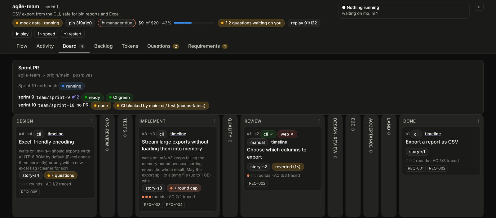
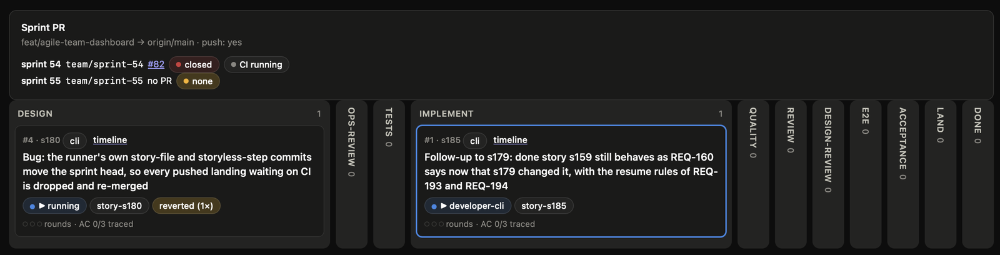
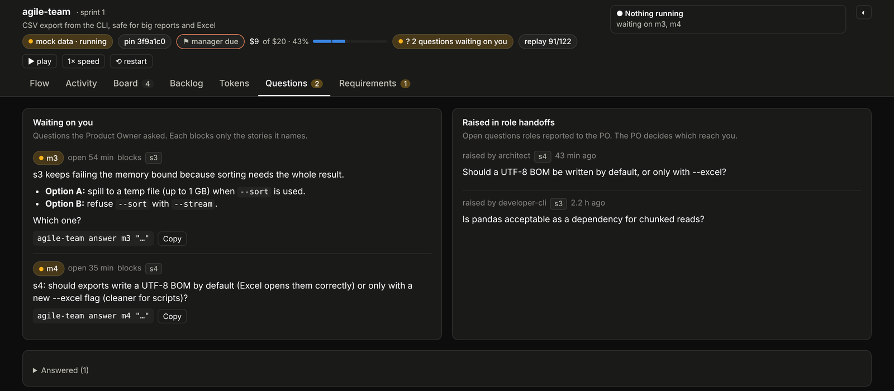
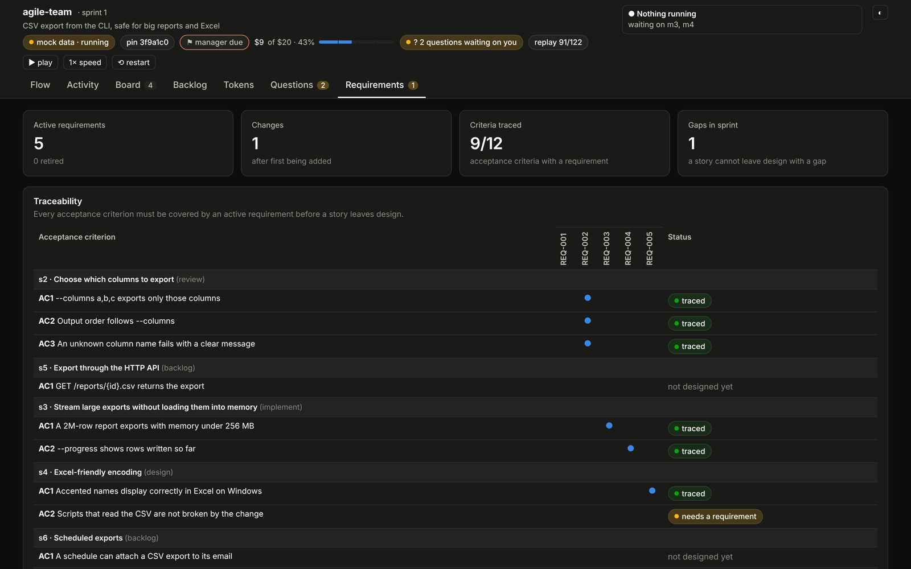
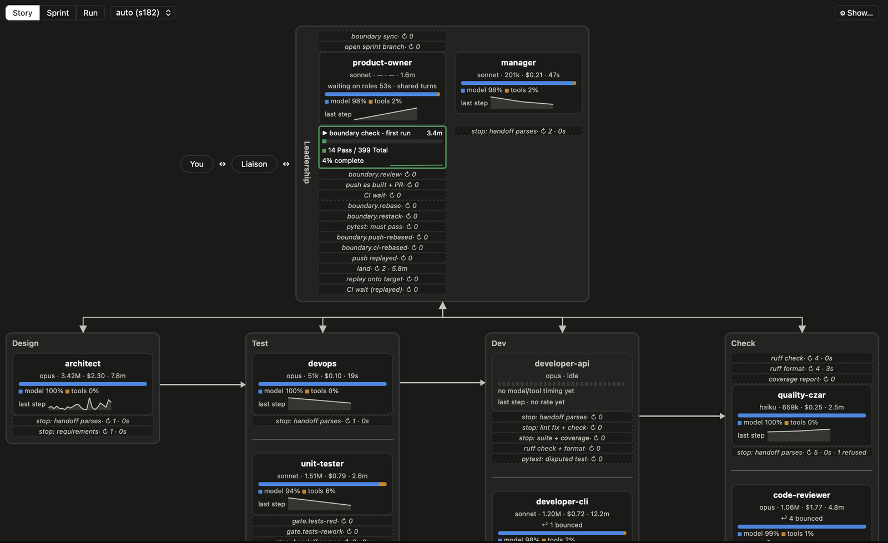
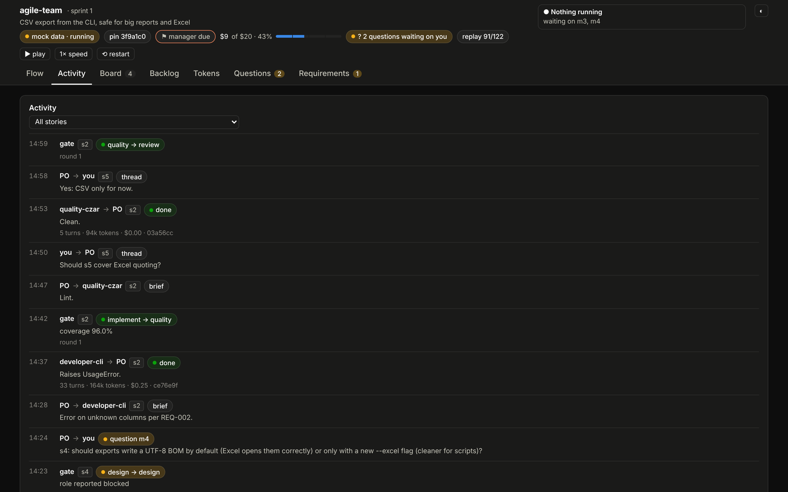
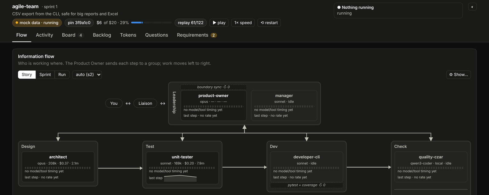

# The Karpathy method: spec, verifier, environment, and how my skills implement it

A talk in document form, paced to the video
<https://youtu.be/7zZy1QTvokM> (13:16), from 0:28 (the transcript supplied starts
at Chapter 2; the intro, 0:00–0:28, isn't covered). Each `---` section is one slide.
The sections follow the video's chapters, and each takes the video's steps
in its order.

**Quotes.** Every quote from the video is copied word for word from its
YouTube transcript, with the timestamp. The transcript is auto-generated: it
spells Karpathy "Carpathy", Claude "Claw" or "Claude MD", and Codex "codeex".
Names are corrected in [brackets]; nothing else is changed. Quotes are
attributed either to **Karpathy** (interview clips shown in the video) or to
**the narrator** (the video's presenter). The transcript doesn't mark
speakers, so "Karpathy, interview clip" is inferred from the narrator's
set-up lines, and the clips' words match Karpathy's own edited transcript
of his Sequoia Ascent 2026 fireside chat, so the clips come from that talk
(**certain**). Quotes labelled *Sequoia Ascent 2026 summary* or *edited transcript* are
from his post about that talk (see Sources): he says an LLM (Codex 5.5)
wrote both and he read them. They are not from the video and have no
timestamp. Certainty tags follow
`~/.claude/CLAUDE.md`: **fact**, **certain**, **possible**, **guessing**.

*All screenshots are the real agile-team dashboard
(`agile-team/runner/agile_team/dashboard/index.html`), running its built-in
replay of the demo run that ships with the skill
(`dashboard/fixtures/snapshot.json`, a CSV-export task). That is why the
header says "mock data". The data is a demo, but the screens are the real
dashboard.*

---

## 1. The car wash (0:28)

> "I want to go to a car wash to wash my car and it's 50 m away. Should I
> drive or should I walk? And state-of-the-art models today will tell you to
> walk because it's so close."
>
> The narrator, retelling Karpathy's example (0:37–0:41)

> "At first, I actually didn't believe this. So, I went to Claude, Gemini,
> [Grok], and [ChatGPT], asked them the same question, and they all gave me
> the same answer"
>
> The narrator (0:48)

> "AI is brilliant at what can be measured, but for context driven things
> like needing a car for a car wash, it has no signal to act on."
>
> The narrator (0:56–1:03)

> "How is it possible that a state-of-the-art model can refactor a
> 100,000-line codebase or find zero-day vulnerabilities, yet tells me to
> walk to the car wash? That's jaggedness. To the extent models remain
> jagged, it means you need to be in the loop."
>
> Karpathy, Sequoia Ascent 2026 edited transcript

Karpathy's word for it is jaggedness: models spike where labs trained them
on verifiable tasks and stay rough elsewhere. The narrator's reading is
missing context. Both point the same way: the model doesn't have the one
piece of context that makes the question obvious, and nothing checks it. The method's three layers are three ways of giving it
that context and checking that it used it:

| Layer | The video's image (8:54) | Question it answers |
|---|---|---|
| 1. **Spec** | "a blueprint pinned to the wall" | What exactly are we building? |
| 2. **Verifier** | "the quality check station by the door" | How do we know it's right? |
| 3. **Environment** | "the workshop itself" | What does every session start from? |

**Not in the video: floor and ceiling.** Karpathy separates two things:

> "Vibe coding raises the floor. It lets almost anyone create software by
> describing what they want. Agentic engineering raises the ceiling. It is
> the professional discipline of coordinating fallible agents while
> preserving correctness, security, taste, and maintainability."
>
> Karpathy, *Sequoia Ascent 2026 summary*, §7

He then lists what the agentic engineer does. agile-team does each item in
code:

| "The agentic engineer … " | agile-team | |
|---|---|---|
| "design specs" | PO interview, story ACs, architect's design | **fact** |
| "supervise plans" | design gate, ops-review, `--approved-by human` | **fact** |
| "inspect diffs" | code-reviewer, then the architect's design-review | **fact** |
| "write tests" | unit-tester writes red tests before the code | **fact** |
| "create evaluation loops" | gates with rounds, `round_cap`, the customer proxy's acceptance | **fact** |
| "manage permissions" | the role guard: each role writes only its own files | **fact** |
| "isolate worktrees" | one branch and worktree per story | **fact** |
| "preserve quality" | house-rules, the coverage gate, CI on the pushed commit | **fact** |

---

## 2. Layer 1: the spec (1:10)

> "a spec is how you deliver your understanding to Claude in a format it can
> use."
>
> The narrator (1:10)

> "I actually don't even like the plan mode. I I would I mean obviously it's
> very useful, but I think there's something more general here where you have
> to work with your agent to design a spec that is very detailed."
>
> Karpathy, interview clip (1:22–1:31; matches the Sequoia transcript, **certain**)

> "[Karpathy] isn't telling you that plan mode is bad. What he's actually
> saying is you have to go deeper. Work with these AI tools to design the
> actual spec."
>
> The narrator (1:34–1:43)

His own cleaned-up version: "People have to be in charge of the spec and
plan. I don't even fully like 'plan mode' as a concept, though it is useful.
… You are in charge of oversight and the top-level categories. The agents
do much of the work underneath." (Karpathy, Sequoia Ascent 2026 edited transcript) His example of why: his
MenuGen agent matched Stripe purchases to Google accounts by email, "plausible
code, but bad system design"; the human had to insist on persistent user
IDs (Karpathy, *Sequoia Ascent 2026 summary*, §7).

Plan mode ("a plan before building anything", 1:17) is the floor. The spec
is a detailed document you design together with the agent.

**Analogy: an architect's brief.** A good architect doesn't start drawing
when you say "a house with a big kitchen". They ask how many people live
there, whether you cook, what the budget is. An architect who just agrees
with you builds the wrong house beautifully.

The video gives three steps. agile-team implements each one in code.

### Step 1: uncover the goal (1:43)

> "If you just say create a end of month report, that's a task. But the
> actual goal is a conclusion you're trying to draw. … we'll tell Claude to
> interview me to identify the goal of this project."
>
> The narrator (1:50–2:07)

**In agile-team:** the PO's first instruction is the interview: "interview
the human with `ask_user` until the goal, scope, users and acceptance
criteria are clear. Ask few, sharp questions at a time"
(`roles/product-owner.md`). Before any of that, the liaison sizes the task
and asks whether a team is needed at all: "Do not decide alone"
(`SKILL.md`). **fact**

### Step 2: be agile, not waterfall (2:07)

> "people are extremely susceptible to using AI agents in a waterfall manner
> because they want to give them everything to do at once. The better move is
> agile specking. You want to have a tight scope, a clear checkpoint. You want
> to review the output, adjust it, and then repeat."
>
> The narrator (2:32–2:41)

**In agile-team:** this is the skill's name. The task becomes stories, each
with its own acceptance criteria (ACs), branch and worktree. Stories run in
sprints; each lands on its own and is reviewed before the next sprint. The
PO sets the order, and you can reorder it from the dashboard. **fact**

*Live Board tab from a real run on this repo (not the demo). The top row is
the sprint branch and its PR: sprint 54 (`team/sprint-54`, PR #82) waiting on
CI, sprint 55 next. Below, each story is a card that moves one column at a
time, DESIGN → OPS-REVIEW → TESTS → IMPLEMENT → QUALITY → REVIEW →
DESIGN-REVIEW → E2E → ACCEPTANCE → LAND → DONE. s180 is in design (and was
reverted once); s185 is with developer-cli. Each card shows its rounds and
how many of its ACs are traced. Small stories, one checkpoint per column:
Layer 1's "agile, not waterfall" made visible.*

### Step 3: be precise and use your brain (2:48)

> "The more precise you are, the less AI has to assume. And every assumption
> that AI makes is a chance for it to drift from the final product you
> actually want. … you can say, 'Make me verify key de[cisions explic]itly
> to ensure nothing is missed.'"
>
> The narrator (2:56–3:12; the bracketed letters were hidden behind the
> player's "Sync to video" button)

> "when you have AI create a spec for you, you have to use your brain to
> think critically about what that spec actually says."
>
> The narrator (3:03)

The narrator then offers a prompt for "a tightly scoped, wellthoughtout spec
that aligns with our actual goal. This is a process that I call modern
engineering, which every successful person has to become." (3:20–3:28; the
prompt itself is on screen, not in the transcript.)
**In agile-team:** an assumption becomes a question, and the question
reaches you instead of being guessed. An open question blocks only the
stories it names; the rest of the team keeps working. Precision is checked
by code: the design gate refuses to let a story leave design until every AC
is covered by a requirement file (`REQ-NNN.md`). Thinking critically about
the spec is my part: `story new --approved-by human` records that I signed a
story off, in a `Human-involvement:` trailer on its commit. **fact**

*Questions tab. "Make me verify key decisions": the team stopped to ask
rather than guess. "s3 keeps failing the memory bound… Option A: spill to a
temp file… Option B: refuse `--sort` with `--stream`. Which one?" Questions
raised inside the team (right) reach you only through the PO.*

*Requirements tab. Every AC maps to a requirement. s4/AC2 shows "needs a
requirement", so s4 can't leave design yet.*

**Where my CLAUDE.md stands.** These three steps are how I work, but no
`CLAUDE.md` writes them down yet. The one chezmoi deploys to
`~/.claude/CLAUDE.md` covers the chezmoi guard, git, code style, confidence
tags and precedence, and `devnu11/home` has no other `CLAUDE.md` on any
branch. Only agile-team's role files and gates hold them today. **fact**

---

## 3. Layer 2: the verifier (3:36)

> "One of the most frustrating things about AI is reviewing and verifying the
> output. And unlike a human, it can't grasp non-measurable things."
>
> The narrator (3:36–3:46)

### Ghosts, not animals (3:51)

> "we're not building animals, we are summoning ghosts."
>
> The narrator, summarising Karpathy (4:01)

> "I think it's just um coming to terms with the fact that these things are
> not, you know, animal intelligences, like if you yell at them, they're not
> going to work better or worse or it doesn't have any impact. Um and uh it's
> all just kind of like these statistical simulation circuits. It's more just
> being suspicious of it and um figuring out over time."
>
> Karpathy, interview clip (4:19–4:36; matches the Sequoia transcript, **certain**)

The narrator's gloss on "animals": people, who have motivations.

> "if you say to a person become an expert at SEO marketing in the next 14
> days or you're fired, they're going to figure it out. That's because they
> have these intrinsic motivations. But AI is not that."
>
> The narrator (4:48–5:01)

**Analogy, the video's: a robot librarian.**

> "think of it like a robot librarian. … the librarian will only suggest
> resources and answers based on the books in its library. If it doesn't have
> a book, it can't help you. And part of [the problem] here is that the
> librarian doesn't know when it's missing a specific book. So, it may just
> confidently make something up."
>
> The narrator (5:09–5:24; "[the problem]" is a guess for words hidden
> behind the player's button)

> "interacting with it like it's an animal, i.e. a human, doesn't help,
> right? Yelling at it, pleading, just saying, "Make this better," doesn't
> necessarily work."
>
> The narrator (5:42)

So scolding a model doesn't work; checking it does:

> "Really, the only lever you have, which most people don't even think to
> use, is the verification lever."
>
> The narrator (5:49)

**What the lever is worth**, in the words of Claude Code's creator:

> "The creator of Claude Code, Boris [Cherny], said it best. If Claude [has
> a feedba]ck loop, it will two to 3x quality of the final result."
>
> The narrator, quoting Boris Cherny (8:07–8:14; the bracketed letters were
> hidden behind the player's button; Cherny's own words are not in the
> video, so this is the narrator's paraphrase of him, **certain**)

Karpathy's own framework says why the lever works:

> "Traditional software automates what you can specify. LLMs and
> reinforcement learning automate what you can verify. If a task has an
> automatic reward or success signal, models can practice it. … They are
> resettable, repeatable, and rewardable."
>
> Karpathy, *Sequoia Ascent 2026 summary*, §5. And on coding: "Coding gives the model feedback: tests
> pass or fail, programs run or crash, diffs can be inspected, benchmarks
> can be measured."

His posture for ghosts: "neither dismissal nor blind trust. It is empirical
familiarity: learn where they work, where they fail, what they were trained
for, and how to build guardrails around them." (Karpathy, *Sequoia Ascent 2026 summary*, §11)

That is the case for agile-team in one line: every gate below is a feedback
loop the model can't skip.

**My analogy: a building inspector.** The electrician doesn't sign off their
own wiring; an inspector does, against the building code, and has no reason
to pass it. Banks do the same: whoever makes a payment can't approve it.

*Live Story view of story s182 on this repo (not the demo). This is Layer 2's
structure: authors and critics are separate boxes, on different models
(architect, devops, developer-api and code-reviewer on opus; developer-cli
and unit-tester on sonnet; quality-czar on haiku). The dashed rows are the runner's gates, not the
roles': `gate.tests-red`, `ruff check`, `coverage report`, `pytest: must
pass`, `CI wait`. The counters are the confrontation in numbers: the
code-reviewer bounced the work 4 times, developer-cli was bounced once, and
the quality-czar had a handoff refused. Leadership's boundary check (14 of
399 tests passed, 4% in) is the runner running tests itself, not taking a
role's word (that it is the full suite is **possible**).*

The video gives three steps.

### Step 1: set the evaluation criteria up front (6:04)

> "Before Claude touches a single thing, whether that's technical or
> non-technical tasks, define what good looks like with precision."
>
> The narrator (6:08)

> "a vague way to evaluate an output is make this report look good. Whereas,
> a precise way would say the report must have three sections. Each ends with
> a recommendation."
>
> The narrator (6:16–6:24), who adds the prompt line "Outline the evaluation
> criteria you will use to ensure a [high-quality] final product. Be precise."
> (6:33)

**In agile-team:** every story has ACs before design starts. Then
`ops-review`, a step that can't be configured away, has DevOps say for each
AC how it will be checked automatically, before any test is written. A check
that doesn't exist yet becomes its own story. An AC is the precise version of
"make it look good": "AC1 --columns a,b,c exports only those columns" (the
Requirements tab above). **fact**

### Step 2: a second AI model as the critic (6:41)

> "use a second AI model as the critic. Think of this like a second robot
> librarian from a different library. You use that librarian to grade the
> output of the first librarian. this other librarian has a whole different
> set of books"
>
> The narrator (6:41–6:49)

The video's tactic: install the [Codex] plugin in [Claude Code] and "run the
final output by [Codex] to ensure both systems agree" (6:57–7:14).

Karpathy goes further. For writing, "you can imagine having a council of LLM
judges", and his test for an agentic engineer is adversarial: "I will use ten
Codex agents to try to break the website you deployed, and they should not be
able to break it." (Karpathy, Sequoia Ascent 2026 edited transcript)

**In agile-team:** the critics are separate roles, set against each other,
on different models (and, through `[providers]`, on local or other
Anthropic-compatible models too):

| Critic | How it is set against the author | |
|---|---|---|
| Unit-tester | Writes the tests before the code. The developer can't edit them; it can only *dispute* one, which the unit-tester fixes or confirms and the architect rules on | **fact** |
| Code reviewer | "Catch bugs before the customer does." Runs on opus; developers default to sonnet (a run can override per role, as the live Story view above shows) | **fact** |
| Customer proxy | "cannot see the source and must not try"; judges the product as a black box against the ACs | **fact** |
| Architect | Reviews the code against its own design in a second pass (`design-review`) | **fact** |
| Manager | Takes over when the same setback repeats; at `round_cap` only the Manager can act | **fact** |

### Step 3: pull external signal (7:14)

> "Let's say you're deploying an app and you're not sure if it's successfully
> deployed. What you can do instead is connect your [Claude] session with
> your system where it's deployed so it can verify that it has been deployed
> successfully."
>
> The narrator (7:22–7:30), who adds: "now if it says that the deployment
> was successful, we know for certainty that it actually was." (7:38) The
> non-technical version: "bring in your historical reports to use as
> reference for the exact format that the final output should be in." (7:44)

**In agile-team:** the runner never takes a role's word that something
works. It runs the suite and coverage itself; a role that tries to run the
full suite is refused. A story lands only with green CI on the exact commit
the runner pushed, read from GitHub by the runner. A web acceptance
environment is started and must answer before the customer proxy begins.
The "historical reports" version is `agile-team share <file> --story <id>`: a
mock or spec I hand the team is committed with its SHA-256, and acceptance
fails if anyone changed it. **fact**

*Activity tab. The gates (`implement → quality`, coverage 96.0%;
`quality → review`) are the runner's, not the roles'. Each role hands off to
the PO; the PO briefs the next role. The quality-czar's step cost $0.00: it
runs on a local model.*

**It works on real code.** Story s182 in this repo needed five code-review
rounds. In one of them a gate fix had quietly removed the earlier bug fix to
make three tests pass, and the reviewer caught it (`c508c9e`). The customer
proxy then failed AC3 for lack of evidence (`66412ef`) until the integration
tester added a real-git test (`6eca601`). **fact** (`git log`)

### Aside, not in the video: red, green, refactor

The video doesn't mention TDD; this is how it maps onto Layer 2. TDD's three beats are the smallest verify loop. The pipeline runs them in
order, each beat by a different role:

| Beat | Meaning | agile-team step |
|---|---|---|
| **Red** | Write a test that fails, because the behaviour isn't there yet | `tests`: the unit-tester writes tests from the design before any code ("new tests are red until implemented", s182's `8c7433c`) |
| **Green** | Write the least code that makes it pass | `implement`: the gate passes only when the suite passes and coverage meets the bar |
| **Refactor** | Clean up, with the tests as a safety net | `quality` and `review`: lint, house-rules and the reviewer send the story back to `implement` until the code is clean, and the tests must stay green |

One gap: red isn't enforced. The `tests` step has no gate, because "a new
test may already pass" (`roles/unit-tester.md`). A test that was never red
proves less. **fact**

---

## 4. Layer 3: the environment (8:46)

> "layer 1 and layer two need somewhere to live. … Think of this layer as a
> workshop. The spec is a blueprint pinned to the wall. The verifier is the
> quality check station by the door. And then the environment is the
> workshop itself. … the problem here is that most people use a workshop
> from scratch every time they use AI"
>
> The narrator (8:46–9:10). Just before, at 8:14: "The third layer,
> however, is where we build a foundation that can't be replicated."

And the workshop is not the chat log: "if you have a single chat with your
entire conversation history. That is not what I'm talking about." (9:10)

Karpathy's name for this is Software 3.0: "In Software 3.0, the context
window becomes the main lever. The LLM is an interpreter over that context,
performing computation over digital information." (Karpathy, *Sequoia Ascent 2026 summary*, §2) The
environment is what fills that window.

A ghost has no memory. The workshop has to be the memory, and it has to be
the same on every machine.

**My analogy: a hospital shift handover.** Nurses change every 12 hours, and
nobody relies on what the last nurse remembers. The chart, the protocols and
the drug cabinet are in the same place every shift, so a new nurse picks up
safely in minutes. An agent changes shift every session.

The video gives four steps.

### Step 1: a proper CLAUDE.md (9:18)

> "you can add to your [CLAUDE.md] before building anything multi-step
> include a verification plan. Now verification is forced into every build,
> not something that you have to remember to say."
>
> The narrator (9:32–9:39). The file "gets injected automatically. It's
> essentially the first thing that Claude reads to help determine how it
> should operate." (9:24)

The narrator's own CLAUDE.md has four sections (9:47–10:03): how the repo
works, the custom skills "and how they're routed", the knowledge
architecture "so that the AI knows where to look", and "key working rules
that it should follow no matter what". His summary: "Make this your
environment. It's your world and AI is living in it. It should not feel like
the other way around." (10:03–10:12)

**In my setup:** three layers of CLAUDE.md, each in git.

| File | Holds | Reaches |
|---|---|---|
| `devnu11/home` `private_dot_claude/CLAUDE.md`, deployed by chezmoi to `~/.claude/CLAUDE.md` | chezmoi guard, git, code style, confidence tags | every session on every machine |
| `claude-skills/.claude/CLAUDE.md` | how skills are built: "process lives in code", coverage ≥ 95%, docs move with behaviour | sessions in this repo, and every agile-team role |
| `.team/CLAUDE.md` | the team charter | every agile-team role |

The video's "verification plan before anything multi-step" is agile-team's
`ops-review`, enforced by the runner instead of requested in a prompt.
Every role reads the repo's `CLAUDE.md`; my home one never reaches the team,
so the team's rules are what is committed. **fact**

### Step 2: an LLM knowledge base (10:12)

> "[Karpathy] went viral for this concept on Twitter that he calls his LLM
> knowledge base. And this is essentially creating a folder system on your
> machine that you're able to ingest your own training data in a way that
> makes it really easy for Claude to understand where information is."
>
> The narrator (10:12–10:28), who adds: "your data is your [moat]. And this
> begins the process of building out your own intellectual data property."
> (10:28–10:37)

Karpathy calls it both "LLM knowledge bases" and his "LLM Wiki": "an agent
incrementally compiles raw sources into a persistent Markdown wiki:
summaries, entity pages, concept pages, contradictions, cross-links, logs,
and evolving synthesis." (Karpathy, *Sequoia Ascent 2026 summary*, §4) The narrator's "went viral on
Twitter" isn't checked (**possible**).

**In agile-team:** the repo is the knowledge base. Story files, requirements,
ADRs, reviews and acceptance reports sit in fixed folders, and every role
commit carries the role and its summary. agile-team's own history in this
repo: 185 story files, 222 requirements, 94 ADRs. **fact**

### Step 3: build custom skills (10:37)

> "if you plan on doing something repeatedly, create a custom skill for that.
> Think of this like a handbook to complete a specific task. … the best way to
> find a leak in a hose is to run water through it."
>
> The narrator (10:37–10:50). "Keep running water through it and your
> system's going to compound over time." (10:58)

Karpathy's version is the installer: instead of a shell script, "a block of
text that you copy and paste into your agent. It is like a little skill"
(Karpathy, Sequoia Ascent 2026 edited transcript).

**In my setup:** this repo is the skill set (agile-team, unattended,
house-rules, six-hats, routed-group-chat, render-markdown), installed on
every machine by chezmoi through the `private_dot_claude/exact_skills`
submodule, pinned to a commit. agile-team runs water through itself: it
builds its own runner, on a pinned copy, and re-pins after each green sprint
(`reference/self-hosting.md`). **fact**

### Step 4: rules the AI can't bypass (11:07)

> "Depending on the cost of getting something wrong, you need to establish
> different AI guard rails. … You could add a line that says don't make up
> information, but that's a guide, not necessarily a hard rule. So, at the
> end of the day, AI can still ignore it."
>
> The narrator (11:07–11:23)

> "You could have a rule in [CLAUDE.md] that says don't touch anything in the
> /important don'tedit folder. And that might get you 80% of the way there,
> but it's essentially a request, not a rule. … So instead, you add a pre-tool
> use hook before Claude uses the write or edit tool … it's enforced at the
> tool level, not the prompt level."
>
> The narrator (11:38–12:02)

This repo's own rule says the same: "A prompt states the rule and the code
checks it. A rule that exists only in a prompt is a wish."

The video's three buckets (12:14–12:23), with my guardrails in each:

| Bucket | Guardrail in code | |
|---|---|---|
| **Always do** ("run on autopilot") | house-rules runs as a PostToolUse hook on every file Claude writes; agile-team's Stop hook makes a role fix its lint and checks before it can finish | **fact** |
| **Ask first** ("anything that you want to double check") | `chezmoi-guard.sh`, a PreToolUse hook: any `chezmoi apply` that would write to `~` asks me, or is denied in auto mode. agile-team asks once before its first push, and only my answer cancels a story | **fact** |
| **Never do** ("lines that can't be crossed") | agile-team's guard refuses a role's write outside its files: the PO can't edit a story, a developer can't edit a test. No push ever replaces a branch's history. A budget ceiling halts the run | **fact** |

*Flow tab. Each role's model, tokens, cost and time; quality-czar runs on a
local model (qwen3-coder). The header tracks spend against the budget ($6 of
$20).*

---

## 5. The one thing to focus on (12:37)

> "You can outsource your thinking, but you can't outsource your
> understanding."
>
> Karpathy, interview clip (12:55; matches the Sequoia transcript, **certain**).
> The line isn't his: "There was a tweet that blew my mind recently, and I
> keep thinking about it" (Sequoia transcript). He doesn't name the author.
> He adds: "you cannot be a good director if you do not understand."

> "the three layers are centered around your understanding of the bigger
> picture. You need to understand your goals and what's needed to direct AI
> to start working for you."
>
> The narrator (12:58). Just before this chapter he offers a prompt "to help
> audit your system and create an optimized environment" (12:28); like his
> other two prompts (3:20, 7:58), it is on screen, not in the transcript.

Karpathy's post closes with the whole method as six lines:

| Karpathy's pattern (Sequoia summary, "The Big Picture") | Layer |
|---|---|
| "define the context" | 1 Spec, 3 Environment |
| "define the tools" | 3 Environment (skills) |
| "define the feedback loop" | 2 Verifier |
| "define the guardrails" | 3 Environment (step 4) |
| "let agents work" | the pipeline |
| "preserve human understanding" | this section |

agile-team is built so the thinking can be handed off and the understanding
can't. The liaison relays the PO's questions to me word for word and never
answers them itself. Cancelling a story is mine alone. Every story's ACs,
requirements and decisions are written down where I can read them.

**The loop, as PDCA.** The three layers make one loop, Deming's
Plan-Do-Check-Act, and each story goes round it:

| PDCA | Layer | agile-team |
|---|---|---|
| **Plan** | Spec | Interview, story, ACs, design, requirements, ops-review |
| **Do** | (generate) | Red tests, then green code |
| **Check** | Verifier | Gates, review, design-review, e2e, acceptance, CI |
| **Act** | (correct / standardise) | Land, or bounce and escalate. The result is recorded in the repo (the environment), which is where the next Plan starts |

---

## 6. Where it's still loose

- **Spec ownership.** `--approved-by none` lets the liaison queue a story
  with no human sign-off; s182 was one. Layer 1 says the human owns the spec.
- **Who writes the verifier.** Tests and acceptance evidence come from
  models. Gates check that evidence exists and passes, not that it's the
  right evidence. Opposed roles narrow the gap but don't close it.
- **Rules that are still requests.** The confidence tags in `CLAUDE.md` have
  no checker. "Interview me", "be agile" and "make me verify key decisions"
  are written down only in agile-team's role files, so a plain Claude Code
  session doesn't get them.

---

## Appendix A: buzz phrases from the video

Word for word from the transcript, names corrected in [brackets].

**Karpathy** (interview clips; matches the Sequoia transcript, **certain**)

| Time | Phrase |
|---|---|
| 1:22 | "I actually don't even like the plan mode" |
| 1:31 | "work with your agent to design a spec that is very detailed" |
| 4:01 | "we're not building animals, we are summoning ghosts" (as the narrator sums up Karpathy's idea) |
| 4:19 | "not, you know, animal intelligences" |
| 4:28 | "statistical simulation circuits" |
| 4:36 | "being suspicious of it" |
| 10:12 | "LLM knowledge base" (his term, per the narrator) |
| 12:55 | "You can outsource your thinking, but you can't outsource your understanding." (a tweet he quotes) |

**Karpathy, Sequoia Ascent 2026 post** (not in the video; summary written
by Codex 5.5 and read by him; § is the summary's section)

| Where | Phrase |
|---|---|
| §1 | "never felt more behind as a programmer" |
| §1 | "macro actions" |
| §1 | "the profession is being refactored" |
| §1 | "an orchestrator of agents" |
| §2 | "Software 3.0" |
| §2 | "the context window becomes the main lever" |
| §2 | "The LLM is an interpreter over that context" |
| §3 | "Some apps should stop existing as apps." |
| §4 | "LLM Wiki" |
| §4 | "What information transformation was impossible before, but is now natural?" |
| §5 | "Traditional software automates what you can specify." |
| §5 | "LLMs and reinforcement learning automate what you can verify." |
| §5 | "resettable, repeatable, and rewardable" |
| §6 | "Jagged Intelligence" |
| §6 | "capability spike ~= verifiability x training attention x data coverage x economic value" |
| §6 | "frontier models do not come with a manual" |
| §6 | "are you on the model's rails?" |
| §7 | "Vibe coding raises the floor." |
| §7 | "Agentic engineering raises the ceiling." |
| §7 | "coordinating fallible agents" |
| §7 | "plausible code, but bad system design" |
| §8 | "adversarial agents try to break it" |
| §8 | "use agents as leverage rather than produce slop" |
| §8 | "10x engineer" |
| §9 | "valuable, verifiable, and undertrained" |
| §10 | "Build for the Agent, Not Just the Human" |
| §10 | "agent-native surfaces" |
| §10 | "sensors and actuators" |
| §11 | "Ghosts, Not Animals" |
| §11 | "jagged, alien tools" |
| §11 | "empirical familiarity" |
| §12 | "You can outsource your thinking, but you can't outsource your understanding." |
| transcript | "council of LLM judges" |
| transcript | "the agents are like interns" |
| transcript | "outside the RL circuits" |
| transcript | "agent representation" |
| Big Picture | "define the context … preserve human understanding" |

**Boris Cherny**, creator of Claude Code (as the narrator quotes him)

| Time | Phrase |
|---|---|
| 8:07 | "If Claude [has a feedba]ck loop, it will two to 3x quality of the final result." |

**The narrator**

| Time | Phrase |
|---|---|
| 0:56 | "AI is brilliant at what can be measured" |
| 1:03 | "it has no signal to act on" |
| 1:10 | "a spec is how you deliver your understanding to Claude" |
| 1:43 | "uncover your goal" |
| 2:07 | "interview me to identify the goal" |
| 2:07 | "be agile with how you work" |
| 2:15 | "waterfall" vs "agile" |
| 2:41 | "agile specking" |
| 2:41 | "a tight scope, a clear checkpoint" |
| 2:48 | "smaller and more compartmentalized specs" |
| 2:48 | "be precise and use your brain" |
| 2:56 | "every assumption that AI makes is a chance for it to drift" |
| 3:12 | "Make me verify key de[cisions explic]itly" |
| 3:20 | "a tightly scoped, wellthoughtout spec" |
| 3:28 | "modern engineering" |
| 4:40 | "gigab[rain] stuff" |
| 5:09 | "robot librarian" |
| 5:24 | "confidently make something up" |
| 5:34 | "confidently wrong" |
| 5:42 | "Yelling at it, pleading, just saying, 'Make this better'" |
| 5:49 | "the verification lever" |
| 5:56 | "playing within the actual rules that the AI follows" |
| 6:04 | "set the evaluation criteria up front" |
| 6:08 | "define what good looks like with precision" |
| 6:41 | "a second AI model as the critic" |
| 6:41 | "a second robot librarian from a different library" |
| 7:14 | "both systems agree" |
| 7:14 | "pull external signal" |
| 7:53 | "empowering the verification process" |
| 7:58 | "a proper evaluation layer" |
| 8:14 | "a foundation that can't be replicated" |
| 8:21 | "anti-slop agreement" |
| 8:30 | "built for humans, not for AI clankers" |
| 8:54 | "a blueprint pinned to the wall" |
| 8:54 | "the quality check station by the door" |
| 9:02 | "the workshop itself" |
| 9:18 | "a proper workspace that improves over time" |
| 9:32 | "include a verification plan" |
| 9:39 | "verification is forced into every build" |
| 10:03 | "key working rules that it should follow no matter what" |
| 10:03 | "It's your world and AI is living in it." |
| 10:28 | "your data is your [moat]" |
| 10:37 | "intellectual data property" |
| 10:46 | "a handbook to complete a specific task" |
| 10:50 | "the best way to find a leak in a hose is to run water through it" |
| 10:58 | "compound over time" |
| 11:14 | "AI guard rails" |
| 11:23 | "a guide, not necessarily a hard rule" |
| 11:30 | "rulebased guard rails" |
| 11:46 | "a request, not a rule" |
| 12:02 | "enforced at the tool level, not the prompt level" |
| 12:14 | "always do", "ask first", "never do" |
| 12:14 | "run on autopilot" |
| 12:23 | "lines that can't be crossed" |
| 12:37 | "The spec, the verifier, and the environment" |
| 12:58 | "your understanding of the bigger picture" |

---

## Appendix B: the video's talking points, and where they are covered

| Time | Talking point | Section |
|---|---|---|
| 0:28–1:03 | Car wash: models say walk; AI is good at what's measurable, has no signal on context | 1 |
| 0:48 | The narrator checked Claude, Gemini, Grok and ChatGPT: same wrong answer | 1 |
| 1:10 | A spec delivers your understanding to Claude | 2 |
| 1:17–1:43 | Plan mode is too high-level for Karpathy; go deeper, design a detailed spec | 2 |
| 1:43–2:07 | Step 1: uncover the goal; a task isn't a goal; have Claude interview you | 2, step 1 |
| 2:07–2:48 | Step 2: agile, not waterfall; tight scope, checkpoint, review, repeat; smaller specs | 2, step 2 |
| 2:48–3:12 | Step 3: be precise; assumptions drift; think critically about an AI-written spec; verify key decisions | 2, step 3 |
| 3:20–3:28 | A prompt for the spec; "modern engineering" | 2, step 3 |
| 3:36–3:46 | Verifying AI output is hard; it can't grasp the non-measurable | 3 |
| 3:51–4:36 | Ghosts, not animals; yelling doesn't help; be suspicious | 3 |
| 4:40–5:01 | Animals are people, driven by motivation (the SEO example) | 3 |
| 5:09–5:42 | Robot librarian: confidently wrong when the book is missing; pleading doesn't work | 3 |
| 5:49–5:56 | The verification lever is the only lever | 3 |
| 6:04–6:33 | Step 1: evaluation criteria up front; vague vs precise; the "be precise" prompt line | 3, step 1 |
| 6:41–7:14 | Step 2: a second model as critic; the Codex plugin | 3, step 2 |
| 7:14–7:53 | Step 3: external signal; the deployment and historical-report examples | 3, step 3 |
| 7:58 | A combined evaluation prompt | 3 (noted) |
| 8:07 | Boris Cherny: a feedback loop gives 2–3x quality | 3 |
| 8:14–8:46 | Layer 3 builds a foundation that can't be replicated (and a subscribe plug) | 4 |
| 8:54–9:10 | Workshop: blueprint, QC station, workshop; not one long chat | 4 |
| 9:18–10:12 | Step 1: a proper CLAUDE.md, injected first; verification plan; the four sections; "your world" | 4, step 1 |
| 10:12–10:37 | Step 2: Karpathy's LLM knowledge base; data is your moat | 4, step 2 |
| 10:37–10:58 | Step 3: custom skills for anything repeated; the hose; compounding | 4, step 3 |
| 11:07–12:23 | Step 4: guard rails by cost of error; CLAUDE.md is a request; PreToolUse hook; always / ask / never | 4, step 4 |
| 12:28 | An audit prompt for the environment | 5 (noted) |
| 12:37–12:58 | You can't outsource your understanding; the layers centre on it | 5 |

Points from Karpathy's Sequoia post that the video doesn't make:

| Post | Talking point | Section |
|---|---|---|
| §1 | December 2025 inflection; delegating "macro actions" | not covered |
| §2 | Software 3.0: the context window is the program; the installer as a skill | 4, intro and step 3 |
| §3 | MenuGen: some apps should stop existing | not covered |
| §4 | LLM Wiki | 4, step 2 |
| §5 | Automate what you can verify; resettable, repeatable, rewardable | 3 |
| §6 | Jaggedness: verifiability x training attention; the car wash | 1 |
| §7 | Vibe coding floor, agentic engineering ceiling; the engineer's list; the Stripe-email bug | 1, 2 |
| §8 | Hiring: build, deploy, let adversarial agents break it | 3, step 2 |
| §9 | Founders: valuable, verifiable, undertrained domains | not covered |
| §10 | Agent-native infrastructure; sensors and actuators | not covered |
| §11 | Ghosts, not animals; empirical familiarity | 3 |
| §12 | Outsource thinking, not understanding (a tweet he quotes) | 5 |
| Big Picture | context, tools, feedback loop, guardrails, agents, understanding | 5 |

The four "not covered" points are about products and founders, not about
how to build with agents.

---

## Sources

| Source | Used for | Checked |
|---|---|---|
| YouTube <https://youtu.be/7zZy1QTvokM>, auto-generated transcript (0:28–13:16), from screenshots D supplied | structure, pacing, every quote with a timestamp | **fact** for the words as transcribed; the narrator is unnamed in the transcript (secondary coverage names Austin Marchese, **possible**) |
| Karpathy, *Sequoia Ascent 2026 summary*, <https://karpathy.bearblog.dev/sequoia-ascent-2026/>, 30 Apr 2026: a summary and an edited transcript of his fireside chat with Stephanie Zhan (<https://www.youtube.com/watch?v=96jN2OCOfLs>). A different video from the one this talk follows. He says Codex 5.5 wrote both and he read them | Karpathy's own wording; checks the interview clips | **fact** for the text, as pasted by D (the host is blocked from the build session) |
| Karpathy, *Animals vs Ghosts*, karpathy.bearblog.dev, 1 Oct 2025 | the ghosts framing the narrator cites | **certain** it exists; not read |
| This repo at `14c30be`: `agile-team/SKILL.md`, `reference/protocol.md`, `runner/agile_team/roles/*.md`, the dashboard and its fixture, `git log` | every agile-team claim and screenshot | **fact** |
| `devnu11/home`: `private_dot_claude/CLAUDE.md`, `hooks/chezmoi-guard.sh`, `.gitmodules` | CLAUDE.md, chezmoi and hook claims | **fact** |
