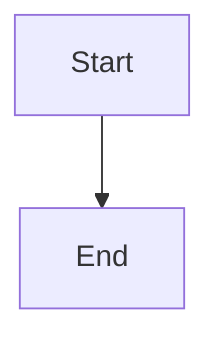

# Sample `render` title

Intro with **bold**, a [relative link](other.md#part) and an .

| Name | Value |
|---|---|
| alpha | 1 |

```python
# a comment, #####, and **kwargs: f(**a, **b)
#include <stdio.h>
```

```text
| not | a table |
|-----|---------|
```

````markdown
```sh
echo fenced
```
````



```mermaid
graph TD
  A[Broken --> ((
```

> A quote.
